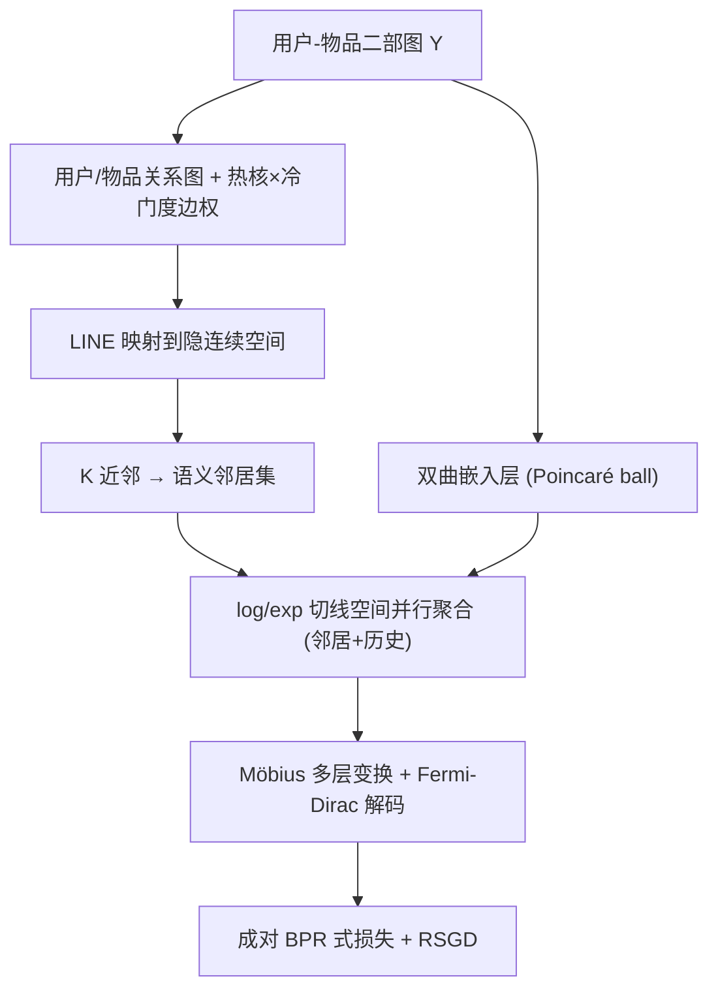
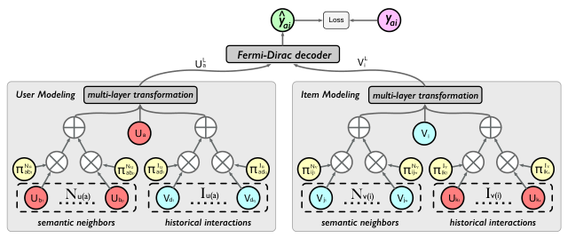
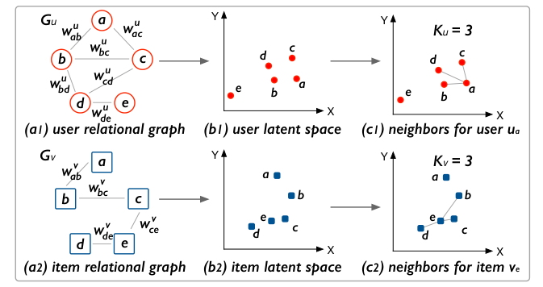

# Hyperbolic Neural Collaborative Recommender (双曲神经协同推荐)

- **会议/期刊**: IEEE TKDE (arXiv 2104.07414, 2021-04)
- **作者与机构**: Anchen Li, Bo Yang (吉林大学)；Hongxu Chen, Guandong Xu (悉尼科技大学)
- **推荐链路定位**: 召回 (用户/物品表示学习与打分)
- **研究方向**: 协同过滤与双塔召回 / 图神经网络与知识图谱推荐
- **论文原文**: [https://arxiv.org/abs/2104.07414v1](https://arxiv.org/abs/2104.07414v1)
- **开源代码**: 暂未开源

## TL;DR (1分钟核心速览)

现有深度 CF 全部在欧氏空间做嵌入，既无法低失真地刻画用户-物品交互的幂律/层次结构，也只建模粗粒度共现邻居而忽略高阶语义传递关系。HNCR 先用热核加权的关系图 + LINE 映射构造用户/物品的 **K 近邻语义邻居集**，再在 Poincaré 球上用陀螺向量算子（Möbius 加法/矩阵乘、log-exp 加速聚合）搭建深度聚合网络。在 Ciao/Yelp/Epinion/Douban 四个数据集上，CTR 的 AUC 较最强基线 LR-GCCF 提升 4.15%/2.92%/2.67%/3.18%，Recall@20 提升 3.47%–5.61%。

## Background & Motivation (背景与核心矛盾)

- **主流范式**: MF/NFM 等浅层或欧氏深度模型，以及 CMN/MMCF 这类用共现关系（共同交互过同一物品/用户）定义邻居的记忆网络；图侧则以 NGCF、LR-GCCF 在二部图上做欧氏传播。
- **前人局限**: ① 欧氏空间嵌入幂律分布数据时失真大，学不出交互图的层次结构；② 共现关系是"宏观粗粒度"的——图 1 中用户 $a$与$d$无共现，却共享$b,c$ 两个一跳邻居，这种高阶传递语义被完全丢弃；对不活跃用户，共现边本就稀疏，无法提供互补信息。
- **核心洞察 (Key Insight)**: 作者在图 5 上验证 Ciao/Epinion 的用户与物品交互数均服从幂律分布，而幂律常隐含层次结构，恰好是负曲率双曲空间能以极小失真嵌入的对象。
- **本文切入点**: 把"语义邻居构造"（图结构 → 隐空间近邻）与"双曲深度聚合"两个阶段解耦，前者离线完成，后者用陀螺向量算子实现可并行的邻居/历史聚合。

## Method (核心方法设计)

### 1. 整体框架 (Overall Architecture)

HNCR 分两阶段。离线阶段：由训练集交互矩阵 $\mathbf{Y}$分别派生用户关系图$\mathcal{G}_u$与物品关系图$\mathcal{G}_v$，边权由热核相似度与共现物品冷门度共同决定；再用 LINE 把两图映射到低维隐空间，取每个节点的$K_u$/$K_v$近邻构成语义邻居集$\mathcal{N}_u(a),\mathcal{N}_v(i)$。在线阶段：用户/物品嵌入与邻居集、历史交互集一同进入双曲聚合层，先分别聚合语义邻居与历史行为，再与自身嵌入做 Möbius 相加并堆叠$L$ 层 Möbius 矩阵-向量变换，最后由 Fermi-Dirac 解码器输出交互概率；全程用 RSGD 在流形上更新。

<figure class="paper-figure" markdown="span">
  <figcaption>图3：HNCR 的推荐框架，其基于双曲表示学习。</figcaption>
</figure>

### 2. 关键设计拆解 (Key Designs)

1. **热核加权语义邻居构造**：共现次数作为边权过于粗糙。对用户对 $(u_a,u_b)$定义$w^u_{ab}=h^u_{ab}\cdot c^u_{ab}$，其中$h^u_{ab}=e^{-\|\mathbf{Y}_a-\mathbf{Y}_b\|^2/t}$度量历史行为相似度（$t=100$），$c^u_{ab}=\frac{2}{|\mathcal{C}_{ab}|}\sum_{v_i\in\mathcal{C}_{ab}}\frac{1}{|\mathcal{I}_v(i)|}$让"共同交互的冷门物品"贡献更大（冷门物品更能体现个性化）。这样关系图既含一跳共现强度，也通过隐空间近邻推断多跳传递语义——$a$与$d$虽无共现边，但在 LINE 空间中因共享$b,c$ 而靠近。

<figure class="paper-figure" markdown="span">
  <figcaption>图2：邻居构建示意图。(a)→(b)：分别将用户关系图和物品关系图映射到潜在空间。(b)→(c)：为用户和物品寻找语义邻居。</figcaption>
</figure>

2. **双曲注意聚合与切线空间加速**：邻居聚合用基于双曲距离的注意力 $\pi^{\mathcal{N}_u}_{ab}=\frac{\exp(-d_c(\mathbf{u}_a,\mathbf{u}_b)/\tau)}{\sum_{b'}\exp(-d_c(\mathbf{u}_a,\mathbf{u}_{b'})/\tau)}$（$d_c(\mathbf{x},\mathbf{y})=\frac{2}{\sqrt{c}}\tanh^{-1}(\sqrt{c}\|-\mathbf{x}\oplus_c\mathbf{y}\|)$），因双曲距离满足三角不等式，注意力天然保持节点间传递性。由于 Möbius 加法不满足交换/结合律，逐项累加在活跃用户上极慢，故改为"对数映射 → 切线空间加权求和 → 指数映射回球"：
$\mathbf{u}_a^0=\exp_0^c\big(\log_0^c(\mathbf{u}_a)+\sum_{u_b\in\mathcal{N}_u(a)}\pi^{\mathcal{N}_u}_{ab}\log_0^c(\mathbf{u}_b)+\sum_{v_d\in\mathcal{I}_u(a)}\pi^{\mathcal{I}_u}_{ad}\log_0^c(\mathbf{v}_d)\big)$，
切线空间内加法可交换结合，聚合可完全并行。

3. **训练目标、负采样与推理效率**：解码器 $\hat{y}_{ai}=1/(e^{(d_c(\mathbf{u}_a^L,\mathbf{v}_i^L)-r)/t}+1)$，损失为成对对数损失$\mathcal{L}=-\sum_{(u,v,\tilde{v})\in\mathcal{D}}[\log\hat{y}_{uv}+\log(1-\hat{y}_{u\tilde{v}})]$，负样本为每正样本采 1 个未交互物品（Uniform）。优化用 RSGD，黎曼梯度$\nabla_R=\frac{(1-\|\theta_t\|^2)^2}{4}\nabla_E$。单轮训练开销$O(|Y|\cdot((K_u+H_u+K_v+H_v)d+Ld^2))$；邻居集离线预计算，推理时仅需一次前向。

## Experimental Setup & Evaluation Protocol (实验设置与评估协议)

- **数据集与预处理**: 显式评分统一二值化为隐式正反馈（"1"）；每个用户按其正样本数等量采样未交互物品为负样本（"0"）。

| 数据集 | #Users | #Items | #Interactions | 密度 | 场景说明 |
| :--- | :---: | :---: | :---: | :---: | :--- |
| Ciao | 7,267 | 11,211 | 147,995 | 0.181% | 电影/书评 + 社交 |
| Yelp | 10,580 | 13,870 | 171,102 | 0.116% | 本地商户点评 |
| Epinion | 20,608 | 23,585 | 454,022 | 0.093% | 信任网络点评 |
| Douban | 12,748 | 22,347 | 785,272 | 0.275% | 图书评分 |

- **数据划分与防穿越**: 随机 **6:2:2** 划分 train/valid/test；关系图与语义邻居仅由训练集交互构造，避免信息泄漏。
- **排名评测协议**: CTR 用 AUC / Accuracy（二分类）。Top-$K$用 **Sampled Ranking**：每个用户随机采 1000 个未交互物品与正样本混合排序，报告 Precision@K / Recall@K，$K\in[10,30]$，每实验重复 5 次取均值。未报告显著性检验。
- **对比基线与超参**: 8 个基线覆盖混合模型 (SVD)、特征交叉 (NFM)、记忆网络 (CMN/MMCF)、图模型 (NGCF/LR-GCCF)、双曲浅层 (PoincaréEmb)，以及本文的欧氏对照 ENCR。嵌入维度 $d\in\{8,16,32,64,128\}$，$K_u,K_v\in[5,25]$，层数$L\in[1,4]$，$c=1,\tau=0.1,r=2,t=1$，batch=1024。

## Key Experimental Results (实验关键数据)

### 1. 主实验对比 (Main Results)

| Method | Ciao AUC | Ciao ACC | Yelp AUC | Yelp ACC | Epinion AUC | Epinion ACC | Douban AUC | Douban ACC |
| :--- | :---: | :---: | :---: | :---: | :---: | :---: | :---: | :---: |
| SVD | 0.7240 | 0.6574 | 0.8170 | 0.7518 | 0.8026 | 0.7279 | 0.8257 | 0.7514 |
| NFM | 0.7333 | 0.6638 | 0.8230 | 0.7588 | 0.8094 | 0.7330 | 0.8373 | 0.7601 |
| CMN | 0.7360 | 0.6613 | 0.8255 | 0.7595 | 0.8133 | 0.7393 | 0.8382 | 0.7597 |
| MMCF | 0.7567 | 0.6838 | 0.8284 | 0.7635 | 0.8269 | 0.7486 | 0.8498 | 0.7728 |
| NGCF | 0.7646 | 0.6948 | 0.8279 | 0.7628 | 0.8235 | 0.7450 | 0.8512 | 0.7721 |
| LR-GCCF | 0.7683 | 0.6980 | 0.8354 | 0.7665 | 0.8305 | 0.7541 | 0.8521 | 0.7717 |
| PoincaréEmb | 0.7595 | 0.6880 | 0.8230 | 0.7608 | 0.8029 | 0.7342 | 0.8377 | 0.7669 |
| **HNCR** | **0.8002** | **0.7104** | **0.8598** | **0.7915** | **0.8527** | **0.7703** | **0.8792** | **0.8018** |
| ENCR (欧氏对照) | 0.7763 | 0.6985 | 0.8295 | 0.7650 | 0.8301 | 0.7518 | 0.8441 | 0.7690 |
| **Improv.% (vs 最优基线)** | **+4.15%** | +1.78% | **+2.92%** | +3.26% | **+2.67%** | +2.15% | **+3.18%** | +3.90% |

### 2. 消融实验 (Ablation Study)

| 变体 (AUC) | Ciao | Yelp | Epinion | Douban |
| :--- | :---: | :---: | :---: | :---: |
| HNCR (完整) | **0.8002** | **0.8598** | **0.8527** | **0.8792** |
| HNCR-0 (去边权) | 0.7972 | 0.8570 | 0.8499 | 0.8772 |
| HNCR-C (共现邻居替代语义邻居) | 0.7933 | 0.8510 | 0.8468 | 0.8704 |
| HNCR-S (去语义邻居) | 0.7918 | 0.8488 | 0.8432 | 0.8685 |
| HNCR-H (去历史行为聚合) | 0.7880 | 0.8462 | 0.8441 | 0.8673 |
| HNCR-A (去注意力，等权平均) | 0.7943 | 0.8521 | 0.8494 | 0.8746 |
| ENCR (欧氏对照) | 0.7763 | 0.8295 | 0.8301 | 0.8441 |
| MMCF → MMCF-S (换用本文邻居) | 0.7567→0.7651 | 0.8284→0.8346 | 0.8269→0.8315 | 0.8498→0.8557 |

### 3. 关键实验发现 (Key Findings)

1. **双曲几何本身贡献最大**：HNCR 较其欧氏孪生 ENCR 在 Ciao/Douban 上分别高 3.08%/4.16%，且图 9 显示 $d$越小差距越大（低维下 HNCR 几乎无损），说明负曲率空间以更低维度换取更强表达力；同时 HNCR 在$L=1$即达最优（ENCR 需$L=2$），双曲空间无需堆深。
2. **语义邻居优于共现邻居且可迁移**：用共现邻居替换后 HNCR-C 掉 0.69–0.88 个点；反向把本文邻居注入 MMCF（MMCF-S）却让四个数据集 AUC 全面上升（Ciao +0.84、Yelp +0.62），证明"关系图 + 隐空间近邻"是与模型无关的通用增益模块。
3. **历史行为聚合比邻居信息更关键，注意力与边权为次要增益**：去掉历史聚合 HNCR-H 掉 1.22 点（Ciao），去掉语义邻居 HNCR-S 掉 0.84 点；而去掉注意力/边权仅掉 0.3–0.6 点。图 8 的稀疏分桶实验显示 HNCR 在 [0-11) 极稀疏用户组上仍领先所有基线，说明语义邻居对冷用户起到了补位作用。

## Highlights & Limitations (亮点、对比与审稿批判)

- **与代表作对比 (vs. Prior Work)**: 相较 MMCF/CMN 只聚合粗粒度共现邻居，HNCR 通过关系图 + LINE 隐空间引入多跳传递语义；相较 PoincaréEmb/HyperML 这类把每个 user-item 对当作孤立样本的双曲浅层模型，HNCR 显式建模用户-用户/物品-物品语义关系并叠加陀螺向量深度网络；相较 NGCF/LR-GCCF，本质差异在于嵌入空间几何（负曲率 vs 欧氏）而非传播层数。
- **可迁移亮点**: ① 热核 × 冷门度倒数 的边权设计可低成本移植到任意"共现构图"模块；② log→切线空间求和→exp 的加速技巧，是处理非交换/非结合聚合算子（如 Möbius、球面/李群算子）的通用工程范式。
- **审稿级局限批判**: ① 评测偏弱——Top-$K$采用 1000 负样本采样排序而非 Full-Ranking，且未做显著性检验，CTR 与 Top-$K$的提升幅度在采样协议下可能被高估；② 邻居构造引入 LINE 预训练、$K_u/K_v$与关系图构图三重离线超参，且$K$过大会引入噪声（图 9 显示过$K$ 后 AUC 回落），工业部署时需为不同活跃度分层调参；③ 论文自述与 arXiv:2102.09389 存在大量文本重叠，方法新颖性需打折看待。

## Rating (四维评分)

- **方法创新性 (Novelty)**: ⭐⭐⭐⭐ （首个把"语义邻居构造 + 双曲深度聚合"合体的 CF 框架，几何直觉（幂律↔负曲率）与加速策略均有说服力，但双曲推荐本身非首创）
- **评估协议与实验扎实度 (Protocol & Experiments)**: ⭐⭐⭐ （四个数据集 + 欧氏对照 + 三重消融较完整，但 Top-$K$ 用 1000 采样排序、无显著性检验、无 Full-Ranking）
- **写作与数学规范度 (Clarity & Rigor)**: ⭐⭐⭐⭐ （陀螺向量算子、黎曼梯度与复杂度分析交代清楚，公式编号完整；切线空间加速的等价性证明偏简）
- **工业落地与复现价值 (Industrial & Practical Value)**: ⭐⭐⭐ （邻居集可离线预计算、聚合可并行，落地友好；但无开源代码，LINE 构图 + 双曲优化栈迁移成本不低）

