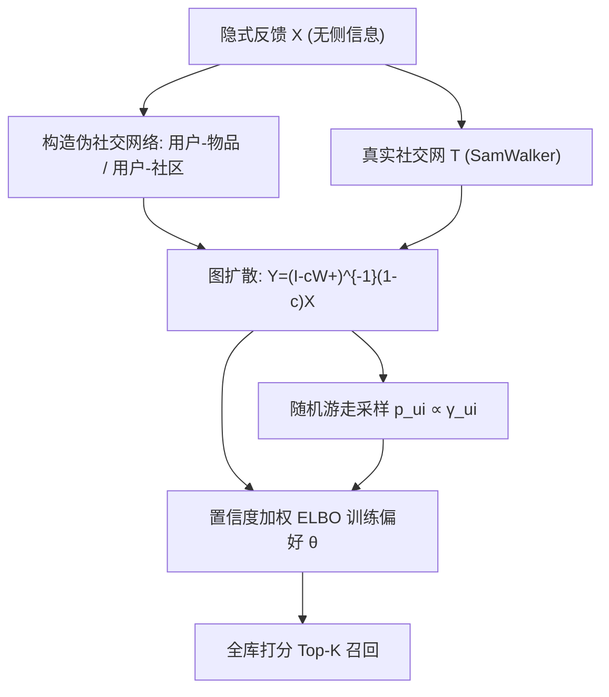
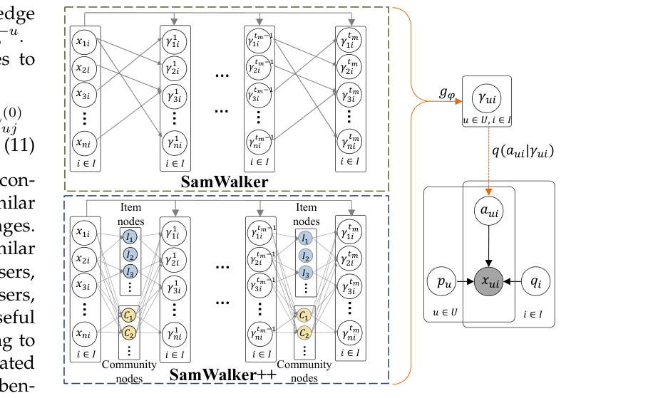
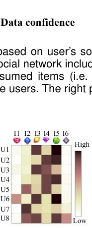

# SamWalker++: recommendation with informative sampling strategy (基于信息量采样的隐式反馈推荐)

- **会议/期刊**: IEEE TKDE (期刊长文，会议版 SamWalker 的扩展)
- **作者与机构**: Can Wang, Jiawei Chen, Sheng Zhou, Qihao Shi, Yan Feng, Chun Chen（浙江大学计算机学院）
- **推荐链路定位**: 召回（矩阵分解式全库打分）
- **研究方向**: 协同过滤与双塔召回 / 自监督去噪与假阳性过滤
- **论文原文**: [arXiv:2011.07734v2](https://arxiv.org/abs/2011.07734v2)
- **开源代码**: [jiawei-chen/SamWalker](https://github.com/jiawei-chen/SamWalker)

## TL;DR (1分钟核心速览)

隐式反馈中"未交互≠不喜欢"，前人要么手工设定未观测数据的置信度权重（缺乏个性化、经验偏差），要么在 $n\times m$全量数据上做随机采样（采到的多是"用户根本不知道"的低信息量样本）。本文在 EXMF 变分框架下把曝光后验$\gamma_{ui}$重参数化为**图扩散核**：SamWalker 用真实社交网$Y=(I-cW)^{-1}(1-c)X$，SamWalker++ 用物品节点与社区节点构造的**伪社交网络**$Y=(I-cW^{+})^{-1}(1-c)X$，把变分参数从$O(nm)$降到$O(|X^{+}|+nK)$；并证明沿该网络随机游走采样的分布正比于$\gamma_{ui}$，从而给出低方差、无偏、免置信度计算的采样器。五个数据集 80/20 划分、全库排序下，Epinions 稀疏集 Pre@5 相对非社交最佳基线提升 67.72%。

## Background & Motivation (背景与核心矛盾)

- **主流范式**: WMF/EXMF/FAWMF 把未观测数据统一视为负例并降权；EXMF 从变分角度把曝光后验 $\gamma_{ui}$当作数据置信度，理论上优雅但参数规模随$n\times m$ 爆炸。
- **前人局限**: ① 置信度多为手工/全局赋值，无法刻画"同一用户对不同物品的曝光差异"，粗粒度权重引入偏好估计偏差；② 大矩阵下必须随机采样，但用户只知晓极小比例物品，均匀/流行度采样器抽中的多是低 $\gamma_{ui}$、对梯度几乎无贡献的样本，收敛慢、方差大。
- **核心洞察 (Key Insight)**: 图 3 显示社交连接用户的共同消费物品数显著多于任意用户对（LastFM/Ciao/Epinions 一致）——**曝光是沿社交/相似关系传播的**，因此"邻居是否消费过该物品"是判断"知道 vs 不喜欢"的天然代理信号。
- **本文切入点**: 用网络上的信息传播算子（而非独立变分参数）生成置信度，并让采样分布直接由该算子诱导，一举解决 P1（自适应置信度）与 P2（高效学习）。

## Method (核心方法设计)

### 1. 整体框架 (Overall Architecture)

模型分两支：SamWalker 以真实社交图 $T$为信息通道，用户把已消费物品标签沿社交边迭代扩散，得到曝光后验矩阵$Y$；SamWalker++ 在无侧信息场景下先构造伪社交网络$G$——用户经**物品节点**（共购桥）与**社区节点**（潜在兴趣簇桥）连接，再在其上做双通道消息传播得到$Y$。$Y$既作为偏好模型$\sigma(\boldsymbol{p}_u^\top\boldsymbol{q}_i)$的加权交叉熵置信度，又诱导随机游走采样分布。训练交替进行：用游走采样的数据批次更新偏好参数$\theta$，用均匀采样的$N_{SI}$个物品反传更新边权$\phi$（Softmax 重参数化保证归一化）。推理时对全部未交互物品按$\boldsymbol{p}_u^\top\boldsymbol{q}_i$ 排序取 Top-K。

<figure class="paper-figure" markdown="span">
  <figcaption>图4. 所提出的 SamWalker（左上）和 SamWalker++（左下）的示意图。SamWalker 直接通过社交网络模拟信息传播，而 SamWalker++ 通过引入特定物品节点和社区节点作为桥梁，在用户之间迁移知识。</figcaption>
</figure>

### 2. 关键设计拆解 (Key Designs)

1. **图扩散核替代独立变分参数（SamWalker）**：EXMF 为每个 $(u,i)$学一个$\gamma_{ui}$，既过拟合又不可扩展。本文令$Y=g_\phi(X,T)$，把 PageRank 式传播$\gamma^{(t+1)}_{ui}=(1-c)\gamma^{(0)}_{ui}+c\sum_{k\in T_u}\phi_{uk}\gamma^{(t)}_{ki}$迭代至稳态，闭式解为$Y=(I-cW)^{-1}(1-c)X$，其中$W_{uk}=\phi_{uk}$为可学习社交边权、$c$控制"朋友证据 vs 自身行为"比重。直觉：$(I-cW)^{-1}$是图扩散核，把高阶邻居的消费证据平滑地灌入目标用户的曝光估计，参数量从$O(nm)$降到$O(|E|)$。
2. **伪社交网络双通道聚合（SamWalker++）**：无社交图时，用两类桥节点重建同质性。沿物品节点与社区节点的消息分别为 $m^{u\leftarrow i\leftarrow v}_{uj}=\sum_{i\in N_u\cap I}\sum_{v\in N_i}\phi^{u\leftarrow i}_{ui}\phi^{i\leftarrow u}_{iv}\gamma^{(t)}_{vj}$、$m^{u\leftarrow c\leftarrow v}_{uj}=\sum_{c\in N_u\cap C}\sum_{v\in N_c}\phi^{u\leftarrow c}_{uc}\phi^{c\leftarrow u}_{cv}\gamma^{(t)}_{vj}$，融合为$\gamma^{(t+1)}_{uj}=c(b_u m^{u\leftarrow i\leftarrow v}_{uj}+(1-b_u)m^{u\leftarrow c\leftarrow v}_{uj})+(1-c)\gamma^{(0)}_{uj}$，稳态为$Y=(I-cW^{+})^{-1}(1-c)X$，$W^{+}=B\Phi^{u\leftarrow i}(\Phi^{i\leftarrow u})^\top+(1-B)\Phi^{u\leftarrow c}(\Phi^{c\leftarrow u})^\top$。路径强度$\phi^{u\leftarrow i}_{ui}\phi^{i\leftarrow u}_{iv}$即"共购相似度"，社区分布$\phi^{u\leftarrow c}_{uc}$端到端学习而非预聚类——作者用"水中浮球+弹性连接"类比说明：正样本的拉力会通过连接把相关未观测样本一起"拉起"，避免$\gamma_{ui}$ 收敛到 0/1 两极而过拟合。
3. **信息量采样与训练目标**：ELBO 为 $\mathcal{L}(\theta,Y;X)=\sum_{ui}\gamma_{ui}\ell\big(x_{ui},\sigma(\boldsymbol{p}_u^\top\boldsymbol{q}_i)\big)+\sum_{ui}f(\gamma_{ui})$，首项即置信度加权交叉熵。关键在于采样分布取$p_{ui}\propto\gamma_{ui}$：此时$\partial\mathcal{L}/\partial\theta=\mathbb{E}_p\big[\sum_{(a,b)\in p}\frac{1}{Z}\partial\ell_{ab}/\partial\theta\big]$，置信度被吸收进采样偏置，**无需显式计算$\gamma$** 即可得无偏低方差梯度。实现上用带重启（概率$c$）的个性化随机游走：从$u$出发按边权走到相似用户$v$，再均匀抽取其消费物品；深度上限$t_m$防无限游走。整体复杂度$O(\alpha n t_m+|S|d+N_{SI}|E|)$，对稀疏数据线性可扩展。

<figure class="paper-figure" markdown="span">
  <figcaption>图2. SamWalker++ 基于构建的伪社交网络估计数据置信度。图左侧展示了一个伪社交网络，其中用户与额外的物品节点（I1-I6）或社区节点（C1-C3）相连。对于具有正反馈的用户-物品对，以及用户属于社区时的用户-社区对，我们给出连接。</figcaption>
</figure>

## Experimental Setup & Evaluation Protocol (实验设置与评估协议)

- **数据集与预处理**: 物品至少 3 次交互、剔除被 >100 用户消费的物品以抑制流行度偏差，评分二值化为隐式反馈。

| 数据集 | #Users | #Items | #Interactions | 稀疏度 | 特征/场景说明 |
| :--- | :---: | :---: | :---: | :---: | :--- |
| LastFM | 1,892 | 4,489 | 52,668 | 0.62% | 含社交关系 25,434 条 |
| Ciao | 5,298 | 19,301 | 138,840 | 0.14% | 含社交关系 106,640 条 |
| Epinions | 21,290 | 34,075 | 333,916 | 0.05% | 含社交关系 414,549 条，极稀疏 |
| MovieLens-1M | 6,040 | 3,678 | 1,000,177 | 4.50% | 无社交，稠密 |
| BookCrossing | 13,097 | 37,075 | 473,846 | 0.10% | 无社交，稀疏 |

- **数据划分**: 随机 **80% 训练 / 20% 测试**（非 Leave-One-Out、非时间切分）。
- **排名评测协议**: 对用户全部未交互物品打分排序的 **全库排序 (Full-Ranking)**，指标 Pre@5、Rec@5、NDCG、MRR；未使用采样负例排序。
- **对比基线**: WMF(ALS)、BPR（均匀采样）、EXMF、FAWMF、LightGCN 为非社交组；SBPR、SERec-Bo、SoEXBMF 为社交组。超参 $d$未在正文突出，$c=0.9,\alpha=100,\beta=20,\eta=0.5$，$t_m\in\{3,4,5,6\}$，5 折交叉 + 网格搜索。

## Key Experimental Results (实验关键数据)

### 1. 主实验对比 (Main Results)

| 方法 | LastFM Pre@5 | Ciao NDCG | Epinions Rec@5 | Epinions NDCG | BookCross Pre@5 | BookCross Rec@5 |
| :--- | :---: | :---: | :---: | :---: | :---: | :---: |
| WMF(ALS) | 0.0928 | 0.1757 | 0.0087 | 0.1522 | 0.0145 | 0.0096 |
| BPR | 0.1004 | 0.1759 | 0.0096 | 0.1541 | 0.0109 | 0.0096 |
| EXMF | 0.0957 | 0.1747 | 0.0093 | 0.1517 | 0.0127 | 0.0108 |
| FAWMF | 0.1011 | 0.1641 | 0.0071 | 0.1444 | 0.0091 | 0.0058 |
| LightGCN | 0.1051 | 0.1800 | 0.0116 | 0.1593 | 0.0136 | 0.0129 |
| SBPR | 0.0956 | 0.1774 | 0.0089 | 0.1542 | — | — |
| SERec-Bo | 0.1018 | 0.1770 | 0.0101 | 0.1577 | — | — |
| SoEXBMF | 0.1108 | 0.1827 | 0.0126 | 0.1600 | — | — |
| **SamWalker** | **0.1177** | 0.1811 | 0.0184 | 0.1656 | **0.0184** | **0.0177** |
| **SamWalker++** | 0.1099 | **0.1834** | **0.0186** | **0.1693** | **0.0184** | **0.0177** |
| Improv. | +6.22% (SW) | +1.89% (SW++) | +60.37% (SW++) | +6.24% (SW++) | +26.40% (SW++) | +37.30% (SW++) |

### 2. 消融实验 (Ablation Study)

| 配置 | 结论 (原文图 8 / 表 5) |
| :--- | :--- |
| SamWalker++ (full) | 5 个数据集上 Pre@5 / Rec@5 一致最优 |
| w/o item nodes (`noi`) | 共购桥缺失，各数据集均下降 |
| w/o community nodes (`noc`) | 社区桥缺失，各数据集均下降 |
| $t_m$ = 3→5→8 | NDCG 先升后平/微降，过深游走注入噪声 |

采样器梯度方差（LastFM，100 iter）：S-allunion 2.5640 > S-balunion 0.4941 > S-itempop 0.1938 > S-cobias 0.1874 > **SamWalker 0.1464 / SamWalker++ 0.1395**。

### 3. 关键实验发现 (Key Findings)

1. **收益集中在稀疏场景**：Epinions（0.05%）上 SamWalker++ 相对非社交最佳的 LightGCN 在 Pre@5/Rec@5 提升 67.72%/60.37%；而稠密 MovieLens-1M（4.50%）上反降 3.08%/0.63%——交互足够时曝光先验冗余，且随机采样式 SGD 相较 FAWMF 的全批记忆化学习仍存在精度损失。
2. **伪社交网络可替代真实社交图**：SamWalker++ 不用任何侧信息，却在 Ciao 的 NDCG（0.1834 vs 0.1811）与 MRR（0.0609 vs 0.0588）反超使用真实社交关系的 SamWalker，说明"共购 + 潜在社区"桥接足以复刻社交同质性。
3. **"难负样本"≠"高信息量样本"**：随机游走采样器 LastFM Pre@5 达 0.1177，显著优于自适应难样本采样 0.0986 与对抗采样 0.1002；同时梯度方差最低（0.1464 vs 2.5640），验证了 $p\propto\gamma$ 的理论优势——被过采样"难例"多为用户根本没曝光的噪声。

## Highlights & Limitations (亮点、对比与审稿批判)

- **与代表作对比 (vs. Prior Work)**: 与 EXMF/SERec-Bo/SoEXBMF 相比，本文把 $O(nm)$ 级独立曝光参数换成由网络边权诱导的低维函数，兼顾个性化与可扩展；与 FAWMF 的全局社区置信度相比具备用户级个性化且不受记忆化 L2 损失约束；与 LightGCN 等点式/图式 CF 相比，本文反驳的是"负例语义"而非打分器结构，二者可叠加。
- **可迁移亮点**: ① 用扩散核 $(I-cW)^{-1}$把"置信度/曝光"变成可学习边权的闭式函数，可套到任何加权损失推荐器；② "$p\propto\gamma$ 使置信度被采样分布吸收"的恒等式，可直接用于免去逐样本重加权计算的加权采样训练。
- **审稿级局限批判**: ① 采样-反传交替的双采样机制引入 $\alpha,\beta,c,t_m$多个敏感超参，且$t_m$ 需按数据集调，缺少自适应终止策略；② 评估仅 80/20 随机划分 + 四个 Top-K 指标，无时间切分/冷启动划分与显著性检验，且稠密集上反而劣于 FAWMF，泛化边界未充分厘清；③ 理论保证仅覆盖梯度方差，未给出图扩散核估计曝光概率的偏差界。

## Rating (四维评分)

- **方法创新性 (Novelty)**: ⭐⭐⭐⭐ （把曝光后验重参数化为图扩散核 + 采样分布正比于置信度的恒等式，两处算子替换都指向同一物理直觉，论证自洽）
- **评估协议与实验扎实度 (Protocol & Experiments)**: ⭐⭐⭐ （五数据集覆盖稀疏/稠密与有/无社交，含方差与收敛曲线；但仅单次随机划分，无显著性检验，稠密集失利未深挖）
- **写作与数学规范度 (Clarity & Rigor)**: ⭐⭐⭐⭐ （从 EXMF 变分下界推导置信度含义、闭式扩散解与复杂度分析链条完整，浮球类比直观；$\phi$ 的 Softmax 重参数化细节略粗）
- **工业落地与复现价值 (Industrial & Practical Value)**: ⭐⭐⭐⭐ （无侧信息即可用、线性复杂度与开源实现便于线上召回；伪社交网络构图与游走开销需按 $|X^{+}|$ 规模裁剪）

