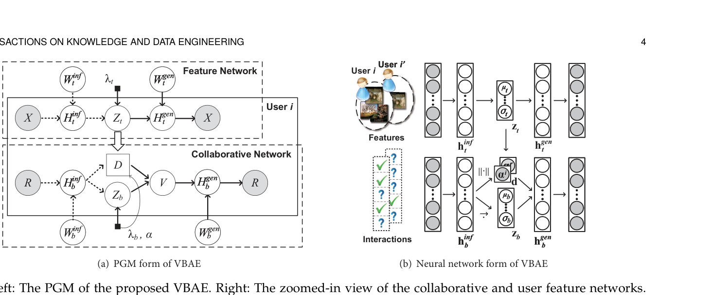
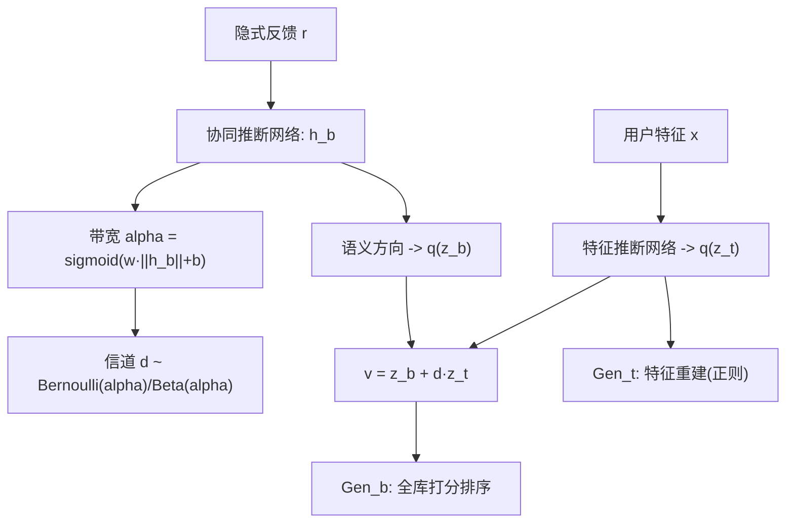
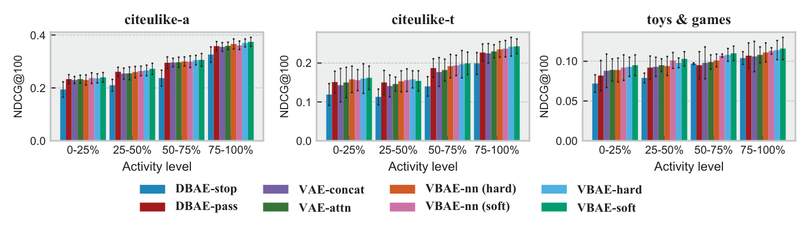

# Variational Bandwidth Auto-encoder for Hybrid Recommender Systems (面向混合推荐系统的变分带宽自编码器)

- **会议/期刊**: IEEE Transactions on Knowledge and Data Engineering (TKDE)
- **作者与机构**: Yaochen Zhu, Zhenzhong Chen（武汉大学遥感信息工程学院）
- **推荐链路定位**: 召回（用户级生成式协同召回）
- **研究方向**: 协同过滤与双塔召回 / 冷启动与长尾推荐
- **论文原文**: [https://arxiv.org/abs/2105.07597v3](https://arxiv.org/abs/2105.07597v3)
- **开源代码**: [https://github.com/yaochenzhu/vbae](https://github.com/yaochenzhu/vbae)

## TL;DR (1分钟核心速览)

混合推荐用用户特征弥补交互稀疏，但特征噪声又会把模型带偏。本文提出 VBAE：把"协同嵌入 $z_b$与特征嵌入$z_t$的融合"建模为一条**用户相关的虚拟通信信道**，用隐带宽变量$\alpha$决定允许多少特征信息流入$v$；$\alpha$由隐藏评分向量的**量子启发长度度量**（不确定性）推断，方向承载语义。在 citeulike-a/t 与 Amazon toys & games 三个数据集、按用户 8:1:1 划分 + 每用户 80%/20% 观测/留出的全库排序协议下，Recall@20 相对最优基线最高提升 7.2%，NDCG@100 最高提升 13.8%，且推断带宽与用户交互密度的 Pearson 相关系数达$-0.80\sim-0.91$。

## Background & Motivation (背景与核心矛盾)

- **主流范式**: 以 Multi-VAE / CondVAE / CoVAE / CVAE 为代表，用 VAE 从隐式反馈学用户协同表征，再通过拼接、条件先验或 offset 变量把用户（或物品）特征注入潜在空间。
- **前人局限一（协同侧）**: 现有模型假定协同嵌入的不确定性对所有人相同，但交互稀疏、兴趣单一（多样性低）、只点冷门物品（重叠度低）三类用户的不确定性差异极大，固定融合权重会让稀疏用户"借用"不到足够辅助信息。<figure class="paper-figure" markdown="span">
  <figcaption>图 1：混合推荐系统中协同成分与特征成分相关的挑战。左：评分稀疏或仅对少被评分物品进行评分的用户，其协同嵌入可能存在较大不确定性。右：用户/物品特征包含大量与推荐无关的信息。</figcaption>
</figure>
- **前人局限二（特征侧）**: 用户画像由历史交互物品内容聚合而来，含大量与推荐目的无关的**高层个性化噪声**（如论文的 Related Work 段落），传统 dropout/高斯扰动只能处理低层噪声，无法处理语义级噪声。
- **核心洞察 (Key Insight)**: 若把 $z_t\to v$看成信道，则"带宽"应随$z_b$的充分性自适应——协同信息足够时收窄带宽，稀疏时放宽带宽；而隐藏评分向量$h_b$的**模长**天然编码了交互充分性（可证明$\mathbb{E}[\|h_b\|^2]=N_{int}K_h\epsilon^2$ 随交互数单调递增），**方向**才是语义。<figure class="paper-figure" markdown="span">
  <figcaption>图 2：左：所提出 VBAE 的 PGM。右：协同网络与用户特征网络的放大视图。用户 i 的评分比用户 i′ 更稀疏，导致其推断的协同嵌入具有更大的不确定性；VBAE 推断出更大的带宽，使更多 zt 的信息流入 v。相反，对于用户 i′，推断出更小的带宽，以避免对特征噪声过拟合。</figcaption>
</figure>
- **本文切入点**: 用一个用户相关的随机信道变量 $d$（Bernoulli 或 Beta）+ 带宽推断网络，把"用多少辅助特征"变成可学习的概率决策。

## Method (核心方法设计)

### 1. 整体框架 (Overall Architecture)

VBAE 是生成式贝叶斯模型：协同推断网络从评分 $r$得到$h_b$，一方面经$\|h_b\|$推断带宽$\alpha$，另一方面经$\mu_b,\sigma_b$采样$z_b$；特征推断网络从$x$得到$z_t$；采样信道变量$d\sim p(d\mid\alpha)$后按$v=z_b+d\cdot z_t$融合，再由解码器$Gen_b$以 multinomial 似然重建$r$，并由$Gen_t$重建$x$。训练采用 **EM 式交替 MAP**（b-step 固定$z_t$优化协同与信道，t-step 固定$z_b,d$ 优化特征网络）以降低显存并避免单一信息源塌缩，推理时一次前向输出全库打分。

### 2. 关键设计拆解 (Key Designs)

1. **量子启发的语义/不确定性解耦**：痛点是把"用户有多可信"和"用户喜欢什么"混在一个向量里。作者令单层线性嵌入 $h_b=\sum_{j:r_j=1}w_{b,:j}$，在$w$为 i.i.d. 高斯假设下$\|h_b\|^2\sim N_{int}\epsilon^2\chi^2_{K_h}$，故模长单调反映交互密度，而$\hat{h}_b=h_b/\|h_b\|$ 把所有用户投到同一球面，消去活跃度差异，只保留偏好方向：
$\alpha=\mathrm{sigmoid}(w_{\alpha}^{b}\,\hat{\|h_b\|}+b_{\alpha}^{b}),\quad z_b\sim\mathcal{N}(\mu_b,\sigma_b^2)$
直觉：噪声在模长上体现、语义在方向上体现，二者可加性解耦。

2. **用户相关信道（hard / soft 双实现）**：痛点固定融合权重忽略个体差异。hard 版 $d\sim\mathrm{Bernoulli}(\alpha)$，严格符合信息瓶颈的"开/关"带宽语义，用 Gumbel-Softmax（温度$\tau$退火）重参数化：$d=\mathrm{sigmoid}((\log\frac{\alpha}{1-\alpha}+g_1-g_2)/\tau)$；soft 版$d\sim\mathrm{Beta}(\alpha,\sigma^2_{fixed})$，用 logistic-normal 近似重参数化为$d=\mathrm{sigmoid}(\log\frac{\alpha}{1-\alpha}+\sigma'(\epsilon_1-\epsilon_2))$，等价于对特征嵌入做乘性缩放，梯度更平滑（图 3）。直觉：hard 是"要不要看特征"，soft 是"看多少"，后者对含噪特征更友好。

3. **训练目标与效率**：最大化 ELBO，
$\mathcal{L}=\mathbb{E}_{q}[\log p(r|v)+\log p(x|z_t)]-\mathrm{KL}[q(z_b,d|r)\|p(z_b,d)]-\mathrm{KL}[q(z_t|x)\|p(z_t)]$b-step 中信道 KL 相当于"每次访问噪声特征都要付带宽税"，从而抑制过度依赖；KL 权重$\beta$从 0 退火到 0.2，$\|h_b\|$经 **batch normalization** 归一化以打破模式下塌（否则$\alpha$恒为 0/1）。无需负采样，训练/推理均为一次前向的全库 softmax，复杂度与 Multi-VAE 同阶，推理$O(JK_h)$。

## Experimental Setup & Evaluation Protocol (实验设置与评估协议)

- **数据集与预处理**: 用户画像由历史交互物品（标题+摘要 / 评论）的 tf-idf 词表按元素取最大值聚合；`5-core` 类过滤未显式声明，表 1 已给出 min #visits（10/5/5）：

| 数据集 | #Users | #Items | #Interactions | 密度 | 特征/场景说明 |
| :--- | :---: | :---: | :---: | :---: | :--- |
| citeulike-a | 5,551 | 16,980 | 约 204k | 0.217% | 8,000 维 tf-idf，学术文献收藏 |
| citeulike-t | 5,031 | 21,133 | 约 121k | 0.114% | 20,000 维（噪声更强） |
| toys & games | 14,706 | 11,722 | 约 124k | 0.072% | 8,000 维，Amazon 评论聚合 |

- **数据划分与防穿越**: **用户级随机 8:1:1** 划为 train/val/test；每个用户内部再按 **80% 观测 / 20% 留出**（per-user hold-out），10 次随机划分取均值，按验证集 NDCG@100 早停。
- **排名评测协议**: **Full-Ranking 全库未交互排序**（对全部 $J$ 个物品的多项式概率排序后取留出物品名次），指标 Recall@20、Recall@40、NDCG@100；因隐式反馈不用 Precision。
- **对比基线与超参**: 线性协同类 FM/CTR/CDL/CVAE，深度协同类 Multi-VAE/RecVAE/CoVAE/CondVAE/DICER；隐维 $K$、层结构均在验证集网格搜索，MLP 隐层与 Multi-VAE 同量级，mini-batch 500 users，Adam，100 epochs。

## Key Experimental Results (实验关键数据)

### 1. 主实验对比 (Main Results)

| 模型 | R@20 (a) | R@20 (t) | R@20 (g) | NDCG@100 (a) | NDCG@100 (t) | NDCG@100 (g) |
| :--- | :---: | :---: | :---: | :---: | :---: | :---: |
| FM | 0.231 | 0.154 | 0.088 | 0.238 | 0.135 | 0.062 |
| CTR | 0.169 | 0.132 | 0.124 | 0.190 | 0.118 | 0.089 |
| CDL | 0.209 | 0.200 | 0.133 | 0.226 | 0.168 | 0.092 |
| CVAE | 0.236 | 0.216 | 0.139 | 0.247 | 0.181 | 0.094 |
| Multi-VAE | 0.261 | 0.168 | 0.114 | 0.265 | 0.139 | 0.082 |
| CoVAE | 0.247 | 0.194 | 0.120 | 0.260 | 0.167 | 0.085 |
| CondVAE | 0.274 | 0.215 | 0.132 | 0.275 | 0.172 | 0.094 |
| DICER | 0.279 | 0.203 | 0.127 | 0.272 | 0.161 | 0.092 |
| **VBAE-soft** | **0.299** | **0.227** | **0.145** | **0.296** | 0.190 | **0.107** |
| VBAE-hard | 0.293 | 0.223 | 0.144 | 0.294 | **0.193** | 0.105 |
| Improv.% | +7.2% | +5.1% | +4.3% | +7.6% | +6.6% | +13.8% |

### 2. 消融实验 (Ablation Study)

| 变体 (citeulike-a / citeulike-t / toys) | R@20 | NDCG@100 | 带宽 $\alpha$ 均值 | 与密度 PCC |
| :--- | :---: | :---: | :---: | :---: |
| DBAE-stop（完全屏蔽特征） | 0.263/0.170/0.119 | 0.269/0.142/0.088 | 0 | N/A |
| DBAE-pass（无损全通） | 0.287/0.212/0.135 | 0.285/0.178/0.094 | 1.000 | N/A |
| VAE-concat（输入拼接） | 0.274/0.215/0.132 | 0.280/0.172/0.095 | N/A | N/A |
| VAE-attn（vanilla 注意力融合） | 0.282/0.219/0.136 | 0.286/0.177/0.097 | N/A | N/A |
| VBAE-nn（MLP 推断带宽） | 0.292/0.221/0.139 | 0.291/0.186/0.103 | 0.610 | −0.87 |
| **VBAE-soft（完整）** | **0.299/0.227/0.145** | **0.296/0.190/0.107** | 0.543 | **−0.898** |

### 3. 关键实验发现 (Key Findings)

1. **噪声税是可量化的**：全通模型 DBAE-pass 相比最优 VBAE 在 citeulike-a 上 R@20 低 4.0%（0.287 vs 0.299），且在活跃度最高 25% 用户群上 NDCG@100 差距继续扩大——说明稠密交互用户的协同信息本身已足够，强行注入特征反而引入噪声（图 6 右侧柱）。<figure class="paper-figure" markdown="span">
  <figcaption>图 6：按历史交互物品数量衡量的不同交互活跃度用户的 NDCG@100 分解。误差条表示十次随机数据集划分上的标准差。</figcaption>
</figure>
2. **带宽确实学到了"该信谁"**：三种数据集上 $\alpha$与交互密度的 PCC 为$-0.803\sim-0.910$，稀疏用户获得大带宽；相对仅用 MLP 打分带宽的 VBAE-nn，量子启发度量带来稳定 NDCG 增益（0.296 vs 0.291），证明"模长=不确定性、方向=语义"的解耦优于黑箱回归。
3. **hard/soft 的选择由特征噪声强度决定**：soft 在三数据集 R@20 全面领先（0.299/0.227/0.145），唯一例外是特征维度 20,000、噪声更强的 citeulike-t 上 hard 的 NDCG@100 更高（0.193 vs 0.190）——噪声越重，干脆"关掉"特征比"打折"更安全。

## Highlights & Limitations (亮点、对比与审稿批判)

- **与代表作对比 (vs. Prior Work)**: 相比 Multi-VAE / RecVAE 只做协同侧去噪，VBAE 把去噪对象升级为"推荐的语义相关性"；相比 CondVAE 用特征算条件先验（信息单向注入、强度固定），VBAE 的注入量由协同充分性反向门控；相比 VAE-attn 的 softmax 归一化权重（两模态竞争、无法表达绝对置信度），信道带宽是有信息论意义的绝对量。
- **可迁移亮点**: (1) "用模长做不确定性、用方向做语义"的球面分解可直接用于任何 embedding 置信度估计与冷启动门控；(2) 用户级带宽作为可解释信号，可作为特征参与 downstream 冷启动物品扶持或排序加权。
- **审稿级局限批判**: (1) 理论推导仅在线性单层 + i.i.d. 高斯权重假设下成立，且 $\|h_b\|$本质上只度量交互数量，论文声称覆盖的"多样性/重叠度"不确定性缺少直接实证（仅以密度 PCC 验证）；(2) hard 通道依赖 Gumbel 温度退火、soft 通道固定 Beta 方差$\sigma^2_{fixed}$，超参敏感且 EM 交替训练需两次前向，收敛慢于端到端联合训练；(3) 三数据集均为中小规模隐式反馈、用户特征来自物品内容聚合，缺少大规模工业 A/B 与物品侧信道验证，泛化性证据有限。

## Rating (四维评分)

- **方法创新性 (Novelty)**: ⭐⭐⭐⭐ （把信道带宽引入用户级门控、并用模长/方向解耦不确定性与语义，视角新颖，但量化理论仅在强假设下成立）
- **评估协议与实验扎实度 (Protocol & Experiments)**: ⭐⭐⭐⭐ （3 数据集 + 10 次随机划分 + 全库排序 + 8 个强基线 + 5 组消融与活跃度分桶，缺显著性检验与更大规模数据）
- **写作与数学规范度 (Clarity & Rigor)**: ⭐⭐⭐⭐ （ELBO、重参数化与复杂度推导完整清晰，hard/soft 对比讨论到位，个别符号与图号引用存在笔误）
- **工业落地与复现价值 (Industrial & Practical Value)**: ⭐⭐⭐⭐ （代码与数据开源，推理为单次前向全库打分，仅需一次带宽推断即可在线门控特征，部署成本低）

