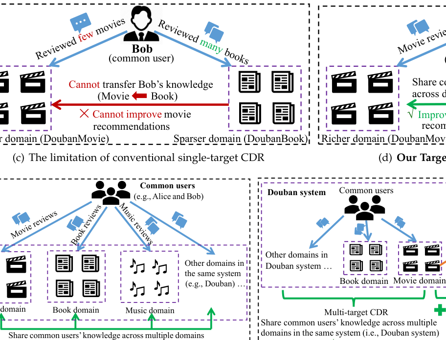
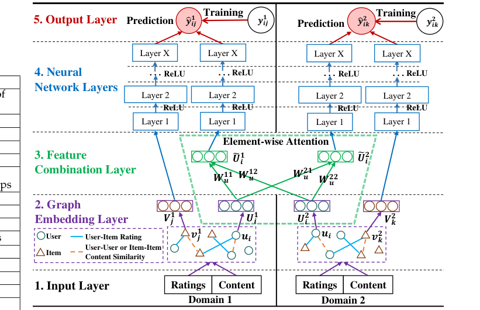
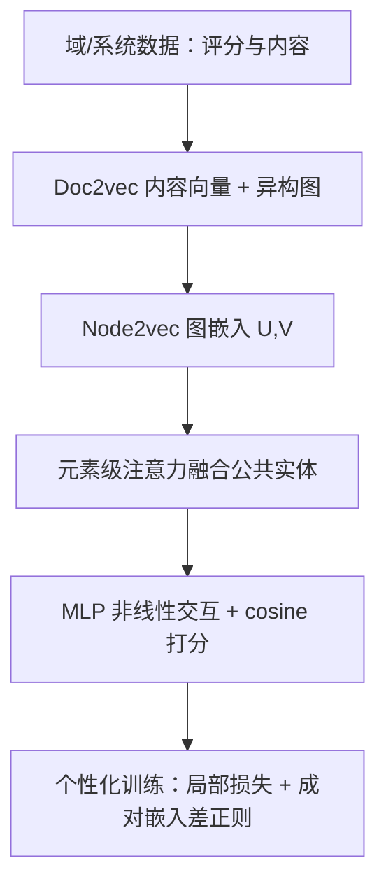

# A Unified Framework for Cross-Domain and Cross-System Recommendations（跨域与跨系统推荐统一框架）

- **会议/期刊**: IEEE TKDE
- **作者与机构**: Feng Zhu, Yan Wang, Jun Zhou, Chaochao Chen, Longfei Li, Guanfeng Liu；蚂蚁集团、Macquarie University
- **推荐链路定位**: 精排 / 评分排序
- **研究方向**: 跨域与多场景推荐 / 图神经网络与知识图谱推荐
- **论文原文**: [https://arxiv.org/abs/2108.07976v1](https://arxiv.org/abs/2108.07976v1)
- **开源代码**: 暂未开源

## TL;DR (1分钟核心速览)

现有 CDR/CSR 多为单目标，只让富域帮稀疏域，无法反哺富域；DTCDR/MTCDR/CDR+CSR 还面临负迁移。本文提出 GA 统一框架：按数据集构建异构图并 Node2vec 嵌入，元素级注意力融合公共用户/物品表示，个性化训练最小化公共实体成对嵌入差。在 4 个真实数据集、Leave-one-out 1:99 采样排序下，GA-DTCDR-P 平均超最佳基线 9.04%，MTCDR/CDR+CSR 平均超 9.21%。

## Background & Motivation (背景与核心矛盾)

- **主流范式**: 单目标 CDR/CSR 以公共用户或公共物品为桥，把富域知识迁移到稀疏域；主流做法是基于 CF 嵌入的 feature-based transfer。
- **前人局限**: ① 只优化目标域，稀疏域中更准的知识不能反哺富域；简单反向迁移、固定 average/max/concat 组合会触发负迁移；② 多域非 IID 数据叠加、CDR+CSR 同时存在公共用户与公共物品时，固定融合更难奏效。
- **核心洞察 (Key Insight)**: 公共实体在不同数据集中的嵌入各含互补但偏置的信息，应按维度自适应选择；同时公共实体嵌入应“相似但保留个性化”，而非强行一致。
- **本文切入点**: 用“异构图嵌入 + 元素级注意力 + 个性化成对嵌入差正则”统一覆盖 DTCDR、MTCDR、CDR+CSR。

<figure class="paper-figure" markdown="span">
  <figcaption>图 1. 跨域与跨系统推荐的不同场景</figcaption>
</figure>

## Method (核心方法设计)

### 1. 整体框架 (Overall Architecture)

输入每个域/系统的评分与内容信息；先对用户/物品文档做 Doc2vec，得到内容向量，再以 user-item 评分边、user-user 与 item-item 内容相似边构建异构图，用 Node2vec 生成单域用户/物品嵌入。随后对公共用户（CDR+CSR 还包括公共物品）做元素级注意力融合，得到各数据集专属的组合嵌入；再拼接域内独有用户嵌入后送入 MLP，输出层用 cosine 打分。训练时联合局部交互损失与公共实体成对嵌入差正则，以缓解负迁移。图 2 给出了 DTCDR 版本的结构。

<figure class="paper-figure" markdown="span">
  <figcaption>图 2. GA-DTCDR-P（或 GA-DTCDR）的概览。这是我们在 DTCDR 场景下的 GA 框架，GA-DTCDR 与 GA-DTCDR-P 的唯一区别在于其训练策略（即 GA-DTCDR 采用第 3.5.1 节中的目标函数，而 GA-DTCDR-P 采用第 3.5.2 节中的个性化目标函数）。注意，对于域 x, y ∈{1, 2}，P2</figcaption>
</figure>

### 2. 关键设计拆解 (Key Designs)

1. **异构图增强单域表示**：传统 CF 只用 user-item 关系，稀疏域嵌入质量差；本文在每域加入用户-用户、物品-物品内容相似边，边采样概率为 $P(i,l)=\alpha\cdot sim(U_i^C,U_l^C)$，再用 Node2vec 学嵌入。直觉是内容相似性补足协同信号，提升稀疏域表示且保留多源信息。
2. **元素级注意力融合公共实体**：固定池化/拼接无法按信息量选择维度；本文对公共用户嵌入做逐维加权：$\tilde{U}_i^x=\sum_{y=1}^{a}W_u^{xy}\odot U_i^y,\quad \sum_{y=1}^{a}W_u^{xy}=1$。CDR+CSR 中对公共物品同理用$W_v^{xy}$。这样每个维度可自适应偏向更可信的域，兼顾共享与域特性。
3. **个性化训练、负采样与推理**：局部损失用归一化交叉熵，并对公共实体成对嵌入差加正则：$\min \sum_{y\in Y^{x+}\cup Y^{x-}}\ell(y,\hat{y})+\sum_{i\ne j}\lambda_{ij}A(\|W_i-W_j\|_F^2)$，其中$A(\cdot)=1-e^{-\|\cdot\|_F^2/\theta}$，$\lambda_{ij}$可训练且$\sum_{i\ne j}\lambda_{ij}=1$。训练每正样本随机采 7 个负样本；推理为 MLP + cosine，复杂度约$O(\sum_{x}i_x(\sum_x m_x+kl))$。

## Experimental Setup & Evaluation Protocol (实验设置与评估协议)

- **数据集与预处理**: 采用至少 5 次交互过滤；Douban 三个子域含评分、评论、标签、用户画像与物品详情，MovieLens 子集含评分、标签与物品详情。

| 数据集 | #Users | #Items | #Interactions | 密度 | 说明 |
| :--- | ---: | ---: | ---: | ---: | :--- |
| DoubanBook | 2,110 | 6,777 | 96,041 | 0.67% | 稀疏书籍域 |
| DoubanMusic | 1,672 | 5,567 | 69,709 | 0.75% | 稀疏音乐域 |
| DoubanMovie | 2,712 | 34,893 | 1,278,401 | 1.35% | 富电影域 |
| MovieLens | 10,000 | 9,395 | 1,462,905 | 1.56% | 跨系统电影域 |

- **数据划分与防穿越**: `Leave-One-Out`：每用户最新交互作测试，其余训练；测试时随机采 99 个未交互物品。
- **排名评测协议**: `Sampled Ranking (1:99)`，报告 HR@10、NDCG@10；非无偏 `Full-Ranking`。
- **对比基线与超参**: 7 个基线：NeuMF、DMF；CTR-RBF、BPR_DCDCSR、TMH；DMF_DTCDR_Concat、DDTCDR。嵌入维度 $k\in\{8,16,32,64,128\}$，实验中$k=64$较优；MLP 为$k\to2k\to4k\to8k\to4k\to2k\to k$；Adam，学习率 0.001，正则 0.001，batch 1024，50 epochs，$\alpha=0.05$；原文未报告显著性检验。

## Key Experimental Results (实验关键数据)

### 1. 主实验对比 (Main Results)

Task 1、$k=64$ 的代表性结果如下（最佳基线：Book 为 TMH，Movie 为 DMF_DTCDR_Concat）：

| 模型 | Book HR@10 | Book NDCG@10 | Movie HR@10 | Movie NDCG@10 |
| :--- | ---: | ---: | ---: | ---: |
| NeuMF | .3908 | .2226 | .5449 | .3152 |
| DMF | .3917 | .2362 | .5632 | .3387 |
| CTR-RBF | .4017 | .2314 | - | - |
| BPR_DCDCSR | .4107 | .2454 | - | - |
| TMH | .4504 | .2768 | .5998 | .3649 |
| DMF_DTCDR_Concat | .4265 | .2452 | .5825 | .3553 |
| DDTCDR | .4258 | .2430 | .6416 | .3941 |
| **GA-DTCDR-P (本文)** | **.4891** | **.3131** | **.6802** | **.4249** |
| **Improv. vs 最佳基线** | **+8.60%** | **+13.11%** | **+13.40%** | **+16.44%** |

原文汇总：GA-DTCDR-P 在 Task1/2/3 上分别平均超最佳基线 10.85%/11.21%/5.06%，总体平均 9.04%；GA-MTCDR-P 与 GA-CDR+CSR-P 在 Task4/5 上平均超 9.21%。

### 2. 消融实验 (Ablation Study)

Task 1、$k=64$：

| 变体 | Book HR | Book NDCG | Movie HR | Movie NDCG |
| :--- | ---: | ---: | ---: | ---: |
| GA-DTCDR Average（平均池化） | .4423 | .2671 | .6416 | .3941 |
| GA-DTCDR（元素级注意力） | .4882 | .3026 | .6817 | .4205 |
| GA-DTCDR-P（+个性化训练） | **.4891** | **.3131** | .6802 | **.4249** |

### 3. 关键实验发现 (Key Findings)

1. **元素级注意力是主增益来源**：Task1 下 Book HR 由 .4423 升至 .4882（相对 +10.38%），Movie HR 由 .6416 升至 .6817（+6.25%）；原文报告平均 +6.76%，说明按维度选择比固定平均/拼接更有效。
2. **个性化训练主要改善排序质量而非全面抬升 HR**：Book NDCG .3026→.3131（+3.47%），Movie HR 略降至 .6802 但 NDCG .4205→.4249（+1.05%）；全任务平均再提升 0.54%，表明成对嵌入差正则可缓解负迁移，但收益小于融合机制。
3. **多域与混合场景可累积收益，但依赖重叠规模**：GA-MTCDR-P/GA-CDR+CSR-P 平均超 9.21%，高于 DTCDR 的 9.04%；密度/重叠实验中 Book 的 v3 优于 v4（HR .4911 vs .4860），说明公共用户重叠度下降会抵消密度增益。

## Highlights & Limitations (亮点、对比与审稿批判)

- **与代表作对比 (vs. Prior Work)**: DTCDR 用固定 average/max/concat 融合公共用户，DDTCDR 用双向迁移与正交映射，TMH 仍是单目标迁移+注意力；本文把三场景统一，并以元素级注意力和个性化成对正则同时处理公共用户/物品。
- **可迁移亮点**: ① 多源公共实体嵌入的元素级注意力融合；② 带可训练权重的成对嵌入差正则，可直接用于多域/多系统负迁移抑制。
- **审稿级局限批判**: ① 强依赖公共实体重叠，异构图与 Node2vec 需离线构建，新增交互后重算成本高；② 评估仅为 1:99 sampled ranking，缺少 Full-Ranking、显著性检验与线上 A/B，且多域 MLP 推理开销未充分讨论。

## Rating (四维评分)

- **方法创新性 (Novelty)**: ⭐⭐⭐⭐ （统一三场景，元素级注意力与个性化成对正则组合较新颖）
- **评估协议与实验扎实度 (Protocol & Experiments)**: ⭐⭐⭐⭐ （4 数据集、5 任务、7 基线、维度与消融较完整，但仅采样排序且无显著性检验）
- **写作与数学规范度 (Clarity & Rigor)**: ⭐⭐⭐⭐ （公式与流程清晰，复杂度有交代；部分符号与权重维度可更统一）
- **工业落地与复现价值 (Industrial & Practical Value)**: ⭐⭐⭐ （模块可复用，但图构建开销大、未开源，线上部署需重算与工程优化）

