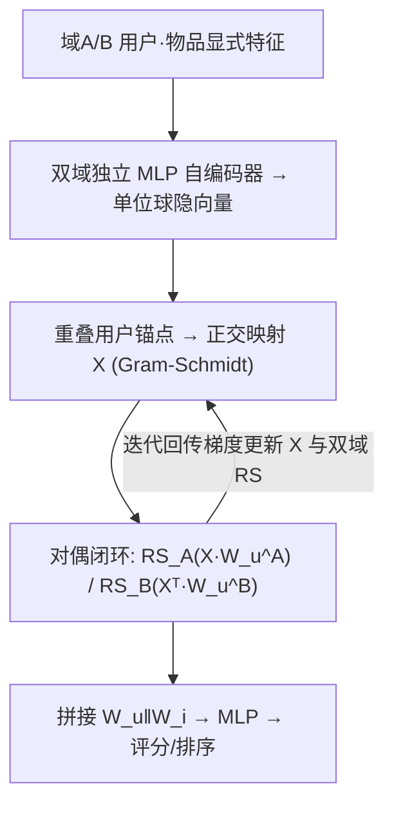

# Dual Metric Learning for Effective and Efficient Cross-Domain Recommendations (面向高效跨域推荐的双重度量学习)

- **会议/期刊**: IEEE TKDE
- **作者与机构**: Pan Li, Alexander Tuzhilin (New York University, Stern School of Business)
- **推荐链路定位**: 精排（跨域评分/排序建模，端到端双域训练）
- **研究方向**: 跨域与多场景推荐 / 协同过滤
- **论文原文**: [https://arxiv.org/abs/2104.08490v2](https://arxiv.org/abs/2104.08490v2)
- **开源代码**: [https://github.com/lpworld/DOML](https://github.com/lpworld/DOML)

## TL;DR (1分钟核心速览)

现有跨域推荐几乎全是"源域 $\to$目标域"的单向迁移，且强依赖大量重叠用户作为枢轴（pivot），在重叠稀疏的电商场景直接失效。本文提出 DML：以自编码器分别学习双域用户/物品隐向量，用一个**正交映射矩阵$X$** 对齐重叠用户，并把该映射嵌入双域推荐网络的**对偶闭环**中迭代互训。理论上$k$维隐空间只需$k(k-1)/2$个重叠用户即可确定$X$（$k{=}16$ 时约 120 人）。在 Imhonet 与 Amazon 六个域对上，5 折交叉验证下 RMSE/MAE/Pre@5/Rec@5 全面超越 8 个基线，Book-Movie 上 RMSE 相对次优提升 1.31%、MAE 提升 3.63%。

## Background & Motivation (背景与核心矛盾)

- **主流范式**: CMF/CoNet/CCFNet/CDFM 通过共享参数或跨连接做知识迁移，DDTCDR 用对偶自编码器做双域软共享，CML 用度量学习把用户与物品投影到共享度量空间。
- **前人局限**: (1) 单向迁移只优化目标域，忽略了两域偏好互为因果的**对偶结构**；真正能让 Book 提升 Movie、Movie 反哺 Book 的闭环缺失。(2) 几乎全部依赖 ID 重叠用户做枢轴，而工业场景中跨品类重合用户往往极少（Amazon 域对仅数千人量级），重叠不足时映射不可辨识、性能塌陷。
- **核心洞察 (Key Insight)**: 若两用户在源域偏好相近，则其在目标域偏好也应相近；度量学习的三角不等式天然会把"非重叠但相似"的用户对拉近，因此**映射的确定不必依赖显式重叠对**，只需极少量锚点即可约束整个隐空间。同时正交约束（$XX^{\top}=I$）保持内积即保持用户相似性，且逆映射免费获得$X^{\top}$，正好支撑对偶双向传递。
- **本文切入点**: 用"正交度量映射 + 对偶学习"把跨域迁移从"特征拼接式单向迁移"重构为"隐空间可逆对齐的双向互训"。

## Method (核心方法设计)

### 1. 整体框架 (Overall Architecture)

DML 分三步闭环。**Step 1**：对每个域独立训练 MLP 自编码器，将离散异构的用户/物品特征压成 16 维隐向量并约束在单位球内（$\|\boldsymbol{W}_u\|_2\le 1$），此步不跨域，避免信息泄漏。**Step 2**：抽取重叠用户嵌入对，学习正交映射$X$使$X\boldsymbol{W}_u^{oA}\approx\boldsymbol{W}_u^{oB}$，同时优化其对偶式。**Step 3**：对偶学习——把源域用户向量映射后喂入目标域推荐网络$\mathrm{RS}_B$，反之亦然，两域网络与$X$ 交替更新至收敛，最终以 MLP+Dropout 拼接用户/物品向量输出评分。

### 2. 关键设计拆解 (Key Designs)

1. **正交隐空间映射（Orthogonal Mapping）**：痛点是不加约束的线性映射参数自由度过高，少量重叠用户下严重过拟合且破坏域内相似结构。改为
$\min_X \sum_{(oA,oB)}\|X\boldsymbol{W}_u^{oA}-\boldsymbol{W}_u^{oB}\|_F^2 \;\; \text{s.t.}\; XX^{\top}=X^{\top}X=I$并同步最小化对偶式$\sum\|\boldsymbol{W}_u^{oA}-X^{\top}\boldsymbol{W}_u^{oB}\|^2$。正交性带来三重收益：保持内积即保持用户近邻关系；$X^{-1}=X^{\top}$使反向映射零成本，直接支撑对偶回路；参数空间被压缩到$k(k-1)/2$ 维流形，因此确定映射所需的重叠用户数骤降。
2. **对偶学习回路（Dual Transfer）**：痛点是单向迁移只做一次投影，源域信息在目标域训练后即被"遗忘"。做法是把映射嵌入两域推荐网络的输入侧并交叉回流：
$\hat{r}_A=\mathrm{RS}_A(X\boldsymbol{W}_u^{A},\boldsymbol{W}_i^{A}),\quad \hat{r}_B=\mathrm{RS}_B(X^{\top}\boldsymbol{W}_u^{B},\boldsymbol{W}_i^{B})$即"用 B 域偏好表征去预测 A 域评分，反之亦然"。由于两域共享同一个$X$，任一侧的梯度都会通过$X$ 反传修正另一侧，形成互相提纯的正反馈闭环，这也是性能随迭代递增而非一次到位的物理直觉。
3. **训练目标、负采样与推理效率**：总损失为双域重建 + 双域监督 + 双向映射对齐
$\mathcal{L}=\lambda_A\|r_A-\hat r_A\|^2+\lambda_B\|r_B-\hat r_B\|^2+\lambda_o\big(\|X\boldsymbol{W}^{oA}-\boldsymbol{W}^{oB}\|^2+\|\boldsymbol{W}^{oA}-X^{\top}\boldsymbol{W}^{oB}\|^2\big)$任务是显式评分回归，无负采样环节；正交约束通过 Gram-Schmidt 正交化每轮迭代后强制施加。推理阶段仅需一次前向（$X$为$16\times16$ 稠密矩阵），开销与单域 NCF 同量级，训练耗时随记录数近似线性增长。

## Experimental Setup & Evaluation Protocol (实验设置与评估协议)

- **数据集与预处理**: 两个工业级数据集共 6 个域对（每数据集 3 域、3 域对）；评分为 [0,1] 归一化；未采用 `5-core` 过滤，保留原始日志规模。

| 数据集 | #Users | #Items | #Interactions | 稀疏度 | 特征/场景说明 |
| :--- | :---: | :---: | :---: | :---: | :--- |
| Imhonet-Book | 804,285 | 182,653 | 223,007,805 | 0.0157% | 8 项问卷用户特征 + Google Books API 物品特征 |
| Imhonet-Movie | 959,502 | 79,866 | 51,269,130 | 0.0669% | IMDB 元数据（导演/编剧/时长等） |
| Imhonet-Music | 45,962 | 183,114 | 2,536,273 | 0.0301% | Spotify 元数据（艺人/专辑/标签等） |
| Amazon-Beauty | 324,038 | 32,586 | 371,345 | 0.0035% | 评分/购买史/评论/时间戳 + 类目/描述/标题/价格 |
| Amazon-Fashion | 749,233 | 186,189 | 883,636 | 0.0006% | 同上 |
| Amazon-Art Crafts | 1,579,230 | 302,809 | 2,875,917 | 0.0006% | 同上 |

- **数据划分与防穿越 (Splitting Strategy)**: 采用 **5 折交叉验证**（随机划分，未做全局时间戳切分，存在潜在时序泄漏风险）。
- **排名评测协议 (Ranking Protocol)**: 以 RMSE/MAE 为主，辅以 **Pre@5 / Rec@5**；原文未明确说明 Pre/Rec 是在全库未交互集合上 `Full-Ranking` 还是采样候选集上计算——这是复现时的关键模糊点。
- **对比基线与超参设置**: 基线含 DDTCDR、CML、CCFNet、CDFM、CoNet、CMF、NCF（单域独立训练）、NCF-joint（数据合并联合训练），覆盖矩阵分解、迁移学习、度量学习、深度多视图四类；嵌入维度 $d=16$，batch size 64，编码/解码均为 2 隐含层（32-16）MLP，超参用贝叶斯优化搜索，显著性水平$p<0.05$（表中 `*` 标注）。

## Key Experimental Results (实验关键数据)

### 1. 主实验对比 (Main Results)

Imhonet Book↔Movie 域对（其余 5 个域对趋势一致，DML 全部指标最优）：

| 方法 | Book RMSE↓ | Book MAE↓ | Book Pre@5↑ | Book Rec@5↑ | Movie RMSE↓ | Movie MAE↓ | Movie Pre@5↑ | Movie Rec@5↑ |
| :--- | :---: | :---: | :---: | :---: | :---: | :---: | :---: | :---: |
| **DML (本文)** | **0.2184\*** | **0.1646\*** | **0.8826\*** | **0.9850\*** | **0.2109\*** | **0.1606\*** | **0.9002\*** | **0.9962\*** |
| Improv.% | +1.31% | +3.63% | +2.69% | +3.71% | +4.70% | +6.30% | +0.86% | +0.92% |
| DDTCDR | 0.2213 | 0.1708 | 0.8595 | 0.9594 | 0.2213 | 0.1714 | 0.8925 | 0.9871 |
| CoNet | 0.2305 | 0.1892 | 0.8328 | 0.8990 | 0.2298 | 0.1903 | 0.8680 | 0.9601 |
| NCF-joint | 0.2378 | 0.1920 | 0.8275 | 0.8880 | 0.2254 | 0.1880 | 0.8410 | 0.9478 |
| CML | 0.2408 | 0.1927 | 0.8150 | 0.8864 | 0.2342 | 0.1924 | 0.8520 | 0.9380 |
| CDFM | 0.2494 | 0.2165 | 0.7978 | 0.8610 | 0.2289 | 0.1901 | 0.8498 | 0.9312 |
| CCFNet | 0.2639 | 0.1841 | 0.8102 | 0.8872 | 0.2476 | 0.1939 | 0.8545 | 0.9300 |
| CMF | 0.2921 | 0.2478 | 0.7972 | 0.8523 | 0.2738 | 0.2293 | 0.8324 | 0.9012 |

### 2. 消融实验 (Ablation Study)

Book↔Movie（Imhonet）上的组件拆解：

| 变体 | RMSE↓ | MAE↓ | Pre@5↑ | Rec@5↑ | 说明 |
| :--- | :---: | :---: | :---: | :---: | :--- |
| DML 完整版 | **0.2184** | **0.1646** | **0.8826** | **0.9850** | 显式特征 + MLP + AE |
| w/o 显式特征（仅 ID） | 0.2395 | 0.1801 | 0.8644 | 0.9535 | 仍比 DDTCDR(0.2568) 好 +6.73% |
| RS 换 CNN | 0.2186 | 0.1648 | 0.8823 | 0.9848 | 几乎无损 |
| RS 换 RNN | 0.2184 | 0.1648 | 0.8830 | 0.9850 | 几乎无损 |
| RS 换 Neural Attention | 0.2165 | 0.1632 | 0.8847 | 0.9858 | 略优（动态偏好） |
| RS 换 Adversarial Net | 0.2192 | 0.1653 | 0.8815 | 0.9848 | 略降 |
| AE 换 VAE / HVAE | 0.2190 / 0.2190 | 0.1654 / 0.1641 | 0.8796 / 0.8816 | 0.9848 | 编码器类型不敏感 |

### 3. 关键实验发现 (Key Findings)

1. **重叠用户数存在明显"肘点"**：重叠用户为 0 时性能最差，加入 8 个后即出现陡升并已超越所有使用全量重叠用户的基线；此后继续增加仅带来边际收益，最终全量重叠时达到全局最优——与理论界 $k(k-1)/2{=}120$ 相比，实测所需人数更低，说明正交约束的实际自由度更紧。
2. **显式特征是"放大器"而非"必需品"**：去掉全部特征改为纯 ID 嵌入后 RMSE 从 0.2184 退化到 0.2395（约 9.7% 相对损失），但仍以 +6.73% RMSE 领先次优基线，说明正交对偶迁移本身贡献了主要增益，特征只提供增量。
3. **增益对网络结构与自编码器类型高度鲁棒**：五种推荐网络（MLP/CNN/RNN/Attention/Adversarial）RMSE 波动区间仅 0.2165–0.2192（<1.3%），五种自编码器（AE/VAE/AAE/WAE/HVAE）差异同样微弱，证明收益来自"正交映射 + 对偶闭环"这一机制层设计而非骨干网络容量；训练 10 个 epoch 内即稳定收敛，缩放实验显示训练时间随记录数线性增长。

## Highlights & Limitations (亮点、对比与审稿批判)

- **与代表作对比 (vs. Prior Work)**: 相比 DDTCDR（同为对偶思想，但用软共享参数、仍需大量重叠用户），DML 用一个显式可逆的正交矩阵把"共享"变成"可解释的坐标变换"，重叠需求从数万级降到个位数；相比 CML（度量学习但仅单域、无跨域映射），DML 把度量学习提升为跨域对齐工具；相比 CoNet/CCFNet（跨连接式特征级迁移），DML 迁移的是隐空间结构而非显式特征，天然规避特征对齐难题。
- **可迁移亮点**: (1) "正交约束 + 参数计数论证"这套思路可直接移植到多场景/多任务的特征空间对齐（如 STAR/PEPNet 的场景映射矩阵约束为近似正交以保持场景内排序不变）；(2) 用"少锚点确定全局映射"的设计可迁移到冷启动用户对齐与跨语言/跨模态 embedding 桥接。
- **审稿级局限批判**: (1) 整个框架建立在**显式评分回归**（RMSE/MAE）之上，缺失隐式反馈（BPR/InfoNCE）与全库负采样排序的验证，与当前工业召回/精排范式有代差；(2) 正交线性映射假设两域隐空间同维且存在刚性旋转关系，若域间偏好结构差异较大（如书 vs 美妆），线性可逆假设可能过强，文中未对该假设做破坏性实验；此外 5 折随机划分未做时间切分，存在未来信息泄漏，Pre@5/Rec@5 的候选集构造也未交代，影响复现可比性。

## Rating (四维评分)

- **方法创新性 (Novelty)**: ⭐⭐⭐⭐ （把对偶学习首次引入跨域推荐，并用正交约束把"减少重叠用户"从经验现象升格为可证明的自由度计数，理论动机扎实但算子本身偏线性简洁）
- **评估协议与实验扎实度 (Protocol & Experiments)**: ⭐⭐⭐ （两大工业数据集×6 域对 + 8 基线 + 显著性检验 + 重叠用户/维度/网络/编码器多维消融很充分，但仅有评分回归指标、缺 Full-Ranking 隐式反馈评测、划分方式未防时序泄漏）
- **写作与数学规范度 (Clarity & Rigor)**: ⭐⭐⭐⭐ （正交性三重收益、$k(k-1)/2$ 重叠用户界与收敛命题推导清晰，但收敛性证明只覆盖简化 MF 情形，深度版本仅靠经验验证，属"命题未闭环"）
- **工业落地与复现价值 (Industrial & Practical Value)**: ⭐⭐⭐⭐ （代码开源、推理仅多一次 $16\times16$ 矩阵乘、训练线性可扩展，且"个位数重叠用户"直击跨业务冷启动痛点；扣分在于依赖显式特征工程与评分数据，纯隐式反馈场景需重新设计损失）

