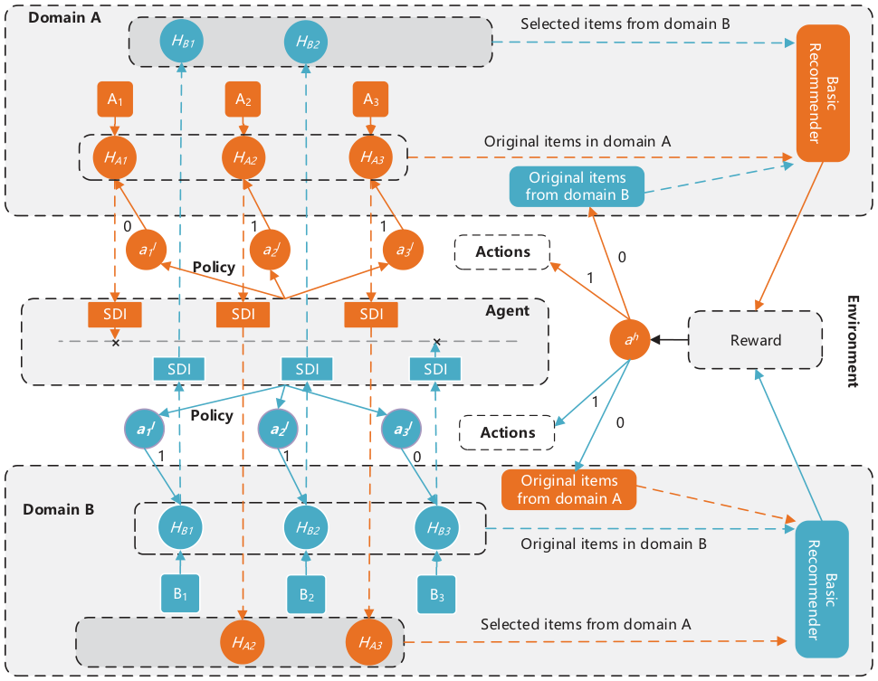
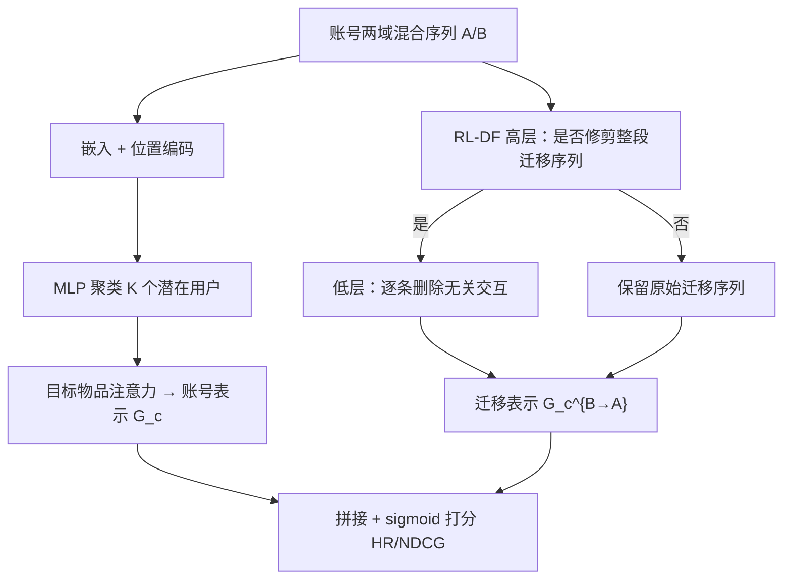
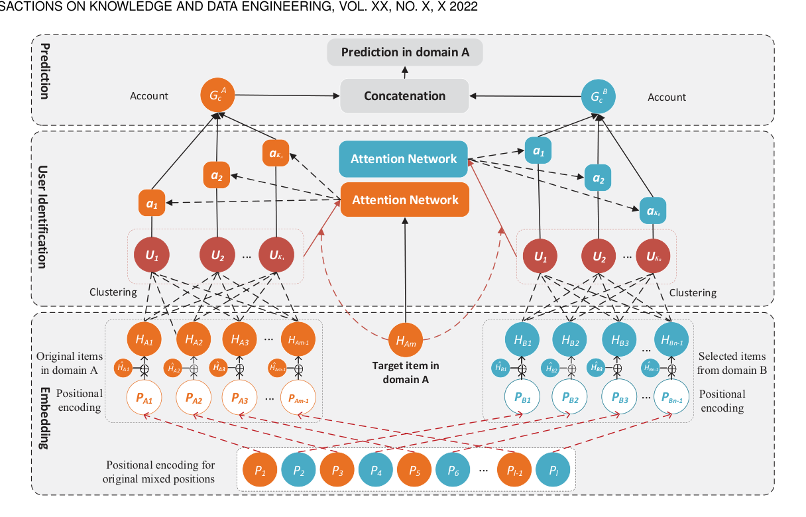

# Reinforcement Learning-enhanced Shared-account Cross-domain Sequential Recommendation (强化学习增强的共享账号跨域序列推荐)

- **会议/期刊**: IEEE TKDE (arXiv 2022-06)
- **作者与机构**: Lei Guo, Jinyu Zhang, Xinhua Wang (山东师范大学)、Tong Chen, Hongzhi Yin (昆士兰大学)
- **推荐链路定位**: 精排 / 序列下一项打分（跨域信息迁移）
- **研究方向**: 跨域与多场景推荐 / 强化学习与动态探索推荐
- **论文原文**: [https://arxiv.org/abs/2206.08088v1](https://arxiv.org/abs/2206.08088v1)
- **开源代码**: 暂未开源

## TL;DR (1分钟核心速览)

SCSR 任务同时面临"多用户共用一号"与"跨域噪声稀释"两重矛盾，π-net/DA-GCN 只是给无关交互降权、并把账号表示在所有域上平摊。RL-ISN 先用 MLP 把混合行为软聚类成 $K$ 个潜在用户，再以目标物品为监督用注意力聚合出"当前是谁"；随后把跨域序列修剪建模为**层次 MDP**（高层决定是否整体修剪、低层决定逐条删除），以推荐概率增益为延迟奖励。在 HVIDEO/HAMAZON 上按采样排序评测，HR@10 相对最优已发表基线提升 2.8%–29.1%。

## Background & Motivation (背景与核心矛盾)

- **主流范式**: CSR 侧靠门控（π-net）、序列拆分拼接（PSJ-net）或跨域异构图（DA-GCN）共享两域知识；共享账号侧多采用"先用户识别、再推荐"的两阶段流程。
- **前人局限**: (1) 现有方法给无关交互**降权**而非**删除**，噪声仍进入表示、稀释目标域意图；(2) 账号表示在高维空间被**均匀切分**给各潜在用户，忽略了"账号同一时刻主要被一个用户占用"这一事实。
- **核心洞察 (Key Insight)**: 账号的**最近行为/目标物品**暴露了当前真实使用者，因此可用目标物品作为弱监督来"辨识"潜在用户，而非平分表示。
- **本文切入点**: 注意力潜在用户聚类解决"是谁"，层次 RL 域过滤器解决"哪些跨域交互该留"。

## Method (核心方法设计)

### 1. 整体框架 (Overall Architecture)

输入为账号 $G_c$在两域交错的行为序列$S^o_c=\{A_1,B_1,\dots\}$。BCR 分支完成嵌入+位置编码 → 行为聚类为$K_A/K_B$个潜在用户 → 以目标物品为 query 的注意力聚合得账号向量$G_c^A$、$G_c^B$；同时另一域序列经同样的 UIN 得到迁移表示$G_c^{B\to A}$。RL-DF 分支则对"待迁移序列"先由高层策略判断是否整体修剪，再由低层策略逐条删除交互，修剪后的序列才送入 BCR 重算迁移表示。训练为三阶段：预训练 BCR → 固定 BCR 预训练 RL-DF → 联合训练（软更新$\Phi_{new}=\lambda\Phi_{new}+(1-\lambda)\Phi_{old}$）。

<figure class="paper-figure" markdown="span">
  <figcaption>图 1. RL-ISN 的系统架构，其中 SDI 表示共享域信息。</figcaption>
</figure>

### 2. 关键设计拆解 (Key Designs)

1. **注意力潜在用户识别网络 (UIN)**：痛点是无用户身份监督、账号不能压成单向量。先用全连接把整条序列映射为潜在用户矩阵 $\mathbf{U}=\max(0,\mathbf{W}\mathbf{H}^A_c+\mathbf{b})\in\mathbb{R}^{K_A\times d}$（一行即一簇），再以目标物品嵌入$\mathbf{H}_{A_t}$为 query 做 MLP 注意力$a_{i,t}=f(\mathbf{H}_{A_t},\mathbf{U}_i)$；关键改动是**弱化版 softmax**：$\alpha_{i,t}=\exp(f_{i,t})\big/\big(\sum_j \exp(f_{j,t})\big)^{\beta},\ \beta\in[0.1,1]$，避免共享用户多时过度惩罚各簇权重（$\beta=1$退化为标准 softmax，实验最优$\beta=0.5$）。账号表示$G_c^A=\sum_i \alpha_{i,t}\mathbf{U}_i$，预测$P(A_m|S^o_c)=\sigma(\mathbf{H}_{A_m}\cdot[G_c^{B\to A};G_c^{A}]^\top+b)$。直觉：账号当前只被一人占用 → 注意力自然后聚焦于与目标一致的簇。

<figure class="paper-figure" markdown="span">
  <figcaption>图 2. 领域 A 中基础跨域推荐器的概览。领域 B 中类似的基础推荐器也可轻松实现。</figcaption>
</figure>

2. **层次 RL 域过滤器 (RL-DF)**：无直接监督判断"哪条跨域交互是噪声"。高层状态 $S_h$由迁移序列与目标物品的平均余弦、平均逐元素积、BCR 给出的推荐概率组成，动作$a_h\in\{0,1\}$决定是否整段修剪；若为 1，低层对每条交互$A_m^{A\to B}$计算状态$S^l_m$（与目标的余弦、保留项平均余弦、绝对差及其均值）并输出$a^l_m$决定删除。策略均为$\pi(S,a)=a\,\sigma(\mathbf{W}_1\mathbf{E})+(1-a)(1-\sigma(\mathbf{W}_1\mathbf{E}))$，$\mathbf{E}=\mathrm{ReLU}(\mathbf{W}_2S+\mathbf{b})$。**奖励设计是核心增量**：即时奖励衡量删除该条后保留项与目标平均余弦的变化
$R_I=\frac{1}{|S^{A\to B}_c|}\sum_{A_i}\cos(\mathbf{H}_{A_i},\mathbf{H}_{B_t})-\frac{1}{|\hat{S}^{A\to B}_c|}\sum_{A_i\in\hat{S}}\cos(\mathbf{H}_{A_i},\mathbf{H}_{B_t})$，
延迟奖励仅在最后一步给出 $R_D=\log p(\hat{S},A_m)-\log p(S_c,A_m)$；总奖励$R=R_I+R_D$。即时项提供稠密梯度加速局部收敛，延迟项保证修剪服务于最终推荐指标。

3. **训练目标、负采样与推理效率**：两域各用独立正则化 log loss 与独立优化器（$\mathcal{L}_A,\mathcal{L}_B$，每正样本 4 负采样，Adagrad/Adam），刻意**避免联合损失引发的"跷跷板"**（一域提升另一域掉点）。RL 侧用 Monte-Carlo 策略梯度（$J$条轨迹）更新$\Phi_h,\Phi_l$。推理时仅需前向 BCR + 一次过滤决策，训练开销随数据比例近线性增长（HVIDEO 0.102k→0.396k 秒/epoch），可扩展。

## Experimental Setup & Evaluation Protocol (实验设置与评估协议)

- **数据集与预处理**: HVIDEO 为真实家庭共享电视账号日志（过滤观看数 <10、时长 <300s）；HAMAZON 由 2–4 个 Amazon 用户按 6 个时间段随机合并**合成**共享账号（M 域 ≥5 项、B 域 ≥2 项）。

| 数据集 | #Accounts | #Items (域) | #Interactions (域) | #Sequences | 特征/场景说明 |
| :--- | :---: | :---: | :---: | :---: | :--- |
| HVIDEO | 13,714 | 16,431 (V) / 3,389 (E) | 1,970,378 / 2,052,966 | 125,943 | 真实家庭共享账号，视频+教育双域 |
| HAMAZON | 13,724 | 67,161 (M) / 126,547 (B) | 4,406,924 / 4,287,240 | 196,297 | 合成共享账号，电影+图书双域 |

- **数据划分与防穿越**: 每条序列**留出最后两项**，倒数第二项作训练目标、最后一项作测试目标，其余为历史；本质为 next-item 预测，无时间戳级全局切分。
- **排名评测协议**: 采用 **Sampled Ranking（1 正 : 4 随机负）** 而非 Full-Ranking，指标为 HR@{5,10} 与 NDCG@{5,10}；显著性用 one-sample paired t-test，$p<0.01$。
- **对比基线与超参**: 5 类共 13 个基线（Item-KNN、BPR-MF、NCF、Light-GCN；共享账号 VUI-KNN；跨域 Conet、NCF-MLP++；序列 GRU4REC/HGRU4REC/NAIS；SCSR π-net/PSJ-net/DA-GCN 及消融变体 ISN-RL）。嵌入维 $d=16$、batch 256、负采样 4、dropout 0.1、预训练 lr 0.01、联合训练 lr 1e-4，策略隐层$d_1=d_2=8$，$K_A,K_B\in\{1..5\}$（最优$K_A=2,K_B=4$）。

## Key Experimental Results (实验关键数据)

### 1. 主实验对比 (Main Results)

| 方法 | E HR@10 | E NDCG@10 | V HR@10 | V NDCG@10 | M HR@10 | M NDCG@10 | B HR@10 | B NDCG@10 |
| :--- | :---: | :---: | :---: | :---: | :---: | :---: | :---: | :---: |
| Item-KNN | 15.72 | 13.41 | 36.21 | 35.19 | 6.32 | 5.80 | 7.52 | 6.98 |
| Light-GCN | 77.79 | 55.20 | 93.41 | 91.03 | 53.38 | 33.78 | 66.57 | 28.88 |
| GRU4REC | 83.28 | 60.85 | 94.06 | 92.56 | 53.11 | 33.03 | 85.20 | 80.86 |
| Conet | 48.99 | 32.83 | 73.28 | 73.27 | 49.15 | 43.72 | 27.20 | 15.06 |
| π-net | 84.57 | 63.04 | 94.69 | 93.02 | 56.77 | 35.94 | 86.16 | 81.95 |
| DA-GCN | 84.67 | 66.40 | 94.23 | 92.38 | 55.93 | 35.54 | 85.02 | 81.16 |
| ISN-RL† (无 RL-DF) | 89.03 | 66.32 | 94.53 | 89.01 | 70.76 | 46.29 | 86.35 | 82.76 |
| **RL-ISN** | **90.91** | **79.86** | **97.30** | **94.15** | **73.28** | **47.44** | **94.61** | **84.97** |
| Improv.% vs 最优公开基线 | +7.4% | +20.3% | +2.8% | +1.2% | +29.1% | +8.5% | +9.8% | +3.7% |

### 2. 消融实验 (Ablation Study)

| 变体 | E HR@10 | E NDCG@10 | M HR@10 | M NDCG@10 | B HR@10 | B NDCG@10 |
| :--- | :---: | :---: | :---: | :---: | :---: | :---: |
| ISN-P (去位置编码) | 90.84 | 79.94 | 69.13 | 46.25 | 94.51 | 84.94 |
| ISN-RL (去 RL-DF) | 89.03 | 66.32 | 70.76 | 46.29 | 86.35 | 82.76 |
| ISN-UI (去用户识别) | 79.45 | 63.28 | 55.95 | 34.91 | 82.33 | 75.97 |
| ISN (三者全去) | 75.03 | 55.13 | 49.53 | 30.12 | 79.51 | 72.02 |
| **RL-ISN** | **90.91** | **79.86** | **73.28** | **47.44** | **94.61** | **84.97** |

### 3. 关键实验发现 (Key Findings)

1. **RL-DF 是最大增益源，且主要修的是排序质量而非命中率**：去掉域过滤器后 E 域 NDCG@10 从 79.86 掉到 66.32（−16.9%）、B 域 HR@10 从 94.61 掉到 86.35（−8.7%），说明删除噪声交互主要把正确物品推向更高位（对比单层 RL 与贪心修剪，贪心最优 HR@10 仍低 3.46%）。
2. **共享账号建模对稀疏合成数据更关键**：去掉 UIN 后 M 域 HR@10 从 73.28 降至 55.95（−23.6%），远超位置编码的贡献（−0.1%），验证"注意力辨识当前用户"比"平均分簇"更有效；且最优 $K_A=2,K_B=4$与典型家庭规模吻合，$\beta=0.5$ 优于标准 softmax。
3. **双域同时受益、无跷跷板**：RL-ISN 在两个目标域均为最优（V 域 HR@10 97.30、B 域 94.61），印证分离优化器 + 独立损失可避免联合训练中"一域升一域降"。

## Highlights & Limitations (亮点、对比与审稿批判)

- **与代表作对比**: π-net 用门控**软降权**跨域信息、PSJ-net 拆分时间戳角色、DA-GCN 用跨域图传播；RL-ISN 首次把"跨域交互取舍"变成**离散删除决策**并接入推荐奖励闭环，同时用目标物品注意力替代"高维空间均分潜在用户"。
- **可迁移亮点**: (1) 用目标物品作 query 的"簇级注意力 + $\beta$ 幂次归一化"，可直接迁到多兴趣/多角色召回；(2) 以最终排序指标增益作延迟奖励、以表示相似度变化作即时奖励的**双层奖励分解**，可复用到数据蒸馏与负样本清洗。
- **审稿级局限批判**: (1) 假设**所有账号共享相同数量的潜在用户** $K_A,K_B$，真实场景用户数未知且异质，需人工网格搜索，泛化性受限；(2) 评测采用 1:4 采样排序而非全库排序，且 HAMAZON 为合成账号，HR@10 已逼近 94–97%，天花板效应可能掩盖方法差异；(3) 三阶段训练 + 策略梯度采样带来额外调参成本与推理前的一次策略前向，工业时延未量化。

## Rating (四维评分)

- **方法创新性 (Novelty)**: ⭐⭐⭐⭐ （将 SCSR 的域过滤首次形式化为层次 MDP，注意力聚类 + 幂次平滑归一化组合有清晰动机）
- **评估协议与实验扎实度 (Protocol & Experiments)**: ⭐⭐⭐ （双数据集、13 基线、$p<0.01$ 显著性与完整消融，但仅采样排序且一数据集为合成）
- **写作与数学规范度 (Clarity & Rigor)**: ⭐⭐⭐⭐ （状态/动作/奖励定义完整、三阶段算法伪代码清晰，部分符号跨节复用略欠统一）
- **工业落地与复现价值 (Industrial & Practical Value)**: ⭐⭐⭐ （训练开销近线性、结构简单易部署，但未开源、$K$ 值需人工设定且 RL 训练稳定性依赖软更新调参）

