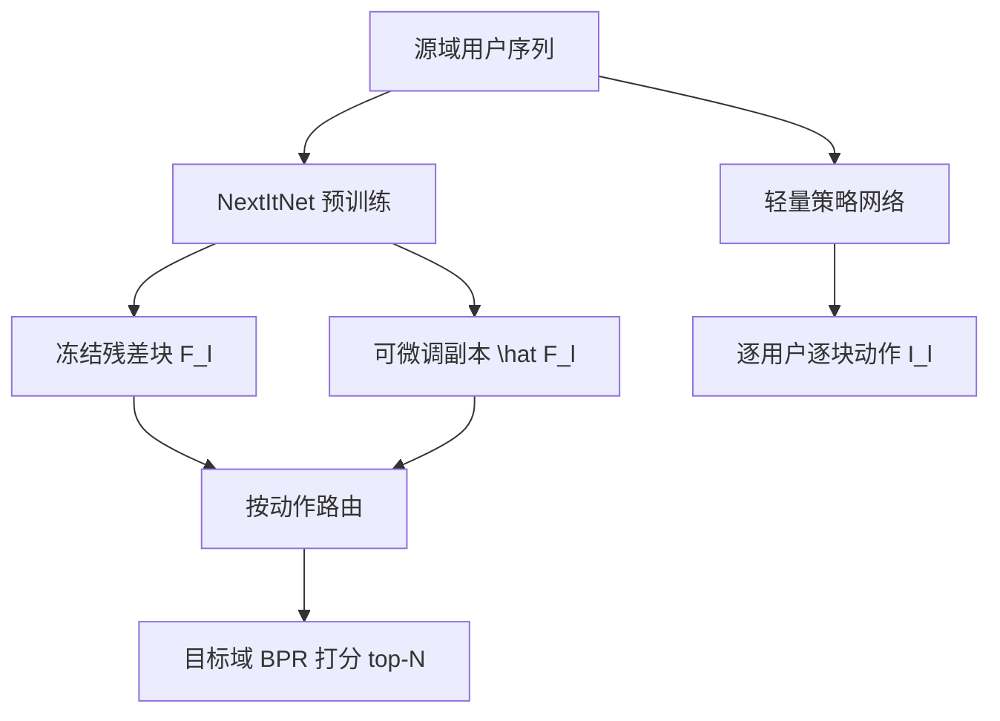
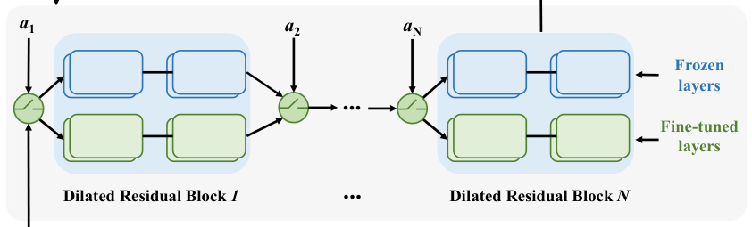

# User-specific Adaptive Fine-tuning for Cross-domain Recommendations (用户级自适应微调的跨域推荐)

- **会议/期刊**: IEEE TKDE
- **作者与机构**: Lei Chen, Fajie Yuan, Jiaxi Yang, Xiangnan He, Chengming Li, Min Yang；SIAT-CAS、西湖大学、HUST、USTC
- **推荐链路定位**: 召回/精排（序列 next-item top-N）
- **研究方向**: 跨域与多场景推荐 / 冷启动与长尾推荐
- **论文原文**: [https://arxiv.org/abs/2106.07864v2](https://arxiv.org/abs/2106.07864v2)
- **开源代码**: [PeterRec 基线代码](https://github.com/fajieyuan/sigir2020)（UAF 暂未开源）

## TL;DR (1分钟核心速览)

针对跨域冷启动中“全局微调策略对所有用户一视同仁”的痛点，本文在源域预训练 NextItNet 后，为每个目标域用户学习轻量策略网络：逐残差块决定冻结预训练参数还是启用可微调副本，并给出 Hard(Gumbel)、Soft(门控)、RL(SCST) 三种实现。四个 Tencent 冷启动数据集、目标域随机 80/5/15 划分、MRR@5/HR@5 下，UAF 相对最强基线最高提升 MRR 2.03%、HR 2.54%。

## Background & Motivation (背景与核心矛盾)

- **主流范式**: CDR 常用“源域预训练 + 目标域微调”；PeterRec 用 adapter 只训小网络，避免目标域数据稀缺时全参数微调过拟合。
- **前人局限**: 现有方法做**全局**冻结/微调决策，忽略用户与源域相似度差异；全量微调易过拟合，全冻结或固定 adapter 又可能在弱相关域产生负迁移。
- **核心洞察 (Key Insight)**: 不同用户应拥有不同层复用策略：与源域接近的用户多冻结，差异大的用户多微调；层利用率应随用户与数据集变化。
- **本文切入点**: 用策略网络输出“每用户 × 每残差块”的 freeze/fine-tune 路由。

## Method (核心方法设计)

### 1. 整体框架 (Overall Architecture)

两阶段：源域用 NextItNet 的因果膨胀卷积与残差块做自监督 next-item 预训练，得到通用用户序列表征；目标域复制每个残差块为可训练副本，原块冻结，策略网络读取源域序列，为每个用户输出 8 个残差块的动作，按动作路由后接目标域 softmax，用 BPR 训练。Hard/Soft/RL 仅在离散动作采样与梯度估计上不同；推理时策略网络贪心给出路由，只前向被选块。

<figure class="paper-figure" markdown="span">
  <figcaption>图 2. 模型架构。所提出的 UAF 包含两个模块：预训练（上方）和微调（下方）。在预训练模型中，我们在源数据集上学习基础网络（NextItNet），以学习通用用户表征。在微调模型中，我们学习一种用户特定的自适应微调策略，通过策略网络按用户自动选择预训练模型的可复用参数。</figcaption>
</figure>
图 2：UAF 的源域预训练与目标域用户级自适应微调框架。

### 2. 关键设计拆解 (Key Designs)

1. **用户级层路由**：痛点来自全局微调忽略用户异构性。第 $l$个残差块输出改为$E_l^u=I_l(E^u)\hat{F}_l(E_{l-1}^u)+(1-I_l(E^u))F_l(E_{l-1}^u)+E_{l-1}^u$，其中$I_l(E^u)\in\{0,1\}$ 由策略网络按用户采样。这样同一模型可为不同用户保留不同比例的源域参数。

2. **三种策略优化**：Hard 用 Gumbel-Softmax 解决不可导：$z=\mathrm{onehot}(\arg\max_i(g_i+\log\pi_i))$，反向用$\alpha_i=\frac{\exp((\log\pi_i+g_i)/\tau)}{\sum_j\exp((\log\pi_j+g_j)/\tau)}$，默认$\tau=10$；Soft 用门控$I_l(E^u)=\sigma(W_p h_p+b_p)$加权融合冻结与微调块；RL 用 SCST，奖励$R(A)=1-(\sum_l\mathbb{I}(A_l)/N)^2$（推荐正确时），错误时$-\gamma$，兼顾效果与少微调块。

3. **训练目标、负采样与推理效率**：目标域用 BPR：$\mathcal{L}_{\mathrm{BPR}}=-\sum_{(u,y)\in T}\log\sigma(o_{y^+}-o_{y^-})$，负例从$Y\setminus\{y^+\}$均匀随机采样；Hard/Soft 端到端联合训练策略与路由，RL 加$\mathcal{L}=\mathcal{L}_{\mathrm{BPR}}+\beta\mathcal{L}_{\mathrm{RL}}$，默认$\beta=1$。推理仅运行 4 层轻量策略网络并贪心选块，避免全模型微调；但训练需维护副本块，显存与调参开销高于普通微调。

## Experimental Setup & Evaluation Protocol (实验设置与评估协议)

- **数据集与预处理**: 四个 Tencent 跨域冷启动数据集，目标域用户交互极少；原文按实例统计，未披露用户数。C1–C4 即 ColdRec-1–4。

| 数据集 | #Users | 源域 #Items | 源域 #Instances | 目标域 #Items | 目标域 #Instances | 目标域冷度 |
| :--- | :---: | :---: | :---: | :---: | :---: | :--- |
| ColdRec-1 | — | 191,022 | 1,649,095 | 20,343 | 3,798,114 | ≤3 交互，半数仅 1 次 |
| ColdRec-2 | — | 645,981 | 1,472,428 | 17,880 | 2,947,688 | ≤5 交互 |
| ColdRec-3 | — | 11,349 | 22,360 | 162 | 24,643 | 90% 用户仅 1 次点击 |
| ColdRec-4 | — | 52,171 | 340,858 | 6,288 | 1,267,117 | ≤5 点击 |

- **数据划分与防穿越**: 目标域随机 80%/5%/15% 训练/验证/测试，非 `Leave-One-Out`、非全局时间切分；源域全量预训练。随机划分可能让同一用户交互跨集，冷启动评估偏乐观。
- **排名评测协议**: 采用 HR@5、MRR@5；训练为 BPR 随机负采样。测试候选规模原文未明示，沿用 PeterRec 协议，复现需核对 Full-Ranking 或 Sampled Ranking 及正负比。
- **对比基线与超参**: Finetune-Zero/CLS/Last1/Last2/All、MTL、PeterRec；$d=128$，Adam lr$=10^{-4}$，batch$=256$，kernel$=3$，backbone 16 膨胀层/8 残差块，policy 4 层；ColdRec-2/3/4 提升 paired t-test$p<0.01$。

## Key Experimental Results (实验关键数据)

### 1. 主实验对比 (Main Results)

| 模型 | C1 MRR | C1 HR | C2 MRR | C2 HR | C3 MRR | C3 HR | C4 MRR | C4 HR |
| :--- | :---: | :---: | :---: | :---: | :---: | :---: | :---: | :---: |
| Finetune-Zero | 0.2332 | 0.4013 | 0.3632 | 0.5464 | 0.1174 | 0.2150 | 0.1929 | 0.3257 |
| Finetune-CLS | 0.2419 | 0.4124 | 0.3712 | 0.5547 | 0.0909 | 0.1657 | 0.1935 | 0.3283 |
| Finetune-Last1 | 0.2546 | 0.4307 | 0.3864 | 0.5724 | 0.1062 | 0.1918 | 0.2032 | 0.3433 |
| Finetune-Last2 | 0.2575 | 0.4337 | 0.3885 | 0.5753 | 0.1176 | 0.2118 | 0.2073 | 0.3485 |
| Finetune-All | 0.2565 | 0.4345 | 0.3880 | 0.5758 | 0.1185 | 0.2192 | 0.2077 | 0.3495 |
| MTL | 0.2410 | 0.4114 | 0.3633 | 0.5468 | 0.1169 | 0.2181 | 0.2093 | 0.3527 |
| PeterRec | 0.2578 | 0.4356 | 0.3886 | 0.5763 | 0.0993 | 0.1795 | 0.2117 | 0.3550 |
| UAF-Hard | 0.2594 | 0.4378 | 0.3940 | 0.5824 | 0.1190 | **0.2212** | **0.2151** | **0.3640** |
| UAF-Soft | **0.2600** | **0.4397** | 0.3939 | **0.5841** | **0.1209** | 0.2189 | 0.2140 | 0.3613 |
| UAF-RL | 0.2599 | 0.4386 | **0.3942** | 0.5837 | 0.1196 | 0.2197 | 0.2142 | 0.3619 |

相对最强基线（C1/C2/C4 为 PeterRec，C3 为 Finetune-All）的 MRR/HR 相对提升：C1 +0.85%/+0.94%，C2 +1.44%/+1.35%，C3 +2.03%/+0.91%，C4 +1.61%/+2.54%。

### 2. 消融实验 (Ablation Study)

| 设定 | C1 MRR | C1 HR | C2 MRR | C2 HR | C3 MRR | C3 HR | C4 MRR | C4 HR |
| :--- | :---: | :---: | :---: | :---: | :---: | :---: | :---: | :---: |
| UAF-Random | 0.2562 | 0.4346 | 0.3917 | 0.5796 | 0.1172 | 0.2158 | 0.2123 | 0.3587 |
| UAF-Hard | 0.2594 | 0.4378 | 0.3940 | 0.5824 | 0.1190 | 0.2212 | 0.2151 | 0.3640 |
| UAF-Soft | 0.2600 | 0.4397 | 0.3939 | 0.5841 | 0.1209 | 0.2189 | 0.2140 | 0.3613 |
| UAF-RL | 0.2599 | 0.4386 | 0.3942 | 0.5837 | 0.1196 | 0.2197 | 0.2142 | 0.3619 |
| 10% Finetune-All | 0.1857 | 0.3366 | 0.2915 | 0.4533 | — | — | — | — |
| 10% PeterRec | 0.1999 | 0.3562 | 0.2938 | 0.4557 | — | — | — | — |
| 10% UAF-Hard | 0.2120 | 0.3714 | 0.3025 | 0.4651 | — | — | — | — |
| 10% UAF-RL | **0.2125** | **0.3721** | 0.3023 | **0.4655** | — | — | — | — |

### 3. 关键实验发现 (Key Findings)

1. **全局策略会负迁移**：C3 上 PeterRec 的 HR@5 仅 0.1795，低于 Finetune-All 的 0.2192；UAF-Hard 达 0.2212。源/目标弱相关时，全冻结 adapter 不如按用户保留/更新层。
2. **收益来自路由而非随机或特定编码器**：C1 上 UAF-Hard MRR 0.2594 vs UAF-Random 0.2562；图 3 显示各数据集块利用率不同且均 <1，未全盘微调；将 policy 换成 GRU 后 C1 MRR 0.2591，与 0.2594 几乎持平。
3. **小样本更稳**：仅用 10% 目标训练数据，C1 UAF-RL MRR 0.2125 vs PeterRec 0.1999（+6.3% 相对），HR 0.3721 vs 0.3562；C2 MRR 0.3023 vs 0.2938。学习曲线显示 Finetune-All 约 5 epoch 后下滑，UAF 到 9 epoch 仍升，冻结层抑制过拟合。

## Highlights & Limitations (亮点、对比与审稿批判)

- **与代表作对比**: PeterRec 全局固定预训练层 + adapter；Finetune-All/LastN 全局决定微调层；MTL 联合训练代价高且目标域非最优。UAF 首次把“层选择”做成用户级离散策略，兼顾复用与个性化。
- **可迁移亮点**: 可将“每用户层/模块路由”迁移到 LLM4Rec 的 adapter 选择、跨域冷启动及多场景多任务精排；Gumbel/SCST 也可用于不可导的结构决策。
- **审稿级局限批判**: 四个数据集均来自 Tencent，C3/C4 非公开，随机划分非时间切分，测试候选协议未明示，外部有效性有限；每用户策略与副本块带来训练显存和在线路由开销，论文未给延迟/存储评估。

## Rating (四维评分)

- **方法创新性 (Novelty)**: ⭐⭐⭐⭐ （首次将 CDR 微调做成用户级层路由，三种离散策略完整；但 Gumbel/SCST/NextItNet 均为已有组件组合）
- **评估协议与实验扎实度 (Protocol & Experiments)**: ⭐⭐⭐ （四数据集、多基线、10% 小样本与过拟合分析充分；但私有数据、非时间切分、测试候选规模不清，复现性受限）
- **写作与数学规范度 (Clarity & Rigor)**: ⭐⭐⭐⭐ （框架与公式清晰，Hard/Soft/RL 对比明确；部分超参与评测细节略简）
- **工业落地与复现价值 (Industrial & Practical Value)**: ⭐⭐⭐⭐ （直接面向 Tencent 冷启动场景，策略网络轻量；但 UAF 未开源，用户级路由与块副本的工程成本需评估）

