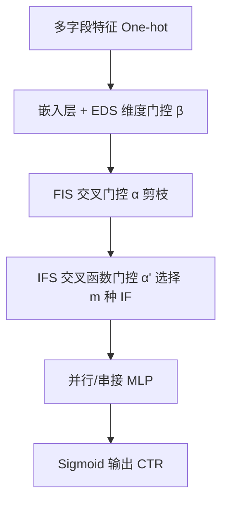
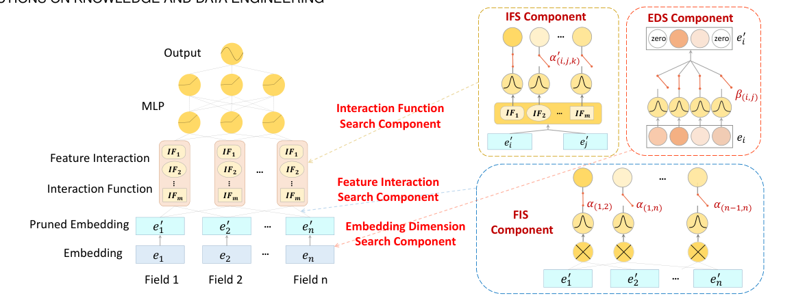

# AIM: Automatic Interaction Machine for Click-Through Rate Prediction (自动交叉机：面向点击率预估的自动化特征交叉框架)

- **会议/期刊**: IEEE TKDE 2021（AutoFIS 的期刊扩展版）
- **作者与机构**: Chenxu Zhu, Bo Chen, Weinan Zhang(通讯), Jincai Lai, Ruiming Tang, Xiuqiang He, Zhenguo Li, Yong Yu（上海交通大学 & 华为诺亚方舟实验室）
- **推荐链路定位**: 精排（CTR 预估打分）
- **研究方向**: CTR/CVR 预估与特征交叉
- **论文原文**: [https://arxiv.org/abs/2111.03318v2](https://arxiv.org/abs/2111.03318v2)
- **开源代码**: [https://github.com/zhuchenxv/AIM](https://github.com/zhuchenxv/AIM)

## TL;DR (1分钟核心速览)

主流深度 CTR 模型存在三处"一刀切"：交叉项靠人工设计或穷举、所有交叉共用同一交叉函数(IF)、所有特征共享同一嵌入维度。AIM 用门控架构参数 $\alpha,\alpha',\beta$把"选交叉 / 选交叉函数 / 选嵌入维度"统一松弛为可微连续搜索，配 GRDA 的$L_1$稀疏化自动置零剪枝，并给出$O(n^2)$ 的高阶交叉候选池生成法。在 Avazu / Criteo / 华为私有集上按 AUC、LogLoss 点式评估，AIM 相对 IPNN 提升 0.66% / 0.21%，线上三周 A/B 对 DeepFM 提升 CTR 4.4%。

## Background & Motivation (背景与核心矛盾)

- **主流范式**: FM 家族（FM/DeepFM/IPNN/xDeepFM）以嵌入层 + 内积交叉层 + MLP 建模二阶/显式高阶交叉；AutoML 侧 AutoFIS、AutoGroup 只做交叉选择，AutoDim、AutoEmb 只做维度搜索。
- **前人局限①**: 交叉项靠穷举（xDeepFM 的 CIN 参数爆炸）或人工指定（Wide&Deep），无用交叉引入噪声致过拟合，搜索空间 $2^{C_n^2}$ 属 NP-Hard。
- **前人局限②③**: 所有交叉共用单一 IF，不同映射子空间下的交叉模式被强行同构；所有特征共用维度 $d$，高预测力特征欠表达、低预测力特征浪费内存。
- **核心洞察 (Key Insight)**: 交叉的"是否保留""用哪种函数""维度留多少"本质是同一类门控开关问题，可用 DARTS 式可微松弛 + 稀疏正则联合求解，且 BN 能解耦门控值与交叉幅度的量纲耦合。
- **本文切入点**: 一个统一门控框架中串行搜索 FIS → IFS → EDS，再以搜索结果为结构重训。

## Method (核心方法设计)

### 1. 整体框架 (Overall Architecture)

输入多字段 one-hot 特征经嵌入层（EDS 控制的变长维度）得到 $E'$，进入交叉层；交叉层由 FIS 的门控决定保留哪些交叉项，再由 IFS 为每个交叉项选择具体 IF（内积/外积/向量核/标量核），其输出与 MLP 并行（DeepFM 式）或串接（IPNN 式）后过 sigmoid。训练分三阶段：Search interaction-IF 阶段同时学$\alpha,\alpha'$；Search embed 阶段固定交叉结构学$\beta$；Re-train 阶段用剪枝后的结构与维度从零重训。之所以拆开，是因为$\alpha'$与$\beta$ 的架构参数存在耦合，联合训练不稳定。线上部署为简化版，推理延迟反而低于 DeepFM。

<figure class="paper-figure" markdown="span">
  <figcaption>图 1. Automatic Interaction Machine（AIM）的架构。</figcaption>
</figure>

### 2. 关键设计拆解 (Key Designs)

1. **FIS：把交叉选择变成加权的内积和 + $L_1$稀疏**：痛点是不知哪个交叉有用。做法是给每个二阶交叉挂架构参数，$\ell_{FIS}=\langle w,x\rangle+\sum_{i<j}\alpha_{(i,j)}\langle e_i,e_j\rangle$，$\alpha_{(i,j)}=0$即关门。关键在于对每个$\langle e_i,e_j\rangle$先做 BN（scale/shift 固定为 1 和 0），消除交叉幅度与$\alpha$的尺度耦合，否则$\alpha$无法代表"相对重要性"。高阶交叉采用两阶段法：先用 top-$k$的$(p-1)$阶交叉与一阶特征做笛卡尔积生成候选池$M^{tmp}_p$，再在池内跑 FIS，把$O(n^p)$降到$O(n^2)$。

2. **IFS 与函数专属嵌入 (FWE)**：$\ell_{IFS}=\langle w,x\rangle+\sum_{i<j}\sum_{k=1}^{m}\alpha'_{(i,j,k)}f_k(e_{ik},e_{jk})$。若沿用共享嵌入，同一向量要同时接收内积、外积等不同映射空间的梯度，产生学习冲突；因此为每个 IF 复制一份嵌入$e_{ik}$，使每个嵌入只服务单一映射空间。代价是参数量约$\times m$，正好交由 EDS 回收。

3. **EDS、训练目标与推理效率**：$\beta\in\mathbb{R}^{n\times d}$逐维门控$e'_i=\beta_i\odot e_i$，搜索后$d_i=\sum_j\mathbb{I}[\beta_{ij}\neq 0]$并保留原维度位置（位置本身编码了与各交叉函数的对齐关系）；同字段的 FWE 共享$\beta$。总目标为交叉熵$\mathcal{L}=-y\log\hat{y}-(1-y)\log(1-\hat{y})$；架构参数用 GRDA（式 21，$L_1$近似 + 自适应稀疏强度$g(t,\gamma)=c\gamma^{1/2}(t\gamma)^{\mu}$）更新，网络权重用 Adam，无需人工指定保留比例，也无需负采样（点式二分类）。推理端剪枝掉约 80% 二阶交叉，Avazu 上推理 20 万样本 0.83s，低于 DeepFM 的 0.88s。

## Experimental Setup & Evaluation Protocol (实验设置与评估协议)

- **数据集与预处理**: 数值特征统一分桶离散化，多值字段用 multi-hot。

| 数据集 | #Users/实例 | #Features | #Fields | 正样本率 | 说明 |
| :--- | :---: | :---: | :---: | :---: | :--- |
| Avazu | $4\times10^{7}$|$6\times10^{5}$ | 24 | 0.17 | Kaggle CTR 公开赛 |
| Criteo | $1\times10^{8}$|$1\times10^{6}$ | 39 | 0.50 | 一个月点击日志 |
| Huawei | $3\times10^{8}$|$1\times10^{5}$ | 10 | 0.07 | AppGallery 一周采样 |

- **数据划分与防穿越**: Avazu 为随机打乱后 80%/20% 训练+验证/测试；Criteo 用 day 6–12 训练验证、day-13 测试（时间切分，防穿越）；华为私有集按周采样划分。
- **排名评测协议**: 本文是**点式二分类 CTR 评估**，指标为 AUC 与 LogLoss，不做 Full-Ranking 全库排序对比；所有实验用 5 个随机种子重复取均值，并对最优基线做双侧非配对 $t$检验（$p<0.005$）。
- **对比基线与超参**: 基线含 FM/FwFM/AFM/FFM/DeepFM/IPNN、FiGNN/AutoInt/xDeepFM、AutoFeature/AutoGroup/AutoFIS。嵌入维度 Avazu $d=40$、Criteo$d=20$，MLP 结构均为$700\times5$，GRDA 参数 Avazu$(c=0.05,\mu=0.6)$、Criteo$(c=0.005,\mu=0.9)$。

## Key Experimental Results (实验关键数据)

### 1. 主实验对比 (Main Results)

| 类别 | 模型 | Avazu AUC | Avazu LogLoss | Criteo AUC | Criteo LogLoss | Huawei AUC | Huawei LogLoss |
| :--- | :--- | :---: | :---: | :---: | :---: | :---: | :---: |
| FM 系 | FM | 0.7793 | 0.3805 | 0.7909 | 0.5500 | 0.8168 | 0.1939 |
| FM 系 | FFM | 0.7831 | 0.3781 | 0.7980 | 0.5438 | 0.8279 | 0.1900 |
| FM 系 | DeepFM | 0.7836 | 0.3776 | 0.7991 | 0.5423 | 0.8338 | 0.1878 |
| FM 系 | IPNN | 0.7868 | 0.3756 | 0.8013 | 0.5401 | 0.8363 | 0.1867 |
| 交叉网络 | xDeepFM | 0.7855 | 0.3766 | 0.8006 | 0.5408 | 0.8368 | 0.1865 |
| AutoML | AutoFeature | 0.7904 | 0.3737 | 0.8023 | 0.5390 | 0.8365 | 0.1861 |
| AutoML | AutoGroup | 0.7909 | 0.3732 | 0.8026 | 0.5386 | 0.8360 | 0.1860 |
| AutoML | AutoFIS | 0.7883 | 0.3748 | 0.8012 | 0.5402 | 0.8373 | 0.1864 |
| — | **AIM** | **0.7920** | **0.3727** | **0.8030** | **0.5379** | **0.8385** | **0.1858** |
| — | Improv. vs 最强基线 | +0.11% | −0.13% | +0.05% | −0.13% | +0.14% | −0.16% |

高阶交叉侧：AIM(3rd) 在 Avazu 取 0.7912、AIM(4th) 取 0.7920，仅保留约 2% 三阶与 0.3% 四阶交叉，相对 AIM(2nd) 再涨 0.27% / 0.37% AUC。

### 2. 消融实验 (Ablation Study)

| 变体 | FIS | IFS | EDS | Avazu AUC | Avazu LogLoss | Criteo AUC | Criteo LogLoss | 参数量($10^7$) Avazu |
| :--- | :---: | :---: | :---: | :---: | :---: | :---: | :---: | :---: |
| DeepFM | × | × | × | 0.7836 | 0.3776 | 0.7991 | 0.5423 | 2.9 |
| AIM-IFS-EDS | √ | × | × | 0.7869 | 0.3755 | 0.8015 | 0.5399 | — |
| AIM-EDS | √ | √ | × | 0.7894 | 0.3740 | 0.8024 | 0.5387 | 10.6 |
| AIM（全量） | √ | √ | √ | 0.7891 | 0.3742 | 0.8022 | 0.5388 | 3.8 |

### 3. 关键实验发现 (Key Findings)

1. **FIS 是主要收益源，且剪枝即加速**：仅加 FIS 就把 Avazu/Criteo 的 AUC 从 0.7836/0.7991 推到 0.7869/0.8015（相对 +0.42%/+0.30%），同时砍掉约 80% 二阶交叉，训练/推理都比 DeepFM 更快（AutoFIS 推理 0.59s vs DeepFM 0.88s）。
2. **IFS 靠"函数异构"而非更复杂网络取胜，但必须配 EDS 才能落地**：IFS 再贡献 +0.25%/+0.09% AUC，代价是参数量从 2.7→10.6（$\times3.9$）；EDS 将其压回 3.8，$\times2.79/\times3.16$ 压缩率下 AUC 仅掉 0.0003，几乎零损。
3. **"多函数"不是越多越好，与交叉的重要性正相关**：图 8 显示高 statistics-AUC 的交叉倾向于保留更多 IF，但随 IF 数量增加，边际 AUC 增益迅速消失（过拟合），说明逐交叉挑选优于统一全用。

## Highlights & Limitations (亮点、对比与审稿批判)

- **与代表作对比 (vs. Prior Work)**: AutoFIS 只解"选交叉"，且所有选中交叉共用内积、共享维度；AutoDim/AutoEmb 只解"选维度"却忽略交叉结构；AutoFeature 虽同时搜交叉与函数，但依赖进化算法 + Naive Bayes 树反复训模型，开销难以工业化。AIM 的差异在于三件事共用一套门控 + GRDA 稀疏范式，并额外解决 FWE 带来的参数膨胀。
- **可迁移亮点**: ①对交互项做 BN（scale/shift 固定）以解耦门控值与算子幅度的尺度耦合，这一技巧可直接搬到任何"带软门控的交叉/注意力打分"结构中；②两阶段 top-$k$ 候选池把高阶搜索从指数降为平方，可复用于高阶交叉、序列物品共现搜索。
- **审稿级局限批判**: ①三阶段串行搜索（$O(n^2)$候选池 + 三次训练）在 Avazu 上单卡仍要 ~155 分钟，且$\alpha'$与$\beta$的分离是工程妥协而非理论最优；②评估仅用点式 AUC/LogLoss，未给出全库排序或校准指标，线上也只报 CTR 相对提升 4.4%，缺少延迟 P99 与训练成本的定量代价分析；③EDS 保留维度位置的方式使嵌入维度不可跨字段对齐，对需要等长向量的 IF（如内积）只能补零，实际仍按$d$ 计算。

## Rating (四维评分)

- **方法创新性 (Novelty)**: ⭐⭐⭐⭐ （首次把交叉选择、交叉函数选择、嵌入维度搜索纳入统一可微门控框架，BN 解耦与 $O(n^2)$ 高阶池是实打实的增量）
- **评估协议与实验扎实度 (Protocol & Experiments)**: ⭐⭐⭐⭐ （三数据集 + 5 种子 + $t$ 检验 + 三周线上 A/B 完整，但缺少排序级指标与延迟/成本代价表）
- **写作与数学规范度 (Clarity & Rigor)**: ⭐⭐⭐⭐ （公式与三组件推导清晰、有复杂度分析，但 $\beta$ 位置映射与高阶 IF 展开细节散落各节，阶段拆分的必要性仅作经验解释）
- **工业落地与复现价值 (Industrial & Practical Value)**: ⭐⭐⭐⭐⭐ （代码开源、剪枝后推理快于 DeepFM、已上线 AppGallery 并带来 4.4% CTR 增益，工程可复现性极强）

