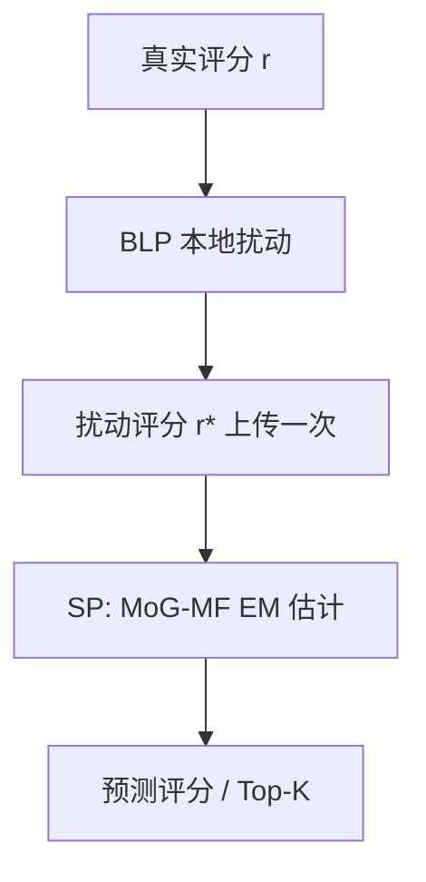
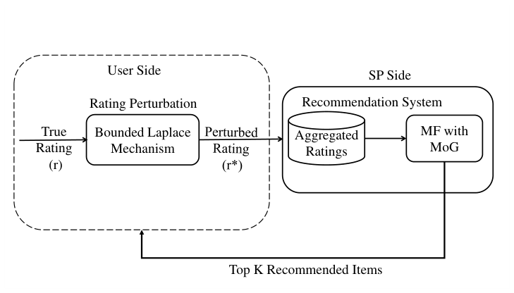

# Private and Utility Enhanced Recommendations with Local Differential Privacy and Gaussian Mixture Model (附中文直译：基于本地差分隐私与高斯混合模型的隐私与效用增强推荐)

- **会议/期刊**: IEEE TKDE
- **作者与机构**: Jeyamohan Neera, Xiaomin Chen, Nauman Aslam, Kezhi Wang, Zhan Shu；Northumbria University / University of Alberta
- **推荐链路定位**: 评分预测/召回（MF 缺失评分预测 + Top-K）
- **研究方向**: 去偏公平、可信隐私与工业架构 / 协同过滤
- **论文原文**: [https://arxiv.org/abs/2102.13453v2](https://arxiv.org/abs/2102.13453v2)
- **开源代码**: 暂未开源

## TL;DR (1分钟核心速览)

针对 LDP 本地加噪导致评分越界、MF 精度骤降的问题，本文在用户端用有界 Laplace（BLP）把扰动评分限制在评分域内，在服务端用 MoG-MF 对噪声残差建模并预测缺失评分。三数据集 10 折 CV、RMSE/Top-10 F-score 下，BLP-MoG-MF 优于 ISGD/PG-MF，图7报告 RMSE 相对降幅最高约 37%，且仅需单轮上传。

## Background & Motivation (背景与核心矛盾)

- **主流范式**: LDP 推荐在用户端对评分加 Laplace 噪声，服务端用 MF/CF 聚合扰动数据，保护用户不被不可信 SP 直接读取原始评分。
- **前人局限**: 标准 Laplace 噪声支撑为 $(-\infty,\infty)$，会产生负评分或超域评分，破坏 MF 的低秩结构；ISGD 用截断/clamp 处理越界值，但会引入偏差，PG-MF 则需多轮梯度交换。
- **核心洞察 (Key Insight)**: 若将噪声限制在评分域 $[l,u]$内，并显式建模扰动残差分布，可在不破坏$\epsilon$-LDP 的前提下恢复数据效用；LDP 的后处理免疫性允许 SP 端估计噪声。
- **本文切入点**: 用 BLP 做用户端输入扰动，用 MoG-MF 在 SP 端估计聚合噪声并做加权矩阵分解。

## Method (核心方法设计)

### 1. 整体框架 (Overall Architecture)

用户端对每个真实评分 $r$用 BLP 采样扰动评分$r^*$，仅上传一次；服务端将扰动矩阵视为真实低秩信号叠加混合高斯噪声，EM 交替估计责任度、混合权重/方差与加权 MF 的$\mathbf{U},\mathbf{V}$，收敛后以$\hat{r}_{ij}=\mathbf{u}_i^\top\mathbf{v}_j$预测缺失评分并生成 Top-K。BLP 保证$\epsilon$-LDP，MoG 估计属于后处理，不额外泄露。

<figure class="paper-figure" markdown="span">
  <figcaption>图1. 基于LDP的MoG-MF推荐</figcaption>
</figure>

### 2. 关键设计拆解 (Key Designs)

1. **有界 Laplace 扰动（BLP）**：痛点在于 Laplace 越界值无物理意义且污染 MF；BLP 采用条件化/拒绝采样，使 $r^*\in[l,u]$，密度为$f_W(r^*)=\frac{1}{C(r)}\frac{1}{2b}e^{-|r^*-r|/b}$，其中$C(r)=1-\frac{1}{2}(e^{-(r-l)/b}+e^{-(u-r)/b})$。作者证明充分条件$b\ge \Delta f/(\epsilon-\log\Delta_C)$；当$\Delta f=u-l,\Delta_C=1$时化为$b\ge(u-l)/\epsilon$，从而在域约束下满足$\epsilon$-LDP。

2. **MoG-MF 噪声估计**：痛点在于逐评分扰动使误差随用户/物品数累积；本文将扰动评分建模为 $p(r_{ij}^*|\mathbf{u}_i,\mathbf{v}_j,\Pi,\Sigma)=\sum_{k=1}^K\pi_k\mathcal{N}(r_{ij}^*|\mathbf{u}_i^\top\mathbf{v}_j,\sigma_k^2)$，用 K 个零均值高斯解释不同噪声强度。EM 的 E 步算$\gamma_{ijk}$，M 步更新$\pi_k,\sigma_k^2$并求解加权 MF：$\min_{\mathbf{U},\mathbf{V}}\sum_{i,j\in\Omega}w_{ij}(r_{ij}^*-\mathbf{u}_i^\top\mathbf{v}_j)^2$，$w_{ij}=\sqrt{\sum_k\gamma_{ijk}/(2\sigma_k^2)}$。高噪声评分权重降低，等价于鲁棒加权低秩恢复。

3. **训练目标、负采样与推理效率**：总目标为 $\max_{\mathbf{U},\mathbf{V},\Pi,\Sigma}\sum_{i,j\in\Omega}\log\sum_{k=1}^K\pi_k\mathcal{N}(r_{ij}^*|\mathbf{u}_i^\top\mathbf{v}_j,\sigma_k^2)$。显式评分场景无负采样，仅用观测评分；推理为$O(d)$点积，SP 端 EM 每轮约$O(|\Omega|Kd)$。用户仅上传一次扰动评分，避免 PG-MF 的多轮 SP→用户传输。

## Experimental Setup & Evaluation Protocol (实验设置与评估协议)

- **数据集与预处理**: 原文未说明过滤，保留原始评分；统计如下。

| 数据集 | #Users | #Items | #Interactions | 稀疏度/密度 | 特征/场景说明 |
| :--- | :---: | :---: | :---: | :---: | :--- |
| Movielens | 943 | 1,682 | 100k | ~6.30% | 0.5–5 星电影评分 |
| Jester | 73,421 | 100 | 2M | ~27.2% | -10–10 笑话评分 |
| Libimseti | 135,359 | 168,791 | 17,359,346 | ~0.076% | 1–10 约会评分，高稀疏 |

- **数据划分与防穿越 (Splitting Strategy)**: 采用 10 折交叉验证计算 RMSE；未见全局时间戳切分或冷启动划分。
- **排名评测协议 (Ranking Protocol)**: 非 Full-Ranking/Sampled Ranking；主指标为评分预测 RMSE 与 Top-10 F-score，未报告 NDCG/HR 等全库排序指标。
- **对比基线与超参设置**: 对比 Non-Private MF（下界）、PG-MF、ISGD；组件对比含 Laplace+MF、BLP+SVD、MoG+SVD 等。隐私预算 $\epsilon\in[0.1,3]$。原文未报告 MF 维度$d$、MoG 分量数$K$ 及显著性检验，复现性受限。

## Key Experimental Results (实验关键数据)

### 1. 主实验对比 (Main Results)

原文主结果以图 5–8 呈现，未给精确表格值；下表汇总可复核趋势与图7标注的 RMSE 相对降幅（vs ISGD，低/高 $\epsilon$ 端点）。

| 方法 | 隐私/通信 | Movielens RMSE | Jester RMSE | Libimseti RMSE | Top-10 F-score |
| :--- | :--- | :---: | :---: | :---: | :---: |
| Non-Private MF | 无隐私/下界 | 最低 | 最低 | — | — |
| PG-MF | 梯度扰动/多轮 | 高于本文 | — | — | 低于本文 |
| ISGD | Laplace+clamp/单轮 | 高于本文 | 高于本文 | 高于本文 | 低于本文 |
| Laplace-MF | Laplace/单轮 | 高于BLP-MF | 高于BLP-MF | — | — |
| BLP-SVD | BLP/单轮 | 高于BLP-MoG | 高于BLP-MoG | — | — |
| **BLP-MoG-MF** | **BLP+MoG/单轮** | **较ISGD降16–21%** | **降28–35%** | **降29–37%** | **私有方法最高** |

### 2. 消融实验 (Ablation Study)

| 变体 | RMSE 趋势 | 归因 |
| :--- | :---: | :--- |
| Full: BLP+MoG-MF | 最低私有RMSE | 域约束+噪声建模互补 |
| w/o BLP: Laplace+MoG-MF | 升高 | 越界噪声破坏低秩结构 |
| w/o MoG: BLP+SVD | 升高，低 $\epsilon$ 更明显 | 未建模异质噪声 |
| w/o both: Laplace+SVD | 最高 | 两组件均必要 |

### 3. 关键实验发现 (Key Findings)

1. **BLP 的域约束稳定有效**：图3在 Movielens/Jester 与 MoG/SVD 两种预测器下，BLP 均比 Laplace 的 RMSE 更低，说明拒绝越界值比事后 clamp 更少引入偏差。
2. **MoG 在强隐私下收益更大**：图4显示 $\epsilon$ 较小时 MoG-MF 明显优于 SVD；EM 责任度使高噪声评分获得更低权重，缓解 LDP 噪声累积。
3. **精度与通信同时占优**：图7报告相对 ISGD 的 RMSE 降幅约 16–37%；相较 PG-MF，本文无需每轮 0.15MB 的 SP→用户传输，作者按“每评分 1 bit”计通信。

## Highlights & Limitations (亮点、对比与审稿批判)

- **与代表作对比 (vs. Prior Work)**: 相比 ISGD 的 Laplace+clamp，BLP 从分布层面消除越界；相比 PG-MF 的迭代梯度交换，本文单轮上传且 SP 端后处理不破坏 LDP；相比 Berlioz 等对扰动阶段的分析，本文给出 BLP 的 LDP 充分条件并联合 MoG 去噪。
- **可迁移亮点**: BLP 可迁移到任何有界反馈（评分、满意度、问卷）的本地隐私采集；MoG 加权 MF 可视为“噪声感知”的鲁棒矩阵分解模板。
- **审稿级局限批判**: 其一，评估仅 RMSE/Top-10 F-score，缺少全库排序、NDCG 与显著性检验，且未给 $d,K$ 等关键超参；其二，BLP 拒绝采样与 SP 端 EM 的计算开销未量化，“1 bit/评分”通信假设偏理想化，且无开源代码。

## Rating (四维评分)

- **方法创新性 (Novelty)**: ⭐⭐⭐⭐ （首次将 BLP 引入 LDP 推荐并给出 $\epsilon$-LDP 充分条件，MoG-MF 去噪思路清晰）
- **评估协议与实验扎实度 (Protocol & Experiments)**: ⭐⭐⭐ （三数据集与多 $\epsilon$ 扫描较完整，但仅有图结果、缺精确表值与显著性检验）
- **写作与数学规范度 (Clarity & Rigor)**: ⭐⭐⭐ （定理与证明较完整，但符号/图注有个别不一致，超参报告不足）
- **工业落地与复现价值 (Industrial & Practical Value)**: ⭐⭐⭐ （单轮通信与后处理兼容利于部署，但 EM/拒绝采样开销与无代码限制复现）

