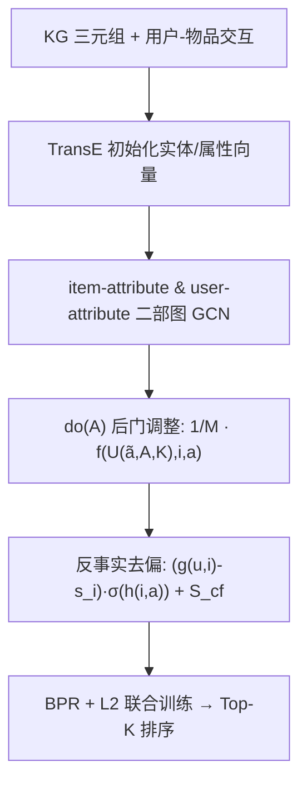
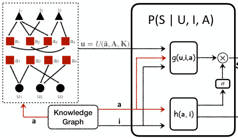

# Causal Inference for Knowledge Graph based Recommendation (基于因果推断的知识图谱推荐)

- **会议/期刊**: IEEE TKDE 2023
- **作者与机构**: Yinwei Wei, Xiang Wang, Liqiang Nie, Shaoyu Li, Dingxian Wang, Tat-Seng Chua (NUS / USTC / 山东大学 / eBay)
- **推荐链路定位**: 精排（属性级相似度打分 + CF 打分融合）
- **研究方向**: 图神经网络与知识图谱推荐 / 去偏公平与因果推荐
- **论文原文**: [https://arxiv.org/abs/2212.10046v1](https://arxiv.org/abs/2212.10046v1)
- **开源代码**: [https://github.com/weiyinwei/KGCR](https://github.com/weiyinwei/KGCR)

## TL;DR (1分钟核心速览)

KG 推荐主流做法（KGAT/KGIN）把 KG 结构信息压缩进用户/物品表征，但**无法建模用户对属性实体（导演、品牌、流派）的细粒度偏好**。KGCR 用因果图指出两处病灶：KG 结构 $K$作为**混淆子**在$U \leftarrow K \rightarrow A$上打开后门路径，造成属性偏好学习的伪相关；用户交互属性$A$到得分$S$的**直接捷径**$A \to S$ 造成相似度打分偏差。作者用 do-calculus 后门调整实现去混淆的属性偏好学习，用反事实推断扣除自然直接效应（NDE）去偏。Amazon-book / LastFM / Yelp2018 在全库排序协议下 Recall@20 相对最强基线 KGIN 分别提升 3.79% / 5.93% / 6.66%，NDCG@20 提升 3.72% / 4.13% / 7.47%。

## Background & Motivation (背景与核心矛盾)

- **主流范式**: 将 item 映射为 KG 中的 item entity，通过 KGE（CKE/KTUP）、路径传播（RippleNet）或 GCN 消息传递（KGAT/KGIN）把知识信息注入用户与物品表征，再用内积打分。
- **前人局限**: ① KG 结构信息决定"哪些属性与物品相连、如何缠绕"，仅凭交互无法区分用户对同一物品上多个属性的偏好，表征被结构"绑架"；② 用户历史交互过的属性会与候选物品在 KG 中形成**多重短路**，属性越多的物品越容易被高分，绕过真正的属性偏好。
- **核心洞察 (Key Insight)**: 将上述现象统一到五变量因果图 $(U, I, A, K, S)$：$K$作混淆子导致$U \leftarrow K \rightarrow A$的伪相关；$A \to S$ 的直接边即打分歧视的"捷径"。
- **本文切入点**: 对 $A$做干预切断$K \to A$（去混淆），再以反事实扣除$A \to S$ 的 NDE（去偏）。

## Method (核心方法设计)

### 1. 整体框架 (Overall Architecture)

先用 TransE 在 KG 上预训练实体/关系向量以初始化物品与属性表征；随后构建 **item-attribute** 与 **user-attribute** 两个二部图，各做 $l$层线性 GCN 传播，聚合结构信息得到属性级用户偏好$u$与属性表征$a$。打分端将"用户-物品语义相似$g(u,i)$"与"物品-交互属性亲和$h(i,a)$"做乘法融合，并与纯 CF 的$S_{u,i}^{cf}$相加得到最终预测。训练用 BPR 主损失 + 属性亲和间隔损失$L_2$；推理时对属性偏好分做反事实去偏（$g(u,i)-s_i$）后再融合。

<figure class="paper-figure" markdown="span">
  <figcaption>图3. 我们所提模型的示意图。</figcaption>
</figure>

### 2. 关键设计拆解 (Key Designs)

1. **do 干预下的去混淆偏好学习（Causal Intervention）**: 病灶是后门路径 $U \leftarrow K \rightarrow A$使$P(U|A)$学到伪相关。作者对$A$施加$do(A=a)$切断$K\to A$并做后门调整$P(S|U=u,I=i,do(A=a))=\sum_{k}P(S|U(a,k),i,a)P(k)$；由于$K$样本空间近无穷，采用 NWGM 近似把外层求和移入线性函数内部，并假设每物品被等概率采样（$1/M$），最终得$P(S|\cdot)\approx\frac{1}{M}f(U(\tilde{a},A,K),i,a)$。直觉：强迫每个交互属性和**所有物品结构**公平交互，打破"属性被特定物品缠绕"的捷径。

2. **反事实推理扣除属性捷径偏差（Counterfactual Debiasing）**: 病灶是 $A \to S$直接效应提供违背偏好$U$的短路。作者在事实世界估计总效应$TE=S_{u,i,a}-S_{u^*,i,a^*}$，在反事实世界（对$U$做$do(U=u^*)$）估计自然直接效应$NDE=S_{u^*,i,a}-S_{u^*,i,a^*}$，二者相减得总间接效应：
$$TIE = TE-NDE = \big(g(u,i)-s_i\big)\,\sigma\big(h(i,a)\big)$$
其中 $s_i$由$g(u,i)$ 的用户均值估计。物理直觉：把"仅由属性亲和带来的虚高得分"整体减掉，只保留真正源于用户偏好差异的分数。

3. **乘法融合打分与双损失训练**: 打分函数 $S_{u,i,a}=f(u,i,a)=g(u,i)\,\sigma(h(i,a))$，其中$g(u,i)=u\cdot i^{\top}$、$h(i,a)=i\cdot a^{\top}$且$a=\frac{1}{M}\sum_{a\in\mathcal{A}}a$；σ 提供非线性容量。总损失$\mathcal{L}=\mathcal{L}_1+\alpha\mathcal{L}_2+\|\Theta\|_2^2$，$\mathcal{L}_1$为融合属性分与 CF 分的 BPR 排序损失，$\mathcal{L}_2=\max(0,\sigma(S_{i,a})-\sigma(S_{j,a})-m)$约束正负物品的属性亲和分差落在区间$m$ 内。负采样为每正样本**均匀采 1 个未交互负例**，推理时无额外开销（仅需一次 GCN 前向 + 内积）。

## Experimental Setup & Evaluation Protocol (实验设置与评估协议)

- **数据集与预处理**: 沿用 KGAT 提供的三套标准划分，无额外 5-core 过滤说明：

| 数据集 | #Users | #Items | #Interactions | #Entities | #Relations | #Triplets | 场景 |
| :--- | :---: | :---: | :---: | :---: | :---: | :---: | :--- |
| Amazon-book | 70,679 | 24,915 | 847,733 | 88,572 | 39 | 2,557,746 | 图书 |
| LastFM | 23,566 | 48,123 | 3,034,796 | 58,266 | 9 | 464,567 | 音乐 |
| Yelp2018 | 45,919 | 45,538 | 1,185,068 | 90,961 | 42 | 1,853,704 | 本地商家 |

- **数据划分与防穿越**: 采用 KGAT 官方 train/test 划分（比例切分，非严格时间戳），训练集每条交互配 1 个随机负例。
- **排名评测协议**: **Full-Ranking 全库排序**——对每个用户将其训练期所有未交互物品（含 ground-truth）作为候选打分降序排列，报告 Recall@20 与 NDCG@20 的用户均值，无采样近似偏差。
- **对比基线与超参**: 8 个基线覆盖嵌入类（CKE/RippleNet/KTUP/MKR）、GCN 类（KGNN-LS/CKAN/KGAT/KGIN）；所有模型 id 与实体维度统一 $d=64$，GCN 三层，学习率/正则从$\{10^{-4},10^{-3},10^{-2},10^{-1}\}$ 网格搜索，与 KGAT 同款早停（Recall@20 连续 10 轮不升即停）。

## Key Experimental Results (实验关键数据)

### 1. 主实验对比 (Main Results)

| Model | Amazon-book R@20 | Amazon N@20 | LastFM R@20 | LastFM N@20 | Yelp R@20 | Yelp N@20 |
| :--- | :---: | :---: | :---: | :---: | :---: | :---: |
| CKE | 0.1343 | 0.0698 | 0.0736 | 0.0630 | 0.0651 | 0.0414 |
| RippleNet | 0.1336 | 0.0691 | 0.0791 | 0.0684 | 0.0664 | 0.0428 |
| MKR | 0.1286 | 0.0676 | 0.0743 | 0.0642 | 0.0634 | 0.0409 |
| KGNN-LS | 0.1362 | 0.0560 | 0.0880 | 0.0642 | 0.0637 | 0.0402 |
| CKAN | 0.1442 | 0.0698 | 0.0812 | 0.0660 | 0.0604 | 0.0377 |
| KGAT | 0.1489 | 0.0799 | 0.0870 | 0.0744 | 0.0712 | 0.0443 |
| KGIN | 0.1687 | 0.0915 | 0.0978 | 0.0848 | 0.0736 | 0.0482 |
| **KGCR** | **0.1751** | **0.0949** | **0.1036** | **0.0883** | **0.0785** | **0.0518** |
| Improv.% | +3.79% | +3.72% | +5.93% | +4.13% | +6.66% | +7.47% |

### 2. 消融实验 (Ablation Study)

| 变体 | Amazon R@20 | Amazon N@20 | LastFM R@20 | LastFM N@20 | Yelp R@20 | Yelp N@20 |
| :--- | :---: | :---: | :---: | :---: | :---: | :---: |
| KGCR (full) | **0.1751** | **0.0949** | **0.1036** | **0.0883** | **0.0786** | **0.0518** |
| w/o DC (去混淆偏好) | 0.1565 | 0.0847 | 0.0867 | 0.0737 | 0.0721 | 0.0469 |
| w/o CI (反事实去偏) | 0.1716 | 0.0926 | 0.0996 | 0.0838 | 0.0774 | 0.0510 |
| w/o U-A (用户-属性图) | 0.1703 | 0.0924 | 0.0927 | 0.0742 | 0.0732 | 0.0476 |
| w/o I-A (物品-属性图) | 0.1662 | 0.0901 | 0.0955 | 0.0747 | 0.0750 | 0.0487 |

### 3. 关键实验发现 (Key Findings)

1. **去混淆偏好是性能主引擎**：移除 DC 造成 Amazon Recall 从 0.1751 骤降至 0.1565（-10.6%），降幅远超移除 CI（-2.0%），说明 $K$ 混淆子对属性表征的污染比打分偏差更致命；而 w/o CI 仍优于 KGIN，佐证去混淆单模块已提供净收益。
2. **结构信息并非越多越好**：移除 I-A 图（0.1662）比重移除 U-A（0.1703）下降更多，且 w/o U-A 反超 w/o DC，定量印证 $K\to A$ 的统计相关主要通过物品结构注入——这正是因果图所预言的后门效应方向。
3. **融合方式与损失需克制**：把 $h(\cdot)$换成 MLP 反而下降（Amazon 0.1735 vs 0.1751），印证 LightGCN"非线性变换无益"；$\mathcal{L}_2$用纯 LOG 形式最差（0.1630），因正负分差过大导致排序信号糊化，需用$\sigma$+margin 将分差约束在$m$区间内（$m\!\approx\!0.5$、$\alpha$ 偏大时最佳）。

## Highlights & Limitations (亮点、对比与审稿批判)

- **与代表作对比 (vs. Prior Work)**: KGAT 把 KG 与 U-I 图拼成整体图做注意力传播；KGIN 用意图分解建模细粒度意图但**不区分知识与协同信号的因果角色**；KGCR 首次把 KG 推荐拆成因果图，明确将"结构混淆"与"属性捷径"分别用干预与反事实处理，是范式层面的差异而非模块堆叠。
- **可迁移亮点**: ① NWGM 把无穷样本空间的后门求和近似为"等概率期望 + 线性函数"的套路，可直接复用到其他含离散混淆子的排序任务；② TE−NDE 扣除捷径偏差的推理期去偏，是一种**免重训、零额外前向**的轻量包装，便于线上部署。
- **审稿级局限批判**: ① 因果图变量（$K$的定义、$U$与$A$的可分性）依赖人工假设，缺乏图结构可识别性检验或对错误因果图的鲁棒性分析；② 去偏项依赖$s_i$ 的用户均值估计与线性函数假设，非线性打分下有偏；③ 实验仅在 KGAT 三套数据、单一 Full-Ranking 协议下进行，未涉及冷启动物品或长尾属性分桶，工业级稀疏场景泛化性未经检验。

## Rating (四维评分)

- **方法创新性 (Novelty)**: ⭐⭐⭐⭐ （首个把 KG 推荐拆成五变量因果图并用 do 干预 + 反事实两级去偏，理论视角新颖，但干预/反事实工具本身在因果推荐中已较成熟）
- **评估协议与实验扎实度 (Protocol & Experiments)**: ⭐⭐⭐⭐ （Full-Ranking 无偏协议 + 8 个强基线 + 4 组消融 + 案例分析，扎实；但缺显著性检验与冷启动/长尾分桶分析）
- **写作与数学规范度 (Clarity & Rigor)**: ⭐⭐⭐⭐ （因果图与 TE/NDE/TIE 推导链条完整、公式清晰；NWGM 近似的误差界仅引用未自证）
- **工业落地与复现价值 (Industrial & Practical Value)**: ⭐⭐⭐⭐ （代码开源，推理期去偏零开销、GCN 三层可扩展，落地成本低；但依赖高质量 KG 三元组，KG 噪声下效果存疑）

