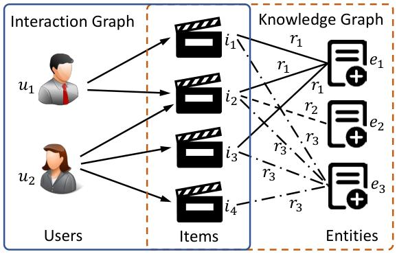
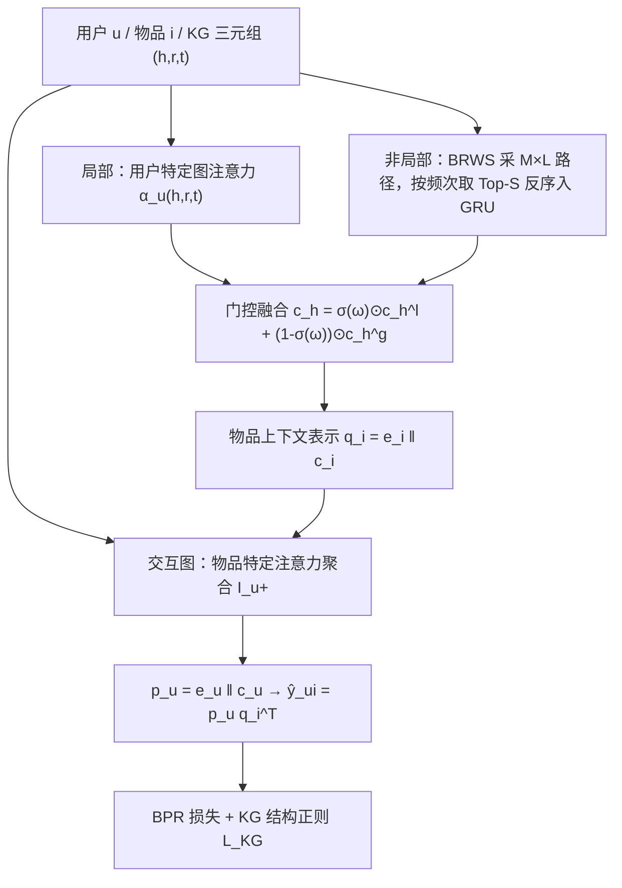
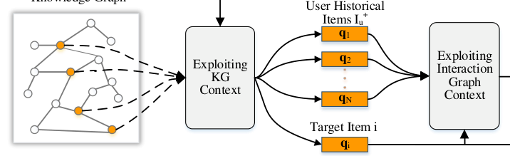

# Contextualized Graph Attention Network for Recommendation with Item Knowledge Graph (基于物品知识图谱上下文图注意力网络的推荐)

- **会议/期刊**: IEEE TKDE (arXiv 预印本 2020-04)
- **作者与机构**: Susen Yang, Yong Liu, Yonghui Xu, Chunyan Miao, Min Wu, Juyong Zhang（USTC / NTU / A*STAR I²R）
- **推荐链路定位**: 召回（KG 增强的用户-物品打分）
- **研究方向**: 图神经网络与知识图谱推荐
- **论文原文**: [https://arxiv.org/abs/2004.11529v1](https://arxiv.org/abs/2004.11529v1)
- **开源代码**: 暂未开源

## TL;DR (1分钟核心速览)

针对 KG 推荐的两个薄弱点——聚合一跳邻居时忽略「不同用户对同一实体有不同偏好」、以及仅靠逐层 GCN 传播难以刻画稀疏节点的高阶相关信息，CGAT 用**用户特定图注意力**聚合局部邻居、用**偏置随机游走采样 + GRU** 显式抽取非局部（高阶）上下文，并以**物品特定注意力**建模用户历史交互。在 FM / ML-1M / BC 的 6:2:2 随机划分、全物品排序协议下，HR@20 较最强基线分别提升 8.33% / 1.04% / 5.41%。

## Background & Motivation (背景与核心矛盾)

- **主流范式**: KG 推荐分为三类：正则化（CKE、KTUP 用 TransR 约束 embedding）、路径式（RippleNet 沿手工/规则路径传播用户偏好）、GNN 式（KGNN-LS、KGAT 用 GCN/GAT 逐层聚合邻居）。
- **前人局限**: ① GNN 式方法在同一条边上传入相同权重，无法体现「$u_1$因属性$e_1$喜欢$i_2$，$u_2$却因$e_3$喜欢$i_2$」的用户个性化；② 对$i_4$这类仅连一条边$e_3$的稀疏物品，一跳聚合不足以表达语义，而$e_1$ 虽与之多跳可达，逐层传播会稀释远处实体甚至引入噪声。
- **核心洞察 (Key Insight)**: KG 中「频次高、多路径可达」的高阶实体对目标实体更重要——这一重要性可用随机游走访问频次近似度量，因此可在一次性预处理中显式抽取，而非在传播层中隐式累积。
- **本文切入点**: 局部上下文（用户特定注意力）+ 非局部上下文（BRWS+GRU）+ 交互图上下文（物品特定注意力）三路并行建模，门控融合后做内积打分。

<figure class="paper-figure" markdown="span">
  <figcaption>图1：一个简单示例，展示用户-物品交互和物品知识图谱。</figcaption>
</figure>

## Method (核心方法设计)

### 1. 整体框架 (Overall Architecture)

对每个候选物品 $i$（KG 中的特殊实体），CGAT 并行取两路 KG 证据：一是用用户特定的图注意力在其一跳邻居集合$C_h^{l}$上加权求和，得到局部上下文$\mathbf{c}_h^{l}$；二是从该实体出发做$M$条长度$L$的偏置随机游走，按实体出现频次降序取 Top-$S$组成非局部上下文$C_h^{g}$，反向送入 GRU 得到$\mathbf{c}_h^{g}$。两路经逐维门控融合为$\mathbf{c}_i$，与实体嵌入拼接成$\mathbf{q}_i=(\mathbf{e}_i\Vert\mathbf{c}_i)$。用户侧再把历史物品$I_u^{+}$作为交互图上下文，用物品特定注意力按与目标物品的相关性加权聚合为$\mathbf{c}_u$，得$\mathbf{p}_u=(\mathbf{e}_u\Vert\mathbf{c}_u)$，最终$\hat{y}_{ui}=\mathbf{p}_u\mathbf{q}_i^{\top}$，以 BPR + KG 结构正则联合训练。

<figure class="paper-figure" markdown="span">
  <figcaption>图2：（a）CGAT 的框架。从左到右，它利用 KG 上下文和交互图上下文预测用户对候选物品的偏好得分；（b）通过对 KG 应用用户特定的图注意力机制来利用局部图上下文；（c）通过基于偏置随机游走的采样（BRWS）和 GRU 模块利用非局部图上下文；（d）通过对用户历史物品应用物品特定的注意力机制来利用交互图上下文。</figcaption>
</figure>

### 2. 关键设计拆解 (Key Designs)

1. **用户特定图注意力（局部上下文）**：痛点是把邻居权重写成与用户无关的 $a(h,r,t)$。CGAT 先做关系感知变换$\mathbf{e}_{rt}=(\mathbf{e}_r\Vert\mathbf{e}_t)\mathbf{W}_0$，再把用户嵌入非线性映射为用户查询向量$\mathbf{m}_u=\mathrm{ReLU}(\mathbf{e}_u\tilde{\mathbf{W}}_1+\tilde{\mathbf{b}}_1)$，注意力 logit 为$\pi_u(h,r,t)=\tanh[(\mathbf{e}_h\Vert\mathbf{e}_{rt})\mathbf{W}_1+\mathbf{b}_1]\mathbf{m}_u^{\top}$，softmax 后聚合并与自身拼接：$\mathbf{c}_h^{l}=\tanh[(\mathbf{e}_h\Vert\sum_{t\in C_h^{l}}\alpha_u(h,r,t)\mathbf{e}_t)\mathbf{W}_2+\mathbf{b}_2]$。直觉：同一邻居在不同用户视角下被「重新打分」，天然实现个性化 KG 剪枝。

2. **偏置随机游走 + GRU（非局部上下文）**：逐层传播对稀疏节点失效，故改为显式采样。游走转移概率 $p(t_{k+1})=\gamma$当回退到$t_{k-1}$或其邻居，否则$1-\gamma$，取$\gamma=0.2<0.5$鼓励更宽的深度优先探索；$M$条路径共$M\cdot L$个实体按频次排序取前$|C_h^{g}|=|C_h^{l}|=S$个，因「频次越高对$h$越重要」，将其**按频次降序的反序**输入 GRU，以末步隐状态作$\mathbf{c}_h^{g}$。该过程可离线预计算，复杂度$O(|I|SML)$。

3. **门控融合、交互图注意力与训练目标**：$\mathbf{c}_h=\sigma(\boldsymbol{\omega})\odot\mathbf{c}_h^{l}+(1-\sigma(\boldsymbol{\omega}))\odot\mathbf{c}_h^{g}$逐维自适应选择局部/非局部证据；用户侧$\beta(i,j)=\mathrm{softmax}_{j\in I_u^{+}}\big(\tanh((\mathbf{q}_i\Vert\mathbf{q}_j)\mathbf{w}^{\top}+b)\big)$，$\mathbf{c}_u=\mathrm{ReLU}[(\mathbf{e}_u\Vert\sum_j\beta(i,j)\mathbf{q}_j)\mathbf{W}_3+\mathbf{b}_3]$。总损失$\mathcal{L}=\mathcal{L}_{\mathrm{BPR}}+\lambda_1\mathcal{L}_{\mathrm{KG}}+\lambda_2\|\Theta\|_2^2$，其中$\mathcal{L}_{\mathrm{KG}}=\sum_{(h,r,t,t')}\log\sigma(s_r(h,t)-s_r(h,t'))$，$s_r=\|\mathbf{e}_h-\mathbf{e}_{rt}\|_2^2$且$t'\sim\mathcal{E}\setminus C_h^{l}$。负采样：每个正样本均匀采 **5** 个未交互物品 + 每个三元组采 1 个非邻居尾实体；训练时固定采$S$个邻居与$N$个历史物品控制显存，单批复杂度$O(BNSd^{2})$，线上打分只需一次前向内积。

## Experimental Setup & Evaluation Protocol (实验设置与评估协议)

- **数据集与预处理**: 由 Microsoft Satori 构建子 KG，仅保留置信度 > 0.9 的三元组，ML/BC 再按关系名含 "film"/"book" 过滤；无法匹配唯一实体的物品被删除；FM/BC 全部评分、ML 仅 >4 分视为隐式反馈。

| 数据集 | #Users | #Items | #Interactions | 稀疏度/密度 | 特征/场景说明 |
| :--- | :---: | :---: | :---: | :---: | :--- |
| FM (Last.FM) | 1,872 | 3,846 | 21,173 | 0.29% | 音乐；9,366 实体 / 60 关系 / 15,518 三元组 |
| ML (MovieLens-1M) | 6,036 | 2,347 | 376,886 | 2.66% | 电影；7,008 实体 / 7 关系 / 20,782 三元组 |
| BC (Book-Crossing) | 17,860 | 14,967 | 69,876 | 0.026% | 图书，极稀疏；77,903 实体 / 25 关系 / 151,500 三元组 |

- **数据划分与防穿越 (Splitting Strategy)**: 随机 **60% 训练 / 20% 验证调参 / 20% 测试** 的比例划分（非 Leave-One-Out、非全局时间戳切分），对每个用户分别计算再取平均。
- **排名评测协议 (Ranking Protocol)**: 未采样负例，对候选物品全集打分排序（全物品排序），报告 Precision@K、Recall@K、Hit Ratio@K，$K\in\{10,20,50\}$。
- **对比基线与超参设置**: 基线含 CFKG、RippleNet、MKR、KGNN-LS、KGAT；$d\in\{8,\dots,128\}$，$S,N\in\{2,\dots,40\}$，$\lambda_1,\lambda_2\in[10^{-6},10^{-2}]$，Adam，最优值按验证集选取；$p<0.05$ Wilcoxon 符号秩检验，27 项指标中 23 项显著占优。

## Key Experimental Results (实验关键数据)

### 1. 主实验对比 (Main Results)

| 数据集 | 方法 | P@10 | R@20 | HR@20 | HR@50 |
| :--- | :--- | :---: | :---: | :---: | :---: |
| FM | RippleNet | 0.0285 | 0.1948 | 0.3628 | 0.5336 |
| FM | MKR | 0.0278 | 0.1820 | 0.3356 | 0.4809 |
| FM | KGNN-LS | 0.0284 | 0.1824 | 0.3398 | 0.4809 |
| FM | KGAT | 0.0466 | 0.2756 | 0.4803 | 0.6426 |
| FM | **CGAT** | **0.0512** | **0.2994** | **0.5203** | **0.6687** |
| FM | Improv. | +9.87% | +8.64% | +8.33% | +4.06% |
| ML | RippleNet | 0.1271 | 0.2008 | 0.7474 | 0.8667 |
| ML | MKR | 0.1376 | 0.2192 | 0.7765 | 0.8852 |
| ML | KGNN-LS | 0.1311 | 0.2172 | 0.7766 | 0.8811 |
| ML | KGAT | 0.1533 | 0.2541 | 0.8179 | 0.9066 |
| ML | **CGAT** | **0.1575** | **0.2608** | **0.8264** | **0.9191** |
| ML | Improv. | +2.74% | +2.64% | +1.04% | +1.38% |
| BC | CFKG | 0.0155 | 0.0904 | 0.1745 | 0.2435 |
| BC | RippleNet | 0.0147 | 0.0880 | 0.1736 | 0.2429 |
| BC | MKR | 0.0154 | 0.0920 | 0.1811 | 0.2496 |
| BC | KGAT | 0.0132 | 0.0776 | 0.1600 | 0.2362 |
| BC | **CGAT** | **0.0161** | **0.0920** | **0.1909** | **0.2718** |
| BC | Improv. | +3.87% | +0.00% | +5.41% | +8.89% |

（Improv. 为相对该数据集最强基线的提升；平均而言 HR@20 较 CFKG / RippleNet / MKR / KGNN-LS / KGAT 提升 26.07% / 21.32% / 22.29% / 21.92% / 9.56%。）

### 2. 消融实验 (Ablation Study)

| 变体 (HR@20) | FM | ML | BC |
| :--- | :---: | :---: | :---: |
| CGAT w/o L（去局部上下文） | 0.5118 | 0.8193 | 0.1884 |
| CGAT w/o G（去非局部上下文） | 0.5167 | 0.8111 | 0.1864 |
| CGAT w/o UA（去用户特定查询 $\mathbf{m}_u$） | 0.5136 | 0.8215 | 0.1817 |
| **CGAT (full)** | **0.5203** | **0.8264** | **0.1909** |

### 3. 关键实验发现 (Key Findings)

1. 收益集中在稀疏场景：FM（密度 0.29%、实体平均度仅 3.31）上 HR@20 较 KGAT 提升 8.33%，而稠密 ML 仅 +1.04%——说明非局部上下文主要在「邻居不足」时补位，稠密图上逐层传播已接近饱和。
2. 非局部上下文并非局部上下文的附属：ML 上去掉非局部（0.8264→0.8111，−1.85%）的跌幅大于去掉局部（−0.86%），BC 上亦为 −2.36% vs −1.31%，印证论文「高阶相关实体有时比一跳邻居更关键」的判断。
3. 个性化注意力是必要条件而非装饰：仅移除 $\mathbf{m}_u$（退化为通用注意力）即导致三数据集一致下降（FM 0.5203→0.5136，BC 0.1909→0.1817，−4.8%），且 BC 上跌幅最大，说明在极稀疏、跨域实体歧义强的图书场景中最依赖用户视角的邻居重加权。

## Highlights & Limitations (亮点、对比与审稿批判)

- **与代表作对比 (vs. Prior Work)**: 相比 CKE/KTUP 的正则化路线，本文把 KG 语义直接写入前向计算；相比 RippleNet 依赖「以历史物品为根」的路径传播，本文的游走根节点是被打分的候选实体本身，方向更贴合排序目标；相比 KGAT/KGNN-LS 的逐层传播隐式累积高阶信息，本文**显式**抽取并按频次排序高阶实体，避免了远距离信息在层级传播中被稀释。
- **可迁移亮点**: ① 「按随机游走频次排序 + 反序 RNN」是一种廉价、可离线预计算的高阶邻居摘要器，可直接用于任何 KG/异构图召回；② 用用户查询向量 $\mathbf{m}_u$ 对同一邻接结构做逐用户重加权，可低成本复用到多场景/多业务共享 KG 的注意力打分中。
- **审稿级局限批判**: ① 评估仅用随机 6:2:2 划分与三份中小规模数据集，缺少 Leave-One-Out 与时间切分，且未做冷启动/长尾分桶，泛化结论偏乐观；② 关键超参（$S=4$、$N=16$、$M=15$、$L=8$、$\gamma=0.2$）与数据集平均度强耦合，换 KG 需重调；BRWS 需为每个物品预采$M\cdot L$条路径并全量重算当 KG 更新，工程上有离线刷新成本；③ 物品特定注意力的打分开销随$|I_u^{+}|$ 线性增长，论文未报告线上延迟与吞吐。

## Rating (四维评分)

- **方法创新性 (Novelty)**: ⭐⭐⭐⭐ （「用户特定图注意力 + 频次排序游走 RNN + 门控融合」三件套组合清晰，显式高阶上下文建模相对逐层传播确有增量，但各组件本身均为已有算子重组）
- **评估协议与实验扎实度 (Protocol & Experiments)**: ⭐⭐⭐ （三数据集 + 5 个 SOTA 基线 + Wilcoxon 检验 + 消融齐全，但随机比例划分、缺时序/冷启动评估，且消融仅报 HR@20 单指标）
- **写作与数学规范度 (Clarity & Rigor)**: ⭐⭐⭐⭐ （公式与符号定义完整连贯、三路上下文职责分明，复杂度分析到 mini-batch 粒度；不足是 GRU 反序输入的必要性仅给直觉、无对照实验）
- **工业落地与复现价值 (Industrial & Practical Value)**: ⭐⭐⭐ （游走上下文可离线预计算、打分仅内积，易部署；但未开源、超参敏感、KG 更新需重采路径且缺少线上性能报告）

