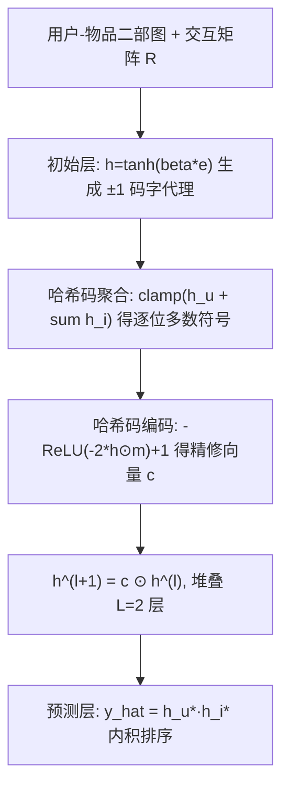
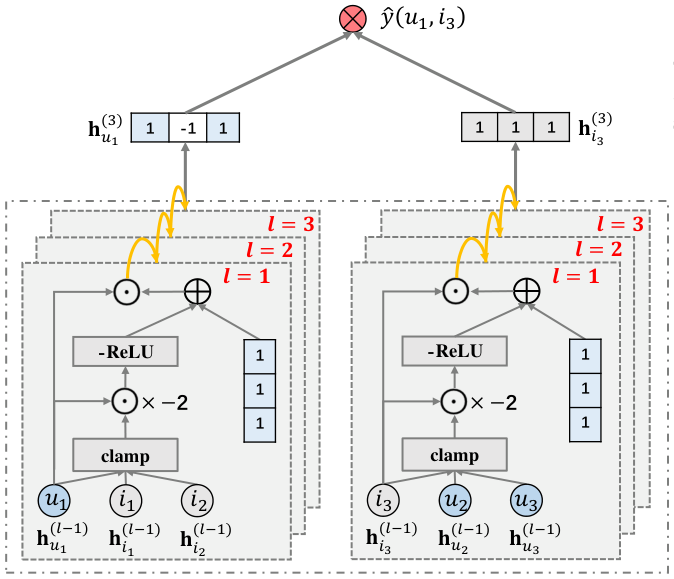

# HS-GCN: Hamming Spatial Graph Convolutional Networks for Recommendation (汉明空间图卷积推荐网络)

- **会议/期刊**: IEEE TKDE 2023
- **作者与机构**: Han Liu, Yinwei Wei, Jianhua Yin, Liqiang Nie（山东大学 / 新加坡国立大学）
- **推荐链路定位**: 召回（哈希码内积 / XOR 快速检索）
- **研究方向**: 图神经网络与知识图谱推荐 / 协同过滤与双塔召回
- **论文原文**: [https://arxiv.org/abs/2301.05430v1](https://arxiv.org/abs/2301.05430v1)
- **开源代码**: [https://github.com/hanliu95/HS-GCN](https://github.com/hanliu95/HS-GCN)

## TL;DR (1分钟核心速览)

哈希推荐用 $\pm1$码替代浮点向量以换取 XOR 级检索速度，但现有方法（HashNet、HashGNN）只被"用户—历史交互物品"的一阶汉明相似度监督，二值量化又放大信息损失，表征能力受限。本文提出 HS-GCN，把图卷积算子整体重写进汉明空间：用 bit-wise 符号投票做邻域聚合、用$\pm1$ 精修向量做编码，从而把二阶及更高阶汉明相似度显式注入码字。在 6 个公开数据集、`Full-Ranking` 协议下，相对最强哈希基线 HashGNN 的 HR@50 提升 3.87%–44.08%（MovieLens 28.41%，Amazon 44.08%），并逼近实值 GraphSage。

## Background & Motivation (背景与核心矛盾)

- **主流范式**: 大规模召回用二值哈希码表示用户/物品，以 Hamming 距离替代内积，把 $O(NMK)$ 的 top-k 检索降到 XOR + 查表级别；HashGNN 等则先用 GCN 在欧氏空间学实值表征再二值化。
- **前人局限**: ① 监督信号仅来自直接交互边（一阶相似度），间接关系（多跳连通性）被丢弃；② HashGNN 在实值代理 $\boldsymbol{e}=\boldsymbol{h}+\boldsymbol{\epsilon}$上传播，每层都累积量化偏差，再叠加$\tanh$ 与权重矩阵，最终码字无法保留高阶汉明结构。
- **核心洞察 (Key Insight)**: 图 1 给出一个反例——$u_1$与$i_1,i_2$的汉明相似度相等时，其一阶信号处于"中点"无法定码；但引入$u_1$与$u_2,u_3$ 的高阶相似度后码字方向立刻确定。作者据此推断：高阶相似度是打破一阶对称性的关键自由度。
- **本文切入点**: 不做"欧氏传播 + 二值化"两段式，而是直接在汉明空间定义可微的图卷积，让 $\{\pm1\}$ 码字逐层被邻域多数比特精修。

## Method (核心方法设计)

### 1. 整体框架 (Overall Architecture)

模型由初始层、$L$层传播层、预测层构成。初始层用$\tanh(\beta\boldsymbol{e})$生成可端到端训练的码字代理；传播层对每个节点先做"哈希码聚合"（把自身与邻居码字按位求和并 clamp 得到多数比特符号），再做"哈希码编码"（比较自身码与多数比特，得到逐位精修向量，乘回码字）；堆叠$L=2$ 层即可捕获二阶汉明相似度；预测层取最后一层码字做内积打分，等价于汉明相似度排序。全流程无权重矩阵、无节点采样，可用矩阵形式批量更新。

<figure class="paper-figure" markdown="span">
  <figcaption>图 2. 我们提出的 HS-GCN 模型示意图（箭头线表示信息流）。用户 u1（左）和物品 i3（右）的哈希码通过多个哈希码传播层进行细化。</figcaption>
</figure>

### 2. 关键设计拆解 (Key Designs)

1. **汉明空间哈希码聚合（bit-wise 多数投票替代加权求和）**：汉明空间不能用可训练权重矩阵 $W$，也无法做 mean/max pooling。作者把一阶相似度重写为非加权求和后套 clamp 函数：
$\boldsymbol{m}_u^{(l)}=\mathrm{clamp}\Big(\boldsymbol{h}_u^{(l)}+\sum_{i\in\mathcal{N}_u}\boldsymbol{h}_i^{(l)}\Big)\in\{-1,0,1\}^K$其物理直觉是：每一 bit 在邻域内服从二项分布，"多数比特值"就是该维应被保留的支配信号；clamp 既保证了输出的有界性又保留了$0$（中性、不投票）状态，为下一步区分"确定差异"与"模棱两可"留出余地。

2. **哈希码编码（逐位差异检测 + 保号精修）**：先做逐位比较 $\boldsymbol{d}_u^{(l)}=\boldsymbol{h}_u^{(l)}\odot\boldsymbol{m}_u^{(l)}$，其中$-1$表示该位与多数邻居相反、$1$表示一致、$0$表示中立。为避免$0$直接乘回导致码字退化为非二值，设计了把$0$映射到$+1$（而非$-1$）的变换：
$\boldsymbol{c}_u^{(l)}=-\mathrm{ReLU}(-2\boldsymbol{d}_u^{(l)})+\mathbf{1},\qquad \boldsymbol{h}_u^{(l+1)}=\boldsymbol{c}_u^{(l)}\odot\boldsymbol{h}_u^{(l)}$这样$\boldsymbol{c}$中的$-1$精确对应"毫无疑问需要翻转的比特"，精修后码字仍严格落在$\{\pm1\}^K$；因$\boldsymbol{h}^{(L)}=\boldsymbol{c}^{(L-1)}\odot\cdots\odot\boldsymbol{c}^{(0)}\odot\boldsymbol{h}^{(0)}$，高阶相似度以逐层符号调制的形式被压进同一个$K$ 维码字，无需拼接（避免码长膨胀）。

3. **训练目标、负采样与推理效率**：总体损失
$\mathcal{L}=\mathcal{L}_{\mathrm{cross}}+\lambda_1\mathcal{L}_{\mathrm{rank}}+\lambda_2\|\boldsymbol{E}\|_2^2$其中$\mathcal{L}_{\mathrm{cross}}$为逐点二元交叉熵重构交互，$\mathcal{L}_{\mathrm{rank}}=\sum_{(u,i,j)}\max(0,-\sigma(\hat{y}_{ui})+\sigma(\hat{y}_{uj})+\alpha)$为三元组 margin 排序损失，且该排序损失同时作用于初始码与最终码（实验显示作用于初始层贡献更大）。训练对每个正样本均匀采 5 个负样本，$\alpha=0.2$，$\lambda_1=0.1$，$\lambda_2=10^{-7}$，Adam + early stopping。模型仅含初始实值矩阵$\boldsymbol{E}$一组参数，与 MF 同规模；推理时码字为$\{\pm1\}$，可用 XOR + 多级索引加速。

## Experimental Setup & Evaluation Protocol (实验设置与评估协议)

- **数据集与预处理**: 采用 `20-core`（Yelp/Amazon/Netflix）与 `10-core`（Gowalla）过滤，MovieLens-1M 与 Pinterest 用现成版本；显式评分统一二值化为隐式反馈。

| 数据集 | #Users | #Items | #Interactions | 密度 | 场景说明 |
| :--- | :---: | :---: | :---: | :---: | :--- |
| MovieLens | 6,040 | 3,706 | 1,000,209 | 4.47% | 电影评分，稠密 |
| Yelp | 40,500 | 58,755 | 2,024,283 | 0.09% | 商户评论，极稀疏 |
| Amazon | 36,783 | 77,379 | 2,402,416 | 0.08% | 图书评论，极稀疏 |
| Gowalla | 29,585 | 40,981 | 1,027,370 | 0.09% | 签到 POI |
| Pinterest | 55,187 | 9,916 | 1,500,809 | 0.27% | 图像社交 |
| Netflix | 429,584 | 17,764 | 99,884,887 | 1.31% | 大规模电影 |

- **数据划分与防穿越 (Splitting Strategy)**: 随机 `70%/30%` 比例划分训练/测试，再从训练集随机取 10% 作验证集调参——**属于随机划分而非全局时间戳切分**，存在轻度未来信息泄漏风险。
- **排名评测协议 (Ranking Protocol)**: 无偏 `Full-Ranking`——将测试用户所有未在训练集出现的物品作为候选做全库排序，报告 HR@50/100 与 NDCG@50/100，并对所有测试用户取平均。
- **对比基线与超参设置**: 哈希基线 DCF / DFM / DHN / Hash ste / HashNet / GCNH / DGCN-BinCF / HashGNN；实值基线 MF / BiNE / PinSage / GraphSage。哈希码与嵌入维度统一 $d=64$，图基线统一两层 GCN + Xavier 初始化，学习率网格$\{10^{-4},3\times10^{-4},10^{-3},3\times10^{-3}\}$搜索，配对 t 检验报告$p$值（均$<0.05$）。

## Key Experimental Results (实验关键数据)

### 1. 主实验对比 (Main Results)

| 方法 | ML HR@50 | ML N@50 | Yelp HR@50 | Yelp N@50 | Amazon HR@50 | Amazon N@50 |
| :--- | :---: | :---: | :---: | :---: | :---: | :---: |
| DCF | 0.0469 | 0.0641 | 0.0143 | 0.0097 | 0.0145 | 0.0113 |
| DHN | 0.0782 | 0.1038 | 0.0228 | 0.0149 | 0.0238 | 0.0176 |
| HashNet | 0.1359 | 0.1940 | 0.0364 | 0.0232 | 0.0353 | 0.0281 |
| GCNH | 0.1552 | 0.1443 | 0.0389 | 0.0294 | 0.0394 | 0.0319 |
| HashGNN | 0.1598 | 0.2335 | 0.0447 | 0.0308 | 0.0363 | 0.0273 |
| GraphSage (实值) | **0.2132** | **0.3195** | **0.0581** | **0.0434** | 0.0408 | 0.0349 |
| **HS-GCN** | 0.2052 | 0.3081 | 0.0497 | 0.0336 | **0.0523** | **0.0436** |
| Improv. vs HashGNN | +28.41% | +31.95% | +11.19% | +9.09% | **+44.08%** | **+59.71%** |

（其余数据集 HR@50 提升：Gowalla +3.87%、Pinterest +6.11%、Netflix +6.51%；$p$值均$\le 1.4\times10^{-2}$。）

### 2. 消融实验 (Ablation Study)

| 变体 | ML HR@50 | ML N@50 | Yelp HR@50 | Yelp N@50 | Amazon HR@50 | Amazon N@50 |
| :--- | :---: | :---: | :---: | :---: | :---: | :---: |
| HS-GCN (L=2, 完整) | **0.2052** | **0.3081** | **0.0497** | **0.0336** | **0.0523** | **0.0436** |
| L=1（仅一阶） | 0.1822 | 0.2774 | 0.0452 | 0.0316 | 0.0407 | 0.0340 |
| L=3 | 0.1840 | 0.2798 | 0.0482 | 0.0329 | 0.0500 | 0.0421 |
| w/o Initial Rank | 0.1773 | 0.2747 | 0.0468 | 0.0313 | 0.0509 | 0.0428 |
| w/o Final Rank | 0.1769 | 0.2566 | 0.0418 | 0.0281 | 0.0460 | 0.0385 |
| w/o CR-Entropy | 0.1564 | 0.2426 | 0.0156 | 0.0100 | 0.0289 | 0.0239 |

### 3. 关键实验发现 (Key Findings)

1. **高阶传播是主增益来源**：$L{=}2$相比$L{=}1$在 MovieLens/Amazon 上 HR@50 分别提升 12.6%/28.5%，而$L{=}3$反而回落（0.2052→0.1840），说明二阶相似度已足够，更深层传播在同一码长上造成过平滑与过拟合——码长恒定$K$ 意味着每层都在"重写"而非"扩展"表征，深度收益天然受限。
2. **稀疏场景收益最大，稠密场景被实值模型压制**：Amazon（密度 0.08%）上 HS-GCN 比最强哈希基线高 44.08%，甚至超过 GraphSage（0.0523 vs 0.0408）；但在 MovieLens（密度 4.47%）上仍落后 GraphSage 约 3.8% HR@50。分桶实验进一步显示 Yelp 最稀疏两组（交互 $<23$、$<42$）提升达 9.31%/6.88%，而最活跃组仅 0.52%——印证高阶相似度本质上是给"一阶信号不足"的冷用户补信息。
3. **排序损失与交叉熵缺一不可，且排序损失更该作用于初始码**：去掉 CR-Entropy 后性能崩塌式下降（Yelp HR@50 0.0497→0.0156，跌幅 68.6%），说明逐点重构才是保持二部图结构的基础监督；去掉初始层排序损失比去掉最终层排序损失损害更大（ML N@50 0.2747 vs 0.2566），因为排序信息在初始化阶段注入可引导整条传播链。
4. **效率侧**：全量 Amazon 上训练 9.1h（HashGNN 23.3h，约 2.4× 加速）、推理 24.8s（MF/GraphSage 约 127s，约 4.9× 加速），且模型规模与 MF 相同（无逐层权重）。此外 bit dropout 优于 node dropout（Yelp 上 node dropout 甚至为负收益，因丢弃邻居会破坏码聚合投票）。

## Highlights & Limitations (亮点、对比与审稿批判)

- **与代表作对比 (vs. Prior Work)**: 相比 HashNet（连续松弛 + $\tanh(\beta x)$逼近 sign，仅一阶），HS-GCN 把相似度监督从"边"扩到"路径"；相比 HashGNN（欧氏空间传播 + straight-through 二值化），本文消除了逐层累积的量化偏差$\epsilon^{(l)}$，且去掉每层权重矩阵$W^{(l)}$，参数更省、收敛更快；相比 LightGCN 式实值 GCN，本文在$\{\pm1\}$ 域内完成了等价简化，属于"把 LightGCN 的线性哲学搬到汉明空间"。
- **可迁移亮点**: ① "clamp 取符号 = 邻域多数比特投票 + $-ReLU(-2d)$ 保号映射"这一对算子，可直接迁移到任何需要离散/量化表征的图传播（如 PQ 码本学习、语义 ID 传播）；② 排序损失同时施加于初始码与最终码的双重监督技巧，可低成本移植到其他多层 GNN。
- **审稿级局限批判**: ① **评估协议偏弱**：70/30 随机划分而非时间戳切分，且未报告冷启动划分下的表现，全库排序虽无偏但训练负采样仅 5 个均匀负例，未探索 hard negative；② **与实值模型关系未说清**：在稠密数据集上仍不敌 GraphSage，作者仅以"comparable"带过，缺少码长 $K$与实值维度$d$在等比特预算下的公平对照；③$L{=}2$、$K{=}64$、$\alpha{=}0.2$等超参未给出敏感度曲线（仅有$K\in\{8,16,32,64\}$ 的弱趋势图），泛化边界不清晰。

## Rating (四维评分)

- **方法创新性 (Novelty)**: ⭐⭐⭐⭐ （首次在汉明空间内定义图卷积算子，clamp 投票 + 保号精修的组合简洁且有其二项分布直觉支撑，属"约束域内的算子重设计"而非全新范式）
- **评估协议与实验扎实度 (Protocol & Experiments)**: ⭐⭐⭐⭐ （6 个数据集 + 全库排序 + t 检验 + 效率/稀疏度/码长多维分析很完整，但随机划分缺乏时间切分与冷启动协议，扣分）
- **写作与数学规范度 (Clarity & Rigor)**: ⭐⭐⭐⭐ （矩阵形式传播规则与 HashGNN 的量化偏差对比推导清晰，符号统一；但部分公式下标层级混用，$L$ 层码长恒定的动机解释略简）
- **工业落地与复现价值 (Industrial & Practical Value)**: ⭐⭐⭐⭐⭐ （代码开源、参数量等同 MF、训练 2.4×/推理 4.9× 加速且能直接对接 XOR + 多级索引的线上召回，落地性价比极高）

