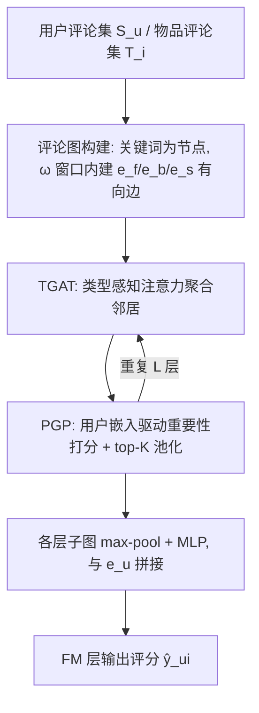
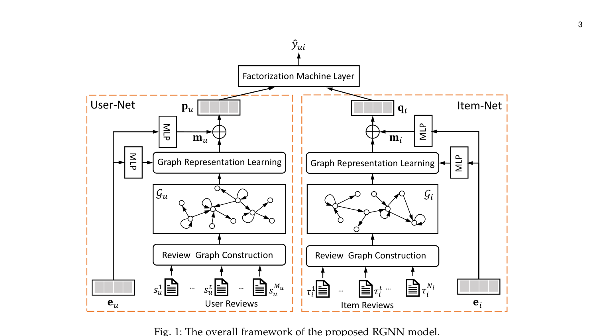
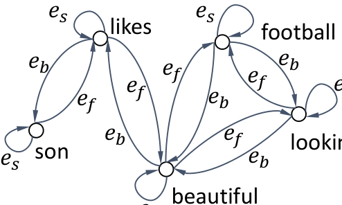

# Learning Hierarchical Review Graph Representations for Recommendation (面向推荐的层级评论图表征学习)

- **会议/期刊**: IEEE TKDE
- **作者与机构**: Yong Liu, Susen Yang, Yinan Zhang, Chunyan Miao, Zaiqing Nie, Juyong Zhang（南洋理工大学 LILY/阿里- NTU 联合研究院、中国科学技术大学、阿里巴巴）
- **推荐链路定位**: 精排（评分预测 / Rating Prediction）
- **研究方向**: 图神经网络与知识图谱推荐 / 冷启动与长尾推荐
- **论文原文**: [论文原文链接](https://arxiv.org/abs/2004.11588v3)
- **开源代码**: 暂未开源

## TL;DR (1分钟核心速览)

针对评论建模中"CNN/RNN 只看窗口内局部词序、且对所有评论一视同仁、易被噪声评论带偏"的痛点，本文为每个用户/物品单独构建一张带前向/后向/自环三类边类型的有向评论图，用类型感知图注意力（TGAT）保留语序、用个性化图池化（PGP）按用户/物品各自的关注点筛选重要词，得到层级语义表征后交给 FM 预测评分。在 6 个 Amazon/Yelp 数据集、随机 80/20 划分的 MSE 评估下，RGNN 全面最优，相对最强基线 DAML 平均再降 1.14%（Beauty 上 2.38%），$p<0.05$ 显著。

## Background & Motivation (背景与核心矛盾)

- **主流范式**: 评论推荐以 LDA/词向量主题模型（HFT、RMR）或 CNN/RNN 组合编码器（DeepCoNN、NARRE、CARL、DAML）+ 注意力 + FM 回归为主，任务多为评分预测。
- **前人局限一（局部性）**: 卷积/循环算子仅捕捉固定窗口内的相邻词依赖，跨句子、非连续的全局词共现被割裂，且 bag-of-words 类方法完全丢失词序（"not really good" 与 "really not good" 无法区分）。
- **前人局限二（噪声与无个性化）**: 所有评论被等权拼接，与用户兴趣/物品属性无关的噪声评论会主导表征；同时全体用户共享同一套参数，忽略了"同一个词对不同用户/物品的信息量不同"。
- **核心洞察 (Key Insight)**: 把某用户全部评论合并成一张词共现图后，内容相近的评论天然形成稠密连接、孤立的噪声评论只产生稀疏边，图结构本身即具备降噪作用；而池化时的"哪些词重要"应由用户/物品自身嵌入决定。
- **本文切入点**: 用**逐用户/逐物品的评论图 + 类型化边注意力 + 个性化 top-$K$ 池化**替代"逐条评论独立编码"。

## Method (核心方法设计)

### 1. 整体框架 (Overall Architecture)

User-Net 与 Item-Net 是两条结构完全相同的并行支路：先对某用户（物品）的全部评论做分词与关键词筛选，在窗口 $\omega$内建带类型的有向图；随后堆叠$L$层 "TGAT 聚合 + PGP 池化"，每层产出规模按$\alpha$收缩的子图；对各层子图做 max-pool + MLP 读出并与用户（物品）ID 嵌入的非线性变换拼接，得到语义向量$\mathbf{p}_u$、$\mathbf{q}_i$；最后经 FM 层建模高阶交互输出评分$\hat{y}_{ui}$，端到端以 MSE 反向传播训练。

<figure class="paper-figure" markdown="span">
  <figcaption>图 1：所提出 RGNN 模型的整体框架。</figcaption>
</figure>

### 2. 关键设计拆解 (Key Designs)

1. **类型化评论图构建（把语序编码进拓扑）**：单条评论编码无法跨句聚合，本文把用户所有评论的关键词并为一个节点集，窗口内距离 $<\omega$的词对建双向边——前向边$e_f$、后向边$e_b$，并为每个词加自环$e_s$。这样同一词在多个评论中的上下文被合并成同一节点的邻域，"全局非连续依赖"变成图上的一跳邻居，噪声评论因连接稀疏而被稀释。
<figure class="paper-figure" markdown="span">
  <figcaption>图 2：为评论“我儿子喜欢这个外观漂亮的足球”构建图的示例。选取单词“son”“likes”“beautiful”“looking”和“football”作为节点。根据经验，我们将窗口大小 ω 设为 3 以构建边。</figcaption>
</figure>

2. **类型感知图注意力 TGAT（区分方向地聚合）**：普通 GAT 对所有邻居同一权重、无视边语义。本文将边类型嵌入 $\mathbf{e}_r$ 加入注意力打分：
$\pi^{\ell}(x_h,e_r,x_t)=\mathrm{LeakyReLU}\big[(\mathbf{x}_h^{\ell}\mathbf{W}_1)(\mathbf{x}_t^{\ell}\mathbf{W}_2+\mathbf{e}_r^{\ell}\mathbf{W}_3)^{\top}\big]$，softmax 归一化后$\bar{\mathbf{x}}_h^{\ell}=\sum_{x_t\in\mathcal{N}_h^{\ell}}a^{\ell}(x_h,e_r,x_t)\,\mathbf{x}_t^{\ell}\mathbf{W}_4$。由于$e_f/e_b$ 不同，模型能区分"谁修饰谁"，把词序信息注入词向量；自环保证中心词自身信息不被邻居淹没。

3. **个性化图池化 PGP + 预测目标**：通用 gPool/SAGPool 对所有图用同一打分函数，无法体现"某用户关心价格、另一用户关心音质"。本文先用 MLP 由用户嵌入生成个性化度量向量 $\boldsymbol{\theta}_u^{\ell}=\mathrm{ReLU}(\mathbf{e}_u\mathbf{W}_5^{\ell}+\mathbf{b}_5^{\ell})$，节点重要性为
$\beta_h^{\ell}=\big|\bar{\mathbf{x}}_h^{\ell}(\boldsymbol{\theta}_u^{\ell})^{\top}\big|+\frac{1}{|\mathcal{N}_h^{\ell}|}\sum_{x_t\in\mathcal{N}_h^{\ell}}\big|(\bar{\mathbf{x}}_h^{\ell}-\bar{\mathbf{x}}_t^{\ell})\mathbf{w}^{\ell\top}\big|$，
第一项衡量"该词对本用户的重要度"，第二项是邻域可重构性（能被邻居重构的冗余节点应被丢弃），再按 $\mathrm{rank}(\beta^{\ell},\lceil\alpha K^{\ell}\rceil)$保留 top-$K$节点与对应诱导邻接矩阵。训练目标为$\min_{\Theta}\sum_{(u,i)}(y_{ui}-\hat{y}_{ui})^2+\lambda\|\Theta\|_F^2$，无负采样（回归任务）；图构建可离线完成，表征学习复杂度$O(\sum_{\ell}\alpha^{\ell}N_w d_0^2)$，与 CNN 编码器同量级甚至更低。

## Experimental Setup & Evaluation Protocol (实验设置与评估协议)

- **数据集与预处理**: Amazon 5-core 子集 + Yelp（保留 ≥10 条评论的用户/物品）：

| 数据集 | #Users | #Items | #Interactions | 密度 | 场景说明 |
| :--- | :---: | :---: | :---: | :---: | :--- |
| Music | 1,429 | 900 | 10,261 | 0.80% | Musical Instruments |
| Office | 4,905 | 2,420 | 53,228 | 0.45% | Office Products |
| Toys | 19,412 | 11,924 | 167,597 | 0.07% | Toys & Games |
| Games | 24,303 | 10,672 | 231,577 | 0.09% | Video Games |
| Beauty | 22,363 | 12,101 | 198,502 | 0.07% | Beauty |
| Yelp | 126,084 | 65,786 | 3,519,533 | 0.04% | 本地商户点评 |

- **数据划分与防穿越**: **随机比例划分**——对每个数据集随机取 20% 用户-物品评论对作测试，余 80% 中再留 10% 作验证集；**未采用全局时间戳切分**（详见局限）。
- **排名评测协议**: 本文做**评分预测**而非 Top-N 排序，指标为全部测试对上的 $\mathrm{MSE}=\frac{1}{|\mathcal{D}_{test}|}\sum(y_{ui}-\hat{y}_{ui})^2$，**无负采样、无候选裁剪**；因此不存在 sampled/full-ranking 之分，但也不检验排序能力。
- **对比基线与超参**: 10 个基线覆盖 MF（PMF、SVD++）、内容/主题（CDL）、神经组合（DeepCoNN）、注意力（ANR、NARRE、CARL、NRPA、DAML）与多视图（RMG）；维度 $d_0,d_1\in\{4..128\}$、$d_2$同区间，$L\in\{1,2,3,4\}$，$\alpha=0.5$，$\omega=3$，Adam + early stopping，显著性用 Student's$t$-test（$p<0.05$）。

## Key Experimental Results (实验关键数据)

### 1. 主实验对比 (Main Results)

| 方法 | Music | Office | Toys | Games | Beauty | Yelp |
| :--- | :---: | :---: | :---: | :---: | :---: | :---: |
| PMF | 1.8783 | 0.9635 | 1.6091 | 1.5260 | 2.7077 | 1.4217 |
| SVD++ | 0.7952 | 0.7213 | 0.8276 | 1.2081 | 1.2129 | 1.2973 |
| CDL | 1.2987 | 0.8763 | 1.2479 | 1.6002 | 1.7726 | 1.4042 |
| DeepCoNN | 0.7909 | 0.7315 | 0.8073 | 1.1234 | 1.2210 | 1.2719 |
| ANR | 0.7825 | 0.7237 | 0.7974 | 1.1038 | 1.2021 | 1.2708 |
| NARRE | 0.7688 | 0.7266 | 0.7912 | 1.1120 | 1.1997 | 1.2675 |
| NRPA | 0.7658 | 0.7343 | 0.8100 | 1.1259 | 1.2034 | 1.2721 |
| DAML | 0.7401 | **0.7164** | 0.7909 | 1.1086 | 1.2175 | 1.2700 |
| **RGNN (Ours)** | **0.7319** | **0.7125** | **0.7786** | **1.0996** | **1.1885** | **1.2645** |
| Improv. vs DAML | 1.11% | 0.54% | 1.56% | 0.81% | 2.38% | 0.43% |

### 2. 消融实验 (Ablation Study)

| 变体 | 移除内容 | Music | Office | Toys |
| :--- | :--- | :---: | :---: | :---: |
| RGNN | 完整模型 | **0.7319** | 0.7125 | **0.7786** |
| RGNN-RG | 用户/物品评论图（改用关键词 max-pool） | 0.7705 | 0.7132 | 0.7903 |
| RGNN-FM | FM 预测头（改内积） | 0.7411 | **0.7115** | 0.7817 |
| RGNN-T | 边类型嵌入（丢词序） | 均劣于 RGNN（图 4） | — | — |
| RGNN-P | 个性化 $\boldsymbol{\theta}_u$（全体共享打分） | 均劣于 RGNN，且 Office/Toys 上劣于 RGNN-PL | — | — |
| RGNN-S | 邻域多样性项（式 5 第二项） | 劣于 RGNN | — | — |
| RGNN-PL | 全部 PGP 池化层 | 劣于 RGNN | — | — |

### 3. 关键实验发现 (Key Findings)

1. **增益主要来自图而非预测头**：去掉评论图的 RGNN-RG 在 Music/Toys 上 MSE 分别恶化 5.01%/1.48%，而仅保留图、去掉 FM 的 RGNN-FM（0.7411/0.7115/0.7817）已超过或追平最强基线 DAML，证明分层评论图表征是核心贡献，FM 只是小幅锦上添花。
2. **词序与自环比"个性化"更不可替代**：边类型消融中 RGNN-s（去掉自环）在 Music/Toys 上最差，RGNN-f（去前向边）比 RGNN-b（去后向边）更伤性能，说明方向性语序信息对情感/偏好判别关键；而共享 $\boldsymbol{\theta}$ 的 RGNN-P 在大稀疏集上甚至不如直接 max-pool 的 RGNN-PL，印证"个性化打分若不加约束反而会坍缩为公共词集"。
3. **层级深度与数据稀疏度正相关**：稠密的 Music/Office/Toys 在 $L=2$最优（0.7319/0.7125/0.7786），稀疏大图 Games/Yelp 需$L=3$、Beauty 需$L=4$才达最优，说明稀疏场景需要更多次池化来提纯信号；$\alpha=0.5$、$\omega\in[3,6]$、$d_0=d_1=16$、$d_2=8$为稳定甜点区，$\alpha>0.5$ 会放回噪声节点。

## Highlights & Limitations (亮点、对比与审稿批判)

- **与代表作对比 (vs. Prior Work)**: 相比 DeepCoNN/NARRE 仅在同一评论内做窗口卷积 + 评论级注意力，RGNN 把"跨评论、非连续"的词共现统一进一张图；相比 NRPA 把个性化注意力停留在评论粒度，本文将其下沉到**词粒度池化**；相比 CDL/HFT 等主题模型，显式保留词序与方向性边。
- **可迁移亮点**: ① 用 $e_f/e_b/e_s$三类型边把语序无损注入 GNN，可迁移到任意短文本序列建模；② 重要性打分 = 用户个性化投影 + 邻域可重构性（冗余度），这一"双项打分 + top-$K$"范式可复用到会话序列去噪、多模态特征筛选。
- **审稿级局限批判**: ① **评估协议偏弱**——随机 20% 划分而非时间戳切分，同一用户的后写评论可能进入训练集造成信息泄漏，MSE 绝对值偏乐观，且完全未验证 Top-N 排序与负采样场景；② **工程开销与冷启动**——需为每个用户/物品离线构建并存储一张图（Yelp 级百万边），新评论到达须增量更新图结构，冷启动用户评论极少时图近乎空图，此时退化风险未做实验。

## Rating (四维评分)

- **方法创新性 (Novelty)**: ⭐⭐⭐⭐ （首次把"逐用户/逐物品评论图 + 类型化边注意力 + 个性化池化"组合起来，思路清晰但组件多为已有算子的定向改造）
- **评估协议与实验扎实度 (Protocol & Experiments)**: ⭐⭐⭐ （6 数据集 + 10 基线 + $t$ 检验较充分，但随机划分存在泄漏、仅做 MSE 回归、缺少排序与冷启动评估）
- **写作与数学规范度 (Clarity & Rigor)**: ⭐⭐⭐⭐ （TGAT/PGP 公式与复杂度分析交代完整，边类型与打分两项的物理直觉解释到位，符号一致）
- **工业落地与复现价值 (Industrial & Practical Value)**: ⭐⭐⭐ （复杂度与 CNN 同级、图可离线构建，但无开源代码、需维护用户级图存储与增量更新，落地成本中等）

