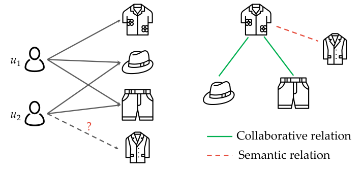
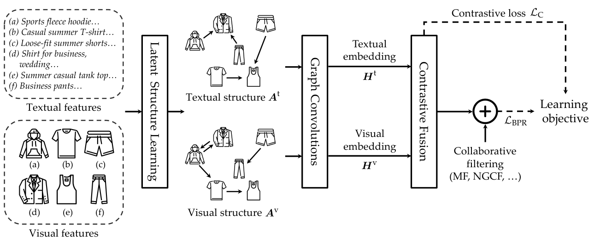
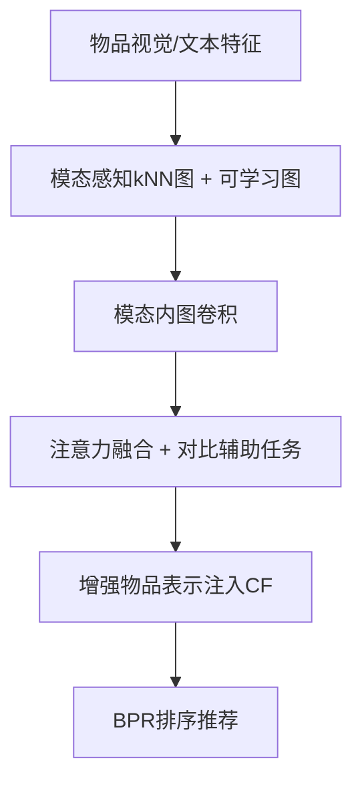

# Latent Structure Mining with Contrastive Modality Fusion for Multimedia Recommendation（面向多媒体推荐的对比模态融合与潜在结构挖掘）

- **会议/期刊**: IEEE TKDE（2023；arXiv 2021，LATTICE 扩展版）
- **作者与机构**: Jinghao Zhang, Yanqiao Zhu, Qiang Liu, Mengqi Zhang, Shu Wu, Liang Wang；中科院自动化所 CRIPAC/NLPR 与国科大
- **推荐链路定位**: 精排（CF 排序）
- **研究方向**: 多模态推荐 / 自监督对比与交互去噪
- **论文原文**: [论文原文链接](https://arxiv.org/abs/2111.00678v2)
- **开源代码**: [开源代码仓库链接](https://github.com/CRIPAC-DIG/MICRO)

## TL;DR (1分钟核心速览)

针对多模态推荐中仅靠协同共现隐式建模物品关系、且多模态融合粗粒度的问题，MICRO 用模态感知图结构学习、模态内图卷积和对比融合，把内容语义关系注入 CF 物品表示。Amazon 三数据集 Recall@20 相对最优基线提升 9.2%–24.1%，冷启动亦优。

## Background & Motivation (背景与核心矛盾)

- **主流范式**: 多模态推荐通常把视觉/文本特征作为 side information，在 user-item 二部图上做 GNN 聚合，代表作为 VBPR、MMGCN、GRCN。
- **前人局限**: ① item-item 关系仅通过 high-order item-user-item 共现隐式得到，内容语义关系未显式建模；② 多模态融合多为线性组合/拼接，所有物品共享同一融合权重，忽略 item-level 细粒度差异。
- **核心洞察 (Key Insight)**: 作者 pilot 实验发现共交互物品语义更相似（Clothing 视觉相似度 0.3958 vs 全体 0.2239，文本 0.5830 vs 0.4206），且即使 $k=5$，仍有 46.88%/54.90% 用户购买视觉/文本近邻物品——语义结构可补充协同信号。
- **本文切入点**: 从多模态特征中挖掘模态感知 item-item 潜在图，再用对比学习迫使融合表示捕捉跨模态共享关系，最终作为插件增强任意 CF 的物品表示。  
<figure class="paper-figure" markdown="span">
  <figcaption>图1. 一个具有两类物品关系的推荐玩具示例。本文认为，从多模态特征中挖掘的语义结构有助于全面发现补充传统工作中协同信号的候选物品（建议彩色查看）。</figcaption>
</figure>

## Method (核心方法设计)

### 1. 整体框架 (Overall Architecture)

MICRO 先由每个模态的原始特征构造 $k$NN 初始物品图，并由可训练变换后的特征动态学习模态感知图；随后在学到的图上对 item ID embedding 做模态内图卷积，得到各模态物品表示；再用注意力融合多模态表示，并以“单模态表示—融合表示”互信息最大化为辅助任务；最后把融合表示归一化后加回下游 CF 的物品 embedding，用 BPR 排序损失训练。多模态结构学习与 user-item 交互建模解耦，因此可插拔到 MF/NGCF/LightGCN。  
<figure class="paper-figure" markdown="span">
  <figcaption>图2. 我们提出的 MICRO 模型的整体框架。首先，我们开发了一种新颖的模态感知结构学习层，从多模态特征中挖掘模态感知的潜在物品-物品语义关系。其次，我们在学习到的模态感知图上使用图卷积，以分别显式建模每个模态的物品关系。第三，我们设计了一种新颖的对比多模态融合框架，以自监督方式迫使融合后的多模态表示自适应地捕捉多个模态之间共享的物品关系。最后，……</figcaption>
</figure>

### 2. 关键设计拆解 (Key Designs)

1. **模态感知潜在结构学习**：原始多模态特征有噪声且可能不完整，直接 $k$NN 图不一定是推荐最优。先由原始特征得$\tilde{S}_m$，再由变换特征$\tilde{e}_i^m=\mathbf{W}_m e_i^m+b_m$重算图$\tilde{A}_m$，并用 skip connection 融合：$A_m=\lambda\tilde{S}_m+(1-\lambda)\tilde{A}_m$。这样既保留原始语义，又允许任务驱动去噪，且$A_m$ 仍稀疏归一化，训练稳定。

2. **模态内图卷积 + 注意力融合**：为显式注入 item affinity，以 ID embedding 为输入做 $H_m^{(l)}=A_mH_m^{(l-1)}$，而非直接把多模态特征当节点输入；多模态特征只负责“搭桥”建图。融合时按物品级注意力加权：$\alpha_i^m=\mathrm{softmax}(q^\top\tanh(\mathbf{W}h_i^m+b))$，$h_i=\sum_m\alpha_i^m h_i^m$。这使不同物品可自适应选择更相关模态，避免全局同一融合权重。

3. **对比多模态融合与训练目标**：仅注意力融合仍可能丢失跨模态共享关系，因此构造辅助 InfoNCE：以单模态表示 $h_i^m$与融合表示$h_i$为正对，同模态其他物品及融合空间其他物品为负对，$\mathcal{L}_C=-\frac{1}{|\mathcal{I}|}\sum_i\frac{1}{|\mathcal{M}|}\sum_m\frac{1}{2}[I(h_i^m,h_i)+I(h_i,h_i^m)]$。最终$\hat{x}_i=\tilde{x}_i+h_i/\|h_i\|_2$，$\hat{y}_{ui}=\tilde{x}_u^\top\hat{x}_i$，$\mathcal{L}=\mathcal{L}_{BPR}+\beta\mathcal{L}_C$。BPR 每正样本采 1 个未交互负样本；对比损失用 in-batch 负样本；图构建可离线，推理仅需 GCN 前向与内积。

## Experimental Setup & Evaluation Protocol (实验设置与评估协议)

- **数据集与预处理**:

| 数据集 | #Users | #Items | #Interactions | 密度 | 特征/场景说明 |
| :--- | :---: | :---: | :---: | :---: | :--- |
| Clothing | 39,387 | 23,033 | 237,488 | 0.00026 | Amazon 服饰；视觉 4096 维，文本 1024 维 |
| Sports | 35,598 | 18,357 | 256,308 | 0.00039 | Amazon 运动户外 |
| Baby | 19,445 | 7,050 | 139,110 | 0.00101 | Amazon 母婴 |

- **数据划分与防穿越**: Warm-start 按每用户交互 80%/10%/10% 划分 train/val/test；Cold-start 从训练集移除随机 20% 物品集的所有交互，其中 10% 验证、10% 测试，测试物品训练中完全未见。
- **排名评测协议**: 指标为 Recall@20、Precision@20、NDCG@20；训练采用 1:1 未交互负采样，原文未披露评测候选是否采样，按全库未交互候选排序理解。
- **对比基线与超参**: 基线含 ItemKNN、MF、NGCF、LightGCN、SGL、VBPR、MMGCN、GRCN；Embedding $d=64$，lr$5\times10^{-4}$，$k=10$，$\lambda=0.7$，$\tau=0.5$，$\beta=0.03$，LightGCN 下游层数$L=1/2$，显著性$p\le0.05$。

## Key Experimental Results (实验关键数据)

### 1. 主实验对比 (Main Results)

| 模型 | Clothing R@20 | Clothing NDCG@20 | Sports R@20 | Sports NDCG@20 | Baby R@20 | Baby NDCG@20 |
| :--- | :---: | :---: | :---: | :---: | :---: | :---: |
| ItemKNN | 0.0280 | 0.0131 | 0.0410 | 0.0212 | 0.0317 | 0.0152 |
| MF | 0.0191 | 0.0088 | 0.0430 | 0.0202 | 0.0440 | 0.0200 |
| NGCF | 0.0387 | 0.0168 | 0.0728 | 0.0332 | 0.0591 | 0.0261 |
| LightGCN | 0.0470 | 0.0215 | 0.0803 | 0.0377 | 0.0698 | 0.0319 |
| SGL | 0.0598 | 0.0268 | 0.0905 | 0.0412 | 0.0745 | 0.0328 |
| VBPR | 0.0481 | 0.0205 | 0.0582 | 0.0265 | 0.0486 | 0.0213 |
| MMGCN | 0.0501 | 0.0221 | 0.0638 | 0.0279 | 0.0640 | 0.0284 |
| GRCN | 0.0631 | 0.0276 | 0.0833 | 0.0377 | 0.0754 | 0.0336 |
| **MICRO** | **0.0782** | **0.0351** | **0.0988** | **0.0457** | **0.0892** | **0.0402** |
| **Improv.%** | **+24.1** | **+27.4** | **+9.2** | **+10.9** | **+18.3** | **+19.7** |

P@20 同向，详见原文表 4。

### 2. 消融实验 (Ablation Study)

下游为 LightGCN，指标为 R@20：

| 变体 | Clothing | Sports | Baby |
| :--- | :---: | :---: | :---: |
| LightGCN+feats | 0.0477 | 0.0754 | 0.0793 |
| MICRO/feats | 0.0659 | 0.0889 | 0.0871 |
| MICRO w/o contrast | 0.0703 | 0.0925 | 0.0830 |
| **MICRO** | **0.0782** | **0.0988** | **0.0892** |

### 3. 关键实验发现 (Key Findings)

- 主实验中 Clothing 增益最大：R@20 +24.1%、NDCG@20 +27.4%，说明服饰类目视觉/文本语义关系与协同信号互补明显；Sports 仅 +9.2%，内容特征与交互信号重叠更强。
- 消融显示“学结构”是主增益：去掉可学习图、改用特征作 GCN 输入后，Clothing R@20 从 0.0782 降至 0.0659；再去掉对比融合降至 0.0703，验证结构学习与细粒度融合各自有效。
- 双模态稳定优于单模态（Clothing 0.0782 vs 视觉 0.0613/文本 0.0699），且文本普遍强于视觉；冷启动下 MICRO 与 w/o contrast 均超 CF/内容基线，说明语义邻居可为孤立物品传播反馈。

## Highlights & Limitations (亮点、对比与审稿批判)

- **与代表作对比**: MMGCN/GRCN 在 user-item 图上做模态聚合或边去噪；MICRO 将内容语义关系与交互建模解耦，学 item-item 图后插件式增强 CF。相比 LATTICE，本文增加对比多模态融合，迫使融合表示捕捉跨模态共享结构。
- **可迁移亮点**: ① 用“原始特征图 + 可学习图 + skip connection”构造模态感知 item 图，可迁移到多模态召回/冷启动物品增强；② 以单模态表示为 teacher、融合表示为 student 的 InfoNCE，可用于任意多视图融合。
- **审稿级局限批判**: ① 物品图需 $O(N^2)$两两相似度与$k$NN 稀疏化，超大 item 库构图成本高；② 冷启动仅验证 item cold-start，未覆盖 user cold-start；③ 评测未明确全库/采样候选比例，且$k,\lambda,\beta$ 需逐数据集调参。

## Rating (四维评分)

- **方法创新性 (Novelty)**: ⭐⭐⭐⭐ （模态感知图学习与对比融合结合自然，item-item 语义结构建模有增量）
- **评估协议与实验扎实度 (Protocol & Experiments)**: ⭐⭐⭐ （三数据集+冷启动+消融较完整，但评测候选协议披露不足、无用户冷启动）
- **写作与数学规范度 (Clarity & Rigor)**: ⭐⭐⭐⭐ （模块公式清晰，图学习与对比目标定义完整，复杂度讨论略少）
- **工业落地与复现价值 (Industrial & Practical Value)**: ⭐⭐⭐⭐ （代码开源、可插拔 CF，但 $O(N^2)$ 构图限制大规模在线部署）

