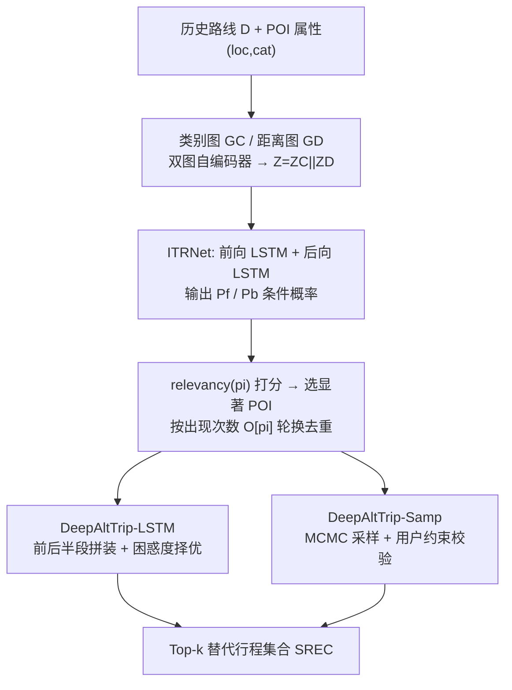

# DeepAltTrip: Top-k Alternative Itineraries for Trip Recommendation（面向行程推荐的Top-k替代行程深度生成）

- **会议/期刊**: IEEE TKDE (Under Review, Sept. 2021)
- **作者与机构**: Syed Md. Mukit Rashid, Mohammed Eunus Ali (BUET), Muhammad Aamir Cheema (Monash University)
- **推荐链路定位**: 端到端生成式（行程级生成）
- **研究方向**: 时空轨迹与POI本地生活推荐 / 序列与会话推荐
- **论文原文**: [arXiv:2109.03535](https://arxiv.org/abs/2109.03535v1)
- **开源代码**: 暂未开源

## TL;DR (1分钟核心速览)

针对"给定起点 $s$与终点$d$，现有学习式行程推荐只能返回单条最热门路线，无法给出多条互不重叠的备选"这一痛点，本文提出 DeepAltTrip：先用双图自编码器学习类别/距离 POI 向量，再用前向+后向双 LSTM 构建 ITRNet 估计任意位置 POI 的条件概率，最后通过"逐次挑选低频显著 POI"或"MCMC 采样式约束生成"迭代产出$k$条替代行程。在 8 个真实数据集（3 个城市 + 5 个主题公园）五折交叉验证上，F1/Pairs-F1 与最强基线持平的同时多样性大幅胜出，$\alpha=0.5$ 的组合指标最高相对提升 29.24%。

## Background & Motivation (背景与核心矛盾)

- **主流范式**: 传统行程推荐（Rank+Markov、NASR 等）把历史轨迹视为马尔可夫转移或序列到序列预测，目标永远是输出**一条**最热门 $s \to d$ 路径。
- **前人局限**: (i) 返回 top-$k$时往往只是同一条热门路线的近似变体（$R_1$与$R_2$ 仅差一个 POI），用户拿到的是"重复推荐"；(ii) 纯搜索式的多样化方法（子模函数、欧氏距离阈值）只优化多样性而忽略历史热度，且无法在推理时灵活接入用户约束（预算、必去点、营业时间）。
- **核心洞察 (Key Insight)**: 作者指出"热门"与"多样"并不天然冲突——若能在历史路线分布上找到若干**等价热门但低重叠**的替代路径（如图 1 中 $R_1$与新生成的$I_2=(s,p_1,p_4,p_8,d)$ 这类不在历史数据中出现的路径），即可同时兼顾二者。
- **本文切入点**: 让模型只学"POI 在序列中某位置的概率"，把流行度与多样性的权衡从**显式目标函数**中解耦，转由生成策略（显著 POI 轮换 / MCMC 采样）隐式承担。

## Method (核心方法设计)

### 1. 整体框架 (Overall Architecture)

输入为城市 POI 集合 $\mathcal{Q}$（含经纬度与类别）与历史路线多重集$\mathcal{D}$。离线阶段先构建 POI 类别图$G_C$与空间距离图$G_D$，用两个图自编码器得到拼接嵌入$Z = Z_C \\| Z_D$；ITRNet 的前向 LSTMs 从起点$s$往后推、后向 LSTM 从终点$d$往前推，输出位置$t$上每个 POI 的条件概率。在线查询$q(s,d,k)$时，按当前累计出现次数筛出"最冷门" POI 池，在其中挑相关性最高的显著 POI 作为锚点，再由两个 LSTM 拼出前后半段（DeepAltTrip-LSTM），或用 MCMC（插入/删除/替换/交换）迭代优化困惑度并校验用户约束（DeepAltTrip-Samp），重复$k$ 轮即得替代集合。

### 2. 关键设计拆解 (Key Designs)

1. **双图自编码器 POI 嵌入（解决稀疏 POI 的冷启动表征）**：历史访问稀疏时仅靠共现无法区分 POI。作者分别用类别一致性 $A^C_{ij}=\mathbb{I}(p_i.\text{cat}=p_j.\text{cat})$ 与指数归一化距离
$A^D_{ij}=\frac{e^{d_{\max}-\text{dist}(p_i,p_j)}-e^{d_{\max}-d_{\min}}}{1-e^{d_{\max}-d_{\min}}}$构造两个邻接矩阵，经 GCN 编码得$\hat{A}=\mathrm{ReLU}(ZZ^{\top})$做重构（$G_C$用交叉熵、$G_D$ 用 MSE）。直觉：语义同类与地理邻近的 POI 共享表征，使罕见的"潜在替代点"也能获得合理概率。

2. **显著 POI 轮换生成多样化行程（本文多样性的核心机制）**：若每轮都取 $\arg\max$相关性，$k$条路线会高度重合。定义单点相关性$\mathrm{relevancy}(p_i)=\frac{1}{2}\left(P_f(x_{i,2}|s,d)+P_b(x_{i,2}|s,d)\right)$，并在每轮中把 POI 限制在**累计出现次数最少**的集合$\mathcal{O}_{\min}$ 内取最大：
$p^{(p)}=\arg\max_{p_i\in\mathcal{O}_{\min}}\mathrm{relevancy}(p_i)$每生成一条线路就对沿线 POI 的$O[p_i]$ 加一，从而实现"隐式去重叠"，无需任何显式多样性项。

3. **MCMC 采样生成 + 约束满足（面向真实落地）**：为了支持预算、必去 POI、时间窗等硬约束，DeepAltTrip-Samp 以四类操作（插入/删除/替换/交换再替换）在行程空间内游走，单点候选分布用前后 LSTM 按剩余长度加权融合：
$P_c(x_t|p(s),p(d)) = \beta\,P_f(x_t|p(s),p(d)) + (1-\beta)\,P_b(x_t|p(s),p(d)),\ \ \beta=\tfrac{t}{T-1}$这样"看得更远"的一侧（子路径更长者）权重更高；接受准则为困惑度$\mathrm{perplexity}(I)=-\sum_{i=1}^{|I|}\log P_f(x_{r_i,i}|s,d)$ 下降**且**全部用户约束通过，否则回退（允许连续两次拒绝以跳出局部最优）。

**训练与推理开销**：两个 LSTM 均用二分类交叉熵逐位置训练（$h_j^f=\mathrm{LSTM}_F(z_{r_j}\\|z_{p(s)}\\|z_{p(d)},h_{j-1}^f)$，$\alpha_{i,t}=\mathrm{MLP}(z_{p_i}\\|h_{t-1}^f)$，softmax 归一化），无负采样；嵌入维度$Z_C=12$、$Z_D=24$，LSTM 隐藏维 32，MLP 30 维，Adam 学习率$10^{-3}$、batch 32。D-LSTM 单查询约 0.19–0.41 s，D-Samp 约 0.49–1.26 s。

## Experimental Setup & Evaluation Protocol (实验设置与评估协议)

- **数据集与预处理**：8 个真实数据集，横跨"城市旅游"与"主题公园"两域；过滤规则为**去除轨迹内重复 POI（防环）且保留长度 $\ge 3$的轨迹**，相邻访问间隔$\le 8$ 小时。

| 数据集 | #POIs | #Routes(≥3) | unique $(s,d)$ | 场景说明 |
| :--- | :---: | :---: | :---: | :--- |
| Edinburgh | 28 | 634 | 267 | Flickr 城市轨迹 |
| Toronto | 29 | 335 | 163 | Flickr 城市轨迹 |
| Melbourne | 88 | 442 | 373 | Flickr 城市轨迹（POI 最多） |
| California Adventure | 25 | 1475 | 404 | 主题公园 |
| Hollywood | 13 | 901 | 134 | 主题公园 |
| Disneyland | 31 | 2792 | 618 | 主题公园（轨迹最多） |
| Disney Epcot | 17 | 1248 | 207 | 主题公园 |
| Magic Kingdom | 27 | 2218 | 508 | 主题公园 |

- **数据划分与防穿越**：**5 折交叉验证**（1 折测试、4 折训练），报告五折平均；不采用时间戳切分（原文未设全局时间切分，属潜在穿越风险点）。
- **排名评测协议**：**非检索式全库排序**，而是对比**推荐集合 $S_{REC}$与真实历史集合$S_{gr}$（同一$(s,d)$的全部历史路线）**的匹配度：F1、考虑顺序的 Pairs-F1、集合级多样性$\mathrm{div}(S_{REC})=\frac{1}{k(k-1)}\sum_{i\ne j}(1-\mathrm{sim}(I_i,I_j))$（$\mathrm{sim}$取 F1，忽略起终点），以及组合指标$\mathrm{comb}=\alpha\cdot \mathrm{pop}+(1-\alpha)\cdot \mathrm{div}$。
- **对比基线（稀缺但合理）**：因该任务无直接前作，作者改编两个 SOTA 行程推荐器（均叠加 diversified beam search 以返回 $k$条）——`Markov+DBS`（Rank+Markov + Viterbi）与 `NASR+DBS`（自注意力 LSTM + beam）。默认$k=3$、$L=5$，$\alpha$ 默认 0.5。

## Key Experimental Results (实验关键数据)

### 1. 主实验对比 (Main Results)

默认设置（$k=3,\ L=5$）下的代表性结果：

| 数据集 | 方法 | F1 | Pairs-F1 | Div. |
| :--- | :--- | :---: | :---: | :---: |
| Edinburgh | Markov+DBS | **0.592** | **0.287** | 0.534 |
| | NASR+DBS | 0.576 | 0.268 | 0.643 |
| | DeepAltTrip-LSTM | 0.580 | 0.272 | **0.766** (+19.13%) |
| | DeepAltTrip-Samp | 0.577 | 0.270 | 0.724 (+12.60%) |
| Toronto | Markov+DBS | **0.597** | 0.284 | 0.461 |
| | NASR+DBS | 0.583 | 0.267 | 0.666 |
| | DeepAltTrip-LSTM | 0.589 | 0.280 | **0.755** (+13.36%) |
| | DeepAltTrip-Samp | 0.594 | **0.286** | 0.665 |
| Melbourne | Markov+DBS | 0.500 | 0.186 | 0.564 |
| | NASR+DBS | 0.497 | 0.181 | 0.722 |
| | DeepAltTrip-LSTM | **0.521** | **0.207** | 0.791 (+9.56%) |
| | DeepAltTrip-Samp | 0.512 | 0.198 | **0.814** (+12.74%) |
| Epcot | Markov+DBS | 0.585 | 0.279 | 0.425 |
| | NASR+DBS | **0.604** | **0.298** | 0.422 |
| | DeepAltTrip-LSTM | 0.585 | 0.280 | **0.741** (+75.6%) |
| | DeepAltTrip-Samp | 0.582 | 0.276 | 0.704 (+66.8%) |
| Magic Kingdom | Markov+DBS | 0.512 | 0.205 | 0.394 |
| | NASR+DBS | **0.525** | **0.215** | 0.525 |
| | DeepAltTrip-LSTM | 0.515 | 0.205 | **0.761** (+44.9%) |
| | DeepAltTrip-Samp | 0.509 | 0.203 | **0.761** (+44.9%) |

### 2. 消融实验 (Ablation Study)

原文**未提供严格的组件级消融表**（仅以两个生成变体对照 + 参数扫描说明各模块作用），下表为基于变体差异与生成策略的功能对照整理：

| 配置/模块 | F1 (Edinburgh) | Div. (Edinburgh) | Comb$_{\alpha=0.5}$ | 说明 |
| :--- | :---: | :---: | :---: | :--- |
| 完整 DeepAltTrip-LSTM | 0.580 | **0.766** | **0.673** | 前后向 LSTM + 显著 POI 轮换 |
| 完整 DeepAltTrip-Samp | 0.577 | 0.724 | 0.651 | MCMC 采样（约束就绪） |
| 基线：仅贪心 beam（无显著 POI 轮换） | 0.576 | 0.643 | 0.610 | 相当于退回 NASR+DBS 的 top-$k$ |
| 基线：纯随机多样化（无 LSTM 概率） | — | — | — | 原文明确否定该方案（见 Fig.1 中 $R_5$ 不热门） |

### 3. 关键实验发现 (Key Findings)

1. **多样性增益随行程变长急剧放大**：Edinburgh 上 $L=5$时 D-LSTM 多样性仅 +19.13%、组合指标 +10.33%，而$L=9$ 时多样性提升 **136%**、组合指标提升 **44.38%**——原因是基线在长行程下因 beam 搜索塌缩到同一条高分路径，多样性骤降至 0.232，而本文仍维持 0.548。
2. **$k$增大时优势不衰减**：Edinburgh 上 D-LSTM 在$k=2,3,4,5$时组合指标分别领先 11.74%/10.32%/10.69%/11.72%，说明"显著 POI 轮换"能持续供给低重叠候选，而非只在$k=2$ 时侥幸。
3. **参数 $\alpha$全区间稳健领先**：从$\alpha=0.1$（重多样）到$\alpha=0.9$（重流行）本文两变体均优于 NASR+DBS；$\alpha=0.5$ 时 Epcot 上 D-LSTM 组合指标 0.663 对 NASR+DBS 0.513，相对提升 **29.24%**（D-Samp 为 25.34%）。

## Highlights & Limitations (亮点、对比与审稿批判)

- **与代表作对比 (vs. Prior Work)**: 与 NASR（自注意力 LSTM 单路线）、Rank+Markov（马尔可夫+Viterbi）等仅返回单条最热门路线的学习式方法相比，本文首次把"多替代"纳入生成流程；与子模/欧氏距离阈值的搜索式多样化方法相比，本文不显式定义多样性度量，且在推理期可接入预算、必去 POI、营业时间等硬约束。
- **可迁移亮点**: (i) "**按出现次数轮换锚点**"是极轻量的隐式去重技巧，可无缝迁移到对话推荐的多候选生成与列表重排的多样性约束；(ii) **$\beta=t/(T-1)$ 的剩余路径长度加权融合**为双向序列解码提供了无需额外训练的通用融合策略；(iii) MCMC 采样器把约束校验放在接受准则里，是"深度生成 + 硬约束"结合的实用范式。
- **审稿级局限批判**: (i) **评估协议不严谨**——5 折随机划分、无时间戳切分导致历史轨迹穿越；且"热门度"用推荐集合与同一 $(s,d)$历史集合的 F1 衡量，属自建代理指标而非线上点击/留存，缺乏显著性检验；(ii) **缺少组件消融**，无法量化双图自编码器与后向 LSTM 各自贡献，且 D-Samp 在$L=9$时单查询耗时 1.26 s，比 D-LSTM 慢 3 倍，对实时出行场景不够友好；(iii) 双图自编码器依赖$(s,d)$对之间共现，$s,d$ 冷门时表征质量存疑。

## Rating (四维评分)

- **方法创新性 (Novelty)**: ⭐⭐⭐⭐ （首个学习式多替代行程框架，"显著 POI 轮换 + MCMC 约束采样"组合在行程生成领域有明确新意，但单模块技术均为成熟组件）
- **评估协议与实验扎实度 (Protocol & Experiments)**: ⭐⭐⭐ （8 数据集覆盖面广、参数扫描充分，但缺时间切分、缺显著性检验、缺组件消融，衡量指标为自建代理）
- **写作与数学规范度 (Clarity & Rigor)**: ⭐⭐⭐⭐ （公式推导与算法伪代码清晰，符号表完整；困惑度接受准则缺少接受概率的温度参数讨论）
- **工业落地与复现价值 (Industrial & Practical Value)**: ⭐⭐⭐⭐ （D-LSTM 与 NASR 等速、$O(|\mathcal{Q}|)$ 级开销可上线；MCMC 变体对约束友好但延迟高，且代码未开源限制了直接复现）

