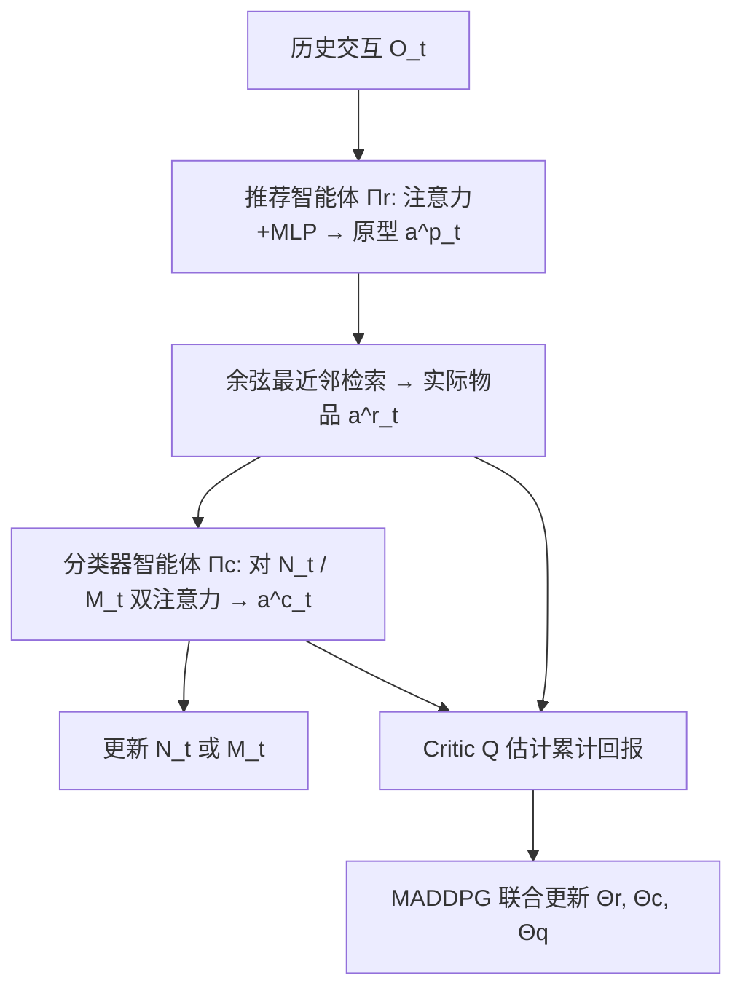

# Learning from Atypical Behavior: Temporary Interest Aware Recommendation Based on Reinforcement Learning (从非典型行为中学习：基于强化学习的临时兴趣感知推荐)

- **会议/期刊**: IEEE TKDE (arXiv 2022-01)
- **作者与机构**: Ziwen Du, Ning Yang, Zhonghua Yu (四川大学), Philip S. Yu (UIC)
- **推荐链路定位**: 精排 / 序列决策式重排（离线强化学习训练，在线单智能体推理）
- **研究方向**: 强化学习与动态探索推荐 / 自监督对比与交互去噪
- **论文原文**: [https://arxiv.org/abs/2201.05970v1](https://arxiv.org/abs/2201.05970v1)
- **开源代码**: [https://github.com/dududu123456/TIARec](https://github.com/dududu123456/TIARec)

## TL;DR (1分钟核心速览)

传统鲁棒推荐把偏离用户主偏好的"非典型交互"一律当作噪声过滤，粗粒度丢弃了其中蕴含的**临时兴趣**信号，且缺乏"哪条交互是非典型"的显式监督。本文提出 TIARec：一个推荐智能体 + 一个辅助分类器智能体 + 一个共享 Critic，采用 MADDPG 联合训练，分类器以"类内相似度"构造的自监督奖励判断交互是否非典型，并通过共享回报把临时兴趣知识迁移给推荐器。在 Movielens-1M / Beauty / Tianchi 三个数据集、70/10/20 时间切分、全库排序协议下，HR@20 相对最强基线最高提升 15.19%，NDCG@10 提升 39.80%。

## Background & Motivation (背景与核心矛盾)

- **主流范式**: 鲁棒推荐分两支——自编码器去噪（CDAE、CVAE、RecVAE 对损坏输入重建）与对抗训练（APR 向 BPR 参数注入扰动），核心动作都是"压低/剔除异常交互的影响"。
- **前人局限**: ①真实兴趣是动态的，NBA 期间偶看篮球视频是**临时兴趣**而非噪声，过滤会削弱个性化；②没有显式标注说明哪条交互"非典型"，模型无法直接从历史中学到临时兴趣。
- **核心洞察 (Key Insight)**: 作者在三个真实数据集上按物品类目统计，超 70% 用户存在频率低于均值 5% 的稀有交互，但 CDAE / APR 能正确召回这类用户的不足 10%（图 1）。即"非典型"是普遍现象且被现有方法系统性忽视。
- **本文切入点**: 把"识别非典型"本身建模为一个可学习的策略（分类器智能体），用强化学习的试错回报替代缺失的监督信号，再通过联合训练把该知识蒸馏进推荐智能体。

## Method (核心方法设计)

### 1. 整体框架 (Overall Architecture)

环境即用户，状态 $s_t=\mathcal{O}_t$为历史交互集合，动作是物品嵌入。每个时间步：推荐智能体$\Pi_r$由注意力聚合历史生成原型嵌入，检索最近邻物品$a^r_t$；分类器智能体$\Pi_c$以$a^r_t$为 query、分别对非典型集合$\mathcal{N}_t$与正常集合$\mathcal{M}_t$做注意力，输出$a^c_t\in[0,1]$决定把该交互并入$\mathcal{N}_t$还是$\mathcal{M}_t$；Critic$Q$以$(s^q_t,a^r_t\oplus a^c_t)$估计累计回报。两智能体共享 Critic 的梯度，训练结束后$\Pi_r$ 可独立推理。

### 2. 关键设计拆解 (Key Designs)

1. **双注意力分类器 + 相似度自监督奖励**：没有标签怎么办？作者用"非典型行为彼此应不相似"作为先验构造奖励：

$$R^c_t=\begin{cases}1-\frac{1}{|\mathcal{N}_t|}\sum_{i}\cos(n_i,a^r_t), & a^r_t\in\mathcal{N}_{t+1}\\ \frac{1}{|\mathcal{M}_t|}\sum_{i}\cos(m_i,a^r_t), & a^r_t\in\mathcal{M}_{t+1}\end{cases}$$

即判为非常规则奖励其与 $\mathcal{N}_t$的**低相似度**（保持多样性），判为正常则奖励其与$\mathcal{M}_t$的**高相似度**（保持一致性）。$\mathcal{N}_t$即"临时兴趣"的显式载体，$\mathcal{M}_t$ 即"一般偏好"。

2. **未知日志策略下的离线奖励推断**：日志由未知策略产生，无法直接用"推荐列表是否命中"设奖励。作者先在全集上跑 PMF 得到 $p(u,v)=\sigma(\boldsymbol{u}^\top\boldsymbol{v})$，再把推荐列表$\mathcal{V}_k$的期望命中率作为奖励$R^r_t=\frac{1}{k}\sum_{v\in\mathcal{V}_k}p(u,v)$——列表整体越可能被点击，奖励越高，规避了传统 off-policy 需要已知行为策略的假设。

3. **训练目标、负采样与推理效率**：总即时奖励 $r_t=R^r_t+\alpha R^c_t$，Critic 损失$\mathcal{L}_q=\mathbb{E}[(q_t-Q(s^q_t,a^q_t))^2]$；智能体损失

$$\mathcal{L}_{r,c}=\mathbb{E}_{s_t}\big[(a^r_t-a^p_t)^2-Q(s^q_t,a^p_t\oplus a^c_t)\big]$$

第一项把检索到的真实物品拉近原型嵌入，第二项用原型（而非离散物品）计算回报以打通梯度。无需负采样；训练用经验回放（容量 2000）+ 目标网络软更新 $\tau=0.01$。推理时仅保留$\Pi_r$，单次前向 + 全库余弦检索。

## Experimental Setup & Evaluation Protocol (实验设置与评估协议)

- **数据集与预处理**: 未做 5-core 过滤，直接使用原始评分。

| 数据集 | #Users | #Items | #Interactions | 稀疏度 | 场景说明 |
| :--- | :---: | :---: | :---: | :---: | :--- |
| Movielens-1M | 6,040 | 3,952 | 1,000,209 | 4.19% | 电影评分 |
| Beauty | 1,210,271 | 249,274 | 2,023,096 | ~0.0007% | 亚马逊美妆 |
| Tianchi | 6,471 | 554,442 | 802,757 | ~0.02% | 天猫电商 |

- **数据划分与防穿越**: 按时间序 **70%/10%/20%** 切分为训练/验证/测试，属全局时间戳切分。
- **排名评测协议**: 对每个测试正样本单独生成排序列表，指标为 HR@k、Recall@k、NDCG@k，$k\in\{5,10,20\}$；从公式 (21)-(24) 的$rank(v^u_i,l^u_i)$ 定义看为 **Full-Ranking（全库排序）**，非采样排序。
- **对比基线与超参**: 基线含鲁棒推荐（CDAE、APR）、RL 推荐（DEERs、HRL、KGQR、PDQ）、交互式推荐（I-CARS）以及消融变体 TIARec-C。嵌入维度 $d=64$（ML-1M）/$128$（Beauty、Tianchi）；$\alpha=0.1/0.5/1.0$，$\gamma=0.99$。基线超参同样在验证集上调优。

## Key Experimental Results (实验关键数据)

### 1. 主实验对比 (Main Results)

| 数据集 / 指标 | CDAE | APR | DEERs | HRL | KGQR | PDQ | I-CARS | TIARec-C | **TIARec** | Improv. |
| :--- | :---: | :---: | :---: | :---: | :---: | :---: | :---: | :---: | :---: | :---: |
| ML-1M HR@20 | 0.3014 | 0.3387 | 0.3651 | 0.3433 | 0.5029 | 0.3712 | 0.3406 | 0.4128 | **0.5793** | +15.19% |
| ML-1M NDCG@10 | 0.0044 | 0.0151 | 0.0174 | 0.0188 | 0.0165 | 0.0196 | 0.0089 | 0.0170 | **0.0274** | +39.80% |
| Beauty HR@20 | 0.2431 | 0.3668 | 0.3066 | 0.2433 | 0.3731 | 0.4378 | 0.3728 | 0.3101 | **0.4699** | +7.33% |
| Beauty Recall@5 | 0.0009 | 0.0018 | 0.0054 | 0.0105 | 0.0114 | 0.0160 | 0.0104 | 0.0151 | **0.0231** | +44.38% |
| Tianchi HR@20 | 0.1669 | 0.1967 | 0.2446 | 0.2327 | 0.2632 | 0.2517 | 0.1675 | 0.2199 | **0.2713** | +3.08% |
| Tianchi NDCG@5 | 0.0003 | 0.0007 | 0.0014 | 0.0039 | 0.0034 | 0.0027 | 0.0003 | 0.0022 | **0.0062** | +58.97% |

### 2. 消融实验 (Ablation Study)

| 变体 | ML-1M HR@20 | Beauty HR@20 | Tianchi HR@20 | ML-1M NDCG@10 |
| :--- | :---: | :---: | :---: | :---: |
| TIARec (完整) | **0.5793** | **0.4699** | **0.2713** | **0.0274** |
| TIARec-C (移除分类器，$\alpha=0$) | 0.4128 | 0.3101 | 0.2199 | 0.0170 |
| 退化幅度 | −28.7% | −34.0% | −19.0% | −37.9% |

### 3. 关键实验发现 (Key Findings)

1. **分类器智能体贡献是主导性的**：移除后 Beauty HR@20 从 0.4699 跌至 0.3101（−34%），甚至低于不做区分的 PDQ（0.4378）；而 $\alpha$调参曲线（图 4）显示性能在$\alpha=0.1/0.5/1.0$ 处达峰后回落，证明"过度关注临时兴趣"与"完全忽视"同样是次优，存在明确的平衡点。
2. **鲁棒性随噪声升级衰减更缓**：在注入比例 0.1→0.8 的模拟噪声（连续 5 条低 frequent 类目交互）下，所有方法 HR@10 均下降，但噪声级别 0.8 时 TIARec 的 HR@10 仍保持 $>0.1$，显著高于全部基线，说明其不是"抵抗"噪声而是"利用"噪声。
3. **案例研究验证兴趣平衡机制**：用户 264 在 2002 年主偏好 Drama/Comedy，10–11 月突现 War 类观看。TIARec 的 top-20 中出现 6 部 War + 10 部 Drama（其中 4 部兼具两标签），而 TIARec-C 与全部基线推荐 War 影片均不超过 2 部，直观说明分类器迁移的知识确实改变了个性化召回结构。

## Highlights & Limitations (亮点、对比与审稿批判)

- **与代表作对比 (vs. Prior Work)**: 与 CDAE/APR 的本质区别在于**从"过滤"转为"分流"**——后者把异常交互压缩掉，TIARec 将其定向写入 $\mathcal{N}_t$ 并赋予独立的注意力通道；与 KGQR/PDQ 等 RL 推荐的区别在于引入了**辅助智能体的显式角色分工**，而非单一 Q 网络对所有交互一视同仁；与 I-CARS 的贪心式偏好跟踪相比，TIARec 以长期累计回报为目标，对探测反馈中的伪信号更具免疫力。
- **可迁移亮点**: ①"类内相似度作为自监督奖励"这一构造极为廉价，可直接用于任何需要判定"异常/新颖"的集合划分任务；②用预训练 PMF 打分替代"是否命中"作为离线 RL 奖励，规避了未知日志策略的 off-policy 假设，是通用 trick。
- **审稿级局限批判**: ①离线奖励完全依赖 PMF 打分的代理质量，若 PMF 本身对长尾拟合差，奖励信号会系统性偏乐观；②MADDPG + 经验回放 + 目标网络的训练成本较高，Beauty 上需约 200 epoch 才收敛，且 $\alpha$ 在三个数据集中最优值相差 10 倍（0.1 vs 1.0），泛化到新场景的调参代价被低估；③评测仅做离线全库排序，无在线 A/B，RL 策略的探索行为在真实流量中的风险未被讨论。

## Rating (四维评分)

- **方法创新性 (Novelty)**: ⭐⭐⭐⭐ （首次把"非典型交互=临时兴趣"从建模视角转为双智能体 RL 问题，分类器角色设定与相似度自监督奖励设计有新意）
- **评估协议与实验扎实度 (Protocol & Experiments)**: ⭐⭐⭐⭐ （三数据集 + 全库排序 + 时间切分 + 8 个基线 + 消融/鲁棒性/案例/超参五维分析，但缺少显著性检验与在线验证）
- **写作与数学规范度 (Clarity & Rigor)**: ⭐⭐⭐（公式与符号定义完整、可观测量，但 Critic 损失式 (17) 缺平方项属笔误，部分公式排版有噪声）
- **工业落地与复现价值 (Industrial & Practical Value)**: ⭐⭐⭐（代码已开源、推理仅保留推荐器开销可控；但离线训练链路含 PMF 预训练与多网络联合优化，工程部署成本较高）

