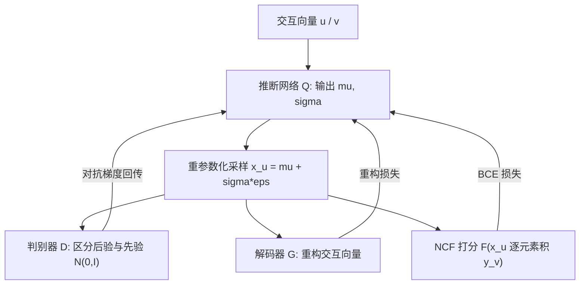

# Dual Adversarial Variational Embedding for Robust Recommendation (面向鲁棒推荐的双侧对抗变分嵌入)

- **会议/期刊**: IEEE TKDE (arXiv 预印本 2021-06)
- **作者与机构**: Qiaomin Yi, Ning Yang (四川大学), Philip S. Yu (UIC)
- **推荐链路定位**: 召回（隐式反馈协同过滤表征学习）
- **研究方向**: 自监督对比学习与交互去噪 / 协同过滤与双塔召回
- **论文原文**: [https://arxiv.org/abs/2106.15779v1](https://arxiv.org/abs/2106.15779v1)
- **开源代码**: [hexiangnan/sigir16-eals](https://github.com/hexiangnan/sigir16-eals)（该链接实为原文所引 Yelp 数据集/基线仓库，DAVE 官方实现暂未开源）

## TL;DR (1分钟核心速览)

针对隐式反馈推荐中"不同用户/物品噪声分布不同"与"VAE 后验单峰、无法刻画多峰偏好"两大痛点，本文提出 DAVE：为每个用户与物品各配一个 VAE 推断专属嵌入分布实现**个性化降噪**，并用辅助判别器与推断网络构成 GAN，以**对抗方式隐式近似 KL 正则**，从而允许任意复杂（多峰）后验。在 5 个真实数据集上按 Leave-One-Out + 1:99 采样排序评估，NDCG@5 相对最强基线提升 1.3%–8.3%，且噪声注入比例升至 0.9 时优势持续扩大。

## Background & Motivation (背景与核心矛盾)

- **主流范式**: 鲁棒推荐有两条路线——一是噪声注入类（CDAE 随机 dropout、APR/ACAE 向参数注入对抗扰动），二是生成式 VAE 类（RecVAE、CVAE-GAN）从潜变量分布采样得到抗噪嵌入。
- **前人局限**: ① 注入噪声的强度是**全局预设常数**，隐含"所有用户的数据噪声水平一致"的强假设，与真实场景中用户行为、物品使用频次的异质噪声相悖；② 标准 VAE 的显式 KL 项把每个 $q_u(\boldsymbol{x}_u|u)$ 都拉向同一各向同性先验，导致嵌入空间退化为**单峰**，而音乐风格、商品品类等偏好天然是多簇多峰的。
- **核心洞察 (Key Insight)**: 若把 KL 正则换成"判别器区分先验样本与后验样本"的对抗博弈，则最优判别器恰给出 $\log p_u-\log q_u$ 的密度比，既保留 KL 正则效果，又**无需为后验指定参数形式**，多峰后验因此可被表达。
- **本文切入点**: 用户侧与物品侧各建一套 VAE+GAN，令方差 $\sigma_u^2$ 充当"个性化噪声水平"，并与 NCF 打分网络端到端联合训练。

## Method (核心方法设计)

### 1. 整体框架 (Overall Architecture)

DAVE 由对称的 UserAVE 与 ItemAVE 两部分构成：输入用户交互向量 $\boldsymbol{u}\in\{0,1\}^M$（或物品交互向量$\boldsymbol{v}$），推断网络$Q_u$输出后验的均值与方差$(\boldsymbol{\mu}_u,\boldsymbol{\sigma}_u)$，经重参数化采样得$\boldsymbol{x}_u=\boldsymbol{\mu}_u+\boldsymbol{\sigma}_u\odot\boldsymbol{\epsilon}_u$；解码器$G_u$重构$\hat{\boldsymbol{u}}$以保证信息不丢失；判别器$D_u$区分后验样本与先验样本。采样得到的$\boldsymbol{x}_u,\boldsymbol{y}_v$送入以逐元素积为输入的 MLP 打分网络$F$输出$\hat{R}_{uv}$。训练交替进行：先更新两个判别器，再联合更新两个 VAE 与$F$。

### 2. 关键设计拆解 (Key Designs)

1. **个性化降噪的双侧 VAE（方差即噪声水平）**：痛点是把噪声当外生超参。DAVE 令每个用户/物品拥有独立后验 $q_u(\boldsymbol{x}_u|u)=\mathcal{N}(\boldsymbol{\mu}_u,\mathrm{diag}(\boldsymbol{\sigma}_u^2))$，$\boldsymbol{\sigma}_u$ 由数据自适应学出，等价于在潜空间按用户自身噪声强度做扰动，取代了"点估计 + 固定扰动"的 CDAE/APR 范式；同时用户侧与物品侧同时建模，弥补了 RecVAE 只做用户侧分布的不足。
2. **对抗式隐式后验正则（多峰表达的关键）**：判别器目标为
   $\mathcal{L}_u^{D}(\Psi_u)=\mathbb{E}_{\boldsymbol{x}_u\sim p_u}\log\sigma(D_u(\boldsymbol{x}_u))+\mathbb{E}_{\boldsymbol{\epsilon}_u\sim\mathcal{N}(0,I)}\log\big(1-\sigma(D_u(\boldsymbol{\mu}_u+\boldsymbol{\sigma}_u\odot\boldsymbol{\epsilon}_u))\big)$。
   其最优解满足 $D_u^{*}(\boldsymbol{x}_u)=\log p_u(\boldsymbol{x}_u)-\log q_u(\boldsymbol{x}_u|u)$，代回 ELBO 后变分目标化为$\mathcal{L}_u^{VAE}=\mathbb{E}\big[\log g_u(u|\boldsymbol{x}_u)+D_u^{*}(\boldsymbol{x}_u)\big]$。直觉：密度比以"黑盒打分"替代解析 KL，后验不受高斯族约束，不同用户的分布簇得以彼此远离，多峰结构被保留。这与 AAE 对**聚合后验**$\mathrm{KL}(q(\boldsymbol{x}),p(\boldsymbol{x}))$ 正则（会抹平个体差异）本质不同。
3. **训练目标与推理开销**：总损失 $\mathcal{L}=\mathcal{L}_u^{VAE}+\mathcal{L}_u^{D}+\mathcal{L}_v^{VAE}+\mathcal{L}_v^{D}+\mathcal{L}_f$，其中$\mathcal{L}_f$为 MLP 上的隐式反馈 BCE；训练负采样为均匀采样比例 2–4。推理时取后验均值$\boldsymbol{\mu}_u,\boldsymbol{\mu}_v$（免采样），仅需一次前向 + MLP 内积打分，与 NCF 同阶；代价是每个用户/物品各需一个推断网络，参数量随用户数线性增长，工程上需按 ID 查表式实现或与 embedding table 融合。

## Experimental Setup & Evaluation Protocol (实验设置与评估协议)

| 数据集 | #Users | #Items | #Interactions | 稀疏度 | 特征/场景说明 |
| :--- | :---: | :---: | :---: | :---: | :--- |
| MovieLens 100K | 943 | 1,682 | 100,000 | 93.69% | 显式评分转隐式（≥20 次/用户） |
| MovieLens 1M | 6,040 | 3,706 | 1,000,209 | 95.53% | 同上 |
| Yelp | 25,677 | 25,815 | 730,790 | 99.89% | 保留 ≥10 交互用户，重复评分去重 |
| Digital Music | 9,906 | 12,381 | 123,518 | 99.90% | Amazon 音乐，按 5-core 过滤 |
| Pinterest | 55,187 | 9,916 | 1,500,809 | 99.73% | 原生隐式 pin 行为 |

- **数据划分与防穿越**: `Leave-One-Out`；Yelp/ML-1M/ML-100K 取每位用户**最新**一条交互作测试，Digital Music/Pinterest 无时间戳则随机抽一条；另随机留一条作验证集调参，重复评分仅计一次以防训练-测试泄漏。
- **排名评测协议**: `Sampled Ranking`——测试正样本与 **99 个随机未交互物品**比较（正负比 1:99），报告 HR@5/10/20 与 NDCG@5/10/20。**注意：全文未使用 Full-Ranking，也未做显著性检验**，绝对数值偏乐观。
- **对比基线与超参**: 基线覆盖 NCF(NeuMF)、去噪自编码(CDAE)、对抗训练(APR/ACAE)、GAN 类(CFGAN)、变分类(AVB/VAEGAN/CVAE-GAN/RecVAE)；嵌入维度 32（Yelp）或 64（其余），batch 128–256，VAE 用 Adam、判别器用 RMSprop（lr=1e-4），判别器 2 隐层(50/100)，打分 MLP 3×32，先验 $\mathcal{N}(0,I)$。

## Key Experimental Results (实验关键数据)

### 1. 主实验对比 (Main Results)

| 数据集 | 方法 | HR@5 | HR@10 | HR@20 | NDCG@5 | NDCG@10 | NDCG@20 |
| :--- | :--- | :---: | :---: | :---: | :---: | :---: | :---: |
| ML-100K | NeuMF | 0.4645 | 0.6257 | 0.7943 | 0.3183 | 0.3704 | 0.4128 |
| ML-100K | CDAE | 0.4284 | 0.6331 | 0.7996 | 0.2855 | 0.3511 | 0.3934 |
| ML-100K | APR | 0.4772 | 0.6755 | 0.8261 | 0.3253 | 0.3896 | 0.4276 |
| ML-100K | ACAE | 0.4602 | 0.6437 | 0.8049 | 0.3107 | 0.3697 | 0.4106 |
| ML-100K | CFGAN | 0.2810 | 0.4422 | 0.6320 | 0.1921 | 0.2438 | 0.2913 |
| ML-100K | RecVAE | 0.4793 | 0.6448 | 0.8028 | 0.3216 | 0.3753 | 0.4157 |
| ML-100K | **DAVE** | **0.4995** | 0.6723 | **0.8293** | **0.3415** | **0.3971** | **0.4369** |
| ML-100K | Improv. | +4.2% | −0.5% | +0.4% | **+5.0%** | +1.9% | +2.2% |
| ML-1M | NeuMF | 0.5089 | 0.6833 | 0.8321 | 0.3562 | 0.4124 | 0.4503 |
| ML-1M | CDAE | 0.4343 | 0.6134 | 0.7882 | 0.2948 | 0.3527 | 0.3970 |
| ML-1M | APR | 0.4603 | 0.6396 | 0.8167 | 0.3148 | 0.3728 | 0.4176 |
| ML-1M | ACAE | 0.5002 | 0.6649 | 0.8164 | 0.3473 | 0.4004 | 0.4388 |
| ML-1M | RecVAE | 0.5371 | 0.6993 | 0.8467 | 0.3729 | 0.4257 | 0.4631 |
| ML-1M | **DAVE** | **0.5417** | **0.7185** | **0.8518** | **0.3761** | **0.4334** | **0.4671** |
| ML-1M | Improv. | +0.9% | +2.7% | +0.6% | +0.9% | +1.8% | +0.9% |

其余数据集（NDCG@5 / HR@5）：Yelp DAVE **0.5018 / 0.6688**，优于 RecVAE 0.4866 / 0.6464（+3.1%）；Digital Music DAVE **0.3555 / 0.4872**，APR 为 0.3500 / 0.4861（+1.6%）；Pinterest DAVE 0.5226 / 0.7219，APR 为 0.5157 / **0.7246**（NDCG 胜、HR 微负）。

### 2. 消融实验 (Ablation Study)

| 变体 | 说明 | ML-100K HR@5 | ML-100K NDCG@5 | Yelp HR@5 | Yelp NDCG@5 | Pinterest HR@5 |
| :--- | :--- | :---: | :---: | :---: | :---: | :---: |
| DAVE | 双侧 VAE + 逐用户对抗隐式后验 | **0.4995** | **0.3415** | **0.6688** | **0.5018** | **0.7219** |
| DAVE-adv | 去掉 GAN，显式高斯 KL | 0.4634 | 0.3193 | 0.6192 | 0.4504 | 0.7020 |
| DAVE+aae | 判别器正则化聚合后验（AAE 式） | 0.4942 | 0.3317 | 0.6687 | 0.4980 | 0.6864 |

### 3. 关键实验发现 (Key Findings)

1. **对抗式隐式后验是最大增益来源，且在稀疏数据上更关键**：去掉 GAN 后 Yelp HR@5 从 0.6688 跌至 0.6192（−7.4%）、ML-100K NDCG@5 从 0.3415 跌至 0.3193（−6.5%），说明显式 KL 造成的单峰坍缩在 99.89% 稀疏度下损害最重。
2. **"逐用户后验"优于"聚合后验"**：换成 AAE 式聚合正则后 Pinterest HR@5 从 0.7219 掉到 0.6864（−4.9%），Yelp NDCG@5 小幅下降 0.3%，验证了个体噪声分布不可被平均化替代；t-SNE 可视化亦显示 DAVE 的用户/物品分布呈明显多簇，而 DAVE-adv 几乎混为一团。
3. **噪声注入曲线拉开差距**：随噪声比例从 0.1 升至 0.9，所有方法性能单调下降，但 DAVE 与 CDAE/ACAE/CVAE-GAN 的间距持续扩大，直接印证"$\sigma_u$ 自适应噪声水平"的抗噪机制；不过在大规模 Pinterest 上 DAVE 的 HR@5 仍略逊 APR（0.7219 vs 0.7246），作者归因于用户/物品数量严重不均衡削弱了偏好多样性，多峰建模收益被压缩。

## Highlights & Limitations (亮点、对比与审稿批判)

- **与代表作对比 (vs. Prior Work)**: 相较 CDAE/APR/ACAE 的"全局固定噪声强度"，DAVE 把噪声强度变成可学习方差；相较 RecVAE 的"用户侧单编码器 + 显式 KL"，DAVE 做了双侧分布并用对抗密度比替代 KL；相较 AVB/VAEGAN 仅迁移网络结构，DAVE 的关键差异是**对每个用户单独正则化后验**而非聚合后验，这才是多峰可表达的根因。
- **可迁移亮点**: ① 用"判别器-密度比"替换 KL 项的技巧可迁到任何需要多峰表征的对比/生成式推荐（如多兴趣序列召回）；② 以方差编码噪声水平、推理取均值的做法，可作为序列/图推荐中鲁棒嵌入层的廉价插件。
- **审稿级局限批判**: ① 评测仅用 1:99 采样排序 + Leave-One-Out 单正样本，缺少 Full-Ranking 与显著性检验，"提升 1–5%" 的结论稳健性存疑，且 2021 年投稿未与 LightGCN/SGL 等图去噪 SOTA 对比；② 每个用户/物品各需独立推断网络，参数量与显存随 ID 数线性增长，推理链路无法直接嵌入工业级 embedding table 与 ANN 召回，且未报告训练耗时；③ 后验仍取对角高斯 + 重参数化，理论上"任意多峰"的表达力受限于推断网络容量，缺乏复杂度与收敛性分析。

## Rating (四维评分)

- **方法创新性 (Novelty)**: ⭐⭐⭐ （将 AVB 的隐式后验正则与双侧 VAE 结合解决个性化降噪，思路清晰但属组合式创新，缺乏理论刻画）
- **评估协议与实验扎实度 (Protocol & Experiments)**: ⭐⭐⭐ （5 个数据集 + 噪声注入实验与 t-SNE 表达力分析较完整，但仅 1:99 采样排序、无全库排序与显著性检验，Pinterest 上甚至未胜最强基线）
- **写作与数学规范度 (Clarity & Rigor)**: ⭐⭐⭐⭐ （ELBO→对抗密度比的推导链条完整，最优判别器结论交代清楚，符号与算法伪代码规范）
- **工业落地与复现价值 (Industrial & Practical Value)**: ⭐⭐⭐ （推理取均值与 NCF 同阶，但逐 ID 推断网络带来存储/训练开销，且官方代码未开源，复现门槛偏高）

