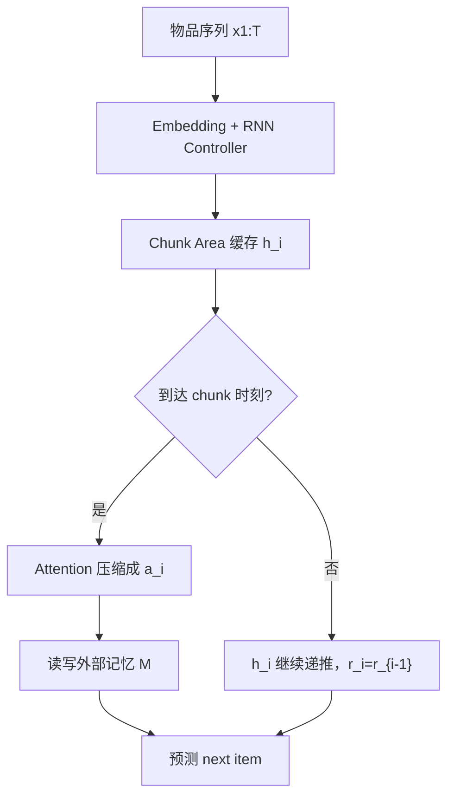
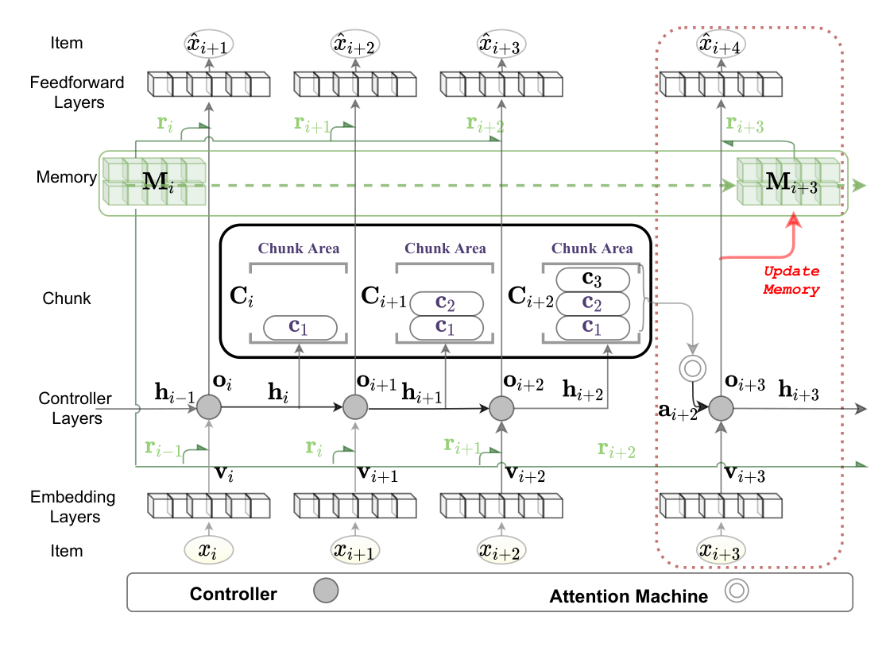
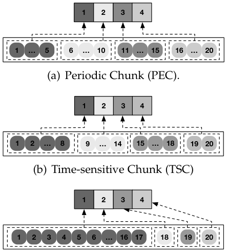

# CmnRec: Sequential Recommendations with Chunk-accelerated Memory Network (CmnRec：基于分块加速记忆网络的序列推荐)

- **会议/期刊**: IEEE Transactions on Knowledge and Data Engineering (TKDE), 2023
- **作者与机构**: Shilin Qu, Fajie Yuan, Guibing Guo, Liguang Zhang, Wei Wei；Monash University / Westlake University / Northeastern University / Tencent Kandian / HUST
- **推荐链路定位**: 精排（Next-Item 序列排序）
- **研究方向**: 序列与会话推荐
- **论文原文**: [https://arxiv.org/abs/2004.13401v2](https://arxiv.org/abs/2004.13401v2)
- **开源代码**: [https://github.com/SLQu/CmnRec](https://github.com/SLQu/CmnRec)

## TL;DR (1分钟核心速览)

针对记忆网络 MNR 在每个时间步都读写外部记忆、长序列训练/推理昂贵的问题，本文提出分块框架 CmnRec：把邻近隐状态缓存为 chunk，在 chunk 时刻用注意力压缩后统一读写记忆，并给出 PEC/TSC 两种切分。在 weishi、ml-10M、ml-latest 的 80/2/18 序列划分与全物品 Top-N 协议下，TSC 较 SRMN 训练最高约 6.34×、推理 10.07× 加速，MRR@5 反升约 1.7%。

## Background & Motivation (背景与核心矛盾)

- **主流范式**: 序列推荐以 GRU4Rec/LSTM4Rec、Caser/NextItNet、SASRec 及外部记忆网络 MNR 为主线；MNR 用 controller + 外部记忆存储长程兴趣。
- **前人局限**: RUM/SRMN 等 MNR 在每个时间步都执行记忆读写，长序列下访存操作成为主要开销；同时单步写入易受异常交互噪声影响。
- **核心洞察 (Key Insight)**: 认知心理学的“chunking”表明，人会把邻近信息合并为有意义单元以降低记忆负担；推荐序列同样可把多步隐状态压缩后再写入记忆。
- **本文切入点**: 不改具体记忆读写实现，而是降低记忆访问频率：非 chunk 时刻只缓存，chunk 时刻注意力压缩并触发一次读写。

## Method (核心方法设计)

### 1. 整体框架 (Overall Architecture)

CmnRec 在标准 MNR 的 Embedding—RNN controller—外部记忆—softmax 链路上插入 chunk 区：非 chunk 时刻只缓存 controller 隐状态，不做记忆读写；到达 chunk 时刻，用注意力把缓存压缩成新隐状态并触发一次记忆读/写，随后清空缓存。这样记忆操作次数从 $T$次降为$m$次（$m$ 为记忆槽数），而每个 chunk 仍保留多步邻近信息，起到压缩与去噪作用。训练用 next-item 交叉熵，推理按 softmax 全物品排序。

<figure class="paper-figure" markdown="span">
  <figcaption>图 4. 基于记忆的神经推荐（MNR）上的分块加速。在非分块时间，信息单元（来自控制器的隐藏状态）被放入分块区域。当到达分块时刻时，注意力机制会从分块区域中提取最有价值的信息，并生成新的信息单元以替换当前隐藏状态。随后，分块区域中存储的信息单元将被清空；并触发记忆读写操作。右侧红色虚线框表示 MNR 执行从信息输入和记忆……的完整过程</figcaption>
</figure>

### 2. 关键设计拆解 (Key Designs)

1. **缓存-注意力压缩（Chunk Area + Attention Machine）**：MNR 的瓶颈是每步读写；CmnRec 将 $C=[\mathbf{h}_{i-l+1},\ldots,\mathbf{h}_i]$缓存，在 chunk 时刻计算$z_{ij}=\mathbf{w}^{\top}\tanh(\mathbf{W}\mathbf{c}_j+\mathbf{U}\mathbf{r}_{i-1})$，$\alpha_{ij}=\mathrm{softmax}(z_{ij})$，$\mathbf{a}_i=\sum_{j=1}^{l}\alpha_{ij}\mathbf{c}_j$，再用$\mathbf{a}_i$ 替代当前隐状态触发记忆更新。多步上下文投票可平均单步噪声，同时把记忆访问从每步降为每 chunk。

2. **PEC / TSC 两种切分规则**：PEC 等长切分，$G=\lfloor T/m\rfloor$，在$T-(m-1)G,\ldots,T$触发，适合偏好平稳场景；TSC 令各段长度约$mg,(m-1)g,\ldots,g$，$g=\lfloor 2T/(m(m+1))\rfloor$，越靠近当前交互切分越密，兼顾长程依赖与近期兴趣漂移。EXC 作为极端对照，只保留最近$m-1$ 步独立成块，验证“只抓最近”会丢长程。

3. **训练目标、负采样与推理效率**：总损失为 next-item 交叉熵 $\mathcal{L}=-\sum_{t=1}^{T-1}\log p(x_{t+1}\mid x_{1:t})$；原文未采用采样负例，按全物品 softmax 训练与评测。复杂度上，MNR 约为$(5h^2+kh)T$，CmnRec 为$(h^2+kh)T+4mh^2$；当$m\ll T$ 时记忆读写开销大幅下降。

<figure class="paper-figure" markdown="span">
  <figcaption>图 6. 分块规则分析。给定输入物品序列长度为 20，记忆槽数量为 4。(a) 展示了周期长度为 5 的周期性分块及序列分段 x1:5、x6:10、x11:15、x16:20，并在时间步 5、10、15 和 20 更新记忆。(b) 展示了时间敏感分块，其中序列分段和记忆更新时间步分别为 x1:8、x9:14、x15:18、x19:20 和 8、14、18、20。(c) 展示了极端分块，其中序列被划分为 x1:17、x18、x19、x20，并在时间步 17、18、19 和 20 更新记忆。</figcaption>
</figure>

## Experimental Setup & Evaluation Protocol (实验设置与评估协议)

- **数据集与预处理**: 过滤低频物品与过短序列后按用户时间顺序切子序列，零填充到统一长度 $T$：

| 数据集 | #Seq/用户 | #Items | #Interactions | 平均长度 s | 统一长度 T | 特征/场景说明 |
| :--- | :---: | :---: | :---: | :---: | :---: | :--- |
| weishi | 1,048,575 | 65,997 | 9,986,953 | 9.52 | 10 | 腾讯微视频，官方已去冷启 |
| ml-10M | 178,768 | 10,670 | 7,256,224 | 40.59 | 50 | MovieLens，过滤低频/短序列 |
| ml-latest | 300,624 | 18,226 | 25,240,741 | 83.96 | 100 | MovieLens，过滤出现<20 次物品 |

- **数据划分与防穿越 (Splitting Strategy)**: 序列级随机划分为训练 80%、验证 2%、测试 18%；非 Leave-One-Out，也未采用全局时间戳切分，存在同用户跨子序列信息泄漏风险。
- **排名评测协议 (Ranking Protocol)**: 以全物品 softmax 概率做 Top-N 排序，未显式采样负例，按 Full-Ranking 理解；报告 MRR@5/20、HR@5/20、NDCG@5/20。
- **对比基线与超参设置**: 对比 GRU4Rec、LSTM4Rec、Caser、NextItNet、SRMN，以及 PEC/TSC/EXC；item embedding $d=128$，GRU/LSTM hidden=256，batch=1024（NextItNet 64–256），Adam，chunk attention 维度$b=64$；未报告显著性检验。

## Key Experimental Results (实验关键数据)

### 1. 主实验对比 (Main Results)

| 方法 | weishi MRR@5 | ml-10M MRR@5 | ml-latest MRR@5 | ml-10M HR@5 | ml-10M NDCG@5 |
| :--- | :---: | :---: | :---: | :---: | :---: |
| Caser | 0.0922 | 0.0618 | 0.0602 | 0.1089 | 0.0816 |
| NextItNet | 0.0987 | 0.0743 | 0.0761 | 0.1283 | 0.0877 |
| GRU4Rec | 0.0943 | 0.0670 | 0.0690 | 0.1172 | 0.0793 |
| LSTM4Rec | 0.0950 | 0.0702 | 0.0703 | 0.1230 | 0.0832 |
| SRMN | 0.1005 | 0.0756 | 0.0773 | 0.1320 | 0.0895 |
| **TSC (ours)** | **0.1010** | **0.0769** | **0.0778** | **0.1356** | **0.0911** |
| PEC (ours) | 0.1006 | 0.0768 | 0.0753 | 0.1350 | 0.0909 |
| EXC (ours) | 0.0954 | 0.0673 | 0.0653 | 0.1188 | 0.0800 |

TSC 相对最强记忆基线 SRMN：MRR@5 在 weishi/ml-10M/ml-latest 分别约 +0.50%/+1.7%/+0.64%；ml-10M 的 HR@5 +2.65%、NDCG@5 +1.67%。

### 2. 消融实验 (Ablation Study)

| 配置（ml-10M） | m | MRR@5 | HR@5 | NDCG@5 | 每轮训练(min) |
| :--- | :---: | :---: | :---: | :---: | :---: |
| SRMN（每步读写） | 9 | 0.0756 | 0.1320 | 0.0895 | 11.69 |
| PEC | 9 | 0.0768 | 0.1350 | 0.0909 | — |
| TSC | 9 | **0.0769** | **0.1356** | **0.0911** | **2.63** |
| EXC | 9 | 0.0673 | 0.1188 | 0.0800 | — |
| TSC（少槽） | 2 | 0.0727 | 0.1285 | 0.0864 | 0.78 |

### 3. 关键实验发现 (Key Findings)

1. **加速收益随序列变长放大**：ml-latest 在 $m=12$ 时 SRMN 训练 51.23 min/epoch、TSC 仅 8.07 min/epoch（约 6.34×），推理平均 10.07×；weishi 平均仅 1.52×，说明 chunk 主要吃长序列红利。
2. **少读写不损精度，TSC 甚至更优**：ml-10M 上 TSC 的 MRR@5/HR@5/NDCG@5 为 0.0769/0.1356/0.0911，全面高于 SRMN 的 0.0756/0.1320/0.0895；PEC 也接近，验证“压缩邻近信息”可保留推荐信号。
3. **切分规则很关键，极端近期权重会失效**：EXC 在 ml-10M 的 MRR@5 仅 0.0673，较 TSC 低约 12.5%，说明只保留最近交互会丢长程；TSC 在 ml-latest 最佳 MRR@5 0.0778，优于 PEC 的 0.0753，时间敏感切分更稳。

## Highlights & Limitations (亮点、对比与审稿批判)

- **与代表作对比 (vs. Prior Work)**: RUM/SRMN 每步读写记忆，CmnRec 改为每 chunk 一次；NextItNet 用固定空洞卷积跳连，CmnRec 用可调 chunk 规则 + 外部记忆，且切分可随近期兴趣加密；GRU4Rec 无外部记忆，长程存储能力弱。
- **可迁移亮点**: “缓存—注意力压缩—低频写记忆”可迁移到任何 RNN/Transformer controller 的记忆增强序列模型；TSC 的“前疏后密”切分适合兴趣漂移明显的短视频/新闻场景。
- **审稿级局限批判**: 评估采用随机 80/2/18 划分而非全局时间切分，可能高估未来泛化；未报告显著性检验，且加速比强依赖序列长度与槽数 $m$，短序列上收益有限。

## Rating (四维评分)

- **方法创新性 (Novelty)**: ⭐⭐⭐⭐ （认知分块与外部记忆结合自然，通用加速框架简洁，但理论分析偏启发式）
- **评估协议与实验扎实度 (Protocol & Experiments)**: ⭐⭐⭐⭐ （三数据集、多基线、槽数与切分消融完整；随机划分与无显著性检验扣分）
- **写作与数学规范度 (Clarity & Rigor)**: ⭐⭐⭐⭐ （公式与复杂度附录清晰，chunk 规则易复现；部分符号与实验细节略省略）
- **工业落地与复现价值 (Industrial & Practical Value)**: ⭐⭐⭐⭐⭐ （最高约 7×/10× 加速、代码开源，直接适配长序列记忆推荐）

