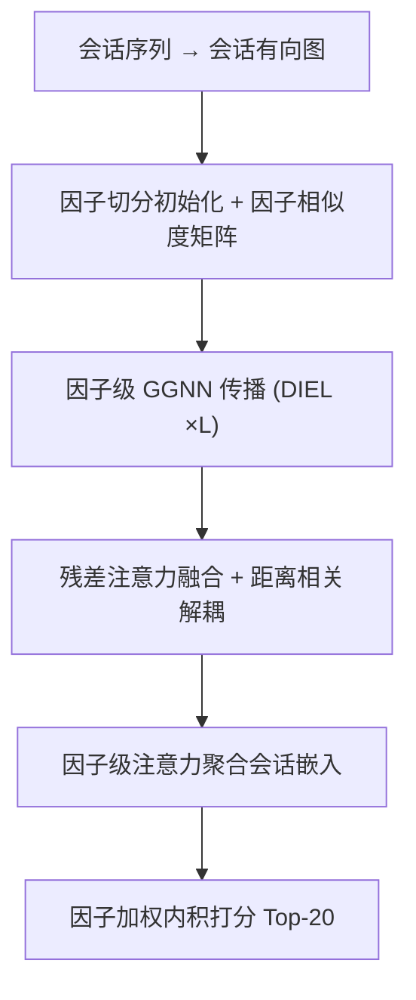
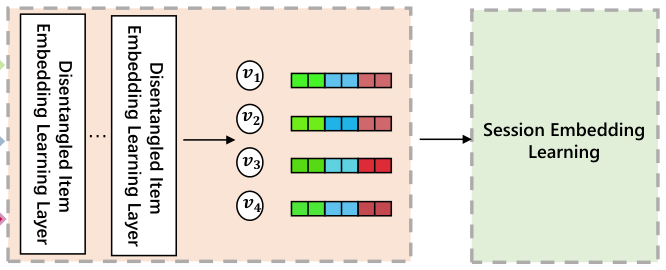

# Disentangled Graph Neural Networks for Session-based Recommendation (面向会话推荐的可解耦图神经网络)

- **会议/期刊**: IEEE Transactions on Knowledge and Data Engineering (TKDE)
- **作者与机构**: Ansong Li, Zhiyong Cheng, Fan Liu, Zan Gao, Weili Guan, Yuxin Peng（齐鲁工业大学山东省人工智能研究院、西安交通大学、新加坡国立大学、Monash University、北京大学）
- **推荐链路定位**: 精排（会话内 Next-Item 预测）
- **研究方向**: 序列与会话推荐 / 自监督与表征解耦
- **论文原文**: [https://arxiv.org/abs/2201.03482v2](https://arxiv.org/abs/2201.03482v2)
- **开源代码**: 暂未开源

## TL;DR (1分钟核心速览)

会话推荐（SBR）主流做法把物品压成一个整体向量、再按物品级注意力聚合会话表征，无法区分"用户到底被物品的哪个侧面（演员？剧情？款式？）打动"。本文提出 Disen-GNN：把物品嵌入切成 $K$ 个因子块，为每个因子单独计算相邻物品相似度矩阵并驱动 GGNN 因子级传播，用距离相关（distance correlation）损失强制因子独立，再用末位物品引导的因子级注意力生成会话嵌入。在 Diginetica / Yoochoose 1/64 / Nowplaying 三数据集、P@20 与 MRR@20 的全库排序评测下全面领先，相对最强基线 TAGNN 在 Diginetica 上 P@20 提升 4.4%、Nowplaying 上提升 16.8%。

## Background & Motivation (背景与核心矛盾)

- **主流范式**: 会话建模已从 GRU4REC/NARM/STAMP 的 RNN+注意力，演进到 SR-GNN/TAGNN 的会话图 + 门控图神经网络，通过高阶邻居聚合学习物品向量，再以"末位物品（局部意图）+ 全局聚合（整体意图）"拼出会话嵌入。
- **前人局限**: ① 物品是**整体嵌入**，用户点击动机被混在一个向量里，无法指认"是演员还是剧情驱动了这次点击"；② 会话聚合只有**物品级权重**，对"同一物品的不同侧面"毫无区分度，噪声点击与真兴趣被等权糅合。
- **核心洞察 (Key Insight)**: 两个相邻物品可能在某个因子上高度相似（同款式）、在另一因子上差异巨大（不同品牌）。若能用**因子专属的邻接权重**做图传播，并把因子注意力落到会话聚合上，即可把粗粒度"喜欢什么物品"细化为"喜欢物品的哪一面"。
- **本文切入点**: 用解耦表征学习把物品向量分块，因子级传播 + 距离相关去冗余 + 因子级注意力聚合，三件套端到端联合训练。

## Method (核心方法设计)

### 1. 整体框架 (Overall Architecture)

输入会话序列 $s=[v_{s,1},\dots,v_{s,n}]$，先构建有向会话图并做因子切分初始化，得到每个物品的$K$段因子嵌入；随后进入$L$层 DIEL（解耦物品嵌入学习）层，每层内以$T$ 层 GGNN 在**因子专属相似度矩阵**上分别传播，层末用残差注意力融合并保留物品自身特征，同时以距离相关损失拉远各因子；最后用末位物品作为局部意图计算因子级注意力，聚合出会话嵌入，与候选物品做因子加权内积打分。

<figure class="paper-figure" markdown="span">
  <figcaption>图1：所提出的Disen-GNN模型概览。</figcaption>
</figure>

### 2. 关键设计拆解 (Key Designs)

1. **因子切分与因子相似度矩阵（Factor-based Similarity Matrix, FSM）**：整体嵌入无法表达"相似在哪"。将物品嵌入经 $K$个线性头切块并 L2 归一：$c_{i,k}=\frac{\sigma(W_k^\top e_{s,i})+b_k}{\|\sigma(W_k^\top e_{s,i})+b_k\|_2}$；相邻物品在因子$k$上的边权为$w^k_{i,j}=c_{i,k}^\top c_{j,k}$，按出/入度分别归一化得$\hat{w}^k_{i,j}$，构成$A^{in}_{s,k},A^{out}_{s,k}$。直觉：同一会话图在不同因子上"重连"出不同拓扑，让信息沿真正相关的侧面流动。

2. **残差注意力机制（RAM）+ 距离相关解耦**：GNN 堆深后节点表征趋同（过平滑），且因子块之间仍可能信息冗余。RAM 以可学习门控融合上一层输出与邻居聚合结果：$\alpha^l=w_f^\top\sigma(W_q e^{l-1,f}_{s,i}+W_p e^{l,T}_{s,i})$，$e^{l,f}_{s,i}=\alpha^l e^{l-1,f}_{s,i}+(1-\alpha^l)e^{l,T}_{s,i}$；解耦则用在首层初始因子上施加的距离相关正则$\mathcal{L}_{dec}=\sum_{k<k'}\mathrm{dCor}(C^{(0,0)}_{s,k},C^{(0,0)}_{s,k'})$，dCor 能捕捉非线性依赖，比余弦正交约束更强。

3. **因子级会话聚合与预测**：全局意图按因子分别聚合 $s_{g,k}=\sum_{i=1}^{n}\alpha_{i,k}c_{i,k}$，其中注意力由末位物品（局部意图）引导：$\alpha_{i,k}=q^\top\sigma(W_1 c_{n,k}+W_2 c_{i,k}+b)$；会话嵌入$s_{h,k}=W_3[s_{l,k};s_{g,k}]$，打分$\hat{z}_i=s_h^\top e_i=\sum_k s_{h,k}^\top c_{i,k}$——预测天然是"因子级相似度 × 因子级注意力"的加和。

4. **训练目标与开销**：交叉熵 + 解耦正则 $\mathcal{L}=\mathcal{L}_c+\lambda\mathcal{L}_{dec}$，BPTT 训练、batch=100、Adam、lr=0.005 每 3 epoch 衰减 0.1，dropout 0.1，L2$10^{-5}$；采用**全库 softmax 交叉熵（隐式负采样）**，无显式负采样器。在线开销与 SR-GNN 同阶，因子数$K$仅影响通道宽度（每因子维度$d/K$），不增加图规模。

## Experimental Setup & Evaluation Protocol (实验设置与评估协议)

- **数据集与预处理**: 沿用 SR-GNN 流程——删除长度 1 的会话、过滤出现次数 < 5 的**低频物品（5-core）**；Yoochoose 仅取最近 1/64。

| 数据集 | #Clicks | #训练会话 | #测试会话 | #Items | 平均/最大长度 |
| :--- | :---: | :---: | :---: | :---: | :---: |
| Diginetica | 982,961 | 719,470 | 60,858 | 43,097 | 5.12 / 70 |
| Yoochoose 1/64 | 557,248 | 369,859 | 55,898 | 16,766 | 6.16 / 146 |
| Nowplaying | 1,367,963 | 825,304 | 89,824 | 60,417 | 7.42 / 30 |

- **数据划分与防穿越**: **全局时间戳切分**——Diginetica 与 Nowplaying 取最后一周、Yoochoose 取最后一天为测试集；训练集内部再按前缀展开 $([v_1],v_2),\dots,([v_1..v_{n-1}],v_n)$ 的序列-标签对，验证集为训练集随机 10%。
- **排名评测协议**: **Full-Ranking（全库未交互物品排序）**，指标 P@20 与 MRR@20，Top-20 截断。
- **对比基线与超参**: 传统 POP / Item-KNN / FPMC，神经 GRU4REC / NARM / STAMP，图模型 SR-GNN / TAGNN。嵌入维度 $d\in\{80,96,100\}$，$K\in\{5,5,12\}$，GGNN 层$T\in\{2,3,3\}$，DIEL 层$L=2$，$\lambda\in\{5,10,15\}$（按数据集调）。

## Key Experimental Results (实验关键数据)

### 1. 主实验对比 (Main Results)

| Model | Diginetica P@20 | Diginetica MRR@20 | Yoochoose P@20 | Yoochoose MRR@20 | Nowplaying P@20 | Nowplaying MRR@20 |
| :--- | :---: | :---: | :---: | :---: | :---: | :---: |
| POP | 0.89 | 0.20 | 6.71 | 1.65 | 2.28 | 0.86 |
| Item-KNN | 35.75 | 11.57 | 51.60 | 21.81 | 15.94 | 4.91 |
| FPMC | 26.53 | 6.95 | 45.62 | 15.01 | 7.36 | 2.82 |
| GRU4REC | 29.45 | 8.33 | 60.64 | 22.89 | 7.92 | 4.48 |
| NARM | 49.70 | 16.17 | 68.32 | 28.63 | 18.59 | 6.93 |
| STAMP | 45.64 | 14.32 | 68.74 | 29.67 | 17.66 | 6.88 |
| SR-GNN | 51.26 | 17.66 | 70.57 | 30.94 | 17.76 | 7.49 |
| TAGNN | 51.53 | 17.90 | **71.02** | **31.12** | 19.02 | 7.82 |
| **Disen-GNN** | **53.79** | **18.99** | **71.46** | **31.36** | **22.22** | **8.22** |
| Improv.% (vs 最优基线) | **+4.39%** | **+6.09%** | +0.62% | +0.77% | **+16.83%** | **+5.12%** |

### 2. 消融实验 (Ablation Study)

| 变体 | Diginetica P@20 / MRR | Yoochoose P@20 / MRR | Nowplaying P@20 / MRR |
| :--- | :---: | :---: | :---: |
| SR-GNN（原版） | 51.26 / 17.66 | 70.57 / 30.94 | 17.76 / 7.49 |
| Disen-SRGNN（仅加解耦） | 51.52 / 17.56 | 70.65 / 31.30 | 18.76 / 7.78 |
| TAGNN（原版） | 51.53 / 17.90 | 71.02 / 31.12 | 19.02 / 7.82 |
| Disen-TAGNN（仅加解耦） | 53.26 / 18.56 | —（显存不足） | 19.53 / 7.99 |
| Disen-GNN w/o FSM（原始邻接） | 53.52 / 18.98 | 71.29 / **31.42** | 21.82 / 7.89 |
| **Disen-GNN（完整）** | **53.79 / 18.99** | **71.46** / 31.36 | **22.22 / 8.22** |

### 3. 关键实验发现 (Key Findings)

- **解耦本身即通用增益**：把同一解耦模块插进 SR-GNN 与 TAGNN 均涨点（Nowplaying 17.76→18.76、19.02→19.53），说明收益来自因子化表征而非特定骨架；但 Disen-GNN 仍优于两者，证明 FSM 与 RAM 才是拉开差距的关键（Nowplaying +2.7 P@20 于 Disen-TAGNN）。
- **FSM 是稀缺的长尾增益来源**：去掉因子相似度矩阵后 Nowplaying 掉 0.40 P@20 / 0.33 MRR，远大于 Diginetica 的 0.27 / 0.01，说明在物品侧特征稀疏、会话更长的音乐场景中，"按因子重连图拓扑"承担了主要收益；Yoochoose 上 MRR 反而略降，暴露该组件对长会话（最大 146）不敏感。
- **$K$与$\lambda$呈倒 U 型且场景相关**：$K=1$（即整体嵌入）表现最差，验证解耦必要性；Diginetica 峰值$K=5$，Nowplaying P@20 到$K=12$仍升而 MRR 在$K>6$后回落（固定$d$时$d/K$变窄削弱表达力）；$\lambda=0$明显劣化、过大则压制预测损失，最优$\lambda$ 为 5/10/15，且无 RAM 时性能随层数增加而**急剧下滑**，加 RAM 后 2–3 层即可稳定最优。

## Highlights & Limitations (亮点、对比与审稿批判)

- **与代表作对比**: 相比 SR-GNN/TAGNN 只在**物品粒度**做注意力聚合、用统一邻接矩阵传播，Disen-GNN 把"注意力"与"图结构"同时下沉到因子粒度；相比同期的解耦推荐工作（如 DGCF/DIPN 面向用户-物品二分图），本文首次把因子解耦引入**匿名会话图**这一无用户侧信息的受限设定。
- **可迁移亮点**: ① "因子专属相似度矩阵"可直接替换任意 GNN 推荐模型中的固定邻接矩阵，几乎零额外参数量；② 用距离相关替代正交/HSIC 约束做因子独立，适合非线性和跨分布场景。
- **审稿级局限批判**: ① 因子数 $K$与嵌入维度$d$相互耦合（固定$d$则$d/K$缩水），三数据集最优$K$差异大需逐集调参，且 Yoochoose 因显存只能取$K\le 5$（作者自承非最优），削弱公平性；② 每个因子单独跑一遍 GGNN，计算量是 SR-GNN 的$K$ 倍，论文未给出训练/推理时延或 FLOPs 对比，长会话（146）场景的落地成本存疑；③ 缺少对"因子语义可解释性"的定性案例分析，所谓 factor 是否真对应演员/剧情等语义仍未验证。

## Rating (四维评分)

- **方法创新性 (Novelty)**: ⭐⭐⭐⭐ （因子级相似度矩阵 + 因子级会话注意力是清晰的增量，把解耦从二分图迁移到匿名会话图有价值，但整体仍是解耦表征 + GGNN 的组合式创新）
- **评估协议与实验扎实度 (Protocol & Experiments)**: ⭐⭐⭐⭐ （三数据集、8 个基线、全库排序、迁移式解耦消融与 $K$/$\lambda$ 敏感性分析齐全，但缺显著性检验与效率对比）
- **写作与数学规范度 (Clarity & Rigor)**: ⭐⭐⭐⭐ （公式链条完整、符号统一，GGNN 更新式与 SR-GNN 的差异交代清楚；dCor 仅引文献未给展开式，距离相关施加位置的选择也仅以经验说明）
- **工业落地与复现价值 (Industrial & Practical Value)**: ⭐⭐⭐ （组件可插拔、无用户侧依赖适合匿名流量场景；但 $K$ 倍图传播开销与未开源代码降低了直接复现与上线的便利度）

