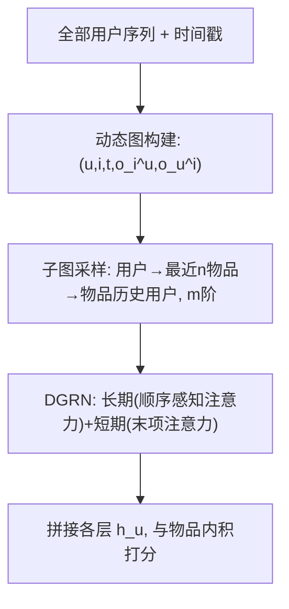
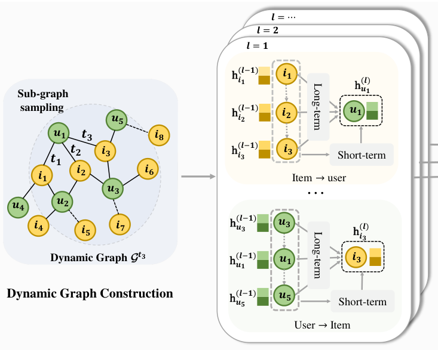

# Dynamic Graph Neural Networks for Sequential Recommendation (动态图神经网络用于序列推荐)

- **会议/期刊**: IEEE TKDE (arXiv 2021, 正式刊出 TKDE 2023)
- **作者与机构**: Mengqi Zhang, Shu Wu, Xueli Yu, Qiang Liu, Liang Wang (中科院自动化所 CRIPAC / 国科大 / BIGAI)
- **推荐链路定位**: 召回 (候选打分)
- **研究方向**: 序列与会话推荐 / 图神经网络与知识图谱推荐
- **论文原文**: [论文原文链接](https://arxiv.org/abs/2104.07368v2)
- **开源代码**: 暂未开源

## TL;DR (1分钟核心速览)

现有序列推荐（GRU4Rec/SASRec/SR-GNN/HGN）几乎只在**单条用户序列内部**编码兴趣，忽略了跨序列的高阶协同信号，也忽略了这种协同关系随时间的演化。DGSR 把全部用户序列织成一张连续时间动态图，边携带时间戳与双向交互序号，通过 m 阶子图采样 + 动态图推荐网络（相对顺序感知注意力建模长期、末项注意力建模短期）做消息传播，将 next-item 预测改写为用户—物品链路预测。在 Leave-One-Out + 100 负例采样协议下，Beauty/Games/CDs 的 NDCG@10 分别相对提升 10.56%/3.92%/3.81%。

## Background & Motivation (背景与核心矛盾)

- **主流范式**: 从 Markov 链、RNN、CNN 到自注意力与序列内 GNN，主流做法是把每个用户的 $S_u$ 独立编码成兴趣向量再与候选物品打分。
- **前人局限**: (1) 只利用序列内部信息，跨序列共享物品形成的高阶连通性（图 1b 中 $u_1$经$i_3$与$u_3$相连）被完全丢弃；(2) 即便建模跨序列（HyperRec 超图、CSRM 会话邻域），也是静态或粗粒度关联，无法刻画"协同邻域随$t_1,t_2,t_3$ 而变"的动态性。
- **核心洞察 (Key Insight)**: 用户兴趣漂移不仅由自身一阶交互驱动，也由动态变化的高阶邻居（关联用户与物品）驱动；而传统静态二部图丢失了交互先后顺序这一序列推荐最关键的信息。
- **本文切入点**: 用带时间戳 + 双向序号 $(u,i,t,o_i^u,o_u^i)$ 的动态图统一表示"序列"与"协同"，把序列推荐变成图上的链路预测。

## Method (核心方法设计)

### 1. 整体框架 (Overall Architecture)

输入为全部用户序列 $\mathcal{S}$与时间戳，先将其转成连续时间动态图$G$；对目标序列$S_u$在$G_{t_k}$（仅含$t_k$及之前的边，天然防穿越）上采样$m$阶子图$\mathcal{G}_u^m(t_k)$；在子图上堆叠$L$层 DGRN，每层分别做 item→user 与 user→item 的消息传播并更新节点；最后拼接各层用户表征与候选物品做内积打分，交叉熵训练。推理只需一次子图采样 +$L$ 层传播。

<figure class="paper-figure" markdown="span">
  <figcaption>图2：DGSR框架概览。以预测u1序列(i1, i2, i3)的下一次交互为例。对应的时间戳序列为(t1, t2, t3)。我们首先将u1的序列及其相关序列转换为动态图Gt3，每条边表示用户与物品之间的交互，并具有时间属性。虚线表示的边是在t3之后发生的交互，不包含在Gt3中（第4.1节）。然后我们采样一个m阶子图Gm</figcaption>
</figure>

### 2. 关键设计拆解 (Key Designs)

1. **顺序感知动态注意力 (DAT)**：静态 GCN/GAT 把所有邻居等权聚合，无法区分"刚买"与"很久前买"；本文为相对序号 $r_i^u=|\mathcal{N}_u|-o_i^u$分配可学习向量$\mathbf{p}^K_{r}$，注入注意力打分：
$e_{ui}=\frac{(\mathbf{W}_2^{(l-1)}\mathbf{h}_u^{(l-1)})^{\top}(\mathbf{W}_1^{(l-1)}\mathbf{h}_i^{(l-1)}+\mathbf{p}^{K}_{r_i^u})}{\sqrt{d}}$，$\alpha_{ui}=\mathrm{softmax}(e_{ui})$。
直觉：注意力同时编码"节点相关性"与"时间距离"，使长期偏好聚合具备序感知，而非平均池化式的噪声混合。

2. **长短期双通道节点更新**：仅用最后一个物品当短期兴趣会丢失历史依赖，仅用长期聚合又钝化最新意图。短期通道用末项对全部历史做注意力 $\mathbf{h}_u^{S}=\sum_{i\in\mathcal{N}_u}\hat{\alpha}_{ui}\mathbf{h}_i^{(l-1)}$，再与长期、上一层表征拼接更新：
$\mathbf{h}_u^{(l)}=\tanh\big(\mathbf{W}_3^{(l)}[\mathbf{h}_u^{L}\|\mathbf{h}_u^{S}\|\mathbf{h}_u^{(l-1)}]\big)$。
双向（user→item 同步）传播让物品侧也能感知"近期购买者群体"的语义漂移。

3. **训练目标与推理开销**：预测层拼接多层用户向量 $\mathbf{h}_u=\mathbf{h}_u^{(0)}\|\cdots\|\mathbf{h}_u^{(L)}$，打分$s_{ui}=\mathbf{h}_u^{\top}\mathbf{W}_P\mathbf{e}_i$；损失为全物品 softmax 交叉熵 + L2：$\mathcal{L}=-\sum_{S}\sum_{i}y_{ui}\log\hat{y}_{ui}+\lambda\|\Theta\|_2^2$。负例由"1 正 + 100 随机负"采样构造。子图规模随阶数$m$指数增长，需靠$m\le4$ 与去重采样控制成本。

## Experimental Setup & Evaluation Protocol (实验设置与评估协议)

- **数据集与预处理**: 三个 Amazon 子集，均按 `5-core` 过滤（用户与物品交互数 ≥5），隐式反馈（有评论/评分即正例）：

| 数据集 | #Users | #Items | #Interactions | 稀疏度/密度 | 特征/场景说明 |
| :--- | :---: | :---: | :---: | :---: | :--- |
| Beauty | 52,024 | 57,289 | 394,908 | 0.01% | 最稀疏、序列最短（均长 7.6） |
| Games | 31,013 | 23,715 | 287,107 | 0.04% | 中等规模，均长 9.3 |
| CDs | 17,052 | 35,118 | 472,265 | 0.08% | 最稠密、序列最长（均长 27.6） |

- **数据划分与防穿越**: `Leave-One-Out`——最近 1 项作测试、倒数第 2 项作验证、其余训练；并将每条序列前缀展开为多条样本 $[i_1,\dots,i_{k-1}]\to i_k$，对应子图取$G_{t_{k-1}}$，严格只用预测时刻之前的边。
- **排名评测协议**: `Sampled Ranking`——每测试样本随机采 100 个负例与 1 个真值共 101 候选排序，报告 Hit@10 与 NDCG@10（非 Full-Ranking，绝对值偏乐观）。
- **对比基线与超参**: 基线覆盖 MF（BPR-MF）、Markov（FPMC）、RNN（GRU4Rec+）、CNN（Caser）、自注意力（SASRec、TiSASRec）、序列内 GNN（SR-GNN）、门控（HGN）、超图（HyperRec）。统一 $d=50$、最大长度$n=50$、Adam lr=0.01、batch=50、$\lambda=1\text{e-}4$、$m=4$，层数$L=3$（Beauty/CDs）、$L=2$（Games），4 个随机种子取均值；未报告显著性检验。

## Key Experimental Results (实验关键数据)

### 1. 主实验对比 (Main Results)

| 数据集 | 指标 | FPMC | GRU4Rec+ | Caser | SASRec | SR-GNN | HGN | TiSASRec | HyperRec | **DGSR** | Improv. |
| :--- | :--- | :---: | :---: | :---: | :---: | :---: | :---: | :---: | :---: | :---: | :---: |
| Beauty | NDCG@10 | 28.91 | 26.42 | 25.47 | 32.19 | 32.33 | 32.47 | 30.45 | 23.26 | **35.90** | +10.56% |
| Beauty | Hit@10 | 43.10 | 43.98 | 42.64 | 48.54 | 48.62 | 48.63 | 46.87 | 34.71 | **52.40** | +7.75% |
| Games | NDCG@10 | 46.80 | 45.64 | 45.93 | 53.60 | 53.25 | 49.34 | 50.19 | 48.96 | **55.70** | +3.92% |
| Games | Hit@10 | 68.02 | 67.15 | 68.83 | 73.98 | 73.49 | 71.42 | 71.85 | 71.24 | **75.57** | +2.15% |
| CDs | NDCG@10 | 33.55 | 44.52 | 45.85 | 49.23 | 48.95 | 49.34 | 48.97 | 47.16 | **51.22** | +3.81% |
| CDs | Hit@10 | 51.22 | 67.84 | 68.65 | 71.32 | 69.63 | 71.42 | 71.00 | 71.02 | **72.43** | +1.41% |

### 2. 消融实验 (Ablation Study)

NDCG@10 / Hit@10（"长期"通道取 GCN、RNN、DAT 或无；"短期"通道取 Last、ATT 或无）：

| 变体 | 长期 | 短期 | Beauty | Games | CDs |
| :--- | :---: | :---: | :---: | :---: | :---: |
| DGSR-G | GCN | – | 33.75 / 49.94 | 53.44 / 73.23 | 48.66 / 70.43 |
| DGSR-D | DAT | – | 35.25 / 51.36 | 55.12 / 74.83 | 49.66 / 71.26 |
| DGSR-L | – | Last | 30.87 / 46.13 | 52.43 / 72.18 | 46.23 / 67.38 |
| DGSR-RL | RNN | Last | 35.47 / 51.68 | 54.86 / 74.84 | 50.26 / 71.24 |
| DGSR-DL | DAT | Last | 35.62 / 51.92 | 55.53 / 75.07 | 50.72 / 72.06 |
| **DGSR-DA** | DAT | ATT | **35.90 / 52.40** | **55.70 / 75.57** | **51.22 / 72.43** |

### 3. 关键实验发现 (Key Findings)

1. **稀疏场景收益最大**：Beauty 密度仅 0.01%、均长 7.6，DGSR 相对最强基线 NDCG@10 提升 10.56%，远高于稠密 CDs 的 3.81%——高阶动态邻居确实为短序列补足了缺失上下文。
2. **长期聚合器与短期通道都不可省**：同等无短期通道下，DAT 优于 RNN 优于 GCN（Beauty 35.25 > 34.81 > 33.75），证明相对序号注意力优于等权池化；而完全去掉长期通道的 DGSR-L 跌至 30.87，甚至低于 SASRec 的 32.19。
3. **层数与图阶数存在饱和**：Games 最优 2 层、Beauty 最优 3 层（更稀疏需更多跳），第 4 层开始过平滑掉点；$m$从 1 增至 3 持续涨、$m=4$后趋平，且子图规模随$m$ 指数增长，说明"多跳有益但有算力上限"。

## Highlights & Limitations (亮点、对比与审稿批判)

- **与代表作对比 (vs. Prior Work)**: SASRec/TiSASRec/SR-GNN 只在序列内建模，可视为 DGSR 在 $L=1$ 且关闭 item→user 传播时的特例；HyperRec 虽跨序列但用超图粗粒度关联、丢弃交互顺序，故在顺序性更强的 Beauty/Games 上明显落后；CSRM 靠会话相似度而无法利用细粒度交互序号。DGSR 的核心增量是"跨序列 + 保序 + 动态"三者同时成立。
- **可迁移亮点**: (1) 用 $o_i^u,o_u^i$双向序号 + 相对位置嵌入替代绝对时间编码，可直接迁移到任何带时间戳的 CTR/序列建模；(2) 子图只在$G_{t_k}$ 上采样，是简洁有效的防穿越范式。
- **审稿级局限批判**: (1) 评测仅用 1 正 + 100 随机负的 Sampled Ranking，未做 Full-Ranking，也未做显著性检验，绝对值与领先幅度可能被高估；(2) 子图规模随 $m$指数膨胀、每样本需在线采样与$L$ 层传播，论文未报告训练/推理时延与内存，工业级万级候选场景落地存疑；(3) 依赖用户—物品共享形成的连通性，在物品长尾、共现稀疏的数据上高阶邻居质量差（HyperRec 在 Beauty 崩溃亦侧面说明此风险）。

## Rating (四维评分)

- **方法创新性 (Novelty)**: ⭐⭐⭐⭐ （首次把连续时间动态图 + 双向交互序号统一进序列推荐框架，五元组边定义与顺序感知注意力是有辨识度的增量）
- **评估协议与实验扎实度 (Protocol & Experiments)**: ⭐⭐⭐ （三数据集 + 9 基线 + 完整消融，但仅 100 负例采样排序、无全库排序与显著性检验，超参分析偏定性）
- **写作与数学规范度 (Clarity & Rigor)**: ⭐⭐⭐⭐ （消息传播/节点更新公式与算法伪码完整、符号一致，缺复杂度与时空开销的定量分析）
- **工业落地与复现价值 (Industrial & Practical Value)**: ⭐⭐⭐ （思路清晰易复现，但无开源代码，子图采样与多层传播的在线开销是主要落地障碍）

