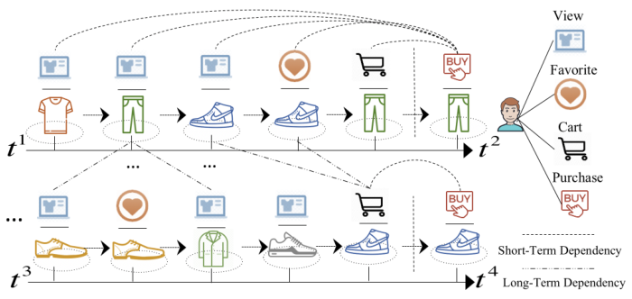
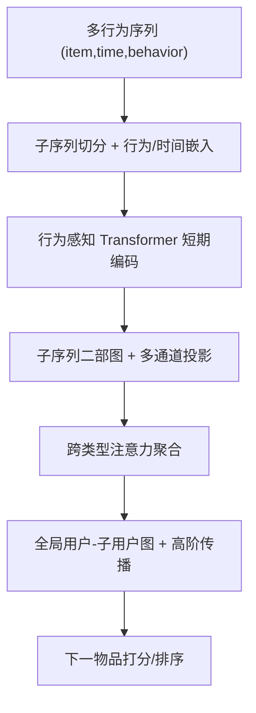
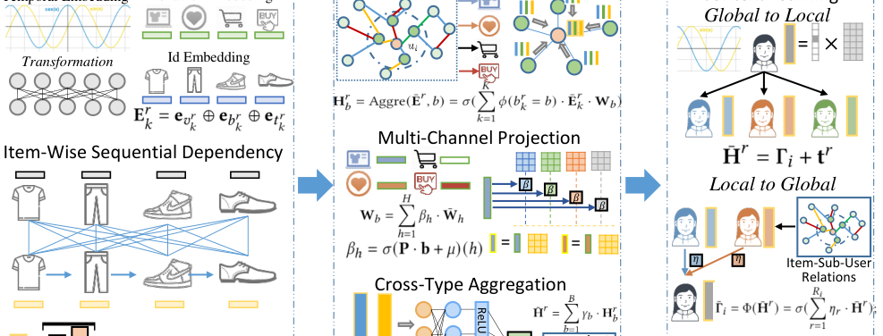

# Multi-Behavior Sequential Recommendation with Temporal Graph Transformer (多行为序列推荐的时间图 Transformer)

- **会议/期刊**: IEEE TKDE (2023; arXiv 2022)
- **作者与机构**: Lianghao Xia, Chao Huang, Yong Xu, Jian Pei；香港大学、华南理工大学、Simon Fraser University
- **推荐链路定位**: 召回/排序（下一物品预测）
- **研究方向**: 序列与会话推荐 / 图神经网络与知识图谱推荐
- **论文原文**: [论文原文链接](https://arxiv.org/abs/2206.02687v1)
- **开源代码**: [开源代码仓库链接](https://github.com/akaxlh/TGT)

## TL;DR (1分钟核心速览)

现有序列推荐多假设单一行为，难以刻画点击、收藏、加购、购买间的跨类型依赖及其时间演化。TGT 以行为感知 Transformer 建模短期子序列，再用时间图多通道消息传递与跨类型注意力融合长期多行为关系。在 Taobao/IJCAI 的 Leave-One-Out 协议下，HR@10 达 0.452/0.519，较 MBGCN 提升 22.5%/12.1%。

## Background & Motivation (背景与核心矛盾)

- **主流范式**: 序列推荐用 RNN/CNN/self-attention 编码物品转移；图推荐用 GNN 传播协同信号；多行为模型多用静态图或多任务学习融合行为类型。
- **前人局限**: SASRec/Bert4Rec 仅建模单一行为，忽略点击、收藏、加购对购买预测的互补证据；MBGCN/MATN 等虽融合多行为，但多为静态关系，难以响应时间演化与跨序列全局依赖。
- **核心洞察 (Key Insight)**: 行为类型不是独立特征，而是随子序列变化的互补证据；需同时保留局部短期物品转移与全局长期多行为动态。
- **本文切入点**: 子序列级行为感知 Transformer + 时间图多通道传播 + 跨类型注意力，联合学习短长期多行为依赖。

<figure class="paper-figure" markdown="span">
  <figcaption>图1：多行为动态序列推荐的示例说明。最佳</figcaption>
</figure>
图1：多行为动态序列示例（点击/收藏/加购/购买）。

## Method (核心方法设计)

### 1. 整体框架 (Overall Architecture)

TGT 将用户多行为序列 $S_i$按时间切成$R$个子序列，每个交互$(v^r_k,t^r_k,b^r_k)$先经物品、行为、时间三路嵌入相加得$E^r_k$；子序列内用多头自注意力编码物品转移，得到$\bar E^r_k$。随后在子序列二部图$G_r$上做行为感知消息传递：多通道投影生成行为专属变换$W_b$，跨类型注意力聚合为$\bar H^r$；再在用户-子用户全局图$G$上以$\eta_r$聚合长期表示，并回写物品。经$L$ 层高阶传播后，用最后子序列表示与物品表示做内积预测下一购买。

<figure class="paper-figure" markdown="span">
  <figcaption>图2：所提出TGT的模型流程。(a) 用户与物品之间关于两者的分层图结构</figcaption>
</figure>
图2：TGT 模型流程：局部行为感知序列编码与全局时间图传播。

### 2. 关键设计拆解 (Key Designs)

1. **行为感知上下文与子序列 Transformer**：痛点在于单行为位置嵌入无法区分点击/收藏/加购/购买语义。核心为 $E^r_k=e_{v^r_k}+e_{b^r_k}+e_{t^r_k}$，时间用正弦函数编码；注意力$\alpha_{k,k'}=\mathrm{softmax}((Q_hE^r_k)^\top(K_hE^r_{k'})/\sqrt{d/H})$。直觉是让同一物品在不同行为/时间下获得不同上下文表示，短期转移不被行为语义淹没。

2. **多通道投影与跨类型聚合**：为每种行为独立参数易过拟合，直接拼接又丢失跨类型依赖。核心为 $W_b=\sum_h\beta_h\bar W_h$，$\beta_h=\mathrm{softmax}(P b+\mu)_h$；$\bar H^r=\sum_b\gamma_b H^r_b$，$\gamma_b$ 由所有行为表示自适应学习。直觉是共享基底保留共性，通道系数保留行为差异；跨类型注意力让购买预测动态选择重要上下文行为。

3. **时间全局图与训练/推理**：仅局部子序列看不到跨时段、跨序列关系。全局用户图 $G$上$\bar\Gamma_i=\sum_r\eta_r\bar H^r$，$\eta_r=\Gamma_i^\top\bar H^r$，再用$\bar H^r=\Gamma_i+t_r$回写；高阶传播按层求和。损失$\mathcal{L}=\sum_i\sum_r\sum_c\max(0,1-P^r_{i,p_c}+P^r_{i,n_c})+\lambda\|\Theta\|_F^2$，训练用 C 组正负采样，推理按内积 top-N；复杂度与 HyRec/GCGNN 同阶。

## Experimental Setup & Evaluation Protocol (实验设置与评估协议)

- **数据集与预处理**:

| 数据集 | #Users | #Items | #Interactions | 稀疏度/密度 | 特征/场景说明 |
| :--- | :---: | :---: | :---: | :---: | :--- |
| Taobao | 147,894 | 99,037 | 7,658,926 | 0.052% | 电商四行为：pv/cart/fav/buy |
| IJCAI | 423,423 | 874,328 | 36,203,512 | 0.0098% | 电商四行为：click/cart/fav/buy |

- **数据划分与防穿越 (Splitting Strategy)**: 采用 `Leave-One-Out`，按时间将每个用户最后交互作为测试正样本；目标行为设为 purchase，其余行为作为 context。
- **排名评测协议 (Ranking Protocol)**: 报告 top-N `HR@N` 与 `NDCG@N`；原文未显式写明全库排序或采样排序比例，训练损失使用 C 组正负采样，复现需核对代码默认负采样配置。
- **对比基线与超参设置**: 对比 BPR/NCF/GRURec/Caser/NARM/SASRec/Bert4Rec/Chorus/HyRec/MAGNN/SR-GNN/GCGNN/MGNN/HGT/NMTR/MATN/MBGCN 等 18 个基线；$d=16$，heads=2，channels=2，$L=2$，子序列长度 6/10，lr=1e-3，batch 256/512；未报告显著性检验。

## Key Experimental Results (实验关键数据)

### 1. 主实验对比 (Main Results)

| 方法 | Taobao HR@10 | Taobao NDCG@10 | IJCAI HR@10 | IJCAI NDCG@10 |
| :--- | :---: | :---: | :---: | :---: |
| BPR | 0.295 | 0.179 | 0.257 | 0.153 |
| NCF | 0.325 | 0.201 | 0.459 | 0.294 |
| SASRec | 0.353 | 0.203 | 0.420 | 0.247 |
| Bert4Rec | 0.369 | 0.229 | 0.467 | 0.297 |
| HGT | 0.364 | 0.216 | 0.450 | 0.265 |
| MATN | 0.354 | 0.209 | 0.489 | 0.309 |
| MBGCN | 0.369 | 0.222 | 0.463 | 0.277 |
| **TGT** | **0.452** | **0.263** | **0.519** | **0.330** |

`Improv.`：较最强基线 HR@10 为 +22.5%/+6.1%，NDCG@10 为 +14.8%/+6.8%；较 MBGCN 的 HR@10 提升为 +22.5%/+12.1%。

### 2. 消融实验 (Ablation Study)

IJCAI-Contest，Top@10：

| 变体 | HR@10 | NDCG@10 | ΔHR vs TGT |
| :--- | :---: | :---: | :---: |
| w/o CE | 0.515 | 0.321 | -0.004 |
| w/o SD | 0.499 | 0.306 | -0.020 |
| w/o MCP | 0.490 | 0.306 | -0.029 |
| w/o LBD | 0.511 | 0.319 | -0.008 |
| w/o CTA | 0.510 | 0.323 | -0.009 |
| FBA | 0.511 | 0.320 | -0.008 |
| **TGT** | **0.519** | **0.330** | — |

### 3. 关键实验发现 (Key Findings)

1. **多通道投影最关键**：去掉 MCP 后 HR@10 从 0.519 降至 0.490（-5.6%），NDCG@10 从 0.330 降至 0.306（-7.3%），说明行为专属变换能避免多行为语义混叠。
2. **短期序列依赖不可省**：w/o SD 的 HR@10/NDCG@10 为 0.499/0.306，比 TGT 低 3.9%/7.3%，证明行为感知 Transformer 对捕捉短期跨物品转移有效。
3. **跨类型权重应学习**：TGT 的 0.519/0.330 高于 w/o CTA 的 0.510/0.323 与频率启发式 FBA 的 0.511/0.320，说明不同行为对购买预测贡献非均等，自适应注意力优于等权拼接或频率加权。

## Highlights & Limitations (亮点、对比与审稿批判)

- **与代表作对比 (vs. Prior Work)**: SASRec/Bert4Rec 仅单行为序列；MBGCN/MATN 静态融合多行为；HGT 建模异构图但缺时间多行为联合。TGT 的本质区别是把“局部子序列短期行为依赖”和“全局时间图长期跨序列关系”放进同一框架。
- **可迁移亮点**: 多通道投影可迁移到多关系/多场景建模；子用户图把长序列拆成时段证据，适合长序列兴趣建模；跨类型注意力可复用于多目标融合。
- **审稿级局限批判**: 仅在两个电商数据集验证，未报告显著性检验；全库/采样排序协议未明示，复现需核对代码；通道数 >2 易过拟合、$L>2$ 出现过平滑，超参敏感且大图训练内存开销较高。

## Rating (四维评分)

- **方法创新性 (Novelty)**: ⭐⭐⭐⭐ （将多行为依赖拆成局部行为感知 Transformer 与全局时间图，跨类型注意力有新意但非全新范式）
- **评估协议与实验扎实度 (Protocol & Experiments)**: ⭐⭐⭐ （两大数据集、18 个基线、消融较完整，但未报告显著性且排序协议未明示）
- **写作与数学规范度 (Clarity & Rigor)**: ⭐⭐⭐⭐ （公式与模块清晰，复杂度分析到位，符号略密）
- **工业落地与复现价值 (Industrial & Practical Value)**: ⭐⭐⭐⭐ （开源代码，复杂度与 HyRec/GCGNN 同阶，适合电商多行为场景；大图需工程优化）

