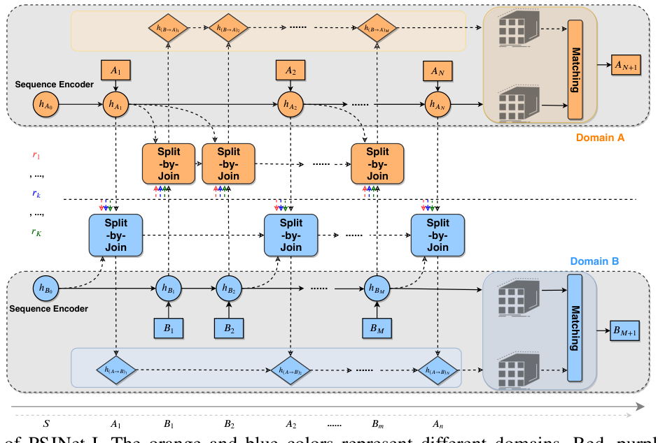
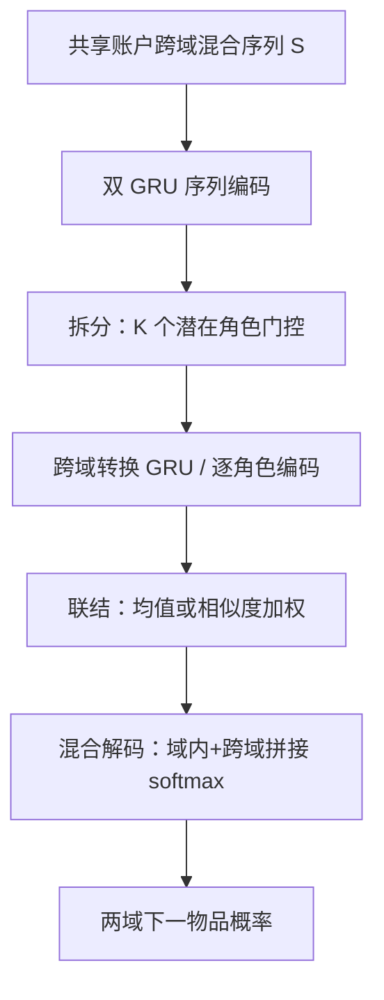
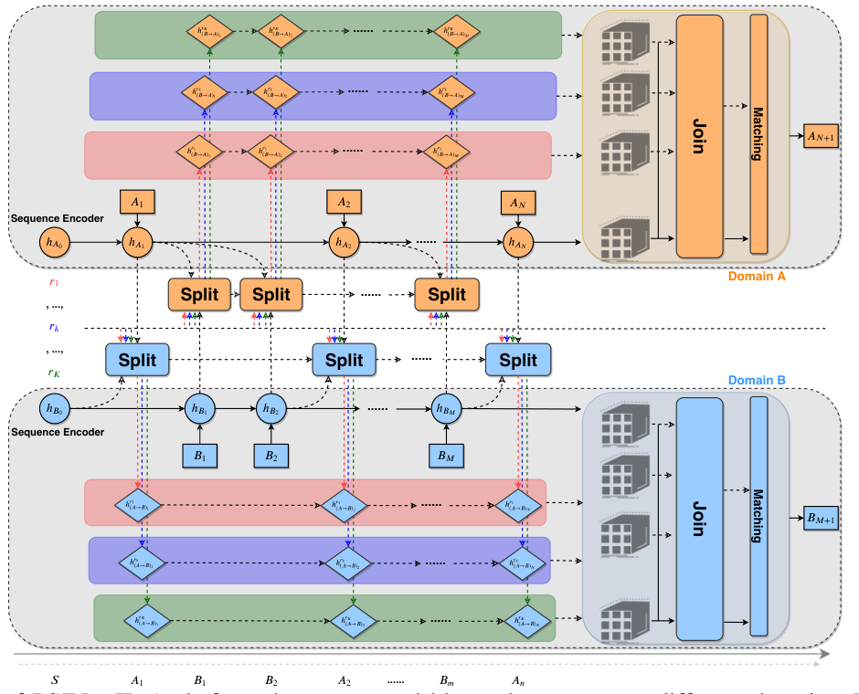

# Parallel Split-Join Networks for Shared-account Cross-domain Sequential Recommendations (面向共享账户跨域序列推荐的并行拆分-联结网络)

- **会议/期刊**: IEEE TKDE (2023)
- **作者与机构**: Wenchao Sun, Muyang Ma, Pengjie Ren, Yujie Lin, Zhumin Chen, Zhaochun Ren, Jun Ma, Maarten de Rijke；山东大学、阿姆斯特丹大学等
- **推荐链路定位**: 召回/排序（Next-Item 序列推荐）
- **研究方向**: 序列与会话推荐 / 跨域与多场景推荐
- **论文原文**: [论文原文链接](https://arxiv.org/abs/1910.02448v4)
- **开源代码**: 暂未开源

## TL;DR (1分钟核心速览)

针对共享账户下多角色行为混叠、且跨域迁移易引入噪声的序列推荐难题，提出并行拆分-联结网络 PSJNet：用角色门控拆分混合表征，再以跨域转换与联结生成互补表征；在 HAmazon/HVIDEO 的全库 softmax 排序协议下，MRR@20/Recall@20 全面超越 GRU4REC、HGRU4REC 等，尤其 HVIDEO 教育域 MRR@20 相对提升约 14.6%。

## Background & Motivation (背景与核心矛盾)

- **主流范式**: 序列推荐以 GRU4REC/HGRU4REC 等 RNN 模型建模单用户单域行为序列；跨域推荐则多通过共享隐空间、跨域映射或跨接网络迁移知识。
- **前人局限**: 共享账户方法通常依赖显式用户识别、时间片或评分信息，难以适配无 user-id 的序列场景；跨域方法多忽略时序动态，或把账户直接映射到同一隐空间，无法区分同一账户下的多角色兴趣。
- **核心洞察 (Key Insight)**: 同一账户的混合序列中，不同角色在不同域活跃且兴趣可互补；若能在每个时间戳“拆”出角色相关分量，再“联”成跨域表征，就能在降噪的同时利用互补域信息。
- **本文切入点**: 将共享账户与跨域推荐统一为 SAC-SR 任务，用并行 split-join 框架同时生成两域下一物品推荐。

## Method (核心方法设计)

### 1. 整体框架 (Overall Architecture)

模型以共享账户在两域的混合行为序列为输入，先用两个独立 GRU 编码域内序列；随后在每一时间戳用 K 个潜在角色门控从混合表征中拆分角色相关分量，并通过跨域 GRU 或逐角色编码转换为互补域表征；最后由联结单元聚合角色/时间表征，与目标域域内表征拼接后经 softmax 输出两域下一物品概率。两域联合端到端训练，推理解码可并行给出双域推荐。整体框架见图2。

<figure class="paper-figure" markdown="span">
  <figcaption>图2：PSJNet-I 的概览。橙色和蓝色表示不同域。红色、紫色和绿色表示不同用户角色。第 III-C 节给出该模型的流程说明。</figcaption>
</figure>

### 2. 关键设计拆解 (Key Designs)

1. **角色门控拆分（Split-by-Join）**：共享账户的域内表征 $h_i^A$是多角色混合，直接跨域迁移会把无关角色噪声带入目标域。PSJNet-I 对每个潜在角色$r_k$计算门控$f_{r_k}^{A_i}=\sigma(W_f^A h_i^A+W_f^B h_j^B+U_f h_{i-1}^{A\to B}+V_f e_{r_k}+b_f)$，并按$h_{r_k}^{A_i}=f_{r_k}^{A_i}\odot\hat h_{r_k}^{A_i}+(1-f_{r_k}^{A_i})\odot h_{i-1}^{A\to B}$选择性保留当前角色候选或继承上一跨域状态；再对 K 个角色取均值$h_i^{A\to B}=\frac1K\sum_k h_{r_k}^{A_i}$，经 GRU 转换。直觉是门控按角色兴趣放行信息，均值联结降低单角色过拟合。

2. **PSJNet-II 的归一化拆分与相似度联结**：PSJNet-I 将拆分和联结耦合，且只用最后时刻 GRU 状态，易丢中间信息。PSJNet-II 先逐时刻逐角色拆分，引入 $f_{\text{none},i}$并约束$f_{\text{none},i}+\sum_k f_{r_k,i}=1$，再对每个角色独立 GRU 编码；联结时用$s_{i,j}=v_s^\top(W_i h_{r_k,i}^{A\to B}+W_j h_j^B)$计算相似度，取$s_i=\max_j s_{i,j}$ 后 softmax 加权。直觉是归一化抑制门控饱和，max-similarity 让角色表征对齐目标域最相关历史（见图4）。

<figure class="paper-figure" markdown="span">
  <figcaption>图4：PSJNet-II 的概览。与之前相同，橙色和蓝色表示不同域。红色、紫色和绿色表示不同用户角色。第 III-D 节给出该模型的流程说明。</figcaption>
</figure>

3. **训练目标、负采样与推理效率**：两域均用全物品 softmax 的负对数似然，$\mathcal{L}=\mathcal{L}_A+\mathcal{L}_B$，未额外负采样；仅 NCF-MLP++ 基线在测试时采样 3000 负例。推理由全物品打分，复杂度约$O((|V_A|+|V_B|)d)$/时间戳，双域并行但大词表 softmax 成本较高。

## Experimental Setup & Evaluation Protocol (实验设置与评估协议)

- **数据集与预处理**: HAmazon 由 Amazon Movie/Book 日志随机合并 2–4 个用户模拟共享账户；HVIDEO 为真实智能电视视频/教育双平台日志。HAmazon 保留 M 域频次 >5、B 域 >10 的物品及跨域重叠用户；HVIDEO 过滤观看 <10 条或 <300 秒的用户，同物品相邻 10 分钟内合并，按 30 条切序列，且每域至少 5 个物品。

| 数据集 | 域 | #Items | #Logs | #Sequences | 场景/过滤 |
| :--- | :--- | :---: | :---: | :---: | :--- |
| HAmazon | M | 67,161 | 4,406,924 | 289,160 | 电影；item freq>5 |
| HAmazon | B | 126,547 | 4,287,240 | 289,160 | 图书；item freq>10 |
| HVIDEO | V | 16,407 | 227,390 | 134,349 | 视频；user≥10，watch≥300s |
| HVIDEO | E | 3,380 | 177,758 | 134,349 | 教育；同上 |

HAma/HVIDEO 各含 13,724/13,714 个跨域重叠用户。

- **数据划分与防穿越 (Splitting Strategy)**: 按序列随机 75%/15%/10% 划分训练/验证/测试；取每域序列最后一项为 ground truth，标签不参与输入。
- **排名评测协议 (Ranking Protocol)**: PSJNet 对全物品做 softmax，属无偏 Full-Ranking；NCF-MLP++ 因逐物品打分在测试时采样 3000 负例，为近似 Sampled Ranking。报告 MRR@5/10/20、Recall@5/10/20，配对 t 检验 $p<0.05$。
- **对比基线与超参设置**: 覆盖 POP、Item-KNN、BPR-MF、VUI-KNN、NCF-MLP++、Conet、GRU4REC、HGRU4REC；embedding/GRU 隐维 90，dropout 0.8，Adam lr=0.001，batch=64，潜在角色数 $K\in\{1,\dots,5\}$。

## Key Experimental Results (实验关键数据)

### 1. 主实验对比 (Main Results)

| 数据集/域 | 指标 | BPR-MF | NCF-MLP++ | Conet | VUI-KNN | GRU4REC | HGRU4REC | PSJNet-I | PSJNet-II | Δ vs best |
| :--- | :--- | :---: | :---: | :---: | :---: | :---: | :---: | :---: | :---: | :---: |
| HAmazon-M | MRR@20 | 3.06 | 14.21 | 15.12 | — | 82.11 | 83.14 | 83.95 | **84.05** | +0.91 (+1.1%) |
| HAmazon-M | Recall@20 | 5.50 | 24.31 | 24.46 | — | 84.06 | 84.91 | **85.33** | 85.28 | +0.42 (+0.5%) |
| HAmazon-B | MRR@20 | 0.96 | 14.05 | 16.28 | — | 81.44 | 82.31 | 84.93 | **85.11** | +2.80 (+3.4%) |
| HAmazon-B | Recall@20 | 2.15 | 22.08 | 25.56 | — | 83.76 | 84.91 | **85.38** | **85.38** | +0.47 (+0.6%) |
| HVIDEO-V | MRR@20 | 1.36 | 17.90 | 23.28 | 2.87 | 78.27 | 80.62 | 80.95 | **82.32** | +1.70 (+2.1%) |
| HVIDEO-V | Recall@20 | 3.38 | 43.04 | 52.72 | 34.76 | 83.04 | 84.43 | 87.48 | **87.75** | +3.32 (+3.9%) |
| HVIDEO-E | MRR@20 | 1.64 | 5.14 | 6.21 | 3.48 | 13.70 | 16.11 | 16.88 | **18.46** | +2.35 (+14.6%) |
| HVIDEO-E | Recall@20 | 5.83 | 20.84 | 22.71 | 24.27 | 32.16 | 37.52 | **45.19** | 42.20 | +7.67 (+20.4%) |

原文另报 @5/@10，趋势一致；@20 上 PSJNet-II 多数最优，但 HVIDEO-E Recall@20 上 PSJNet-I 更强。

### 2. 消融实验 (Ablation Study)

| 变体 | HAmazon-M MRR/R@20 | HAmazon-B MRR/R@20 | HVIDEO-V MRR/R@20 | HVIDEO-E MRR/R@20 |
| :--- | :---: | :---: | :---: | :---: |
| PSJNet (-PSJ，无跨域) | 77.51/84.39 | 81.73/85.34 | 78.28/82.93 | 14.05/31.45 |
| PSJNet-I (-SJ) | 83.33/84.31 | 84.04/85.38 | 78.97/85.33 | 17.59/34.44 |
| PSJNet-II (-S) | 83.60/85.14 | 84.88/85.35 | 81.99/87.71 | 17.84/41.38 |
| PSJNet-II (-J) | 82.38/84.92 | 83.46/85.08 | 82.12/87.77 | 18.46/44.30 |
| PSJNet-I | 83.95/85.33 | 84.93/85.38 | 80.95/87.48 | 16.88/45.19 |
| PSJNet-II | 84.05/85.28 | 85.11/85.38 | 82.32/87.75 | 18.46/42.20 |

### 3. 关键实验发现 (Key Findings)

1. **并行跨域建模是最大增益来源**：HAmazon-M 从无跨域的 77.51 提升到 PSJNet-II 84.05 MRR@20（+6.54 pts），HVIDEO-E 从 14.05 到 18.46（+4.41 pts），说明互补域信息确实能补偿单域稀疏。
2. **“拆分”对稀疏教育域更关键**：HVIDEO-E 去掉 split 后 MRR@20 从 18.46 降至 17.84、Recall@20 从 42.20 降至 41.38；角色门控能过滤混合账户噪声，但 K 需预设为 3–4 才贴近真实家庭规模。
3. **“联结”并非稳定正向**：PSJNet-II 去掉 join 后 HVIDEO-E Recall@20 反升至 44.30，高于完整模型 42.20；说明相似度 join 可能过度平滑角色特异性，PSJNet-I 的 split-by-join 在该指标上以 45.19 最优。

## Highlights & Limitations (亮点、对比与审稿批判)

- **与代表作对比 (vs. Prior Work)**: 相比 GRU4REC/HGRU4REC，本文显式处理共享账户多角色与双域并行迁移；相比 Conet/NCF-MLP++，本文不依赖重叠账户到同一隐空间的硬映射，而是保留序列动态与角色级门控。
- **可迁移亮点**: 角色门控拆分可直接迁移到家庭账号、企业账号等多用户混合行为场景；max-similarity join 可作为跨域表征对齐的轻量模块。
- **审稿级局限批判**: HAmazon 通过随机合并用户模拟共享账户，域间语义相关性弱，结论外推受限；HVIDEO 上 join 单元收益不一致，且全库 softmax 在大词表下推理成本高、K 值需人工设定。

## Rating (四维评分)

- **方法创新性 (Novelty)**: ⭐⭐⭐⭐ （角色级拆分+双域并行 join 比简单跨域聚合更细粒度，两个变体形成清晰对照）
- **评估协议与实验扎实度 (Protocol & Experiments)**: ⭐⭐⭐⭐ （真实 HVIDEO 与模拟 HAmazon 双数据、全库排序、多指标与 t 检验较完整，但 HAmazon 模拟性限制外推）
- **写作与数学规范度 (Clarity & Rigor)**: ⭐⭐⭐ （公式与模块流程清楚，但符号密集、K 个潜在角色假设较强，join 设计动机与反例讨论略不足）
- **工业落地与复现价值 (Industrial & Practical Value)**: ⭐⭐⭐ （智能电视共享账户场景真实，但未开源、全物品 softmax 与角色数预设增加部署成本）

