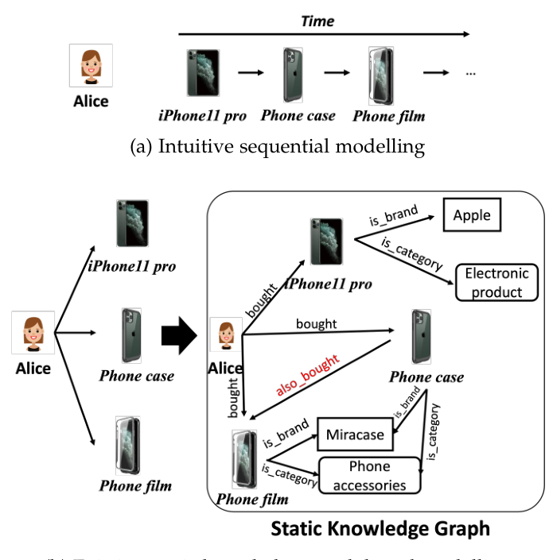
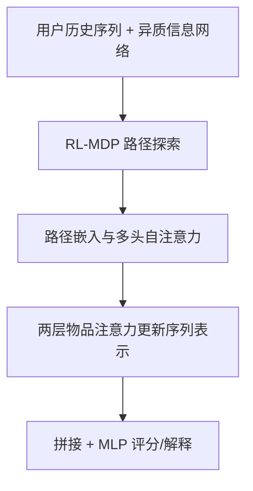
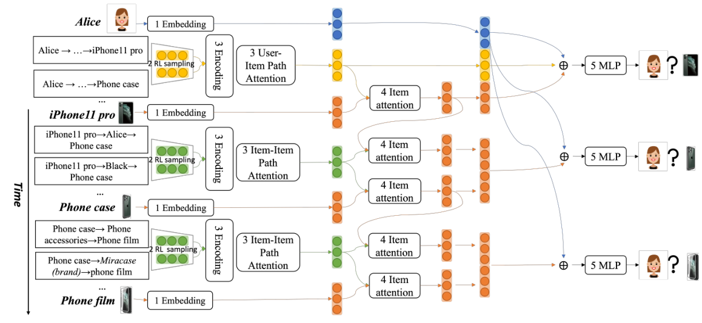

# Reinforcement Learning based Path Exploration for Sequential Explainable Recommendation (基于强化学习路径探索的序列可解释推荐)

- **会议/期刊**: IEEE TKDE
- **作者与机构**: Yicong Li, Hongxu Chen, Yile Li, Lin Li, Philip S. Yu, Guandong Xu；UTS、Tongji、WHUT、UIC
- **推荐链路定位**: 排序（Top-N 评分）
- **研究方向**: 序列推荐 / 图推荐
- **论文原文**: [论文原文链接](https://arxiv.org/abs/2111.12262v1)
- **开源代码**: 暂未开源

## TL;DR (1分钟核心速览)

针对静态知识图谱路径推荐忽略用户—物品时序演化、且序列建模与路径解释割裂的问题，TMER-RL 用强化学习在动态异质图上探索连续物品间 item-item 元路径实例，并以自注意力聚合路径、两层物品注意力传递序列信息，MLP 打分。在 4 个数据集、500 负采样排序协议下，HR@1 达 0.8762/0.9258/0.8632/0.6276，较前作 TMER 提升约 1.65%–4.76%。

## Background & Motivation (背景与核心矛盾)

- **主流范式**: 基于元路径的知识图谱推荐将用户—物品路径作为可解释证据；序列推荐则用 RNN/GRU 建模历史购买序列。
- **前人局限**: 静态 KG 方法忽略“先买手机、再买手机壳”的时序因果；TMER/KARN 等虽引入序列，但只建模路径内顺序或把用户历史粗粒度整体融合，且 item-item 内在关系缺失。
- **核心洞察 (Key Insight)**: 连续物品间的 item-item 路径可同时表达互补、替代、共同购买等具体理由，并天然承载序列依赖；路径选择不应依赖人工预定义与随机采样。
- **本文切入点**: 将路径探索建模为 MDP，用 RL 挖掘对推荐有用的 item-item 与 user-item 路径，再用注意力把路径上下文注入序列物品表示。

<figure class="paper-figure" markdown="span">
  <figcaption>图1：现有序列建模与基于静态知识图谱的建模。</figcaption>
</figure>

## Method (核心方法设计)

### 1. 整体框架 (Overall Architecture)

输入为用户历史购买序列与异质信息网络（用户、物品、品牌、类别/作者、出版社）。先用 DeepWalk 初始化实体；RL-MDP 从当前物品出发探索到下一物品的 item-item 路径，并探索用户到首物品的路径；路径经 Word2Vec+Mean 编码后，由多头自注意力学习多路径组合权重；两层物品注意力把上一物品信息与路径上下文写入当前物品；最后拼接用户、物品与路径向量，经 MLP 输出评分。训练用负采样隐式反馈损失，推理阶段复用离线探索路径并在线打分。

<figure class="paper-figure" markdown="span">
  <figcaption>图3：基于强化学习的时间元路径实例引导的可解释推荐（TMER-RL）架构。图中展示了一个示例：用户 Alice 按顺序购买了 iPhone 11 pro、手机壳和手机膜，以及 Alice 的训练过程。每个网络块中的数字表示模型的步骤顺序。详见第3.1节。</figcaption>
</figure>

### 2. 关键设计拆解 (Key Designs)

1. **RL 路径探索（替代预定义元路径与随机采样）**：痛点是路径数量随边数立方增长且人工元路径不一定有用。动作打分用余弦相似度，路径得分为各步平均分，到达目标实体给 1 奖励，否则 0，用 REINFORCE 优化：
$s_{e_i}=\mathrm{softmax}\left(\frac{\mathbf{h}_{e_t}\cdot\mathbf{h}_{e_i}^{\top}}{\|\mathbf{h}_{e_t}\|\|\mathbf{h}_{e_i}\|}\right),\quad c_{u\to i}=\frac{1}{T}\sum_{t=1}^{T}s_{e_t}$。
直觉是让路径节点语义相关且长度不偏置，剪枝 top-k 动作降低组合爆炸。

2. **item-item 路径自注意力 + 两层物品注意力**：痛点是连续购买理由复杂且多因，不能只用单一路径。对候选路径做多头自注意力得到组合上下文 $\mathbf{h}_{\phi}$，再更新当前物品：
$\mathbf{h}_i^{(1)}=g(\mathbf{W}_{i-1}\mathbf{h}_{i-1}+\mathbf{W}_{\phi_{i-1\to i}}\mathbf{h}_{\phi_{i-1\to i}}+\mathbf{b}^{(1)})\odot\mathbf{h}_{i-1}$，
$\mathbf{h}_i^{(2)}=g(\mathbf{W}_i\mathbf{h}_i+\mathbf{W}_{\phi_{i-1\to i}}^{(2)}\mathbf{h}_{\phi_{i-1\to i}}+\mathbf{b}^{(2)})\odot\mathbf{h}_i$。
首物品用 user-item 路径替代上一物品，保证冷启动位置仍有上下文。

3. **训练目标、负采样与推理效率**：最终 $\hat{r}_{u,i}=\mathrm{MLP}([\mathbf{h}_u;\mathbf{h}_i^{(1)};\mathbf{h}_i^{(2)}])$；损失为均匀负采样隐式反馈$\mathcal{L}=-\mathbb{E}_{j\sim P_{neg}}[\log(1-\hat{r}_{u,j})]$。RL 路径探索可离线完成，在线仅路径查表+注意力+MLP，较 RNN 序列模型更轻。

## Experimental Setup & Evaluation Protocol (实验设置与评估协议)

- **数据集与预处理**: 四个公开数据集，物品含品牌/类别或作者/出版社元信息；论文未报告交互总数与密度。

| 数据集 | #Users | #Items | #Interactions | 稀疏度/密度 | 特征/场景说明 |
| :--- | :---: | :---: | :---: | :---: | :--- |
| Amazon Musical Instruments | 1,450 | 11,457 | 未报告 | — | 品牌 1,185 / 类别 429 |
| Amazon Automotive | 4,600 | 36,663 | 未报告 | — | 品牌 3,790 / 类别 1,592 |
| Amazon Toys and Games | 9,300 | 58,743 | 未报告 | — | 品牌 5,404 / 类别 820 |
| Goodreads | 11,800 | 12,142 | 未报告 | — | 作者 3,633 / 出版社 1,442 |

- **数据划分与防穿越 (Splitting Strategy)**: 每用户按时间戳取最新 12 个物品，前 2 个为 bridge，随后 4 个训练，最后 6 个测试；属每用户时间序列切分，非全局时间戳切分。
- **排名评测协议 (Ranking Protocol)**: `Sampled Ranking`，每个正样本混入 500 个随机负样本排序，并采用 corrected sampled metrics 缓解采样偏差；消融实验用 100 负采样。指标 HR@1/5/10/20、NDCG@1/5/10/20。
- **对比基线与超参设置**: 基线含 GRU4Rec、NARRE、MCRec、NFM、Chorus、S3Rec、TMER；嵌入/注意力维度约 100，路径最大长度 6，学习率 1e-5/5e-5/1e-4，未报告显著性检验。

## Key Experimental Results (实验关键数据)

### 1. 主实验对比 (Main Results)

表1 主实验（500 负采样；HR@1 与 NDCG@20，加粗为最优；Improv. 为相对 TMER）

| 数据集 | 指标 | GRU4Rec | NARRE | MCRec | Chorus | S3Rec | TMER | TMER-RL | Improv. |
| :--- | :--- | :---: | :---: | :---: | :---: | :---: | :---: | :---: | :---: |
| Music | HR@1 | 0.3379 | 0.6171 | 0.5838 | 0.1020 | 0.3448 | 0.8620 | **0.8762** | +1.65% |
| Music | NDCG@20 | 0.5910 | 0.7580 | 0.6189 | 0.4474 | 0.5095 | 0.9389 | **0.9470** | +0.86% |
| Automotive | HR@1 | 0.4376 | 0.6521 | 0.6899 | 0.1389 | 0.4457 | 0.9070 | **0.9258** | +2.07% |
| Automotive | NDCG@20 | 0.6688 | 0.7699 | 0.7261 | 0.4746 | 0.6221 | 0.9585 | **0.9773** | +1.96% |
| Toys | HR@1 | 0.3914 | 0.6698 | 0.6802 | 0.1753 | 0.4741 | 0.8327 | **0.8632** | +3.66% |
| Toys | NDCG@20 | 0.6355 | 0.8059 | 0.7133 | 0.4852 | 0.6578 | 0.9356 | **0.9534** | +1.90% |
| Goodreads | HR@1 | 0.2168 | 0.5007 | 0.4679 | 0.1490 | 0.1967 | 0.5991 | **0.6276** | +4.76% |
| Goodreads | NDCG@20 | 0.4818 | 0.6899 | 0.5404 | 0.4514 | 0.3901 | 0.8251 | **0.8395** | +1.75% |

### 2. 消融实验 (Ablation Study)

表2 模块消融（100 负采样；H@1/H@20/N@20）

| 数据集 | 指标 | TMER-RL | TMER | w/o UI | w/o II |
| :--- | :--- | :---: | :---: | :---: | :---: |
| Music | H@1 | **0.9252** | 0.9216 | 0.8797 | 0.8739 |
| Music | H@20 | **0.9979** | 0.9965 | 0.9479 | 0.9471 |
| Music | N@20 | **0.9775** | 0.9770 | 0.9310 | 0.9297 |
| Automotive | H@1 | **0.9594** | 0.9482 | 0.8933 | 0.8979 |
| Automotive | H@20 | **0.9989** | 0.9963 | 0.9600 | 0.9618 |
| Automotive | N@20 | **0.9911** | 0.9863 | 0.9460 | 0.9468 |

### 3. 关键实验发现 (Key Findings)

1. **RL 路径探索稳定增益**：消融中 Automotive H@1 从 TMER 的 0.9482 升至 0.9594（+1.12pt），Music 从 0.9216 升至 0.9252；主实验 500 负采样下 Goodreads HR@1 相对提升 4.76%，说明学习到的路径比人工元路径更贴合推荐目标。
2. **item-item 与 user-item 路径缺一不可**：去掉 UI 或 II 后，Automotive H@1 分别跌至 0.8933/0.8979（约 -6.2~-6.6pt），Music 跌至 0.8797/0.8739（约 -4.6~-5.1pt），证明双路径注意力是主要增益来源。
3. **稀疏场景更受益于 RL 探索**：训练比例 0.2 时 TMER-RL 与 TMER 的差距最大，且 HR@1/HR@20 始终更优；说明在路径稀少时，RL 仍能剪枝出有效 item-item 连接，缓解序列稀疏。

## Highlights & Limitations (亮点、对比与审稿批判)

- **与代表作对比 (vs. Prior Work)**: MCRec 仅用 user-item 路径且忽略时序；TMER 预定义元路径并随机采样；Chorus/S3Rec 只建模序列或物品关系，不显式给出路径解释。TMER-RL 的本质增量是“RL 选路径 + item-item 路径承载序列依赖”。
- **可迁移亮点**: 将 item-item 路径作为序列推荐的显式上下文，可替代重型 RNN；RL top-k 动作剪枝可用于任意图上的路径组合爆炸控制。
- **审稿级局限批判**: 评估仅为 500 负采样排序，非全库 Full-Ranking，可能高估绝对性能且未报告显著性；可解释性仅 case study，缺少人工评测与注意力忠实性检验；RL 离线路径搜索与路径存储带来额外工程开销，且未开源。

## Rating (四维评分)

- **方法创新性 (Novelty)**: ⭐⭐⭐⭐ （首次把 RL 路径探索与 item-item 时序路径结合，机制清晰但理论分析偏弱）
- **评估协议与实验扎实度 (Protocol & Experiments)**: ⭐⭐⭐ （四数据集与消融较完整，但采样排序、无显著性、解释评估薄弱）
- **写作与数学规范度 (Clarity & Rigor)**: ⭐⭐⭐⭐ （框架与公式可读，部分符号与损失写法略简）
- **工业落地与复现价值 (Industrial & Practical Value)**: ⭐⭐⭐ （在线打分轻量，但 RL 路径维护成本高且无开源代码）

