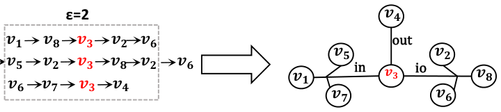
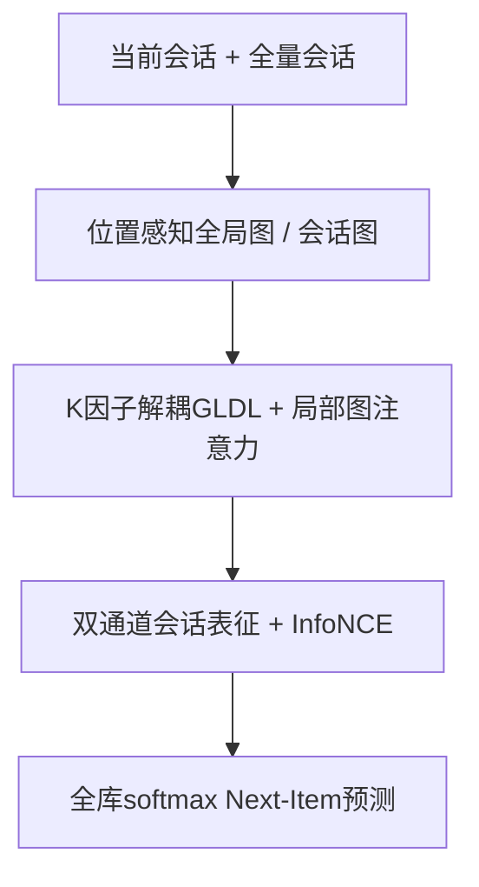
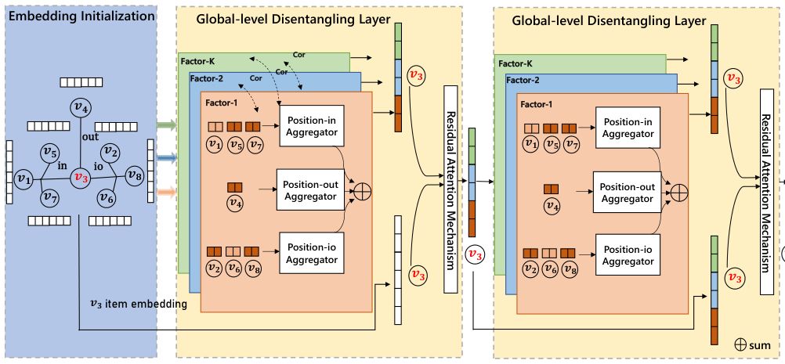

# Transition Information Enhanced Disentangled Graph Neural Networks for Session-based Recommendation (转移信息增强的解耦图神经网络会话推荐)

- **会议/期刊**: TKDE（目标目录；arXiv 预印本 2022）
- **作者与机构**: Ansong Li；西安交通大学软件工程系
- **推荐链路定位**: 召回 / 端到端会话 Next-Item 排序
- **研究方向**: 序列与会话推荐 / 图神经网络与知识图谱推荐
- **论文原文**: [论文原文链接](https://arxiv.org/abs/2204.02119v1)
- **开源代码**: [开源代码仓库链接](https://github.com/AnsongLi/TIE-DGNN)

## TL;DR (1分钟核心速览)

匿名会话推荐中，全局邻居常被无条件聚合，既丢失“谁指向谁”的细粒度转移，也缺少可解释的用户意图因子。TIE-DGNN 构建位置感知全局图，把物品切成 K 个因子并在图上解耦传播，再用双通道会话表征与对比学习增强鲁棒性。三数据集按全库 softmax 排序评估，Tmall 的 P@20 达 39.01，较 GCE-GNN 提升 11.2%，Last.fm 与 Nowplaying 分别提升 4.0% 和 3.9%。

## Background & Motivation (背景与核心矛盾)

- **主流范式**: 会话推荐以会话图 GNN 建模局部转移，并以全局图引入跨会话协同信号，代表作为 SR-GNN、GCE-GNN、Disen-GNN。
- **前人局限**: ①GCE-GNN 等把不同会话的邻居压成统一集合，忽略邻居类型与相对位置，难以区分 $A\to B$、$B\to A$ 或双向转移；②物品多为整体嵌入，无法解释“因颜色/风格/价位中的哪一因子发生转移”，且短会话本地信号稀疏。
- **核心洞察 (Key Insight)**: 全局转移的贡献应由邻居方向、距离、频次及目标会话的因子偏好共同决定；若将物品拆成独立因子，可在更细粒度上匹配用户意图。
- **本文切入点**: 用位置感知全局图保留转移方向与距离，用因子解耦 GNN 分解转移原因，并以局部-全局双通道对比学习提升鲁棒性。

<figure class="paper-figure" markdown="span">
  <figcaption>图1：会话图与位置感知全局图的构建示意图。</figcaption>
</figure>

## Method (核心方法设计)

### 1. 整体框架 (Overall Architecture)

输入为当前匿名会话与全量训练会话。模型先为每个物品构建位置感知全局图，将物品嵌入切成 K 个因子块；GLDL 层按 in/out/in-out 三类邻居及距离分别聚合因子信息，并用残差注意力缓解过平滑。局部侧在会话图上用边类型感知注意力学习物品表示。随后分别生成因子感知的 inter-session 与 intra-session 会话向量，经 InfoNCE 对比后线性相加，与候选物品点积做全库 softmax 预测。训练联合交叉熵、因子独立性正则与对比损失。

### 2. 关键设计拆解 (Key Designs)

1. **位置感知全局图与位置感知传播**：针对统一邻居集丢失转移方向的问题，对距离 $\le \varepsilon$的邻居按 in/out/in-out 分型，边权用跨会话出现频次$w_{ij}$表示，并为不同距离学习位置向量$p^{rg}_{\mu}$。注意力同时融合邻居因子$c_{j,k}$、会话因子偏好$s_k$、频次与位置：$\theta_{i,j}=q_{rg}^\top \mathrm{LeakyReLU}(\mathbf{W}_{rg}[\mathbf{s}_k\odot c_{j,k}\|w_{ij}\|p^{rg}_{\mu}])$。这样可区分“近距离前驱”与“远距离同现”对目标物品的不同贡献。

2. **因子解耦 GLDL 与独立性正则**：将物品嵌入投影为 K 个归一化因子块 $c_{i,k}=\frac{\sigma(\mathbf{W}_k^\top \mathbf{v}_i)+\mathbf{b}_k}{\|\sigma(\mathbf{W}_k^\top \mathbf{v}_i)+\mathbf{b}_k\|_2}$，每因子独立聚合全局邻居并更新；层间用残差注意力$\alpha$融合新旧表示，抑制过平滑。为避免因子冗余，加入成对因子余弦近似独立性正则$\mathcal{L}_{cor}=\sum_{k<k'}\cos(c_{i,k},c_{i,k'})$，使不同子空间承载互补语义。

<figure class="paper-figure" markdown="span">
  <figcaption>图3：我们的解耦嵌入学习方法中两个GLDL层的示例。具体而言，我们首先将位置感知全局图中的每个节点（即物品）投影到不同的嵌入子空间，使每个子空间表示一个潜在因子。然后，在每个子空间中，我们采用位置感知聚合器分别聚合不同位置类型的邻居信息，以学习节点的因子嵌入。在下一阶段，我们以v3为例。将不同的因子嵌入拼接成新的物品嵌入。为防止过拟合，我们融合了新的</figcaption>
</figure>

3. **双通道会话表征、对比学习与训练目标**：全局通道按因子聚合并引入反向位置嵌入，得到 $s_g$；局部通道在会话图上聚合得到$s_l$。最终$S=s_g+s_l$。对比损失使用行/列打乱的负样本：$\mathcal{L}_{con}=-\log\sigma(s_g^\top s_l)-\log\sigma(1-\tilde{s}_g^\top s_l)$。总损失$\mathcal{L}=\mathcal{L}_{c}+\beta\mathcal{L}_{cor}+\lambda\mathcal{L}_{con}$。训练交叉熵覆盖全物品，无额外均匀负采样；推理为一次双通道编码加全库点积。

## Experimental Setup & Evaluation Protocol (实验设置与评估协议)

- **数据集与预处理**: 过滤长度为 1 的会话及出现次数少于 5 的物品，并用前缀切分扩充训练样本。

| 数据集 | #Train Sessions | #Test Sessions | #Items | 平均长度 | 场景 |
| :--- | ---: | ---: | ---: | ---: | :--- |
| Tmall | 351,268 | 25,898 | 40,728 | 6.69 | 电商购物 |
| Last.fm | 2,837,644 | 672,519 | 38,615 | 11.88 | 音乐艺人 |
| Nowplaying | 825,304 | 89,824 | 60,417 | 7.42 | 社交音乐收听 |

- **数据划分与防穿越**: Tmall 取前 12 万会话，最后 100 秒为测试；Last.fm 按 8 小时间隔切分，最近 20% 会话测试；Nowplaying 最后两个月测试。
- **排名评测协议**: 采用全库候选 softmax 排序，报告 P@20 与 MRR@20；训练目标覆盖全物品，未采用采样负例排序。
- **对比基线与超参**: 对比 FPMC、GRU4Rec、NARM、STAMP、SR-GNN、GC-SAN、Disen-GNN、GCE-GNN。图范围 $\varepsilon=3$、全局邻居数 12，batch=100，Adam 初始学习率 0.001；Tmall/Last/Now 的$d$分别为 275/128/105，$K$为 5/4/7，$\beta$为 5/4/5，$\lambda$ 为 0.005/0.02/0.005。

## Key Experimental Results (实验关键数据)

### 1. 主实验对比 (Main Results)

| Model | Tmall P@20 | Tmall MRR@20 | Last.fm P@20 | Last.fm MRR@20 | Nowplaying P@20 | Nowplaying MRR@20 |
| :--- | ---: | ---: | ---: | ---: | ---: | ---: |
| FPMC | 9.15 | 3.31 | 12.86 | 3.78 | 7.36 | 2.82 |
| GRU4Rec | 10.93 | 5.89 | 17.61 | 6.62 | 7.92 | 4.48 |
| NARM | 23.30 | 10.70 | 21.83 | 7.59 | 18.59 | 6.93 |
| STAMP | 26.47 | 13.36 | 21.76 | 7.66 | 17.66 | 6.88 |
| SR-GNN | 27.57 | 13.72 | 22.33 | 8.23 | 18.87 | 7.47 |
| GC-SAN | 21.80 | 10.17 | 22.64 | 8.42 | 18.85 | 7.43 |
| Disen-GNN | 31.56 | 15.31 | 22.92 | 8.75 | 22.22 | 8.22 |
| GCE-GNN | 35.09 | 15.80 | 24.26 | 8.66 | 22.47 | 8.40 |
| **TIE-DGNN** | **39.01** | **17.75** | **25.25** | **8.83** | **23.35** | **8.53** |
| **Improv.%** | **+11.2%** | **+12.3%** | **+4.0%** | **+0.9%** | **+3.9%** | **+1.5%** |

### 2. 消融实验 (Ablation Study)

| 变体 | Tmall P@20 | Tmall MRR@20 | Last.fm P@20 | Last.fm MRR@20 | Now P@20 | Now MRR@20 |
| :--- | ---: | ---: | ---: | ---: | ---: | ---: |
| w/o PEM | 37.52 | 16.90 | 24.97 | 8.65 | 21.97 | 8.45 |
| w/o PGG | 38.10 | 16.77 | 24.12 | 8.30 | 23.03 | 7.66 |
| **TIE-DGNN** | **39.01** | **17.75** | **25.25** | **8.83** | **23.35** | **8.53** |

### 3. 关键实验发现 (Key Findings)

- 完整模型在三个数据集、两个指标上全面最优；Tmall 相对 GCE-GNN 的 P@20/MRR@20 分别提升 11.2%/12.3%，显著高于 Last.fm 与 Nowplaying，说明短且稀疏的电商会话更依赖细粒度全局转移。
- 去掉位置感知全局图（w/o PGG）后，Last.fm MRR 由 8.83 降至 8.30；去掉位置嵌入（w/o PEM）后，Tmall MRR 由 17.75 降至 16.90、Nowplaying P@20 由 23.35 降至 21.97，表明“邻居分型+距离权重”二者互补。
- 因子数存在场景阈值：Last.fm 约 $K=4$、Nowplaying 约$K=7$最优，继续增大反而下降；$\beta$与$\lambda$ 取非零值均优于零值，但权重过大引发联合损失梯度冲突，故独立性正则与对比学习需轻量约束。

## Highlights & Limitations (亮点、对比与审稿批判)

- **与代表作对比**: 相比 GCE-GNN 的“统一全局邻居集”，本文显式区分转移方向、距离与频次；相比 Disen-GNN 仅解耦局部会话图，本文将因子解耦扩展到全局转移并以双通道对比增强；相比 SR-GNN，额外引入跨会话细粒度信号。
- **可迁移亮点**: 位置分型邻居+频次权重的构图可直接用于 Next-POI、电商序列召回；因子块+成对独立性正则可低成本嵌入现有 GNN 推荐器。
- **审稿级局限**: 全局图为全物品离线构图，邻居缓存与 K 因子传播带来额外内存/训练开销；实验仅用 P@20/MRR@20，缺少显著性检验与线上 A/B，且 $K,\beta,\lambda$ 对数据集较敏感，跨场景部署需重调。

## Rating (四维评分)

- **方法创新性 (Novelty)**: ⭐⭐⭐⭐ （位置感知全局转移与因子解耦结合，较统一邻居集有明确增量）
- **评估协议与实验扎实度 (Protocol & Experiments)**: ⭐⭐⭐ （三数据集与八个基线较完整，但缺显著性检验及对比损失单独消融）
- **写作与数学规范度 (Clarity & Rigor)**: ⭐⭐⭐⭐ （模块与公式链条清楚，距离相关与余弦近似处略有符号不严谨）
- **工业落地与复现价值 (Industrial & Practical Value)**: ⭐⭐⭐ （开源可复现，离线全局图与多因子传播增加工程成本，适合作为召回增强模块）

