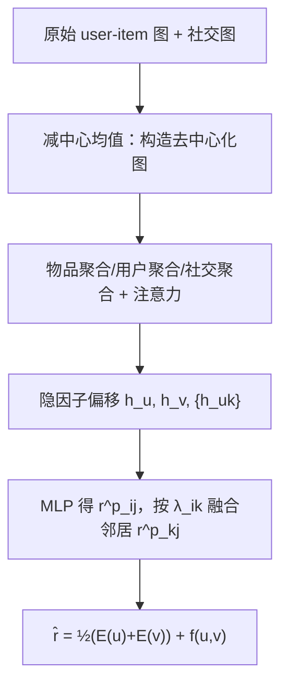
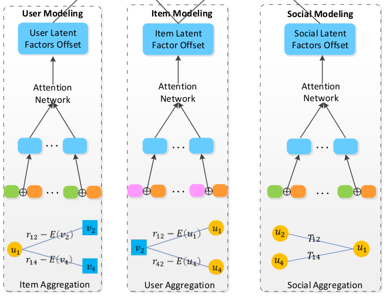

# GDSRec: Graph-Based Decentralized Collaborative Filtering for Social Recommendation (基于去中心化图的社交推荐)

- **会议/期刊**: IEEE TKDE (2023, arXiv 2022-05)
- **作者与机构**: Jiajia Chen, Xin Xin, Xianfeng Liang, Xiangnan He, Jun Liu (USTC / 山东大学)
- **推荐链路定位**: 精排（评分预测 + Top-N 列表排序）
- **研究方向**: 社交与群组推荐 / 图神经网络推荐
- **论文原文**: [论文原文链接](https://arxiv.org/abs/2205.09948v1)
- **开源代码**: [MEICRS/GDSRec](https://github.com/MEICRS/GDSRec)

## TL;DR (1分钟核心速览)

社交推荐中的 GNN 方法直接在图上学表征，忽略了"挑剔用户给 3 分其实已是好评"这类**统计偏置**，且把社交边一律视为等强度。GDSRec 将偏置从标量升级为**向量**，通过逐边减去中心均值构造"**去中心化图**"，在图上做注意力聚合学习用户/物品/社交邻居的隐因子偏移；并用共同评分一致性定义**可微社交强度** $T_{ij}$ 修正最终评分。在 Ciao/Epinions 两个基准上，MAE 相对 SOTA (DiffNet++) 在 Epinions-60% 降低 3.3%、Ciao-60% 降低 1.8%。

## Background & Motivation (背景与核心矛盾)

- **主流范式**: 将 user-item 交互与 user-user 社交关系统一表示为图，用 GraphRec / DiffNet++ / LightGCN 等 GNN 做邻居聚合学表征。
- **前人局限一**: FunkSVD/SVD++ 虽引入偏置，但只用**标量** $b_u,b_i$ 线性相加，无法刻画偏置在物品维度上的完整结构；且直接在原始评分上学，未显式剥离偏置。
- **前人局限二**: 社交边强度不可微、不加区分（GraphRec、DiffNet++ 同等对待所有邻居），弱关系噪声会污染聚合。
- **核心洞察**: 若把每条评分先减去对应中心均值（用户侧减物品均值、物品侧减用户均值），残差才是真正反映"个体偏好差异"的信号。
- **本文切入点**: 先离线构造去中心化图再学偏移量，同时把社交强度做成可计算的显式系数融入预测式。

## Method (核心方法设计)

### 1. 整体框架 (Overall Architecture)

输入用户-物品评分矩阵与社交图；先统计 $E(u_i)$、$E(v_j)$与关系系数$T_{ij}$，将原始二部图逐边减去中心均值，得到去中心化交互图。在该图上并行三支注意力聚合：物品聚合→用户隐因子偏移$h_{u_i}$、用户聚合→物品偏移$h_{v_j}$、社交聚合→邻居偏移$\{h_{u_k}\}$。偏好评分$r^p_{ij}$由 MLP 从$[h_{u_i}\oplus h_{v_j}]$得到，最后与社交邻居的$r^p_{kj}$按$\lambda_{ik}$融合并加回均值基准，输出$\hat{r}_{ij}$。训练侧评分预测用 MSE、排序任务用 BCE，配 RMSprop 与 node dropout。

<figure class="paper-figure" markdown="span">
  <figcaption>图 3. 所提框架概览。包含四个组件：用户建模、物品建模、社交建模和偏好评分预测。</figcaption>
</figure>

### 2. 关键设计拆解 (Key Designs)

1. **偏置向量化 + 去中心化图（核心增量）**: 痛点是把偏置当标量只做加法。GDSRec 改用**评分差**做嵌入：用户侧 $\bar{r}_{ij}=\lceil |r_{ij}-E(v_j)|\rceil$，物品侧$\tilde{r}_{ij}=\lceil |r_{ij}-E(u_i)|\rceil$，再与对侧 ID 嵌入拼接过 MLP$x_{il}=\mathrm{LU}([q_{v_l}\oplus s_{\bar{r}_{il}}])$，注意力加权得$h_{u_i}=\tanh(W\sum_{v_l\in R(u_i)}\eta_{il}x_{il}+b)$。直觉：偏置被编码成"可学习向量 + 图结构残差"，模型只需拟合残差分布，收敛目标更干净（消融中去掉该设计的 GDSRec-RD 掉点最大即为证据）。
2. **可微社交强度与评分修正**: 痛点在于社交边不可区分。仅对**共同评分物品**计一致性：$T_{ij}=1+\sum_{v_k\in R(u_i)\cap R(u_j)}\mathbb{I}(|r_{ik}-r_{jk}|\le\delta)$，归一化$\lambda_{ik}=T_{ik}/\sum_{u_k\in N(u_i)}T_{ik}$，最终$f(u_i,v_j)=\frac{1}{2}\big(r^p_{ij}+\sum_{u_k\in N(u_i)}\lambda_{ik}r^p_{kj}\big)$。与 GraphRec 用社交**学用户表征**不同，这里社交只作为**预测后的校准项**，等价于在邻居维度做一次软去噪，$\delta$ 控制"多像才算像"。
3. **训练目标、负采样与推理开销**: 评分任务 $\mathcal{L}_1=\frac{1}{2|\mathcal{O}|}\sum(\hat{r}_{ij}-r_{ij})^2$；排序任务$\mathcal{L}_2=\sum y_{ij}\log\hat{y}_{ij}+(1-y_{ij})\log(1-\hat{y}_{ij})$，正样本定义为$r_{ij}\ge F$（$F=3,4$两档），**免负采样**（测试集内正负天然混合）。node dropout 对每节点随机保留最多$K$条交互，保护低度数节点。复杂度$O(((N+M)K+|\mathcal{O}|)D)$，在线需$|N(u_i)|$ 次邻居前向。

## Experimental Setup & Evaluation Protocol (实验设置与评估协议)

- **数据集与预处理**: 两套公开社交评分数据集，未做 5-core 过滤，评分区间 1–5：

| 数据集 | #Users | #Items | #Interactions | 密度 | 社交边 |
| :--- | :---: | :---: | :---: | :---: | :---: |
| Ciao | 7,317 | 104,975 | 283,319 | 0.037% | 111,781 |
| Epinions | 18,088 | 261,649 | 764,352 | 0.016% | 355,813 |

- **数据划分与防穿越**: **随机比例划分**（训练 60% 或 80%，余下均分验证/测试，沿用 GraphRec 设定）。⚠️ 无全局时间戳切分，存在未来交互穿越风险。
- **排名评测协议**: **Sampled/观测集内排序**——仅在测试集已出现过的样本上排序（正样本 $r\ge F$），**非全库 Full-Ranking**，未报告负采样比例；指标 Recall@5、NDCG@5，取 5 次平均。
- **对比基线与超参**: 覆盖传统 (PMF/FunkSVD)、社交 MF (TrustMF)、深度 (NeuMF/DeepSoR)、GNN (GCMC/GCMC+SN/LightGCN/GraphRec/DiffNet++)；$D\in\{16,...,512\}$，$\delta\in\{0,1,2,3\}$，$K$在 Ciao 取$\{5,10,15,20\}$、Epinions 取$\{15,20,25,30\}$；RMSprop，dropout 防过拟合。

## Key Experimental Results (实验关键数据)

### 1. 主实验对比 (Main Results)

| 模型 | Ciao-60 MAE↓ | Ciao-60 RMSE↓ | Ciao-80 MAE | Ciao-80 RMSE | Epi-60 MAE | Epi-60 RMSE | Epi-80 MAE | Epi-80 RMSE |
| :--- | :---: | :---: | :---: | :---: | :---: | :---: | :---: | :---: |
| PMF | 0.9520 | 1.1967 | 0.9021 | 1.1238 | 1.0211 | 1.2739 | 0.9952 | 1.2128 |
| FunkSVD | 0.8462 | 1.0513 | 0.8301 | 1.0515 | 0.9036 | 1.1431 | 0.8874 | 1.1422 |
| TrustMF | 0.7681 | 1.0543 | 0.7690 | 1.0479 | 0.8550 | 1.1505 | 0.8410 | 1.1395 |
| NeuMF | 0.8251 | 1.0824 | 0.8062 | 1.0617 | 0.9097 | 1.1645 | 0.9072 | 1.1476 |
| GCMC+SN | 0.7697 | 1.0225 | 0.7526 | 0.9931 | 0.8602 | 1.1004 | 0.8590 | 1.0711 |
| LightGCN | 0.7715 | 1.0203 | 0.7562 | 0.9963 | 0.8717 | 1.1103 | 0.8677 | 1.0801 |
| GraphRec | 0.7540 | 1.0093 | 0.7387 | 0.9794 | 0.8441 | 1.0878 | 0.8168 | 1.0631 |
| DiffNet++ | 0.7459 | 0.9987 | 0.7398 | 0.9774 | 0.8435 | 1.0795 | 0.8201 | 1.0635 |
| **GDSRec** | **0.7328** | **0.9846** | **0.7323** | **0.9740** | **0.8157** | **1.0685** | **0.8047** | **1.0566** |
| **Improv.%** | 1.76% | 1.41% | 0.87% | 0.35% | 3.30% | 1.02% | 1.48% | 0.61% |

排序任务（图 4/5）：所有模型 Recall@5 均在 0.92–0.99 间高度饱和（正样本占比过高导致预测天然偏正），差异主要体现在 NDCG@5 上，GDSRec 在 Ciao/Epinions、$F=3$与$F=4$ 四种设置下 NDCG@5 均最优，说明其更擅长把真正正样本推到列表高位。

### 2. 消融实验 (Ablation Study)

| 变体 (60% 训练) | Ciao MAE | Ciao RMSE | Epi MAE | Epi RMSE |
| :--- | :---: | :---: | :---: | :---: |
| GDSRec 完整 | **0.7328** | **0.9846** | **0.8157** | **1.0685** |
| w/o 关系系数 (RC, $\lambda_{ik}=1/|N|$) | 0.7394 (+0.9%) | 0.985× | – | 略升 |
| w/o 社交网络 (SN, $f=r^p_{ij}$) | 0.732× | 0.9924 (+0.79%) | – | – |
| w/o 评分差 (RD, 用原始 $r_{ij}$) | 显著劣化 | 显著劣化 | 显著劣化 | 显著劣化 |
| 注意力→均值 (avg) | 0.7326 | 0.9871 | 0.8155 | 1.0704 |
| 注意力→最大 (max) | 0.7388 | 0.9884 | 0.8183 | 1.0706 |

超参敏感性：$\delta=1$时两组数据均最优（Ciao RMSE 0.9846；Epinions MAE 0.8157），$\delta\ge2$引入噪声使 MAE 升至 0.7441/0.8252；权重$\alpha$在均值项前取 1 最佳，$\alpha\to0$或$\alpha>1$均劣化；node dropout 的$K$需逐数据集调（Ciao$K=10$、Epinions$K=25$ 最优）。

### 3. 关键实验发现 (Key Findings)

1. **偏置向量化是最大增益源**：把评分差替换回原始评分 (GDSRec-RD) 造成 MAE/RMSE 全线下滑最多，而仅去掉社交强度 (RC) 只带来 Ciao MAE +0.9%、去掉社交网络只带来 RMSE +0.79%，说明"去中心化残差建模"贡献远大于"社交边加权"。
2. **社交信息是校准项而非表征源**：Epinions-60% 上 GDSRec 相对 DiffNet++ MAE 改善 3.30%（0.8435→0.8157），明显高于 Ciao 的 1.76%，稀疏度更高的数据集（0.016% vs 0.037%）从社交校准中获益更大。
3. **训练数据越多，相对优势反而收窄**：Ciao 从 60%→80% 训练后相对 DiffNet++ 的 MAE 提升由 1.76% 降至 0.87%，说明统计偏置在数据稀缺时更关键，符合"均值先验替代观测"的直觉。

## Highlights & Limitations (亮点、对比与审稿批判)

- **与代表作对比**: GraphRec 将社交图用于**学用户表征**并把评分直接嵌入交互；DiffNet++ 用影响/兴趣双层扩散；LightGCN 仅做高阶 item 传播无社交。GDSRec 的差异是双重的——偏置以**向量 + 图残差**方式显式剥离，社交以**预测后加权校准**方式介入，二者解耦后可分别开关。
- **可迁移亮点**: ①"逐边减中心均值构造残差图"可零成本套用到任何评分/多行为推荐模型；②用共同交互的评分一致性定义边权 $\lambda_{ik}$，可迁移到跨域对齐或异构图去噪。
- **审稿级局限批判**: ①评估协议偏弱——随机划分存在时间穿越、排序仅在已观测集内进行且无负采样比例，Recall 全面饱和失去区分度，"优于 SOTA"的结论在 Full-Ranking 下未经检验；②方法本质是评分预测框架，依赖显式评分计算 $E(\cdot)$和$\delta$一致性，难以直接迁移到隐式反馈；③超参敏感（$\delta$、$K$、$\alpha$ 均需逐数据集网格搜索）且在线需对每个社交邻居各跑一次 MLP，邻居多时延迟不可忽略。

## Rating (四维评分)

- **方法创新性 (Novelty)**: ⭐⭐⭐⭐ （把偏置从标量升级为向量并与去中心化图绑定，视角新颖；但注意力聚合与社交加权均为已有模块的组合）
- **评估协议与实验扎实度 (Protocol & Experiments)**: ⭐⭐⭐ （两数据集 + 评分/排序双任务 + 四组消融尚算完整，但随机划分、观测集内排序与 Recall 饱和削弱了结论强度）
- **写作与数学规范度 (Clarity & Rigor)**: ⭐⭐⭐⭐ （公式链从式 (1) 到 (23) 完整自洽，复杂度与超参设置交待清楚；评分差用取整处理削弱了理论解释力）
- **工业落地与复现价值 (Industrial & Practical Value)**: ⭐⭐⭐⭐ （代码已开源、结构轻量易部署；但强依赖显式评分与社交图，落地场景限定在点评/电商评价类平台）

