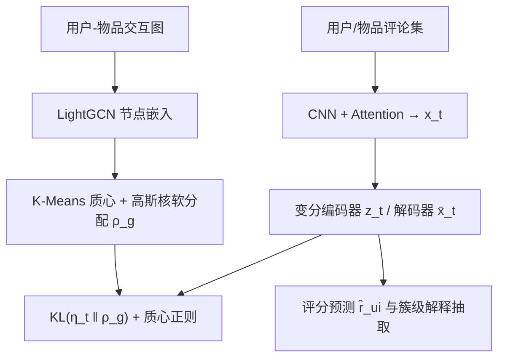

# Explainable Recommender with Geometric Information Bottleneck (基于几何信息瓶颈的可解释推荐)

- **会议/期刊**: IEEE TKDE (2024, arXiv v2 2024-01)
- **作者与机构**: Hanqi Yan, Lin Gui, Menghan Wang, Kun Zhang, Yulan He（University of Warwick、University of Cambridge、Amazon 等）
- **推荐链路定位**: 精排（评分预测）+ 事后解释生成
- **研究方向**: 对话推荐与智能体仿真（可解释推荐理由生成）/ 多模态推荐（图 + 文本模态融合）
- **论文原文**: [https://arxiv.org/abs/2305.05331v2](https://arxiv.org/abs/2305.05331v2)
- **开源代码**: [https://github.com/hanqi-qi/Explainable-Recommender-GIANT](https://github.com/hanqi-qi/Explainable-Recommender-GIANT)

## TL;DR (1分钟核心速览)

抽取式可解释推荐只能在"当前 $u$-$i$ 这一条评论"里挑句子，遇到"我很喜欢，推荐给朋友"这类空话就失效，也无法利用相似用户/相似物品的隐含证据。GIANT 先在用户-物品交互图上用 LightGCN + K-Means 得到用户/物品的簇级软分配，将其作为**几何先验**，再借"可迁移信息瓶颈"的上界把该先验写成文本 VAE 后验的 KL 目标。三个电商数据集上平均 RMSE/MAE 为 84.18/62.87（最优基线 RGCL 为 84.49/63.49），并用同簇他人评论抽出更忠实的解释。

## Background & Motivation (背景与核心矛盾)

- **主流范式**: 一条路是 NARRE 类 review-level attention 从给定 $u$-$i$ 的评论中抽句/词作 rationale；另一条是生成式，需人工标注解释文本，代价高昂。
- **前人局限一**: 抽取范围被锁死在单条评论内，大量评论过于笼统（"I really like this smartphone"），无法支撑评分解释。
- **前人局限二**: 文本模态单独训练无法感知交互图的全局结构——同类用户偏好的物品、相似物品被他人写下的评论，这些证据在单条评论里根本不存在。
- **核心洞察 (Key Insight)**: 图与文本是同一批样本的两种模态，理论上共享同一信息瓶颈上界；因此图模态的后验分布可直接充当文本模态隐变量的"先验"，从而替代 VAE 中被过度简化的各向同性 $\mathcal{N}(0,I)$。
- **本文切入点**: 把"交互图聚类结果"翻译成簇上的概率分布（几何先验），以 KL 散度约束文本隐因子，使隐维度天然对齐语义簇，既用于打分也用于解释抽取。

## Method (核心方法设计)

### 1. 整体框架 (Overall Architecture)

离线阶段在交互图上跑 LightGCN 得节点嵌入 $\boldsymbol{e}_g$，K-Means 得$K$个质心$\boldsymbol{C}_k$，并用高斯核把每个用户/物品转换为$K$维软簇分布$\rho^g$；在线阶段把用户历史评论集与物品评论集（剔除$u$对$i$的那条）经 CNN + Attention 编码为$\boldsymbol{x}^t$，送入共享权重的变分编码-解码器得隐因子$\boldsymbol{z}^t$，其 KL 目标被$\rho^g$拉齐；最终$\boldsymbol{z}^t$拼上 ID 嵌入做评分回归，同时取$\arg\max_k z^t_k$ 定位簇，从同簇评论中检索句子作为解释。训练采用先质心正则、后逐步退火的 KL schedule。

### 2. 关键设计拆解 (Key Designs)

1. **几何先验（Gaussian-kernel soft cluster assignment）**：痛点是用 $\mathcal{N}(0,1)$无法表达"这两个用户本就属于同一兴趣簇"。作者把图空间距离转成簇概率$\rho^g_k = \exp(-\|\boldsymbol{e}_g-\boldsymbol{C}_k\|^2/2\alpha^2)\big/\sum_{k'}\exp(-\|\boldsymbol{e}_g-\boldsymbol{C}_{k'}\|^2/2\alpha^2)$，且$\sum_k \rho^g_k = 1$；当$K$ 足够大时该分布弱近似高斯，物理直觉是"用图的邻域几何替代人为先验"。

2. **可迁移信息瓶颈（Transferable IB）**：标准 IB 目标为 $O_{IB}=I(\bar{X};Z)-\beta I(X;Z)$，但文本侧无法单独定义合适先验。作者证明跨模态上界$I(X^t;Z^g)\le H(X^t)-H(X^g)+H(X^g|X^t)+I_c$，于是文本目标改写为$O^t_{IB}=I(\bar{X}^t;Z^t)-\beta I(X^t;Z^g)$，落地即
$\mathcal{L}_{IB}=\mathbb{E}\big[-\log q(\bar{\boldsymbol{x}}^t|f(\boldsymbol{x}^t,\epsilon))\big]+\beta\,\mathrm{KL}\big(p(Z^t|\boldsymbol{x}^t,\epsilon)\,\|\,r(Z^g)\big)$。
这一步的意义是：**图模态无需与文本共享参数，只共享一个上界**，即可把全局结构注入文本隐空间。

3. **先验落地三件套与训练目标**：为解决随机初始化下 $\boldsymbol{z}^t$与簇"对不上位"，先用质心正则$R_{centroid}=\sum_{k=1}^{K}\|\boldsymbol{W}^k_{en}-\boldsymbol{C}_k\|^2$把编码器权重列对齐质心（仅训前 50% 轮次，否则会忽略输入）；再用 Student-t 软分配$\eta^t_k=\big(1+e^{\phi(z^t_k)/\tau}\big)\big/\sum_{k'}e^{\phi(z^t_{k'})/\tau}$与$\rho^g$做$\mathrm{KL}=\sum_k \eta^t_k\log(\eta^t_k/\rho^g_k)$。重建项由 Nadaraya-Watson 核密度估计推得$Q(\boldsymbol{x}^t)\propto\log\exp(-\|\bar{\boldsymbol{x}}^t-\boldsymbol{x}^t\|^2)$，故等价于 MSE。总损失$\mathcal{L}=\mathcal{L}_{r}+O^t_{IB}+R_{centroid}$，其中$\hat{r}_{ui}=f_{cls}(\boldsymbol{\zeta}_u,\boldsymbol{\zeta}_i)+b_u+b_i$，$\boldsymbol{\zeta}_u=\boldsymbol{W}_u\boldsymbol{z}^t_u+\boldsymbol{\epsilon}_u$。推理仅需一次前向 + 点积，复杂度与 LightGCN 同量级，随每用户/物品评论数线性增长。

**解释生成**：隐因子最大维即簇编号，用户候选句子取自"与 $u$同簇用户对$i$的历史评论"，物品候选取自"主题维与$i$ 相同的评论"；主题用簇内 TFIDF top-5 词的 GloVe 均值表示，按余弦相似度抽句——这正是"beyond individual review"的机制来源。

## Experimental Setup & Evaluation Protocol (实验设置与评估协议)

- **数据集与预处理**: 三个电商数据集均采用 **5-core** 稠密子集；额外过滤评论数 > 100 的用户/物品（长尾截断），评论截断长度分别为 200/400/300。

| 数据集 | #Users | #Items | #Train Interactions | 稀疏度 | 场景说明 |
| :--- | :---: | :---: | :---: | :---: | :--- |
| BeerAdvocate | 6,939 | 13,122 | 35,450 | 4.4e-4 | 啤酒长评论，最稀疏 |
| Digital Music | 5,541 | 3,568 | 51,768 | 2.9e-3 | Amazon 音乐 |
| Office Products | 4,902 | 2,364 | 35,999 | 3.5e-3 | Amazon 办公用品 |

- **数据划分与防穿越**: 随机 **80%/10%/10%** 比例划分（非全局时间戳切分，存在轻度未来信息泄漏风险，原文未讨论）。
- **排名评测协议**: **Sampled Ranking**——每个测试样本随机采 100 个未交互负样本，与正样本混排后截断 @10；**未做 Full-Ranking**，因此 HitRatio/NDCG 的跨模型可比性有限。
- **对比基线与超参**: HFT / DeepCoNN / NARRE / RGCL 及 4 种自建 VAE 变体（StandPrior、WassersteinVAE、IndivPrior、AutoEncoder）；图嵌入维 $d=64$，簇数$K\in\{16,\dots,512\}$，温度$\tau\in\{1,2,4,6,8\}$，$\beta=0.01$，Adam lr=1e-3，显著性检验$p<0.01$。

## Key Experimental Results (实验关键数据)

### 1. 主实验对比 (Main Results)

| 模型 | Beer RMSE↓ | Beer MAE↓ | Music RMSE↓ | Music MAE↓ | Office RMSE↓ | Office MAE↓ |
| :--- | :---: | :---: | :---: | :---: | :---: | :---: |
| HFT | 79.81 | 62.42 | 96.42 | 74.76 | 89.46 | 68.57 |
| DeepCoNN | 77.28 | 59.45 | 94.69 | 71.03 | 85.14 | 64.82 |
| NARRE | 76.80 | 58.94 | 93.69 | 69.30 | 84.40 | 63.40 |
| RGCL | **74.65** | **57.12** | **92.02** | **68.49** | 86.81 | 64.87 |
| StandVAE | 75.80 | 58.73 | 93.60 | 69.21 | 84.69 | 63.97 |
| WassersteinVAE | 75.62 | 58.06 | 93.81 | 69.32 | 84.20 | 63.43 |
| **GIANT** | 75.36 | 57.87 | 92.87 | 68.68 | **84.32** | **62.05** |
| **Improv.% (vs 最优基线)** | −0.95% | −1.31% | −0.92% | −0.28% | +0.14% | +1.85% |

排序指标（HitRatio@10 / NDCG@10）：GIANT 为 0.62/0.57（Beer）、0.69/0.67（Music）、0.64/0.64（Office）；NARRE 为 0.61/0.52、0.65/0.59、0.59/0.64；RGCL 为 0.47/0.55、**0.72**/**0.63*-、**0.64**/**0.72**。可见"GIANT 全面最优"并不成立。

### 2. 消融实验 (Ablation Study)

| 变体 | NDCG@10 (B/M/O) | RMSE (B/M/O) | 隐变量多样性 Div (B/M/O) |
| :--- | :---: | :---: | :---: |
| Full Model | 0.57 / 0.67 / 0.64 | 75.36 / 92.87 / 84.32 | 1.89 / 3.46 / 1.58 |
| w/o $R_{centroid}$ | 0.55 / 0.65 / 0.62 | 75.96 / 92.62 / 84.58 | **0.04 / 0.07 / 0.02** |
| w/o KL term | 0.55 / 0.65 / 0.61 | 75.64 / 93.83 / 84.23 | 1.43 / 2.86 / 1.21 |
| w/o $Q(\boldsymbol{x}^t)$ | 0.52 / 0.61 / 0.59 | 76.02 / 93.95 / 84.94 | 1.04 / 3.10 / 0.93 |
| $Q$ 换余弦相似度 | 0.56 / 0.67 / 0.63 | 75.35 / 92.85 / 84.97 | 0.11 / 1.76 / 0.07 |

### 3. 关键实验发现 (Key Findings)

1. **质心正则是"防后验坍缩"的唯一命门，而非 KL**：移除 $R_{centroid}$ 后隐变量多样性从 1.89/3.46/1.58 崩至 0.04/0.07/0.02（几乎所有样本落入同一簇），而移除 KL 仍保留 1.43/2.86/1.21；同时 Music 上 RMSE 反而从 92.87 微降至 92.62，说明可解释性与打分精度存在轻微 trade-off。
2. **几何先验的增益主要体现在语义可分性与跨评论解释**：GIANT 簇内平均余弦相似度达 0.49/0.46/0.49（用户侧），远高于直接用图嵌入 K-Means 的 0.09/0.16/0.25；WassersteinVAE 的三个簇 top-4 词共享 "sweet/light/malt"，StandVAE 更退化为 "hop/malt/good" 全重叠。人工评测 Music 上 relevance 4.7 vs NARRE 4.4、WassersteinVAE 4.0，Office 上 informativeness 4.2（Cohen's κ 分别为 0.42/0.38/0.47）。
3. **相对图对比学习基线并无压倒性优势**：Beer/Music 上 RMSE 落后 RGCL（75.36 vs 74.65、92.87 vs 92.02），仅 Office 领先（84.32 vs 86.81）并靠此项拉平均（84.18/62.87 vs 84.49/63.49）；Office 排序上 NDCG@10 更被 RGCL 0.72 大幅反超，"$p<0.01$ 显著优于最优基线"的表述与表 III/IV 实际数值存在张力。

## Highlights & Limitations (亮点、对比与审稿批判)

- **与代表作对比**: NARRE 用 review-level attention 在**给定 $u$-$i$ 评论内**抽句，本文用簇先验把候选池扩到同簇用户/同主题物品评论；WassersteinVAE / StandPrior 仍依赖各向同性或实例级高斯先验，本文先验来自**另一模态的图几何**；RGCL 以对比损失融合图与评论语义，是节点级正则，本文是**簇级软分配 + IB 上界**，更强调隐维度的可解释对齐。
- **可迁移亮点**: ① 任何"文本 VAE + 结构化辅助模态"的推荐场景都可复用该"软簇分布作 KL 目标"的配方；② 用 Nadaraya-Watson 核密度估计把难以计算的 $Q(\boldsymbol{x}^t)$ 严格化为 MSE 的推导，可作为其他 IB 类模型的落地模板；③ "质心正则只训前 50%、KL 再退火"的两段式 schedule 可缓解 VAE 后验坍缩。
- **审稿级局限批判**: ① **评测协议偏弱**——排序仅 100 负采样的 Sampled Ranking，方差大且已出现跨数据集结论矛盾（Office 上 RGCL NDCG 0.72 > 0.64），缺 Full-Ranking 与时间切分；② **解释与预测非端到端**，抽句依赖 TFIDF top-5 + GloVe 余弦这一事后启发式，无法联合优化，且 NARRE 这类基线天然吃亏；③ K-Means 需离线重跑、$K$在$[16,512]$搜索、$\alpha$与$\tau$ 均需调参，冷启动用户（无图邻居）时先验近乎均匀，优势会退化。

## Rating (四维评分)

- **方法创新性 (Novelty)**: ⭐⭐⭐⭐ （把跨模态 IB 上界与图聚类软分配结合，给出"图先验约束文本后验"的严格推导，思路新颖但簇先验本身不算激进）
- **评估协议与实验扎实度 (Protocol & Experiments)**: ⭐⭐⭐ （三数据集 + 消融 + 人工评测齐全，但仅采样排序、随机 80/10/10 划分、显著性声明与主表数值不完全自洽）
- **写作与数学规范度 (Clarity & Rigor)**: ⭐⭐⭐⭐ （IB 上界、NW 估计、复杂度分析推导完整；但 Student-t 软分配公式书写略含混，符号 $Z^t/Z^g$ 前后一致性可更严谨）
- **工业落地与复现价值 (Industrial & Practical Value)**: ⭐⭐⭐⭐ （代码开源、复杂度与 LightGCN 同量级、可直接插在已有精排模型的评论塔上；但 K-Means 离线重训与解释抽句的工程链路增加维护成本）

