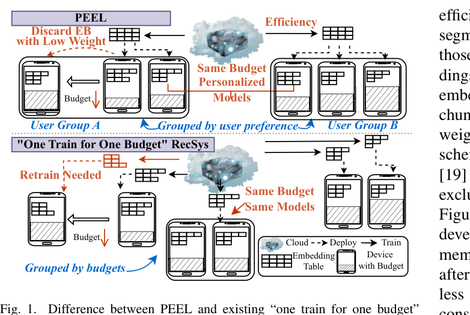
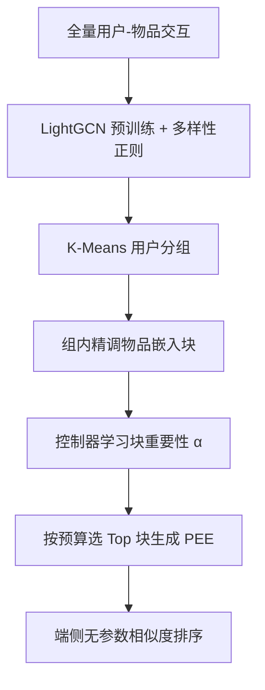
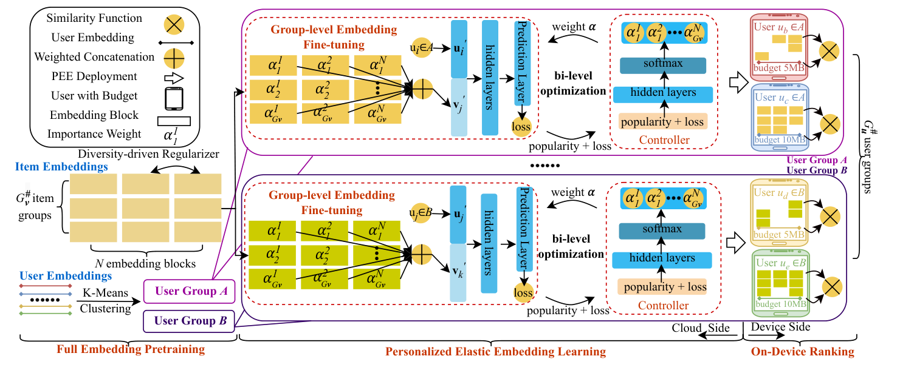

# Personalized Elastic Embedding Learning for On-Device Recommendation (面向端侧推荐的个性化弹性嵌入学习)

- **会议/期刊**: IEEE TKDE
- **作者与机构**: Ruiqi Zheng, Liang Qu, Tong Chen, Kai Zheng, Yuhui Shi, Hongzhi Yin；University of Queensland / SUSTech / UESTC
- **推荐链路定位**: 端侧召回与排序
- **研究方向**: 协同过滤与双塔召回（端侧内存高效推荐）
- **论文原文**: [论文原文链接](https://arxiv.org/abs/2306.10532v4)
- **开源代码**: 暂未开源（论文提及匿名仓库，检测未获稳定地址）

## TL;DR (1分钟核心速览)

端侧推荐模型受限于设备内存异构与动态预算，现有弹性嵌入方法多为“一个预算一次训练”，并忽略用户偏好差异。PEEL 在云端用 LightGCN 预训练全量物品嵌入，按用户聚类做组级精调，并用控制器学习嵌入块重要性，一次训练即可为任意预算裁剪出个性化弹性嵌入（PEE）。Amazon-Book/Yelp2020 全库排序下，10MB/25MB 的 NDCG@50 较 RULE 提升 6.7%/8.5%，Yelp 25MB Recall@50 提升 48.9%。

## Background & Motivation (背景与核心矛盾)

- **主流范式**: 云端训练大模型，再将压缩后的嵌入表或组合嵌入部署到端侧，以降低通信与延迟；代表路线包括二值化、组合嵌入、多维嵌入与弹性嵌入。
- **前人局限**: ① 设备异构被抹平，同一预算共享同一模型，模型被迫适配最弱设备；② 预算动态变化时需重训/重搜索，且全局模型忽略用户组间偏好漂移。
- **核心洞察 (Key Insight)**: 物品嵌入可切分为多个块，块的重要性在不同用户组内不同；只要学到“块—组”权重，就能在部署后按预算即时裁剪，无需再次训练。
- **本文切入点**: 将“按预算搜索模型”转为“学习块级重要性 + 组级个性化嵌入”，实现 once-for-all 的端侧弹性部署。

<figure class="paper-figure" markdown="span">
  <figcaption>图1. PEEL 与现有“一个预算一次训练”的内存高效 RecSys 之间的差异。</figcaption>
</figure>

## Method (核心方法设计)

### 1. 整体框架 (Overall Architecture)

PEEL 分三阶段：云端以 LightGCN 在全量交互上预训练用户/物品嵌入，并加多样性正则使嵌入块可区分；随后用 K-Means 将用户聚为 $G_u$ 组，对每个用户组复制物品嵌入表，以组内交互精调，同时控制器根据物品热度与推荐损失输出块权重，二者以双层优化交替训练；部署时按设备预算保留高权重嵌入块，端侧仅存该用户嵌入与裁剪后的物品 PEE，并用无参数相似度完成排序。

<figure class="paper-figure" markdown="span">
  <figcaption>图2. PEEL 概览。a) 预训练阶段使用收集的数据实例与多样性驱动正则化器训练模型。b) PEE 学习阶段利用用户组内的本地数据实例细化模型，控制器学习嵌入块的权重。c) 设备端排序阶段使用无参数相似度函数输出推荐。</figcaption>
</figure>

### 2. 关键设计拆解 (Key Designs)

1. **多样性驱动的嵌入块预训练**：若块间高度相似，按权重裁剪会退化为重复信息。作者在 BPR 损失后加入块间 Frobenius 距离正则：$\mathcal{L}_{rec}=-\sum_{(u_i,v_j,v_k)\in\mathcal{D}}\ln\sigma(\hat y_{ij}-\hat y_{ik})-\lambda\sum_{n_1<n_2}\|\mathbf{E}_{n_1}-\mathbf{E}_{n_2}\|_F^2$，迫使同一物品组的不同块在元素级分化，提升可裁剪性。
2. **组级个性化与控制器赋权**：全局模型难适配偏好漂移，逐用户训练又数据稀疏。PEEL 先按用户嵌入聚类，组内精调物品块；控制器输入物品组热度向量 $\mathbf{p}$与当前损失$L_{rec}$，输出$\boldsymbol{\alpha}=\mathrm{softmax}(\mathrm{MLP}_c([\mathbf{p},L_{rec}]))$，再将块加权拼接为$\mathbf{v}'_j=[\alpha_{n,G_v}\cdot\hat{\mathbf{e}}^n_j]_{1\le n\le N}$。热度与损失联合使高贡献块被保留，且不同用户组权重不同。
3. **双层优化、预算裁剪与端侧排序**：权重与嵌入互相依赖，若同批训练易过拟合，故用 $\min_{\mathbf{V}}\mathcal{L}_{val}(\mathbf{W}^*(\mathbf{V}),\mathbf{V})$s.t.$\mathbf{W}^*=\arg\min_{\mathbf{W}}\mathcal{L}_{train}(\mathbf{W},\mathbf{V})$，并以一步近似更新控制器。给定预算$M$，按$C=\lfloor (M-\mathrm{size}(\mathbf{u}_i))/\mathrm{size}(EB)\rfloor$选块，且每个物品组至少留一块；端侧相似度为$r_{ij}=\frac{\max_k |S_{ik}|}{|S_{ij}|}\sum_{n\in S_{ij}}\mathbf{u}_i^\top\bar{\mathbf{e}}^n_j$，无需额外参数。

## Experimental Setup & Evaluation Protocol (实验设置与评估协议)

- **数据集与预处理**: 过滤交互数少于 10 的用户/物品（`10-core` 类过滤）：

| 数据集 | #Users | #Items | #Interactions | 稀疏度/密度 | 特征/场景说明 |
| :--- | :---: | :---: | :---: | :---: | :--- |
| Amazon-Book | 52,643 | 91,599 | 2,984,108 | 0.0619% | 图书隐式反馈 |
| Yelp2020 | 138,322 | 105,843 | 3,865,586 | 0.0264% | 本地商家评论 |

- **数据划分与防穿越 (Splitting Strategy)**: 按 7:1:2 划分训练/验证/测试；未采用全局时间戳切分，属于比例划分。
- **排名评测协议 (Ranking Protocol)**: `Full-Ranking`，所有未交互物品作为候选负样本；报告 Recall@50、NDCG@50，按用户平均。
- **对比基线与超参设置**: 基线含 PMF、LightGCN、DLRM-CE、LightRec、ESAPN、AutoEmb、RULE；嵌入块长 $d=8$，块数$N=16$（全维$D=128$），用户组$G_u=15$，物品组$G_v=20$，Adam 学习率 0.001；未报告显著性检验。

## Key Experimental Results (实验关键数据)

### 1. 主实验对比 (Main Results)

**Amazon-Book（R@50 / N@50）**

| 方法 | 5MB R | 5MB N | 10MB R | 10MB N | 25MB R | 25MB N |
| :--- | ---: | ---: | ---: | ---: | ---: | ---: |
| PMF | 0.02552 | 0.02603 | 0.02590 | 0.02869 | 0.02894 | 0.03118 |
| LightGCN | 0.05257 | 0.09102 | 0.06284 | 0.10750 | 0.06475 | 0.13450 |
| DLRM-CE | 0.02371 | 0.04033 | 0.02818 | 0.06018 | 0.03300 | 0.06948 |
| LightRec | 0.04408 | 0.07662 | 0.05045 | 0.07969 | 0.05921 | 0.10345 |
| ESAPN | 0.02199 | 0.04040 | 0.02323 | 0.05125 | 0.02490 | 0.05891 |
| AutoEmb | 0.02035 | 0.04203 | 0.02284 | 0.05156 | 0.02403 | 0.05215 |
| RULE | 0.05334 | **0.09219** | 0.06512 | 0.11402 | 0.06602 | 0.12867 |
| PEEL | **0.05351** | 0.09122 | **0.06643** | **0.12167** | **0.06639** | **0.13962** |

**Yelp2020（R@50 / N@50）**

| 方法 | 5MB R | 5MB N | 10MB R | 10MB N | 25MB R | 25MB N |
| :--- | ---: | ---: | ---: | ---: | ---: | ---: |
| PMF | 0.00597 | 0.01095 | 0.00849 | 0.01325 | 0.00950 | 0.01575 |
| LightGCN | 0.01549 | 0.01867 | 0.01804 | 0.02809 | 0.01893 | 0.03315 |
| DLRM-CE | 0.01268 | 0.01230 | 0.01435 | 0.01627 | 0.01445 | 0.01953 |
| LightRec | 0.00768 | 0.01573 | 0.01255 | 0.01456 | 0.01350 | 0.02094 |
| ESAPN | 0.00698 | 0.01431 | 0.00838 | 0.01490 | 0.00874 | 0.01589 |
| AutoEmb | 0.00729 | 0.01353 | 0.00812 | 0.01437 | 0.00914 | 0.01471 |
| RULE | **0.01752** | 0.01945 | 0.02337 | 0.03236 | 0.02320 | 0.02881 |
| PEEL | 0.01571 | **0.02237** | **0.02466** | **0.03299** | **0.03455** | **0.03582** |

PEEL 相对最强基线：Amazon 10MB N@50 +6.71%，25MB N@50 +8.51%；Yelp 10MB N@50 +1.95%，25MB R@50 +48.9%、N@50 较 LightGCN +8.06%。仅 Yelp 5MB R@50 与 Amazon 5MB N@50 略逊 RULE。

### 2. 消融实验 (Ablation Study)

| 变体 | 关键改动 | 图4趋势（10MB, NDCG@50，PEEL=0.12167） |
| :--- | :--- | :--- |
| PEEL-P | 用平均池化替代末层嵌入 | 轻微下降 |
| PEEL-R | 物品随机分组替代热度排序 | 明显下降 |
| w/o Reg | 去掉多样性正则 | 明显下降 |
| w/o UC | 去用户聚类/组级精调 | 大幅下降 |
| w/o IW | 去控制器，随机选块 | 降幅最大 |

原文仅以图4给分布，未列精确数值；趋势表明控制器选块与用户分组是主增益来源。

### 3. 关键实验发现 (Key Findings)

1. 10MB 下 PEEL 的 Amazon NDCG@50 为 0.12167，较 RULE 的 0.11402 提升 6.71%；25MB 再升至 0.13962（+8.51%），说明块重要性+组精调在中等预算最能释放增益。
2. Yelp2020 25MB 下 PEEL Recall@50 达 0.03455，较 RULE 的 0.02320 提升 48.9%；动态预算 25→10→5MB 只需端侧裁剪，累计部署时间不增，而基线新增预算需约 $10^3$ 秒重训/搜索。
3. 延迟测试中，5MB 手机端排序 <100ms，25MB 时 Amazon/Yelp 为 214.39/250.78ms，IoT 设备仍 <1s；预算扩大带来近 2–3 倍延迟，端侧实时性仍可控。

## Highlights & Limitations (亮点、对比与审稿批判)

- **与代表作对比 (vs. Prior Work)**: RULE 用进化搜索为每个预算找嵌入，需重搜索且无用户组个性化；LightRec/DLRM-CE 用组合嵌入压缩，但块共享、表达受限；ESAPN/AutoEmb 做多维嵌入搜索，却未显式适配端侧预算。PEEL 的本质差异是“一次训练学习块权重，部署后免训练裁剪”，并把组级个性化纳入同一框架。
- **可迁移亮点**: ① “块级重要性 + 预算阈值裁剪”可直接迁移到双塔召回的物品向量压缩；② 组级精调在个性化与数据增广间折中，适合云端—端侧协同场景。
- **审稿级局限批判**: ① 用户聚类固定，难处理新用户与偏好漂移；组模型与控制器需按 $G_u\times G_v\times N$ 并行训练，云端开销未充分披露。② 评估集中在两个隐式反馈数据集，未报告显著性检验，消融仅给图；端侧延迟来自模拟虚拟机，真实手机后台竞争与能耗未验证。

## Rating (四维评分)

- **方法创新性 (Novelty)**: ⭐⭐⭐⭐ （将弹性块嵌入、组级个性化与双层权重学习合并为 once-for-all 端侧范式，但建立在 RULE/组合嵌入基础上）
- **评估协议与实验扎实度 (Protocol & Experiments)**: ⭐⭐⭐⭐ （两数据集、Full-Ranking、多预算与动态预算/延迟实验较完整，但缺显著性检验与逐项消融数值）
- **写作与数学规范度 (Clarity & Rigor)**: ⭐⭐⭐⭐ （块定义、预算约束、双层优化与端侧相似度公式清晰，复杂度分析略简）
- **工业落地与复现价值 (Industrial & Practical Value)**: ⭐⭐⭐⭐ （免重训裁剪与端侧低延迟价值高；匿名代码未稳定公开，组级云端训练成本需工程评估）

