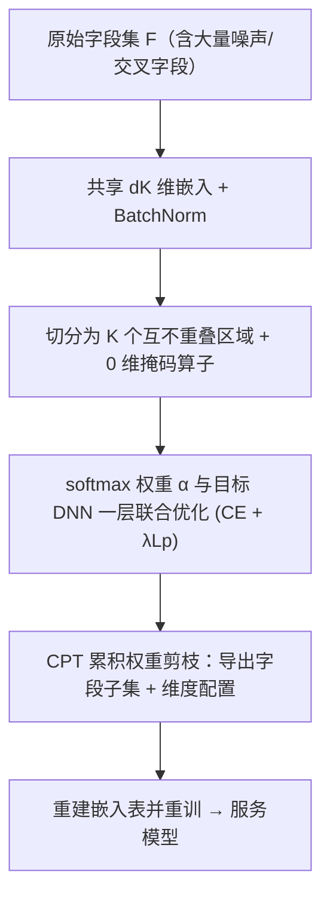
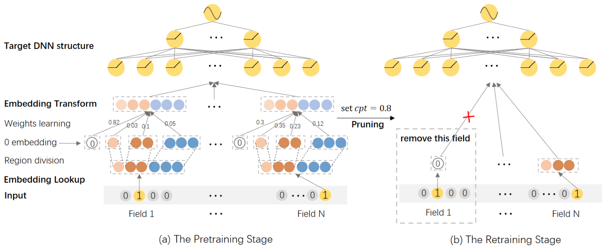
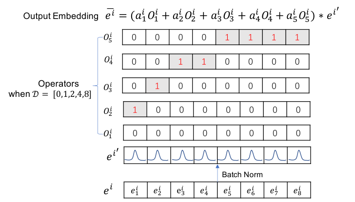

# i-Razor: A Differentiable Neural Input Razor for Feature Selection and Dimension Search in DNN-Based Recommender Systems (面向 DNN 推荐系统的可微输入剃刀：特征选择与维度搜索联合优化)

- **会议/期刊**: IEEE TKDE (2024)
- **作者与机构**: Yao Yao、李潇（清华-伯克利深圳学院 TBSI）；刘彬、何浩勋、盛大魁、王科、曹欢欢（字节跳动）
- **推荐链路定位**: 精排（CTR 预估）+ 在线服务模型压缩
- **研究方向**: CTR预估与特征交叉 / 工业架构与可信
- **论文原文**: [论文原文链接](https://arxiv.org/abs/2204.00281v2)
- **开源代码**: [开源代码仓库链接](https://github.com/YaoYao1995/i-Razor.git)

## TL;DR (1分钟核心速览)

工业 CTR 模型动辄上千字段，噪声字段与"一刀切"的嵌入维度既伤精度又撑爆内存；而既有做法先做特征选择再做维度搜索（串行），训练成本翻倍且易陷入次优。i-Razor 把两者合并成一个算子选择问题：在共享嵌入上切分互不重叠的区域，并新增 **0 维吸收算子**，通过可微 softmax 权重端到端学习各区域重要性，再用 CPT 累积权重剪枝一次性导出「留哪些字段 + 每字段几维」。在 Avazu-FG 上 AUC 从 0.7842（AutoDim）升至 **0.7896**，字段从 300 压到 75；Criteo 上参数量降 38% 而 AUC 反升 0.0002。

## Background & Motivation (背景与核心矛盾)

- **主流范式**: 工业实践按「先 Filter/Wrapper/AutoML 选字段 → 再 AutoDim/DARTS/NIS 搜维度」的串行流水线优化输入配置。
- **前人局限 1**: 串行优化中，选字段用的是代理准则或子模型，与目标 DNN 的最优字段子集存在 **模型不一致 (model-inconsistent)** 偏差。
- **前人局限 2**: 维度搜索方法（AutoDim/DNIS）都隐含"所有字段都有用"的假设——候选维度集从正整数开始，被迫给噪声字段也分配维度；而 AutoDim 的候选维度互相重叠覆盖，只能用 argmax 硬选，粒度粗且不稳定。
- **核心洞察 (Key Insight)**: 字段重要性应当由"它在目标 DNN 下需要的**最优嵌入维度**"来衡量；若某字段的所有嵌入区域权重都被压低，其维度自然收敛到 0，即等价于被删除。维度搜索是特征选择的通道。
- **本文切入点**: 把 0 维作为候选维度引入搜索空间，配合互不重叠的区域划分与累积概率剪枝，使两个任务在同一可微框架内一次完成。

## Method (核心方法设计)

### 1. 整体框架 (Overall Architecture)

两阶段闭环。**预训练阶段**：每个字段分配一个 $d_K$维共享嵌入$e_i$（而非拼接 K 份候选嵌入，省内存），经 BatchNorm 消除量纲后按候选维度集$\mathcal{D}=\{0,d_1,\dots,d_K\}$切成 K 个独立区域，每区域配一个 0/1 掩码算子$O_{ij}$；softmax 温度权重$\alpha_{ij}$与下游 DNN 参数**一层优化**同步梯度更新，从而在目标模型指导下学到各区域相对重要性。**重训阶段**：对每个字段按权重降序累积区域，直到累积权重过阈值$c_{pt}$，得到$d_{f_i}$；$d_{f_i}=0$ 则整字段丢弃，剩余字段按新维度重建嵌入表、同步调整 MLP 首层维度后仅用交叉熵重训。

<figure class="paper-figure" markdown="span">
  <figcaption>图 2：用于联合优化特征选择与维度搜索的 i-Razor 整体框架。(a) 在预训练阶段，我们将每个字段的嵌入划分为若干部分，并在目标模型直接指导下训练，以学习这些区域的相对重要性。(b) 在重训练阶段，我们使用剪枝算法过滤无用字段，仅保留所需维度以重构模型。用训练数据集重训练后，即可得到最终的服务模型。</figcaption>
</figure>

### 2. 关键设计拆解 (Key Designs)

1. **0 维吸收算子 + 解耦区域划分（把特征选择变成维度搜索的特例）**：已有方法候选维度 $\{d_1{<}\dots{<}d_K\}$且大维度覆盖小维度，算子之间强耦合、无法表达"该字段不要"。i-Razor 令$d_1=0$，且第$j$区仅覆盖第$(d_{j-1}{+}1)$到$d_j$ 位，算子彼此正交：

$$e_i = e_i' \odot \sum_{j=1}^{K}\alpha_{ij}O_{ij},\qquad \alpha_{ij}=\frac{\exp(w_{ij}/\tau)}{\sum_{m}\exp(w_{im}/\tau)}$$

   正交区域使"保留/丢弃"可独立决策且可组合——取 $\mathcal{D}=\{0,1,3,6\}$时可通过选第 3、4 区拼出任意 5 维，实际维度空间覆盖$[d_1,d_K]$的全部整数，比 AutoDim 只能取候选值更细。BatchNorm 把$e_i'$规范化到$\mathcal{N}(0,1)$，否则嵌入幅值与 DNN 其他参数耦合，$\alpha$ 无法代表真实重要性。

2. **基数感知的复杂度正则 $L_p$（按字段规模加权惩罚）**：字段基数差异巨大（Gender 仅 2 值，Browsed Goods 上百万），均匀惩罚会误伤。故以字段特征数占比加权各区域被选概率：

$$L_p=\sum_{i=1}^{N}\frac{|f_i|}{\sum_{j=1}^{N}|f_j|}\sum_{m=1}^{K}c_m\alpha_{im},\qquad c_m=\begin{cases}d_1,&m=1\\ d_m-d_{m-1},&\text{else}\end{cases}$$

   直觉：大基数字段省下 1 维等于小字段省上千维，正则把参数预算推向"高基数 × 高权重"区域。

3. **CPT 剪枝与训练开销**：argmax 在权重接近（如 $\{0.33,0.33,0.34\}$）时会丢掉总权重远大于保留项的区域，预训练/重训模型不一致。CPT 改为"按权重降序累积区域尺寸与权重，直到权重和$\ge c_{pt}$"，$c_{pt}=0$退化为 argmax、$c_{pt}=1$全保留，属可调信息保留率。总损失$\mathcal{L}=-\!y\log\hat{y}-(1{-}y)\log(1{-}\hat{y})+\lambda L_p$，无负采样（CTR 点式二分类，Criteo 仅做负样本降采样至 50% 正例）。空间复杂度$O(nd_K)$，训练复杂度$O(NKd_K)$；Avazu/Criteo 全流程在单张 A100 上分别约 3h / 6h。

<figure class="paper-figure" markdown="span">
  <figcaption>图 3：i-Razor 中的嵌入变换与划分。</figcaption>
</figure>

## Experimental Setup & Evaluation Protocol (实验设置与评估协议)

| 数据集 | #Users(实例) | #Features | #Fields | 正例率 | 说明 |
| :--- | :---: | :---: | :---: | :---: | :--- |
| Criteo | $1\times10^{8}$|$1\times10^{6}$ | 39 | 0.50 | 一个月点击日志，负采样至 50% |
| Criteo-FG | $1\times10^{8}$|$1\times10^{8}$ | 780 | 0.50 | 暴力全交叉扩充字段 |
| Avazu | $4\times10^{7}$|$6\times10^{5}$ | 24 | 0.17 | Kaggle CTR 竞赛数据 |
| Avazu-FG | $4\times10^{7}$|$4\times10^{7}$| 300 | 0.17 | 全交叉扩充至$24+C_2^{24}$ |

- **数据划分与防穿越**: Criteo 采用**全局时间戳切分**（day 6–12 训练 / day 13 测试）；Avazu 采用 **80%/20% 随机比例划分**（训练+验证 / 测试）。
- **排名评测协议**: 非全库排序任务，采用 **CTR 点式二分类 + AUC** 评估；同时报告保留字段数 `Fields`、总嵌入维度 `Dims`、嵌入参数量 `Params`。CTR 场景下 AUC 的 0.001 级提升即被视为显著，并做双侧 t 检验（$p<0.05$/$p<0.01$）。
- **对比基线与超参**: 基线含 FDE（统一维度）、FTRL、AutoField、AdaFS、AutoFIS（特征选择类）、AutoDim、DARTS（维度搜索类）及串行混合 `AutoFIS w/ AutoDim`、`AutoFIS w/ i-Razor`。统一 MLP=[700×5,1]、Adagrad (lr=0.02)、偏置项 FTRL (lr=0.01)、L2=1e-3；i-Razor 取 $\tau\in[0.05,0.2]$、$\lambda=10^{-4}$、$c_{pt}\in[0.3,0.8]$。

## Key Experimental Results (实验关键数据)

### 1. 主实验对比 (Main Results)

| 方法 | Avazu AUC↑ | Avazu Fields↓ | Avazu Params(M)↓ | Avazu-FG AUC↑ | Avazu-FG Fields↓ | Avazu-FG Dims↓ |
| :--- | :---: | :---: | :---: | :---: | :---: | :---: |
| FDE | 0.7811 | 24 | 19.36 | 0.7814 | 300 | 300 |
| FTRL w/ FDE | 0.7812 | 20 | 19.27 | 0.7845 | 160 | 160 |
| AdaFS w/ FDE | 0.7812 | 12 | 19.34 | – | – | – |
| AutoFIS w/ FDE | – | – | – | 0.7835 | 189 | 189 |
| AutoDim | 0.7820 | 24 | 16.63 | 0.7842 | 300 | 588 |
| DARTS | 0.7815 | 24 | 17.97 | 0.7839 | 300 | 596 |
| AutoFIS w/ i-Razor | – | – | – | 0.7848 | 87 | 159 |
| **i-Razor (Ours)** | **0.7823** | **16** | **12.32** | **0.7896** | **75** | **108** |
| Improv. | +0.0003 (p<0.05) | −33% | −26% | +0.0048 (p<0.01) | −14% | −32% |

| 方法 | Criteo AUC↑ | Criteo Dims↓ | Criteo Params(M)↓ | Criteo-FG AUC↑ | Criteo-FG Fields↓ | Criteo-FG Params(M)↓ |
| :--- | :---: | :---: | :---: | :---: | :---: | :---: |
| FDE | 0.7994 | 975 | 29.47 | 0.8017 | 780 | 566.62 |
| AutoField w/ FDE | 0.7985 | 825 | 21.89 | – | – | – |
| AutoDim | 0.7983 | 334 | 10.11 | 0.8018 | 780 | 261.18 |
| DARTS | 0.7983 | 289 | 9.23 | 0.8015 | 780 | 170.33 |
| AutoFIS w/ i-Razor | – | – | – | 0.8017 | 570 | 182.24 |
| **i-Razor (Ours)** | **0.7996** | 507 | 18.13 | **0.8019** | **433** | **169.03** |
| Improv. | +0.0002 | −48% | −38% | +0.0001 | **−45%** | −35% |

### 2. 消融实验 (Ablation Study)

| 变体 | Avazu-FG AUC↑ | Fields↓ | Params(M)↓ | Criteo-FG AUC↑ | Fields↓ | Params(M)↓ |
| :--- | :---: | :---: | :---: | :---: | :---: | :---: |
| (1) CPT + 0 维 (完整) | **0.7890** | 80 | 67.32 | **0.8019** | 599 | 208.71 |
| (2) 仅 CPT，无 0 维 | 0.7827 | 300 | 82.64 | 0.8015 | 780 | 314.23 |
| (3) argmax + 0 维 | 0.7883 | 74 | 58.14 | 0.8013 | 256 | 84.11 |
| (4) argmax，无 0 维 | 0.7826 | 300 | 81.50 | 0.8012 | 780 | 136.90 |

### 3. 关键实验发现 (Key Findings)

1. **0 维算子是精度主贡献项，CPT 是精度/体积的旋钮**：Avazu-FG 上加入 0 维带来 AUC +0.0063（0.7827→0.7890）并砍掉 220 个字段；改用 CPT 相对 argmax 仅牺牲 6% 参数（58.14→67.32M）就换来 +0.0007 AUC，说明"细粒度保留信息"比"硬选 top-1"更贴近最优输入配置。
2. **串行优化确实次优**：Criteo-FG 上 `AutoFIS w/ i-Razor`（先选字段后搜维度）为 0.8017/570 字段/182.24M，被联合优化的 0.8019/433 字段/169.03M 全面压制；Avazu-FG 上串行版 0.7848 亦明显低于 0.7896，验证了模型一致性假设的必要性。
3. **维度分配呈现"重要度—基数"双重偏好**：Avazu-FG 最终 300 字段仅 75 个存活，`site_id`、`app_id`、`device_ip` 等高基数或位置类字段衍生出大量被保留交叉字段（如 `site_id*C14`、`device_model*C20` 获最大维度），而 `site_id` 单独字段被压到 0——说明 i-Razor 学到的是"交互价值"而非"字段本身价值"，可直接指导特征工程迭代。

## Highlights & Limitations (亮点、对比与审稿批判)

- **与代表作对比**: 相较 AutoField/AdaFS 只能做 0/1 字段开关，i-Razor 用维度作为重要性的连续度量；相较 AutoDim 的覆盖式候选 + argmax，本文用正交区域 + 0 维 + CPT 实现"选字段即搜维度"；相较 NIS 的特征级强化学习搜索，本文在字段级以可微方式完成，训练成本从指数搜索降为一次梯度优化。
- **可迁移亮点**: (1) 0 维吸收算子思想可直接移植到多模态/序列推荐的"模态或行为序列段落裁剪"；(2) 基数占比加权的 $L_p$ 是可复用的参数预算正则；表 7 显示 MLP 上学到的配置迁移到 DeepFM/xDeepFM/IPNN 仍普遍涨点（如 DeepFM 0.7824→0.7832），具备跨模型冷启配置先验的价值。
- **审稿级局限批判**: (1) 增益幅度偏小，Avazu 仅 +0.0003、Criteo 仅 +0.0002，且主张"模型一致配置最优"却未给出方差/多次运行置信区间，AUC 差值在随机波动量级附近；(2) 字段级而非特征级搜索，对同字段内长尾特征无法差异化压缩；且 $c_{pt}$、$\lambda$、区域划分方案需逐数据集网格搜索，预训练仍在原始全字段（含 780 字段）上跑完一遍，冷启动与在线动态特征迭代场景的工程收益有限。

## Rating (四维评分)

- **方法创新性 (Novelty)**: ⭐⭐⭐⭐ （把特征选择重构成"维度收敛到 0"的算子选择，正交区域 + 0 维 + CPT 三点组合干净且自洽，但整体仍属 DARTS/AutoDim 框架的工程化改良）
- **评估协议与实验扎实度 (Protocol & Experiments)**: ⭐⭐⭐⭐ （两个大规模数据集 + 四个变体消融 + 维度划分/超参/兼容迁移研究齐全，含 t 检验；但缺少多次重复实验的方差报告，AUC 提升量级偏小）
- **写作与数学规范度 (Clarity & Rigor)**: ⭐⭐⭐⭐ （搜索空间、区域划分、$L_p$、CPT 伪代码定义清晰，复杂度分析完整；层归一化符号 LN 与 BatchNorm 记号在文中偶有不统一，$c_m$ 的下标约定需回看两处）
- **工业落地与复现价值 (Industrial & Practical Value)**: ⭐⭐⭐⭐⭐ （代码开源、单卡 3–6h 完成两阶段训练、参数量与存储直降 35%–49%，字节线上特征迭代场景明确，属可直接落地的 embedding table 压缩插件）

