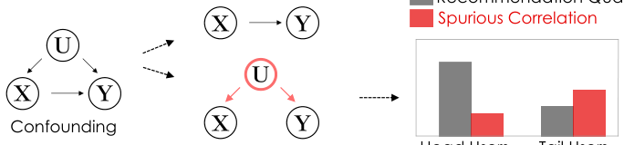
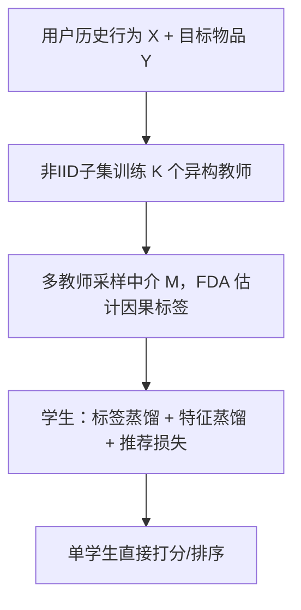

# Causal Distillation for Alleviating Performance Heterogeneity in Recommender Systems (基于因果蒸馏缓解推荐系统性能异质性)

- **会议/期刊**: IEEE TKDE 2024
- **作者与机构**: Shengyu Zhang, Ziqi Jiang, Kun Kuang, Fei Wu 等；浙江大学、上海交大、中科大、新加坡国立、阿里巴巴等
- **推荐链路定位**: 精排
- **研究方向**: 去偏公平、可信隐私与工业架构
- **论文原文**: [论文原文链接](https://arxiv.org/abs/2405.20626v1)
- **开源代码**: 暂未开源

## TL;DR (1分钟核心速览)

本文指出推荐性能存在长尾异质性：头部用户因活跃度高、行为一致而获益，统一训练会放大模型偏差。作者将用户活跃度、热门偏好视为未观测/可观测混淆，提出 CausalD：以异构教师采样中介变量近似前门调整 FDA，并将因果标签与特征蒸馏到单学生模型。在 MovieLens/Amazon/Alipay 的 1:100 采样排序协议下，NDCG@5 相对最佳基线提升约 6%，异质性显著下降。

## Background & Motivation (背景与核心矛盾)

- **主流范式**: 推荐模型通常由 encoder 将历史行为 $X$编码为隐表征，再由 predictor 预测下一行为$Y$，统一训练所有用户。
- **前人局限**: 公平推荐追求组间均等且依赖敏感属性；IPS/后门调整要求无偏数据或混淆可观测；已有因果推荐常忽略好友推荐、情绪等未观测混淆。
- **核心洞察 (Key Insight)**: 性能异质性由数据自然不平衡与模型偏差共同造成；混淆 $U$同时影响$X,Y$，产生虚假相关$X\leftarrow U\rightarrow Y$，统一训练会放大该偏差。
- **本文切入点**: 用中介 $M$阻断未观测混淆，以 FDA 估计$P(Y|do(X))$，再用异构多教师蒸馏实现高效近似。

<figure class="paper-figure" markdown="span">
  <figcaption>图2：用于说明由虚假相关导致性能异质性放大的因果图。</figcaption>
</figure>

## Method (核心方法设计)

### 1. 整体框架 (Overall Architecture)

CausalD 先把训练集按用户属性/聚类切成非 IID 子集，训练同架构但“非特权”的异构教师；教师编码器给出多个中介值 $m$，通过注意力与 in-batch 用户采样近似 FDA 因果标签；学生同时接收因果标签蒸馏、特征蒸馏与常规推荐损失。推理仅保留学生，复杂度与 Base 模型一致。

### 2. 关键设计拆解 (Key Designs)

1. **FDA 因果标签近似**：直接枚举 $m,x$不可行，CausalD 用教师编码器采样$m$，用注意力权重建模$P(M=m|X)$，并以 batch 内样本近似先验$P(X=x)$：$\tilde{o}_i=\sum_k\alpha_{k,i}\sum_j\frac{1}{N_b}\sigma(\psi_{\mathrm{FDA}}([\tilde{m}_j,\tilde{m}_{k,i},y_i]))$。异构教师覆盖不同数据分布，使中介分布采样更充分。
2. **因果特征蒸馏与后门辅助**：当混淆可观测时，按混淆值分组训练教师，并以先验加权聚合特征：$\tilde{m}^{\circ}_i=\sum_k\tilde{m}_{k,i}P(z_k)$，$L_{\mathrm{BDA}}=\sum_i d(\tilde{m}^{\circ}_i,\hat{m}_i)$。该辅助损失阻断$X\leftarrow Z\rightarrow M$ 的反向路径，提升 FDA 的中介有效性。
3. **训练目标、负采样与推理效率**：总损失 $\mathcal{L}=\mathcal{L}_{\mathrm{Rec}}+\lambda_{\mathrm{BDA}}L_{\mathrm{BDA}}+\lambda_{\mathrm{FDA}}L_{\mathrm{FDA}}$，其中$L_{\mathrm{FDA}}=L_{\mathrm{kd}}(\tilde{o}_i,\hat{o}_i)+L_{\mathrm{ce}}(\tilde{o}_i,o_i)$。训练用随机负样本，推理丢弃教师，仅学生前向，保持线上延迟不变；但多教师训练开销约 157s/epoch，Base 为 64s/epoch。

## Experimental Setup & Evaluation Protocol (实验设置与评估协议)

- **数据集与预处理**: 采用 16-core 过滤，统计如下：

| 数据集 | #Users | #Items | #Interactions | 密度 | 场景 |
| :--- | ---: | ---: | ---: | ---: | :--- |
| MovieLens | 6,040 | 3,900 | 1,000,209 | 0.04246 | 电影评分 |
| Amazon | 459,133 | 313,966 | 8,898,041 | 0.00063 | Book 评论 |
| Alipay | 400,594 | 19,503 | 38,710,494 | 0.00495 | 小程序点击 |

- **数据划分与防穿越**: 按用户行为时间排序，留最后一项测试，属 next-item `Leave-One-Out` 式划分。
- **排名评测协议**: `Sampled Ranking`，每个测试目标配 100 个用户未交互负样本；另报告 Heterogeneity↓，即用户组间性能标准差经式(8)去自然异质后的模型偏差项。
- **对比基线与超参**: 对比 KD、IPS、CausalRec、DeRec、DebiasD、EnsCTR、MEAL；Base 为 DIN/DeepFM，embedding=8，batch=4096，Adagrad lr=0.01；5 次重复，双侧检验 $p<0.05$。

## Key Experimental Results (实验关键数据)

### 1. 主实验对比 (Main Results)

DIN Base，MovieLens 与 Alipay 的核心结果：

| 模型 | ML NDCG@5↑ | ML Hetero↓ | Alipay NDCG@5↑ | Alipay Hetero↓ |
| :--- | ---: | ---: | ---: | ---: |
| DIN | 0.2378 | 0.7291 | 0.1186 | 2.3419 |
| KD | 0.2382 | 0.4533 | 0.1221 | 2.3383 |
| IPS | 0.2362 | 0.3056 | 0.1237 | 1.8455 |
| CausalRec | 0.2400 | 0.7529 | 0.1255 | 1.5405 |
| DeRec | 0.2507 | 0.7893 | 0.1474 | 2.4671 |
| DebiasD | 0.2485 | 0.6889 | 0.1532 | 2.1373 |
| EnsCTR | 0.2589 | 0.9531 | 0.1307 | 2.4441 |
| MEAL | 0.2492 | 0.7773 | 0.1745 | 2.1125 |
| **CausalD** | **0.2755** | **0.1086** | **0.1851** | **1.0207** |
| Improv. vs best | +6.41% | −64.5% | +6.07% | −33.7% |

### 2. 消融实验 (Ablation Study)

DIN Base，Amazon/Alipay 的 NDCG@10 与 Recall@10：

| 变体 | Amazon NDCG | Amazon Recall | Alipay NDCG | Alipay Recall |
| :--- | ---: | ---: | ---: | ---: |
| Base DIN | 0.5384 | 0.6877 | 0.2076 | 0.3518 |
| Ho Teachers | 0.5429 | 0.6883 | 0.2289 | 0.3953 |
| w/o FDA | 0.5527 | 0.7008 | 0.2238 | 0.4168 |
| **CausalD** | **0.5751** | **0.7216** | **0.2779** | **0.4457** |

### 3. 关键实验发现 (Key Findings)

1. CausalD 在 DIN Base 下 MovieLens NDCG@5 达 0.2755，较最佳基线 EnsCTR 提升 6.41%，同时 Hetero 从 IPS 的 0.3056 降至 0.1086，说明降异质不以牺牲整体精度为代价。
2. Alipay 上 NDCG@5 较 MEAL 提升 6.07%，Hetero 较最佳因果基线 CausalRec 降低 33.7%；图4显示收益主要来自尾部/低活跃用户，头部用户基本保持。
3. 移除 FDA 后 Alipay NDCG 从 0.2779 降至 0.2238（−19.5%），同构教师也降至 0.2289，证明异构中介采样与因果标签蒸馏均是关键；教师数从 8 增至 16 增益趋缓。

## Highlights & Limitations (亮点、对比与审稿批判)

- **与代表作对比 (vs. Prior Work)**: IPS/后门调整需可观测混淆或无偏数据；CausalRec/DeRec 主要校正曝光或推断混杂，难覆盖未观测因素；DebiasD/EnsCTR 只做多教师蒸馏，可能进一步放大尾部偏差，而 CausalD 显式建模 FDA。
- **可迁移亮点**: 非特权异构教师可作为“因果中介采样器”，蒸馏出单模型而不增推理成本；模型无关，可套在 DIN/DeepFM 等 encoder-predictor 架构上。
- **审稿级局限批判**: 训练需多教师预训练与额外前向，耗时约为 Base 2.5 倍；评测为 1:100 采样排序而非 Full-Ranking，且 DeepFM 上因 FM/DNN 双分支因果标签权重难定，部分指标不稳定。

## Rating (四维评分)

- **方法创新性 (Novelty)**: ⭐⭐⭐⭐ （首次将 FDA 与多教师蒸馏结合处理推荐未观测混淆，因果图与中介设计清晰）
- **评估协议与实验扎实度 (Protocol & Experiments)**: ⭐⭐⭐⭐ （三数据集含工业 Alipay，多次重复与显著性检验齐全；但采样排序非全库排序）
- **写作与数学规范度 (Clarity & Rigor)**: ⭐⭐⭐⭐ （FDA 两步估计与损失定义完整，复杂度分析清楚；部分符号与实现细节略密）
- **工业落地与复现价值 (Industrial & Practical Value)**: ⭐⭐⭐⭐ （推理零额外开销、模型无关，适合精排；但训练成本较高且暂未开源）

