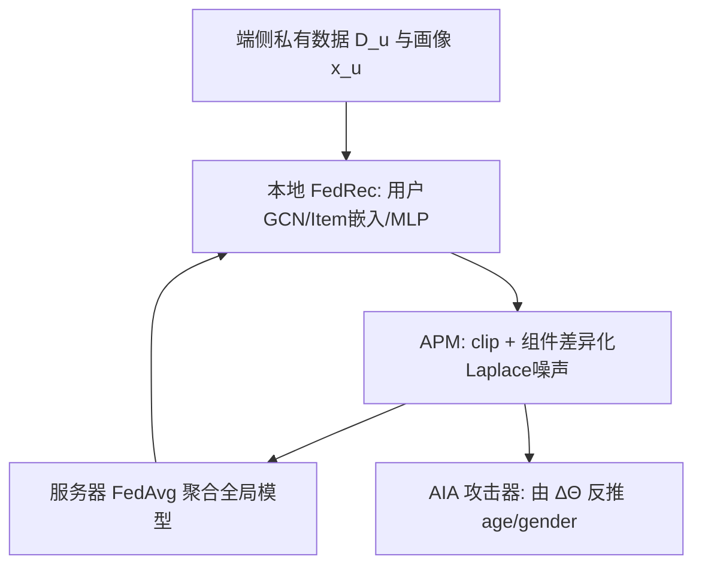
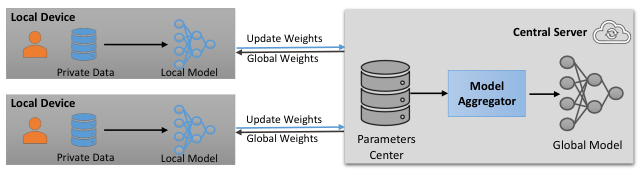

# Comprehensive Privacy Analysis on Federated Recommender System against Attribute Inference Attacks (联邦推荐系统对抗属性推断攻击的全面隐私分析)

- **会议/期刊**: IEEE TKDE (arXiv:2205.11857v2)
- **作者与机构**: Shijie Zhang, Wei Yuan, Hongzhi Yin (The University of Queensland, RBDI Lab)
- **推荐链路定位**: 召回 (Top-K 排序，端侧本地模型 + 云端 FedAvg 聚合)
- **研究方向**: 去偏公平、可信隐私与工业架构 / 图神经网络推荐
- **论文原文**: [https://arxiv.org/abs/2205.11857v2](https://arxiv.org/abs/2205.11857v2)
- **开源代码**: 暂未开源

## TL;DR (1分钟核心速览)

联邦推荐常被视为"数据不出端即安全"，但本文证明其上传的模型更新仍可被诚实但好奇的服务器反推用户性别/年龄。作者先设计以 $\Delta\Theta$ 为输入的三层 DNN 属性推断攻击器 (AIA)，逐组件量化泄漏差异，发现**用户组件最脆弱、item 组件最安全**；据此提出自适应 LDP 机制 APM，为不同组件分配不同噪声强度。在 ML-100K/ML-1M 的 `Leave-One-Out + Full-Ranking` 协议下，Age 属性推断 F1 相对 Pure FedRec 降低 **18.8%**，而 Hit@20 仅从 0.115 降至 0.103。

## Background & Motivation (背景与核心矛盾)

- **主流范式**: 以 FedAvg 协同训练端侧 DSSM/GCN 推荐模型（用户组件做 GCN 邻域聚合、item 组件为嵌入表、MLP 打分），仅上传参数不上传交互与画像。
- **前人局限**: ①DP/加密类隐私推荐（GERAI、DPMF）多为集中式设计，迁移到联邦后属性保护与精度双降；②现有联邦隐私工作只关注成员推断，且对所有层使用**同一个固定隐私预算** $\epsilon$，忽略各组件参数分布与记忆能力的巨大差异。
- **核心洞察 (Key Insight)**: 端侧上传的 $\Delta\Theta_t=(\Theta^{t-1}-\Theta^t)/\mu_1$ 本质是单步 SGD 梯度，是最直接的"数据指纹"；而不同子网络对该指纹的暴露程度并不等价。
- **本文切入点**: 先做逐组件隐私体检，再把"体检结论"变成噪声分配的先验，用"脆弱的多加噪、稳健的少加噪"换取隐私-精度双赢。

## Method (核心方法设计)

### 1. 整体框架 (Overall Architecture)

系统由三层构成：端侧本地 FedRec 在私有 $\mathcal{D}_u$与画像$x_u$上做交叉熵训练，得到$\Theta_u$；APM 模块先对参数做$L_2$ 裁剪，再按组件抗攻击等级注入不同尺度 Laplace 噪声；服务器用 FedAvg 聚合并回发全局模型。攻击侧则复用同一份上传更新训练分类器，形成"攻击—诊断—加固"的闭环评测。

<figure class="paper-figure" markdown="span">
  <figcaption>图1：典型联邦推荐器的架构</figcaption>
</figure>

### 2. 关键设计拆解 (Key Designs)

1. **梯度式属性推断攻击器 (AIA)**：集中式攻击依赖全量交互与推荐结果，在联邦下不可得。本文仅用上传更新构造样本 $(\Delta\Theta_u,y_u)$，以三层 DNN 输出$C$ 类概率，损失为
$\mathcal{L}_{adv}=-\sum_{u\in U_{adv}}\sum_{c=1}^{C}y[c]\log\hat{y}[c]$。
只招募 $\zeta$比例用户作为有标签攻击集$U_{adv}$，其余用户测 F1。直觉：梯度中每个坐标的更新幅度与"该用户是否具有某属性"强相关，浅层分类器即可解码。

2. **抗性函数与自适应隐私预算 (APM)**：固定 $\epsilon$会让高脆弱层欠保护、低脆弱层过保护。作者定义单调抗性映射$l(\theta_i)\in\{0,1,2,3\}$（用户组件最低、item 组件最高、MLP 首层低于次层），并令$p(\theta_i)=\epsilon_{\min}+b\cdot l(\theta_i)$、$\lambda_i=2\delta/p(\theta_i)$，加噪为
$\mathcal{M}(\Theta)=\mathrm{clip}(\Theta,\delta)+n,\quad n\sim\mathrm{Lap}(0,\lambda_i)$。
最终预算取 $\lambda_{\text{user}}=0.033$、$\lambda_{\text{MLP}_1}=0.025$、$\lambda_{\text{MLP}_2}=0.020$、$\lambda_{\text{item}}=0.017$（$\delta=0.5$）。直觉：把噪声"花在刀刃上"，用户组件本就高度记忆画像，多扰动的边际效用损失最小。

3. **训练目标、负采样与推理效率**：本地目标为交叉熵 $\mathcal{L}_{rec}=-\sum r_{uv}\log\hat{r}_{uv}+(1-r_{uv})\log(1-\hat{r}_{uv})$，训练时按$1{:}q$比例下采样负例，评分$\hat{r}_{uv}=\sigma(\mathrm{MLP}(z_u^*\oplus z_v))$；推理仅需全局 item 嵌入与端侧前向，无额外通信轮次，APM 的开销仅是一次裁剪与逐参数采样。

## Experimental Setup & Evaluation Protocol (实验设置与评估协议)

| 数据集 | #Users | #Items | #Interactions | 稀疏度 | 特征/场景说明 |
| :--- | :---: | :---: | :---: | :---: | :--- |
| ML-100K | 943 | 1,682 | 100,000 | 93.7% | 含性别/年龄/职业画像，年龄离散为 3 组 |
| ML-1M | 6,039 | 3,705 | 1,000,000 | 95.5% | 同上，规模更大 |

- **数据划分与防穿越**: `Leave-One-Out`，每用户保留 1 个真实交互作测试正例。
- **排名评测协议**: 无偏 `Full-Ranking`（对全部未交互 item 打分，不做候选采样）；攻击侧用 `F1 Score`，并以随机猜测分类器作 null model。
- **对比基线与超参**: Pure FedRec、F-DPMF、F-GERAI、F-GERAI-NL、FedRec-GN、FedNews；$d=64$，学习率 0.001，batch 32，本地 epoch 5，每轮采样 50%(ML-100K)/10%(ML-1M) 用户，$\delta=0.5$，$\epsilon\in[30,60]$。

## Key Experimental Results (实验关键数据)

### 1. 主实验对比 (Main Results)

攻击强度（$\zeta=0.1$，F1 越低越安全）与推荐精度（Hit@20，越高越好）联合对比如下：

| 方法 | Age F1 (100K) | Gender F1 (100K) | Age F1 (1M) | Gender F1 (1M) | Hit@20 (100K) | Hit@20 (1M) |
| :--- | :---: | :---: | :---: | :---: | :---: | :---: |
| Pure FedRec | 0.528 | 0.677 | 0.522 | 0.684 | **0.115** | **0.064** |
| F-DPMF | 0.584 | 0.703 | 0.579 | 0.709 | 0.072 | 0.015 |
| F-GERAI | 0.503 | 0.639 | 0.501 | 0.627 | 0.040 | 0.014 |
| F-GERAI-NL | 0.509 | 0.657 | 0.505 | 0.634 | 0.054 | 0.018 |
| FedRec-GN | 0.455 | 0.575 | 0.449 | 0.627 | 0.054 | 0.032 |
| FedNews | 0.446 | 0.568 | 0.439 | 0.597 | 0.093 | 0.052 |
| **APM (ours)** | **0.429** | **0.559** | **0.414** | **0.574** | 0.103 | 0.053 |
| Improv. (vs FedNews) | −3.8% | −1.6% | −5.7% | −3.9% | +10.8% | +1.9% |

### 2. 消融实验 (Ablation Study)

| 变体 | 隐私预算策略 | Hit@20 (100K) | Hit@20 (1M) | 隐私强度 |
| :--- | :--- | :---: | :---: | :--- |
| FixRec-max | 全组件统一取 $\lambda_{\max}$ | 0.067 | 0.043 | 最强 |
| FixRec-min | 全组件统一取 $\lambda_{\min}$ | **0.105** | **0.054** | 最弱 |
| **APM (ours)** | 按抗性函数分配 | 0.103 | 0.053 | 接近 FixRec-max |

### 3. 关键实验发现 (Key Findings)

1. **隐私增益远大于精度代价**：APM 将 ML-100K 上 Age F1 从 0.528 压到 0.429（−18.8%）、Gender 从 0.677 压到 0.559（−17.4%），而 Hit@20 仅从 0.115 降到 0.103（−10.4%）；相比之下 F-DPMF 虽几乎无隐私收益（Age F1 反升到 0.584），Hit@20 却暴跌至 0.072，说明"优化目标扰动"类 DP 在联邦场景下既不安全也不保精度。
2. **自适应预算是唯一同时逼近两端帕累托点的方案**：固定 $\lambda_{\max}$时隐私最优但 Hit@20 仅 0.067，固定$\lambda_{\min}$时精度 0.105 但几乎无保护；APM 取得 0.103 的精度与接近$\lambda_{\max}$ 的隐私强度，证明组件级差异化加噪确实消除了"过度保护"带来的效用损失。
3. **跨主干与跨攻击器均稳健**：将 APM 挂到 FedLightGCN 上，Hit@20 为 0.076（无保护 0.080，固定 LDP 0.073）、Age F1 0.415（固定 LDP 0.462）；面对 DT/SVC/KNN/AIA 四类攻击器，APM 在 8 组设定中 7 组取得最低 F1（如 ML-1M Age 下 SVC 0.333 vs FedNews 0.390）。

## Highlights & Limitations (亮点、对比与审稿批判)

- **与代表作对比**: 相较 GERAI（集中式、对画像做双阶段扰动）与 FedNews（固定 $\epsilon$ 的 Laplace-LDP），本文首次把"隐私预算"从全局超参升级为与模型结构绑定的**组件级资源分配问题**，并给出可复用的抗性排序方法论；相比 RAP 类对抗训练方案，本文不依赖预设攻击器结构。
- **可迁移亮点**: ①用 $\Delta\Theta/\mu$ 作为攻击特征、以组件级 F1 差异反推"噪声预算表"的流程，可直接迁移到 FedGNN、序列联邦推荐的隐私审计；②裁剪+差异化 Laplace 的实现仅十余行，适合在端侧 SDK 中低成本落地。
- **审稿级局限批判**: ①抗性函数 $l(\cdot)$的取值与文中报告的$\lambda$分配存在对应关系含糊（item 组件既称$l=1$又给出$\epsilon=60$），预算映射依赖人工先验，缺少自动化搜索；②威胁模型假设服务器被动、且需$\zeta$ 比例用户提供真实画像作攻击训练集，对主动投毒/多轮累积推断与通信-计算开销均未评估，年龄仅 3 分类也偏乐观。

## Rating (四维评分)

- **方法创新性 (Novelty)**: ⭐⭐⭐⭐ （组件级隐私脆弱度分析视角新颖，但自适应 LDP 本身实现相对轻量）
- **评估协议与实验扎实度 (Protocol & Experiments)**: ⭐⭐⭐⭐ （Full-Ranking + 双数据集 + 四类攻击器 + 跨主干验证较完整，缺显著性检验与更大规模工业数据）
- **写作与数学规范度 (Clarity & Rigor)**: ⭐⭐⭐ （攻击与加噪公式清晰，但 $l(\cdot)$与$\epsilon$ 的映射符号前后不一致，理论保证仅停留在 LDP 定义层面）
- **工业落地与复现价值 (Industrial & Practical Value)**: ⭐⭐⭐⭐ （改动小、无额外通信轮次，适合端侧重训；但未开源、缺线上延迟与预算调参成本分析）

