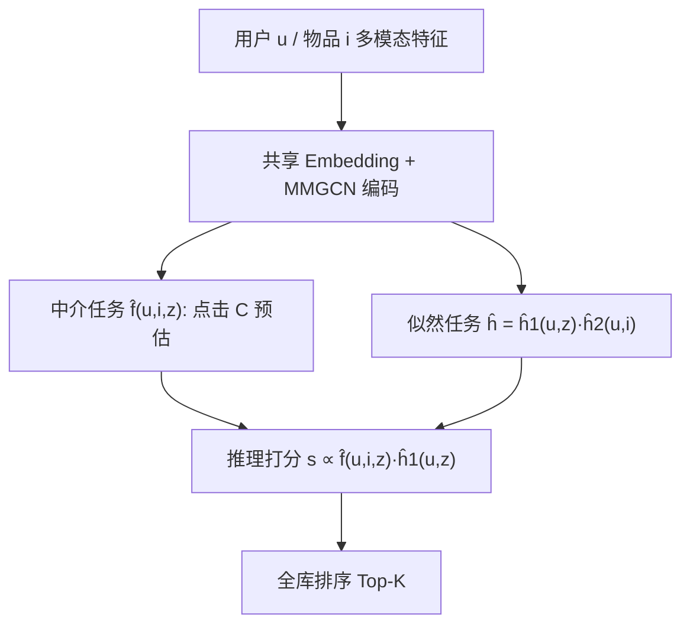
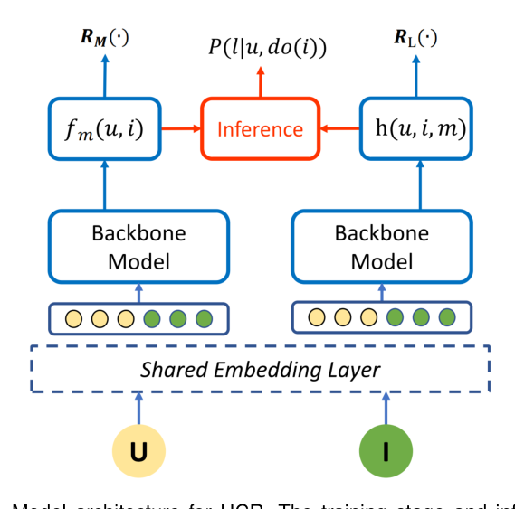
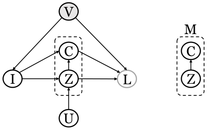

# Mitigating Hidden Confounding Effects for Causal Recommendation (面向因果推荐的隐混淆效应消除)

- **会议/期刊**: IEEE TKDE (arXiv v2, 2024)
- **作者与机构**: Xinyuan Zhu, Yang Zhang, Fuli Feng, Xun Yang, Dingxian Wang, Xiangnan He（中国科学技术大学、eBay Research America）
- **推荐链路定位**: 精排（后点击点赞/购买预估）+ 排序打分
- **研究方向**: 去偏公平、可信隐私与工业架构 / CTR-CVR 预估与特征交叉
- **论文原文**: [https://arxiv.org/abs/2205.07499v2](https://arxiv.org/abs/2205.07499v2)
- **开源代码**: 暂未开源

## TL;DR (1分钟核心速览)

现有因果推荐（IPW、DCF、反事实推理）都假设混淆因子可观测，但商品质量、新闻事件等混淆因子在平台侧根本不可测量，导致后门路径 $I\leftarrow V\rightarrow L$无法切断。本文提出 HCR：借助中介（用户-物品集成特征$Z$与点击$C$）做**前门调整**，把$P(l|u,do(i))$ 分解为两个可由观测数据识别的部分效应，并以多任务共享 Embedding 训练、以乘积形式免遍历推理。在 Tiktok/Kwai/Taobao 的全库排序（Full-Ranking）协议下，N@50 相对最强基线提升 5.88% / 1.32% / 19.44%，低活跃用户与高混淆强度场景增益更大。

## Background & Motivation (背景与核心矛盾)

- **主流范式**: 因果推荐把目标从 $P(l|u,i)$改写为$P(l|u,do(i))$，用倾向加权（IPW/DR）重加权样本，或用后门调整对混淆因子取值做分层求和（PDA、CR、DCF）。
- **前人局限**: ① 后门调整必须知道混淆因子 $V$的取值或分布，而商品质量、疫情新闻等$V$在第三方平台不可测量；② DCF 用曝露模型构造"替代混淆因子"，一旦$V$ 与曝露弱相关，替代量即失效（Kwai 上 R@100 仅 0.0264，反被 CT 超越）。
- **核心洞察 (Key Insight)**: 只要 $V$不直接影响中介（无$V\rightarrow M$边），物品特征的一切影响都必须"经过"中介才能作用于点赞，因此可绕开$V$、仅在可观测的$M$ 上做前门调整。
- **本文切入点**: 用中介两段式分解 + 分解式打分函数，把不可测混淆因子从因果估计中整体消去。

## Method (核心方法设计)

### 1. 整体框架 (Overall Architecture)

输入用户 $u$与物品$i$的多模态特征，经共享 Embedding 与 MMGCN 编码后分成两支：一支预测中介分布$P(m|u,i)$（实例化为点击预估$\hat f$），另一支预测似然$P(l|i,m)$，并进一步分解为$\hat h_1(u,z)\cdot\hat h_2(u,i)$。训练阶段以多任务 BCE 联合优化两支并共享底层 Embedding；推理阶段两支输出相乘作为排序分，跳过了对$M$与$I$的双重求和，复杂度从$|\mathcal{M}|\cdot|\mathcal{I}|$ 次前向降到 1 次。

<figure class="paper-figure" markdown="span">
  <figcaption>图2. HCR 的模型架构。训练阶段和推理阶段分别使用蓝色箭头和红色箭头。</figcaption>
</figure>
图 2. HCR 模型架构：训练（蓝箭头）与推理（红箭头）阶段。

### 2. 关键设计拆解 (Key Designs)

1. **前门调整分解（把不可测 $V$消掉）**：由因果图（图 3）写出联合分布并对$v,m$求和，再利用$M$与$V$在给定$I$下独立、$L$与$I$在给定$V,M$下独立，得到完全不含$V$ 的识别式
$$P(l|u,do(i))=\sum_{m}P(m|u,i)\sum_{i'}P(l|i',m)P(i').$$
两块分别对应"物品特征如何改变中介"与"中介如何改变点赞"，二者都只依赖可观测条件概率，故**无需估计混淆因子本身**即可去偏。

2. **分解式打分免遍历（工程可行性核心）**：朴素实现要对 $|\mathcal{M}|\times|\mathcal{I}|$组合做前向，线上不可接受。作者令$h(u,i,m)=h_1(u,m)h_2(u,i)$，则内层求和$\sum_{i'}h_2(u,i')P(i')=S_u$ 对给定用户是常数、不影响排序，于是
$$s(u,i)\propto \hat f(u,i,z(u,i))\,\hat h_1(u,z(u,i)),$$
把因果推断压缩为两次前向相乘，代价与普通双任务模型几乎相同。

3. **训练目标与推理开销**：$\min_{f_m,h}\sum \mathcal{R}_M(f_m(u,i),m)+\beta\sum\mathcal{R}_L(h(u,i,m),l)$，$\mathcal{R}$为交叉熵，$\beta\in\{1,2,3,5\}$ 平衡点击/点赞两任务；两塔共享 Embedding 以迁移知识（消融显示去掉共享即显著掉点）。负样本未额外构造，训练用曝光日志中的点击/点赞标签，评测走全库未交互物品排序；推理为单次前向 + 乘积，无采样、无遍历。

<figure class="paper-figure" markdown="span">
  <figcaption>图3. 一般因果图（图1）下的一种特定因果图，其中变量 {C, Z} 构成中介变量 M。V：隐藏混杂因素，Z：用户-物品对的集成特征，C：点击反馈，L：点赞反馈。</figcaption>
</figure>
图 3. 实例化因果图：$\{C,Z\}$构成中介$M$，$V$ 为隐混淆因子。

## Experimental Setup & Evaluation Protocol (实验设置与评估协议)

- **数据集与预处理**: 三个真实多行为数据集，点赞作为 $L$，点击作为中介$C$：

| 数据集 | #Users | #Items | #Clicks | #Likes | 场景说明 |
| :--- | :---: | :---: | :---: | :---: | :--- |
| Tiktok | 39,275 | 37,482 | 1,767,525 | 571,619 | 微视频，文本/视觉/音频特征，caption 为曝露特征 |
| Kwai | 36,261 | 26,094 | 2,401,852 | 1,241,489 | 微视频，封面视觉特征为曝露特征 |
| Taobao | 49,251 | 53,141 | 1,515,055 | 195,744 | 电商，点击→购买，卖家/类目特征 |

- **数据划分与防穿越**: 按点击时间**全局时间戳切分**，前 70% 点击用于训练；每个用户未被训练覆盖的点赞样本按时间均分为验证/测试集（点赞稀疏、混淆效应随时间漂移，故严格的时序切分是必要的防穿越设计）。
- **排名评测协议**: 无偏 **Full-Ranking**——对训练集中未出现的全部物品排序，仅验证/测试集点赞为正样本，报告 R@50/N@50/R@100/N@100（$K=50,100$）。
- **对比基线与超参**: 普通方法 CT、ESMM；去偏方法 CR、Multi-IPW、Multi-DR、DCF；全部统一以 MMGCN 为骨干（保证公平对比多模态特征），Adam、batch=1024、学习率 $\{10^{-4},5\times10^{-4},10^{-3}\}$（Taobao 额外试$10^{-5}$）、L2$\{10^{-4},10^{-3},10^{-2}\}$，以验证集 N@50 早停（patience=10）。

## Key Experimental Results (实验关键数据)

### 1. 主实验对比 (Main Results)

| 方法 | Tiktok R@50 | Tiktok N@50 | Tiktok R@100 | Kwai R@50 | Kwai N@50 | Kwai R@100 | Taobao R@50 | Taobao N@50 | Taobao R@100 |
| :--- | :---: | :---: | :---: | :---: | :---: | :---: | :---: | :---: | :---: |
| CT | 0.0181 | 0.0068 | 0.0269 | 0.0158 | 0.0072 | 0.0270 | 0.0319 | 0.0108 | 0.0444 |
| CR | 0.0209 | 0.0088 | 0.0318 | 0.0164 | 0.0076 | 0.0282 | — | — | — |
| ESMM | 0.0223 | 0.0074 | 0.0282 | 0.0068 | 0.0034 | 0.0100 | 0.0305 | 0.0105 | 0.0416 |
| Multi-IPW | 0.0229 | 0.0095 | 0.0252 | 0.0093 | 0.0040 | 0.0167 | 0.0201 | 0.0076 | 0.0311 |
| Multi-DR | 0.0228 | 0.0078 | 0.0278 | 0.0154 | 0.0071 | 0.0203 | 0.0141 | 0.0064 | 0.0169 |
| DCF | **0.0245** | 0.0102 | 0.0297 | 0.0153 | 0.0072 | 0.0264 | 0.0321 | 0.0106 | 0.0444 |
| **HCR** | 0.0244 | **0.0108** | **0.0355** | **0.0172** | **0.0077** | **0.0291** | **0.0350** | **0.0129** | **0.0516** |
| Improv.% | -0.41% | +5.88% | +11.64% | +4.88% | +1.32% | +3.19% | +9.03% | +19.44% | +16.22% |

### 2. 消融实验 (Ablation Study)

| 变体 | 说明 | Tiktok R@50 / N@50 | Kwai R@50 / N@50 | Taobao R@50 / N@50 |
| :--- | :--- | :---: | :---: | :---: |
| HCR | 完整模型 | **0.0244 / 0.0108** | **0.0172 / 0.0077** | **0.0350 / 0.0129** |
| HCR-T | 推理改为 $\hat f\hat h_1\hat h_2$（纯相关、不干预） | 0.0222 / 0.0094 | 0.0128 / 0.0059 | 0.0339 / 0.0126 |
| HCR-S1 | 只用 $\hat f$（点击支） | 0.0229 / 0.0099 | 0.0159 / 0.0072 | 0.0212 / 0.0079 |
| HCR-S2 | 只用 $\hat h_1$（中介→点赞支） | 0.0088 / 0.0029 | 0.0033 / 0.0016 | 0.0242 / 0.0086 |
| HCR-NS | 去掉两任务共享 Embedding | 0.0229 / 0.0105 | 0.0131 / 0.0062 | 0.0284 / 0.0092 |

### 3. 关键实验发现 (Key Findings)

1. **分解式因果推断本身是主要增益源**：HCR-T 保留全部网络与参数、仅把推理换回相关式相乘，Kwai R@50 从 0.0172 掉到 0.0128（−25.6%），说明收益并非来自多任务结构，而来自 $do(\cdot)$ 干预项的引入；同理 HCR-NS 掉至 0.0131，证明共享 Embedding 的知识迁移是准确估计两个条件概率的前提。
2. **对低活跃用户与高混淆强度更有效**：HCR 相对 CT 在低活跃用户群的相对提升高于活跃用户群（6 组中 5 组胜出）；半仿真 Taobao 上掩码比从 0 升到 0.5 时，HCR 相对 CT 的提升单调扩大、性能衰减更缓，直接对应"隐混淆越强、前门调整越划算"的因果解释。
3. **推荐质量而非仅点击率提升**：在 like/click 比值高的物品分组上 HCR 的 Normalized Recall 稳定优于 CT，说明去除 $V\rightarrow$ 高价/标题党类虚假关联后，模型不再靠"高曝光低满意度"物品刷指标，这对平台生态与生产者的曝光公平性有直接价值。

## Highlights & Limitations (亮点、对比与审稿批判)

- **与代表作对比**: 相比 IPW/DR 系（Multi-IPW、Multi-DR）需要准确倾向分、方差大且假设无隐混淆，HCR 完全不做样本重加权；相比 DCF 依赖"曝露↔混淆强相关"来构造替代变量，HCR 只需中介存在且无 $V\rightarrow M$ 边，故在 Kwai/Taobao 这类曝露信息弱的场景优势明显；相比 CR 只处理曝露特征导致的点击诱饵、丢弃点赞监督，HCR 把点击当作中介纳入因果链，用得更多而非更少。
- **可迁移亮点**: ①"分解打分函数把 $\sum_{i'}$ 吸收为与用户相关的常数"这一技巧，可迁移到任何需要对隐变量求边缘化的排序模型；②把因果识别式直接落成两次前向相乘，是因果推荐上线的一条低成本工程范式。
- **审稿级局限批判**: ① 强假设无 $V\rightarrow M$ 边，一旦混淆因子同时污染中介（如新闻事件直接影响用户-物品匹配表征），前门准则失效、只能"部分缓解"，作者亦承认需借助工具变量；② 只考虑点赞/点击两类中介，且未在排序阶段做多候选联合重排，线上真实延迟与千万级物品下的排序稳定性尚未验证；③ Tiktok 上 R@50 仍略输 DCF（−0.41%），说明短 K、强曝露场景下替代变量法仍有残余价值，HCR 的收益主要体现在 NDCG 与更长列表。

## Rating (四维评分)

- **方法创新性 (Novelty)**: ⭐⭐⭐⭐ （首次把前门调整系统性引入推荐隐混淆问题，识别式与分解打分设计自洽且有完整因果图讨论）
- **评估协议与实验扎实度 (Protocol & Experiments)**: ⭐⭐⭐⭐ （三真实数据集 + 全库排序 + 六类基线 + 消融/低活跃/时间漂移/半仿真五组深入分析，唯缺显著性检验与线上 A/B）
- **写作与数学规范度 (Clarity & Rigor)**: ⭐⭐⭐⭐ （Eq.(1)–(7) 逐步给出独立性依据与求和消去，假设边界在第 3.4 节显式列出，可复现性强）
- **工业落地与复现价值 (Industrial & Practical Value)**: ⭐⭐⭐⭐ （推理仅两次前向相乘、与现有多任务精排架构同构，易插拔；但代码未开源、且依赖点击作为中介的日志完备性）

