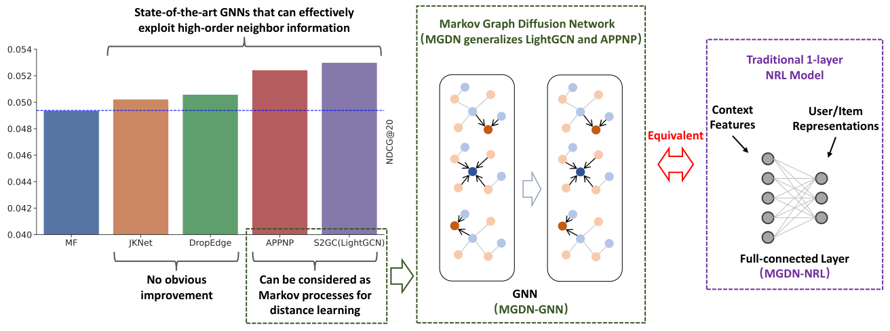
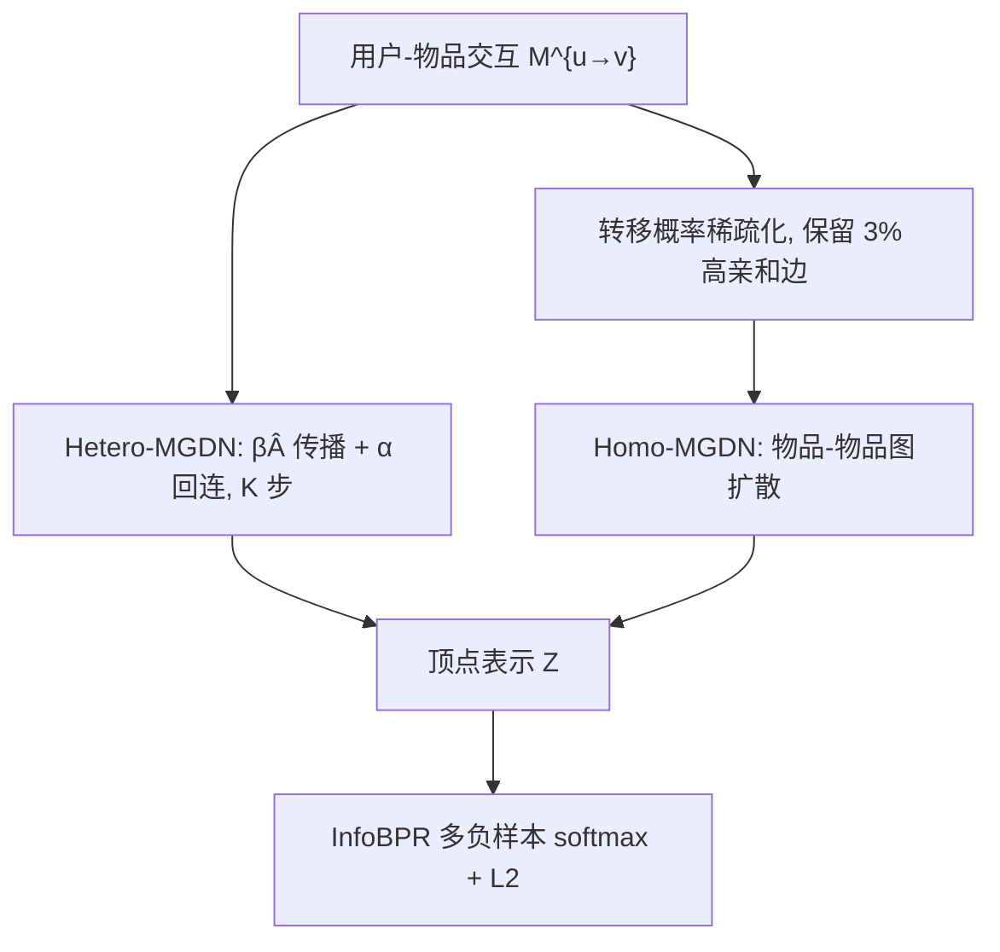
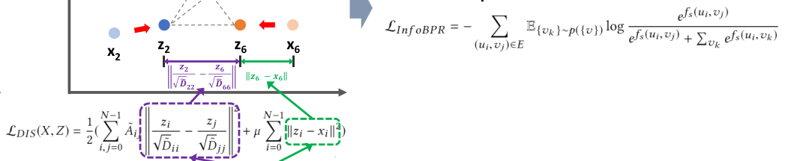

# MGDCF: Distance Learning via Markov Graph Diffusion for Neural Collaborative Filtering (基于马尔可夫图扩散距离学习的神经协同过滤)

- **会议/期刊**: IEEE Transactions on Knowledge and Data Engineering (TKDE)
- **作者与机构**: Jun Hu, Bryan Hooi (新加坡国立大学)；Shengsheng Qian, Changsheng Xu (中科院自动化所)；Quan Fang (北京邮电大学)
- **推荐链路定位**: 召回（用户/物品表示学习，全库排序）
- **研究方向**: 图神经网络与知识图谱推荐 / 协同过滤与双塔召回
- **论文原文**: [https://arxiv.org/abs/2204.02338v2](https://arxiv.org/abs/2204.02338v2)
- **开源代码**: [https://github.com/hujunxianligong/MGDCF](https://github.com/hujunxianligong/MGDCF)

## TL;DR (1分钟核心速览)

本文要回答一个被忽视的问题：**GNN 到底凭什么改善协同过滤？** 作者先证明 LightGCN / APPNP 等价于"用一层全连接层编码常量上下文特征"的传统 1 层 NRL 模型，再提出马尔可夫图扩散网络 MGDN（权衡平滑距离与自保距离）、同构稀疏化实现与 InfoBPR 多负样本排序损失。在 Gowalla / Yelp2018 / Amazon-Book 的 Full-Ranking 协议下，Hetero-MGDCF 在 Gowalla NDCG@20 达 0.1589（超 LightGCN 2.5%），Homo-MGDCF 在 Amazon-Book 达 0.0460（超 LightGCN 46.9%）。

## Background & Motivation (背景与核心矛盾)

- **主流范式**: GNN-based CF（NGCF、JKNet、DropEdge、APPNP、LightGCN）在用户-物品二部图上堆叠多层传播聚合高阶邻居，并把 GNN 当作"传播可学习嵌入的黑箱"，收益归因于正则化/平滑。
- **前人局限一**: **深不等于好**。论文实测 4 层 JKNet (0.1391)、DropEdge (0.1394) 在 Gowalla 上与 MF (0.1365) 几乎无差，甚至有 NGCF (0.1327) 劣于 MF——堆叠高阶邻居并不保证收益，反而可能过平滑。
- **前人局限二**: 缺少与经典 NRL（DeepWalk/GraRep/DNGR）的理论桥梁。这些传统模型都是"先构造上下文特征、再用一层浅网络编码"，而 GNN 的等价物从未被显式写出，导致无法解释"增益到底来自表示空间扩张（正则化）还是优化路径改变"。
- **核心洞察 (Key Insight)**: APPNP 与 LightGCN 的传播本质是一个**马尔可夫过程**，在"相邻顶点表示应靠近"（平滑）与"输出不应离输入太远"（自保）两类距离之间做权衡；其闭式极限正是 Normalized Laplacian Regularization 的最优解。
- **本文切入点**: 把 GNN 从可训练黑箱降级为**不可训练的马尔可夫过程**，只负责构造常量上下文特征，把全部学习能力交给一层全连接层与排序损失。

<figure class="paper-figure" markdown="span">
  <figcaption>图1. 当前最先进的基于GNN的CF模型与传统1层NRL模型之间的关系。</figcaption>
</figure>

## Method (核心方法设计)

### 1. 整体框架 (Overall Architecture)

输入仅用户-物品交互矩阵 $\mathbf{M}^{u\to v}$。模型有两条并行分支：**异构分支 Hetero-MGDN** 直接在二部图上做$K$步马尔可夫扩散得到用户/物品表示$\mathbf{Z}$；**同构分支 Homo-MGDN** 先用转移概率稀疏化构造物品-物品图（保留 3% 高亲和边），再在物品图上扩散、用户保留原始嵌入。两条分支的输出都送入 InfoBPR 多负样本 softmax 排序损失与 L2 正则联合优化，推理时用$\mathbf{Z}$的内积全库打分。关键等价性：整个 MGDN 可重写为$f_{FC}(\mathbf{X}_{context})$，即上下文特征构造（不可训练）+ 一层全连接编码（可训练）。

<figure class="paper-figure" markdown="span">
  <figcaption>图2. MGDCF的整体框架。MGDCF使用MGDN通过权衡两类距离来学习顶点表示：（1）左侧距离（紫色虚线框内）与CF任务高度相关，最小化它可提高顶点表示在图上的平滑性。（2）最小化右侧距离（绿色虚线框内）与最小化左侧距离相悖，可视为防止过平滑的正则化。</figcaption>
</figure>

### 2. 关键设计拆解 (Key Designs)

1. **MGDN：用系数约束把图扩散变成距离学习**。痛点：通用 GDN 的 $\sum_k\theta_k\hat{\mathbf{A}}^k$系数自由，缺乏物理含义。MGDN 施加$\sum_k\theta_k=1$的约束并写成马尔可夫迭代$\mathbf{H}^{(k)}=\beta\hat{\mathbf{A}}\mathbf{H}^{(k-1)}+\alpha\mathbf{H}^{(0)}$，归一化后$\mathbf{Z}=\big(\beta^{K}\hat{\mathbf{A}}^{K}+\sum_{k=0}^{K-1}\alpha\beta^{k}\hat{\mathbf{A}}^{k}\big)\mathbf{X}/\Gamma$，$\Gamma=\beta^{K}+\sum_{k=0}^{K-1}\alpha\beta^{k}$。$\beta\hat{\mathbf{A}}\mathbf{H}^{(k-1)}$压低"相邻顶点距离"（对应 CF 目标），$\alpha\mathbf{H}^{(0)}$反向拉扯、防止过平滑。取$\alpha=\beta=1$退化为 LightGCN（$\Gamma=K+1$即均值池化），取$\alpha$为传送概率、$\beta=1-\alpha$退化为 APPNP（$\Gamma=1$），故 MGDN 是二者的严格推广。
2. **NRL 等价重写：把嵌入变成全连接层权重**。痛点：$\mu\sum_i\|\mathbf{z}_i-\mathbf{x}_i\|^2$这一项在$\mathbf{X}$随机初始化时"看起来有害"，黑箱解释不自洽。将$\mathbf{Z}=f_{MGDN}(\mathbf{X},\mathbf{A})=f_{MGDN}(\mathbf{I},\mathbf{A})\mathbf{W}$，即**输入嵌入$\mathbf{X}$其实是 FC 层的权重$\mathbf{W}$**，$\mathbf{X}_{context}=f_{MGDN}(\mathbf{X}_{one-hot},\mathbf{A})\in\mathbb{R}^{N\times N}$是与训练无关的常量上下文特征（对应 GraRep 的 PPMI、DNGR 的自编码器输入）。由此推出工程上极实用的三条映射：嵌入 Dropout ⇔ 权重 Dropout，边 Dropout ⇔ 特征 Dropout，MF 恰是$K=0$ 的退化特例（只编码 one-hot 特征）。
3. **InfoBPR 与同构稀疏化**。BPR 可视作二分类 softmax，只用一个负样本；InfoBPR 沿 InfoNCE 扩成多类：$\mathcal{L}_{InfoBPR}=-\sum_{(u_i,v_j)\in\mathcal{E}}\mathbb{E}_{\{v_k\}\sim p(\{v\})}\log\frac{e^{f_s(u_i,v_j)}}{e^{f_s(u_i,v_j)}+\sum_{v_k}e^{f_s(u_i,v_k)}}$，$N_{neg}=1$时严格退回 BPR。同构分支的亲和权重由条件转移概率估计$\hat{A}_{ij}=\sqrt{\tilde{M}^{v\to v}_{ij}\tilde{M}^{v\to v}_{ji}}=p(v_i,v_j)/\sqrt{p(v_i)p(v_j)}$，从而在**不显式计算联合概率**的前提下拿到 GCN 归一化权重，剔除$s\%$（默认 97%）低权重边以抑制"机器人用户"造成的稠密噪声图。总损失$\mathcal{L}_{CF}=\mathcal{L}_{InfoBPR}(\mathbf{Z})+\Psi_{L2}\|\mathbf{Z}\|_2^2$；负采样为均匀分布（非硬负采样），推理无额外开销（稀疏矩阵乘法，Amazon 上预处理约 1 分钟 vs 训练 60 分钟）。

## Experimental Setup & Evaluation Protocol (实验设置与评估协议)

- **数据集与预处理**: 沿用 NGCF / LightGCN 发布的基准版本（已做 k-core 过滤，无任何侧特征）：

| 数据集 | #Users | #Items | #Interactions | 稀疏度/密度 | 特征/场景说明 |
| :--- | :---: | :---: | :---: | :---: | :--- |
| Gowalla | 29,858 | 40,981 | 1,027,370 | 0.084% | LBSN 签到，无特征 |
| Yelp2018 | 31,668 | 38,048 | 1,561,406 | 0.130% | 本地生活点评，无特征 |
| Amazon-Book | 52,643 | 91,599 | 2,984,108 | 0.062% | 电商图书，最稀疏 |

- **数据划分与防穿越 (Splitting Strategy)**: 沿用 LightGCN 官方**用户级留出比例划分**（每用户划分训练/验证/测试），**未使用全局时间戳切分**，因此不显式防未来信息穿越；冷物品仅靠图传播间接获得表示。
- **排名评测协议 (Ranking Protocol)**: 无偏 **Full-Ranking（全库未交互物品排序）**，报告 NDCG@20 与 Recall@20，与 LightGCN / UltraGCN 保持一致。
- **对比基线与超参设置**: 基线分两组——BPR 组 (MF、NGCF、JKNet、DropEdge、APPNP、LightGCN) 与先进损失组 (SGL-ED、UltraGCNBase、UltraGCN)。所有模型 $d=64$（NGCF 因拼接为$(K+1)d$）；统一跳数$K=4$（Homo-MGDCF 因物品图对应二部图$2K$跳故取$K=2$，SGL-ED 取官方最优$K=3$）；默认$\alpha=0.1,\beta=0.9$（即 APPNP 先验）；稀疏化$s\%=97\%$。

## Key Experimental Results (实验关键数据)

### 1. 主实验对比 (Main Results)

| 方法 | Gowalla N@20 | Gowalla R@20 | Yelp N@20 | Yelp R@20 | Amazon N@20 | Amazon R@20 |
| :--- | :---: | :---: | :---: | :---: | :---: | :---: |
| MF | 0.1365 | 0.1591 | 0.0492 | 0.0601 | 0.0261 | 0.0342 |
| NGCF | 0.1327 | 0.1570 | 0.0461 | 0.0566 | 0.0263 | 0.0344 |
| JKNet | 0.1391 | 0.1622 | 0.0502 | 0.0608 | 0.0268 | 0.0343 |
| DropEdge | 0.1394 | 0.1627 | 0.0506 | 0.0614 | 0.0270 | 0.0342 |
| APPNP | 0.1463 | 0.1708 | 0.0521 | 0.0635 | 0.0299 | 0.0384 |
| LightGCN | 0.1550 | 0.1830 | 0.0530 | 0.0649 | 0.0313 | 0.0406 |
| SGL-ED | – | – | 0.0555 | 0.0675 | 0.0379 | 0.0478 |
| UltraGCNBase | 0.1566 | 0.1845 | 0.0552 | 0.0667 | 0.0393 | 0.0504 |
| UltraGCN | 0.1580 | 0.1862 | 0.0561 | 0.0683 | **0.0556** | **0.0681** |
| **Hetero-MGDCF** | **0.1589** | **0.1864** | 0.0572 | 0.0696 | 0.0378 | 0.0490 |
| **Homo-MGDCF** | 0.1571 | 0.1860 | **0.0575** | **0.0699** | 0.0460 | 0.0566 |

相对最优 GNN 基线：Gowalla N@20 较 LightGCN **+2.52%**、较 APPNP **+8.61%**；Yelp N@20 较 LightGCN **+8.49%**、较 UltraGCN **+2.50%**；Amazon N@20 较 LightGCN **+46.96%**、较 UltraGCNBase **+17.05%**（UltraGCN 为异构+同构混合模型，非本文讨论范围，但 Homo-MGDCF 仍较其 Base 版全面领先）。

### 2. 消融实验 (Ablation Study)

NDCG@20，考察"编码器 × 损失函数"的解耦效应：

| 配置 | 编码器 | 排序损失 | Gowalla | Yelp2018 | Amazon-Book |
| :--- | :---: | :---: | :---: | :---: | :---: |
| MF (BPR) | 无 (K=0) | BPR | 0.1365 | 0.0492 | 0.0261 |
| MF-MultiBPR | 无 (K=0) | 多负样本拼接 BPR | 0.1360 | 0.0515 | 0.0284 |
| MF-InfoBPR | 无 (K=0) | InfoBPR | 0.1547 | **0.0581** | 0.0373 |
| w/o InfoBPR (APPNP) | Hetero-MGDN | BPR | 0.1463 | 0.0521 | 0.0299 |
| w/o InfoBPR (LightGCN) | Hetero-MGDN ($\alpha=\beta=1$) | BPR | 0.1550 | 0.0530 | 0.0313 |
| w/o 稀疏化 (Hetero) | Hetero-MGDN | InfoBPR | 0.1595 | 0.0574 | 0.0371 |
| **Homo-MGDCF** | Homo-MGDN | InfoBPR | 0.1571 | 0.0575 | 0.0460 |

### 3. 关键实验发现 (Key Findings)

1. **增益来自优化而非正则化**：理论上 MGDN 与 MF 的解空间完全相同（$\mathbf{X}=f^{-1}_{MGDN}(\mathbf{Z},\hat{\mathbf{A}})=\frac{\Gamma}{\alpha}(\mathbf{I}-\beta\hat{\mathbf{A}})\mathbf{Z}$可逆），实证上$K=0$ 的 MF-InfoBPR 在 Yelp2018 反而以 0.0581 **超过** Hetero-MGDCF 的 0.0574——一旦排序损失足够强，图传播的结构性收益被大幅摊薄。
2. **多负样本的"正确打开方式"很关键**：朴素 MultiBPR（采样多个负样本后对每个三元组分别算 BPR）几乎无收益（Gowalla 0.1360 甚至劣于 MF 0.1365），而 InfoBPR 把二分类 softmax 改为多类 softmax，使提升幅度达到 MultiBPR 的约 5.5 倍（Amazon-Book 0.0373 vs 0.0284），说明负样本必须在同一 softmax 分母内互相对比才有效。
3. **稀疏化是"隐式去噪"**：Amazon-Book 上把边剔除率从 97% 提到 99.9% 时 Homo-MGDCF 达到峰值 0.0460，显著超异构版 0.0378，相对 LightGCN 提升 46.9%——说明稠密共现图中的噪声边被有效压制；但超过 99.99% 后性能骤降，去噪与信息损失存在明确 trade-off。超参上 $\alpha,\beta,K$均不敏感，唯有$K=1$ 明显退化，与 NGCF/LightGCN 的单层失效现象一致。

## Highlights & Limitations (亮点、对比与审稿批判)

- **与代表作对比 (vs. Prior Work)**: 相较 LightGCN/APPNP 聚焦"造更深的 GNN 架构"，本文直接给出二者的统一闭式解与马尔可夫解释，把设计维度从"层结构"转到"系数约束 + 损失函数"；相较 SGL-ED（需图增强 + 自监督辅助损失）与 UltraGCN（维护 $|U|\times|V|$ 负采样权重、且依赖异构+同构混合），InfoBPR 仅改 softmax 分母即可匹敌，工程代价极低。
- **可迁移亮点**: (1) "把可学习嵌入重解释为 FC 层权重"的等价变换，可直接用于分析任意 embed-then-propagate 模型的 Dropout / 正则语义；(2) 基于 $\hat{A}_{ij}=\sqrt{\tilde{M}_{ij}\tilde{M}_{ji}}$ 的转移概率稀疏化，是无超参调优压力的一次性图去噪预处理，可迁移到社交图、知识图谱剪枝。
- **审稿级局限批判**: (1) **实验规模偏小**：三个数据集均在百万级交互、10 万物品以内，未验证十亿级工业稀疏场景，也未做线上 A/B；(2) **混合模型缺位**：UltraGCN 的异构+同构融合在 Amazon-Book 上明显更强 (0.0556 vs Homo 0.0460)，本文明确将其留作 future work，因此"SOTA 声称"需打折；(3) **划分协议未防穿越**：用户级比例划分而非全局时间戳切分，且表 2 与表 4 中 Hetero-MGDCF 结果不一致（0.1589 vs 0.1595），K 设置未完全统一，复现时需谨慎对齐。

## Rating (四维评分)

- **方法创新性 (Novelty)**: ⭐⭐⭐⭐ （把 GNN-based CF 严格归约为马尔可夫距离学习并给出 LightGCN/APPNP 的闭式特例，理论统一性漂亮，但核心算子仍是已知扩散框架的系数重参数化）
- **评估协议与实验扎实度 (Protocol & Experiments)**: ⭐⭐⭐⭐ （三数据集 + Full-Ranking + 8 个主流基线 + 完整消融/超参/收敛曲线，但缺时间切分、缺大规模与线上验证）
- **写作与数学规范度 (Clarity & Rigor)**: ⭐⭐⭐⭐⭐ （从距离损失到闭式解、从 GNN 到 1 层 NRL 的双向推导完整，Dropout 映射表清晰，符号自洽）
- **工业落地与复现价值 (Industrial & Practical Value)**: ⭐⭐⭐⭐ （开源 TensorFlow 实现，稀疏化预处理仅分钟级，InfoBPR 改动量几行代码即可上生产，唯需注意 UltraGCN 类混合模型的竞争）

