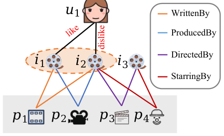
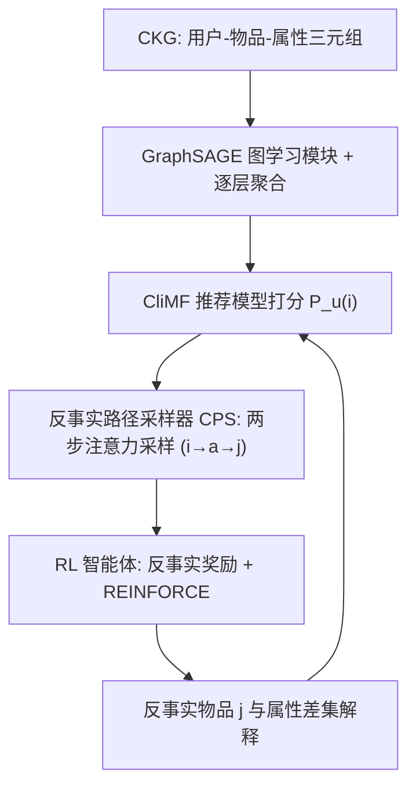
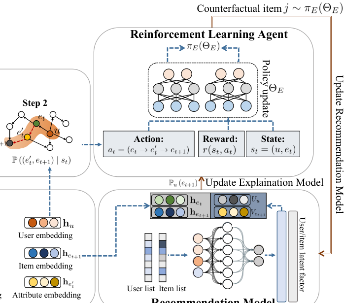

# Reinforced Path Reasoning for Counterfactual Explainable Recommendation (基于强化路径推理的反事实可解释推荐)

- **会议/期刊**: IEEE TKDE (arXiv 预印本 2022-07)
- **作者与机构**: Xiangmeng Wang, Qian Li, Dianer Yu, Guandong Xu（悉尼科技大学 DSMI Lab / 科廷大学）
- **推荐链路定位**: 精排 + 解释生成（解释策略与排序模型迭代共训）
- **研究方向**: 图神经网络与知识图谱推荐 / 强化学习与动态探索推荐
- **论文原文**: [https://arxiv.org/abs/2207.06674v1](https://arxiv.org/abs/2207.06674v1)
- **开源代码**: [https://github.com/Chrystalii/CERec](https://github.com/Chrystalii/CERec)

## TL;DR (1分钟核心速览)

现有反事实解释要么基于"用户动作"（删点击边），要么基于"物品侧面"（改 aspect 分数），且需在巨大候选中做贪心搜索，解释既不直观也不是**物品属性级**（如品牌、流派）。本文提出 CERec：把反事实解释建模为协同知识图谱上的**路径推理 MDP**，用两步注意力路径采样器把动作空间从"任意高阶路径"压缩为"物品→属性→物品"三元路径，再用 REINFORCE 优化"合理性 + 相似性"反事实奖励；产出的反事实物品既生成属性差分解释，又作为高质量负样本做**成对共训**。在 Last-FM / Amazon-book / Yelp2018 上，Recall@20 相对最优基线提升 13.20%–16.70%，Yelp2018 Recall@80 提升 78.03%，解释一致性 F1 相对 CaDSI 提升约 1.8–2.0 倍。

## Background & Motivation (背景与核心矛盾)

- **主流范式**: 可解释推荐分模型内建（决策树、关联规则）与模型无关（post-hoc 归因）。反事实解释这一支再分为**搜索式**（对交互/特征做扰动后贪心搜索，Kaffes et al.、Xiong et al.）与**优化式**（删边后算 PageRank 的 PRINCE、改 aspect 分数的 CountER）。
- **前人局限**: ①搜索式在组合爆炸的候选空间上开销不可承受；②优化式只覆盖 user-action 或 item-aspect 两类解释，**物品属性（demographic attribute）级反事实仍空白**；③既有方法用固定数量（如 top-10）重要属性构造解释，**从不搜索"最小充分改变集"**，因此解释冗长且不可证伪。
- **核心洞察 (Key Insight)**: 若 $i_1$（属性$\{p_1,p_2\}$）被喜欢而$i_2$（属性$\{p_1,p_2,p_3,p_4\}$）被讨厌，则把$\{p_3,p_4\}$当作解释比罗列全部属性更接近真实因果——**"差集"而非"交集"才是解释**；且该差集反过来可判定同属性的$i_3$ 也应被过滤，从而**解释即负样本**。

<figure class="paper-figure" markdown="span">
  <figcaption>图 1：从知识图谱中推断基于物品属性的反事实解释的简单示例。</figcaption>
</figure>

- **本文切入点**: 以协同知识图谱 (CKG) 为唯一载体，把"找最小属性差集"转化为"找最小差异的反事实物品"，再用 RL 策略在路径空间中高效搜索。

## Method (核心方法设计)

### 1. 整体框架 (Overall Architecture)

CKG 由用户-物品交互与外部 KG 经对齐函数 $\psi:\mathcal{I}\to\mathcal{E}$融合而成。三个模块闭环：**图学习模块**（GraphSAGE + 逐层聚合）产出用户/物品/属性实体嵌入；**推荐模型**（CliMF，$\hat{y}_{ui}=\mathbf{U}_u^{\top}\mathbf{V}_i$）产出 top-$K$列表$\mathcal{Q}_u$；**反事实解释模型**在嵌入空间上用两步注意力采样"物品→属性→物品"路径作为动作，RL 智能体依据"合理性 + 相似性"奖励学习解释策略$\pi_E$；策略输出的反事实物品$j$一方面抽取$j$与$i$ 的属性差集生成自然语言解释，另一方面作为成对负样本回灌推荐模型，形成迭代优化。

<figure class="paper-figure" markdown="span">
  <figcaption>图 2：CERec 框架：图学习模块从 CKG 中学习用户、物品和属性实体的嵌入；推荐模型为用户生成物品排序分数；反事实路径采样器利用实体嵌入采样路径，作为强化学习智能体的动作；强化学习智能体通过优化采样器所部署动作的累积反事实奖励来学习解释策略。学习到的解释策略为原始用户-物品交互输出反事实物品。同时，连接原始物品与反事实……的路径</figcaption>
</figure>

### 2. 关键设计拆解 (Key Designs)

1. **两步注意力路径采样器 CPS（把指数级动作空间压成可学习分布）**：全 CKG 上高阶路径数量不可枚举，直接 RL 不可行。CPS 将动作定义为长度 2 的路径 $a_t=(e_t\to e'_t\to e_{t+1})$，先按"用户-物品-属性"三元交互打分选属性，再在属性邻居中选反事实物品：
$\alpha^{(1)}(e_t,e'_t)=\mathbf{h}_u^{\top}\delta(\mathbf{h}_{e_t}\odot\mathbf{h}_{e'_t})$，$\alpha^{(2)}(e'_t,e_{t+1})=\mathbf{h}_u^{\top}\delta(\mathbf{h}_{e'_t}\odot\mathbf{h}_{e_{t+1}})$，
并以 $P(a_t|s_t)=P((e_t,e'_t)|s_t)\cdot P((e'_t,e_{t+1})|s_t)$归一化。关键剪枝：若候选$e_{t+1}\in\mathcal{Q}_u$（仍被推荐），则其概率硬置 0——**"反事实"语义直接写进采样分布**，无需事后过滤。直觉是用用户嵌入作 query 与物品/属性做双线性匹配，使采样天然偏向"用户确实在意的那一维属性"。
2. **双准则反事实奖励（把"合理"与"最小改变"合成一个标量）**：若奖励只看是否翻转，模型会挑与 $i$ 毫不相似的物品，解释失去说服力。故奖励取
$r(s_t,a_t)=1+\cos(\mathbf{h}_{e_t},\mathbf{h}_{e_{t+1}})$（当$P_u(e_t)-P_u(e_{t+1})\ge\epsilon$），否则仅$\cos(\cdot)$；
其中阈值自适应定义 $\epsilon=P_u(e_t)-P_u(\mathcal{Q}_u^{K})$，即候选必须跌出 top-$K$边界才算翻转。$\cos$项即"最小属性改变"的可微代理，$+1$ 是对翻转的稀疏奖励。
3. **解释-推荐迭代共训与策略梯度**：推荐侧把每轮采样出的 $j\sim\pi_E$ 当作难负样本，与正例做成对排序
$\mathcal{L}_R=-\ln\sigma\big(f_R(u,i)-f_R(u,j)\big)$；
解释侧因采样离散不可反传，采用 REINFORCE with baseline：$\mathcal{L}_E\simeq\frac{1}{T}\sum_{t}\gamma^{t}r(s_t,a_t)\nabla_{\Theta_E}\log P(a_t|s_t)$。训练为**交替式**：先均匀负采样冷启 CliMF，再"采样反事实$\to$更新推荐$\to$ 更新策略"，无额外硬负采样构造开销；推理时冻结策略，每个正交互输出 1 个反事实物品，开销为一次两步注意力前向。

## Experimental Setup & Evaluation Protocol (实验设置与评估协议)

- **数据集与预处理**（交互侧 `10-core` 过滤；KG 侧过滤频次 <10 的实体与出现 <50 次的关系；Amazon-book/Last-FM 对齐 Freebase，Yelp2018 用本地商户信息网）：

| 数据集 | #Users | #Items | #Interactions | 密度 | KG #实体/#关系/#三元组 |
| :--- | :---: | :---: | :---: | :---: | :--- |
| Last-FM | 23,566 | 48,123 | 3,034,796 | 0.268% | 58,266 / 9 / 464,567 |
| Amazon-book | 70,679 | 24,915 | 847,733 | 0.048% | 88,572 / 39 / 2,557,746 |
| Yelp2018 | 45,919 | 45,538 | 1,185,068 | 0.057% | 90,961 / 42 / 1,853,704 |

- **数据划分**: 交互按 **60%/20%/20% 比例划分** train/valid/test（非 Leave-One-Out、非全局时间戳切分）。
- **排名评测协议**: 指标为 Recall@K / NDCG@K / HR@K，表中 K∈{20,40,60,80}（默认 K=20）；**原文未显式声明候选池归一化方式**，以 CliMF 对全物品打分排序，可视作 **Full-Ranking** 风格但缺少"采样/全库"显式声明，属复现时的模糊点。
- **解释评测协议**: 一致性 Precision/Recall/F1（沿用 CountER 定义），ground-truth 负属性集由 **动态负采样 DNS** 训练属性感知 MF 后取高分负属性得到。
- **基线**: 推荐侧 NeuMF、MCRec、KGpolicy、KGQR、KGAT；解释侧 NeuACF、CaDSI、RDExp（随机抽 10 属性）。嵌入 $d=64$，图卷积 2 层输出 {32,64}，最大 400 epoch + 早停，显著性用 Wilcoxon signed-rank 检验。

## Key Experimental Results (实验关键数据)

### 1. 主实验对比 (Main Results)

K=20 主结果（加粗为最优）：

| 模型 | Last-FM R@20 | N@20 | H@20 | Amazon R@20 | N@20 | H@20 | Yelp R@20 | N@20 | H@20 |
| :--- | :---: | :---: | :---: | :---: | :---: | :---: | :---: | :---: | :---: |
| NeuMF | 0.0651 | 0.0767 | 0.2921 | 0.0799 | 0.0611 | 0.1010 | 0.0279 | 0.0380 | 0.1008 |
| MCRec | 0.0770 | 0.0821 | 0.2811 | 0.0879 | 0.0666 | 0.1420 | 0.0327 | 0.0412 | 0.1234 |
| KGpolicy | 0.0761 | 0.0689 | 0.3197 | 0.1242 | 0.0684 | 0.2211 | 0.0557 | 0.0435 | 0.1528 |
| KGQR | 0.0821 | 0.0856 | 0.3162 | 0.1076 | 0.0787 | 0.2182 | 0.0417 | 0.0458 | 0.1621 |
| KGAT | 0.0870 | **0.0897** | 0.3292 | 0.0801 | 0.0791 | 0.2006 | 0.0444 | 0.0472 | 0.2341 |
| **CERec** | **0.1015** | **0.0900** | **0.3867** | **0.1406** | **0.0803** | **0.2451** | **0.0650** | **0.0495** | **0.2515** |
| Improv.% | +16.67 | +0.33 | +17.47 | +13.20 | +1.52 | +10.85 | +16.70 | +4.87 | +7.43 |

K=80 时优势扩大：Last-FM R@80 0.1603（vs KGpolicy 0.1302，+23.11%）、Yelp2018 R@80 0.1572（vs 0.0883，**+78.03%**）、Yelp H@80 0.4739（+23.38%）。

### 2. 消融与敏感性 (Ablation / Sensitivity)

原文**未提供逐模块消融（w/o CPS、w/o 奖励项、w/o 共训均缺失）**，仅以 RL 深度 $T$ 与奖励曲线作代理分析：

| 设置 | Last-FM | Amazon-book | Yelp2018 | 说明 |
| :--- | :---: | :---: | :---: | :--- |
| $T=1$（仅 1-hop 邻居） | 次优 | 较低 | 较低 | 候选反事实多样性不足 |
| $T=2$ | **最优** | 上升 | 上升 | 稠密数据足够 |
| $T=4$ | 下降 | **最优** | **最优** | 稀疏数据需更大搜索深度 |
| $T=5$ | 下降 | 下降 | 下降 | 引入弱相关物品，解释被稀释 |

解释一致性（表 III）：Amazon-book 上 CERec Precision 23.90% / Recall 3.10% / F1 5.14%，CaDSI 为 13.26/1.09/2.87；Yelp2018 上 CERec 45.50/41.59/**37.25**，CaDSI 17.73/19.08/18.31；随机解释 RDExp 仅 0.02–0.46% Precision。

### 3. 关键实验发现 (Key Findings)

1. **反事实负样本的增益在稀疏数据上被放大**：Yelp2018 密度仅 0.057%，K=80 时 Recall 相对最优基线 +78.03%，而稠密 Last-FM（0.268%）的 NDCG@20 仅 +0.33%。说明"差集反事实"主要补的是**冷/低活跃用户缺失的负向偏好信号**，对已饱和的头部排序精修贡献有限。
2. **搜索深度须与数据稀疏度匹配**：$T$从 2 增至 4 使 Amazon/Yelp 达到峰值，说明稀疏图需要更高跳数才能触达有效反事实物品；而$T=5$ 在三套数据一致回落，验证"路径越长、语义越漂移"的奖励稀释效应。训练侧奖励曲线在稀疏集约 40 epoch 即收敛，Last-FM 需约 120 epoch。
3. **"最小差集"优于"固定 top-10 属性"**：CaDSI 用重要性排序取 10 个属性，Yelp F1 为 18.31%；CERec 通过翻转约束自动定长属性集，F1 达 37.25%，且 Precision 是前者的 2.5 倍——证明**约束最小性（而非排序长度）**才是解释一致性的来源。

## Highlights & Limitations (亮点、对比与审稿批判)

- **与代表作对比 (vs. Prior Work)**: 与 PRINCE / Tran et al. 相比，本文解释对象从"用户动作边"升级为**物品属性实体**，且不再依赖删边重算 PageRank 的重复推理；与 CountER 相比，不再依赖预定义 user-aspect 偏好矩阵与固定属性条数，而是端到端搜索最小翻转集；与 KGPolicy/KGQR 相比，同为 KG 上的 RL，但奖励目标是**解释合理性**而非纯负采样多样性，并把策略输出反灌排序训练。
- **可迁移亮点**: ①"候选在推荐列表中则采样概率置 0"这种**把约束写进动作分布**的硬掩码技巧，可直接迁移到任何带业务约束的 RL 采样器；②把解释产物当作**难负样本**回灌 pairwise 损失，是解释模型反哺主模型最轻量的接法。
- **审稿级局限批判**: ①**缺关键消融**：未拆分 CPS、$\cos$相似项、$+1$ 翻转项、共训回灌各自的贡献，因果归因只能靠与黑盒基线对比，说服力打折；②**评测与效率隐忧**：解释 ground-truth 来自 DNS 训练的 MF 模型，属"模型自证"闭环，缺少人工评测；路径采样需存储/遍历 CKG 且 RL 训练需 400 epoch 早停，在线为每个正交互都跑一次策略前向，工业侧延迟与图更新成本未报告；③Yelp 上 HR 增益显著而 NDCG 增益仅 4.87%，提示提升可能集中于"是否命中"而非"排序位置质量"。

## Rating (四维评分)

- **方法创新性 (Novelty)**: ⭐⭐⭐⭐ （首次将反事实解释定义在 KG 物品属性实体上，并用"约束掩码 + 双准则奖励"把搜索式与优化式统一进 RL 框架，思路清晰但组件多为已有积木的组合）
- **评估协议与实验扎实度 (Protocol & Experiments)**: ⭐⭐⭐ （三套大规模数据 + 推荐/解释双任务 + Wilcoxon 检验值得肯定，但缺模块消融、无 Full-Ranking/采样协议声明、解释真值依赖自建 DNS）
- **写作与数学规范度 (Clarity & Rigor)**: ⭐⭐⭐⭐ （MDP 五要素、采样分布与奖励定义完整，公式推导到 REINFORCE 一气呵成；CPS 中"强制置 0"对梯度的影响未做讨论）
- **工业落地与复现价值 (Industrial & Practical Value)**: ⭐⭐⭐⭐ （代码开源、可插拔于任意 embedding 型排序模型；但 CKG 构建与 RL 迭代训练成本较高，更适合离线解释生成 + 负样本挖掘流水线）

