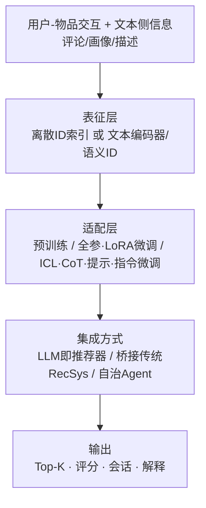

# Recommender Systems in the Era of Large Language Models (LLMs)（大语言模型时代的推荐系统）

- **会议/期刊**: IEEE TKDE, vol. 36, no. 11, pp. 6889–6907, Nov. 2024
- **作者与机构**: Zihuai Zhao, Wenqi Fan, Qing Li 等（香港理工大学、香港城市大学、MSU、Amazon）
- **推荐链路定位**: 端到端（贯穿召回/精排/重排/可解释生成与会话交互的范式级综述）
- **研究方向**: 大语言模型推荐 / 生成式推荐
- **论文原文**: [arXiv:2307.02046v6](https://arxiv.org/abs/2307.02046v6)
- **开源代码**: 综述本身无自有代码库，但正文表 1–3 逐条给出被综述方法的复现仓库（如 PTUM `github.com/wuch15/PTUMNext`、P5 `github.com/jeykigung/P5`、TALLRec `github.com/sai990323/tallrec`）

## TL;DR (1分钟核心速览)

DNN/PLM 推荐器受限于三点：对用户-物品长文本语义刻画不足、任务定制架构难以跨任务泛化、缺乏多步推理能力。本文作为 TKDE 综述，放弃"按任务罗列"的常规写法，改用**表征层（离散 ID 索引 vs 文本侧信息增强）× 适配层（预训练 / 全参与 PEFT 微调 / 提示与指令微调）** 的二维骨架，归并 60 余项 LLM4Rec 工作，并给出幻觉、安全鲁棒、公平、可解释与隐私五条未来路线。因其为综述，全文**不含统一基准实验**，价值体现在范式划分的完备性与"方法—开源仓库"的工程索引。

## Background & Motivation (背景与核心矛盾)

- **主流范式**: RecSys 经历 CF/MF → DNN（NeuMF、LightGCN 类图模型、DeepCoNN/NARRE 双塔评论编码）→ PLM（BERT4Rec、UniMIND）三级跃迁（原文图 2 时间线）。
- **前人局限**: (i) CNN/LSTM/BERT 规模的模型对评论文本、商品描述中的细粒度知识"读不懂"；(ii) 架构与任务强绑定，能预测评分却无法顺带做 top-K 与解释生成；(iii) 对旅行规划类需要"先选景点→再排行程→按预算收敛"的多步决策无能为力。
- **核心洞察 (Key Insight)**: LLM 的 in-context learning 与 chain-of-thought 恰好补上"零样本泛化 + 分步推理"两块短板，使推荐可被重写为语言生成/排序任务，且无需为每个任务改网络结构。
- **本文切入点**: 以"**如何把 LLM 接入 RecSys**"而非"推荐任务是什么"为组织轴，把散落的 P5/TALLRec/Chat-Rec 等统一到同一坐标系中比较。

## Method (核心方法设计)

### 1. 整体框架 (Overall Architecture)

综述的"方法"即其分类框架，可视为一条四段流水线：**输入侧**把用户-物品交互与文本侧信息（用户画像、评论、商品标题/描述）序列化为自然语言 prompt；**表征层**决定用离散 ID 短语（P5 的 `<item_6637>` 特殊 token）还是文本编码器（BERT/UniSRec/VQ-Rec）产出用户与物品向量；**适配层**沿三条正交路线改造 LLM——预训练（行为级自监督）、微调（全参或 PEFT/LoRA）、提示（冻结参数下的 ICL/CoT/prompt tuning/instruction tuning）；**输出侧**统一为 top-K 列表、评分、会话回复与推荐理由。整个框架的关键主张是：任何一项 LLM4Rec 工作都能被定位为"(表征, 适配范式, 集成方式)"三元组。

### 2. 关键设计拆解 (Key Designs)

1. **表征层：索引方案与语义 ID（解决稀疏下 ID 无相关性可算）**：纯 ID 索引天生离散，交互稀疏时无法度量用户-物品相关性，且扩充词表会改动 LLM 参数。原文归纳出四种索引——sequential / collaborative / semantic / hybrid，并重点讨论 RQ-VAE 的层级码字：对物品语义向量逐级残差量化，$c_{i,l}=\arg\min_{c\in\mathcal{C}}\lVert r_{i,l}-e_c\rVert_2^2$，$r_{i,l+1}=r_{i,l}-e_{c_{i,l}}$，使码字既唯一又保持语义邻近；文本侧路线则用 BERT 的 `[CLS]`（IDA-SR）或 VQ-Rec 的向量量化码替代 ID，把相关性计算搬回连续语义空间。

2. **适配层之一：行为级预训练与参数高效微调（解决"语言 token ≠ 用户行为"与算力门槛）**：PTUM 把 MLM/NTP 改造成行为级任务——掩码行为预测 MBP 只遮单个行为 $\mathcal{L}_{\text{MBP}}=-\sum_{t\in\mathcal{M}}\log p_\theta(b_t\mid\mathcal{B}\setminus\{b_t\})$，Next-K 行为预测 NBP 则显式建模"过去行为→未来 K 行为"的时序因果；M6 用 text-infilling + 自回归，P5 用 multi-task multi-mask 混合语料换取零样本能力。全参微调（RecLLM 微调 LaMDA、GIRL、TransRec）代价过高，LoRA 以$h=W_0x+\frac{\alpha}{r}BAx$（$r\ll\min(d,k)$）只训练低秩旁路，这正是 TALLRec 能在**单张 RTX 3090** 上微调 LLaMA-7B 的原因。

3. **适配层之二：提示三件套与集成方式（解决跨任务迁移成本）**：prompting 分零样本/少样本 ICL 与 CoT（"Let's think step by step" 显式补中间推理步）；prompt tuning 分 hard（离散模板，本质是离散优化）与 soft（连续向量 $[P;x_{1:n}]$，只更新$P$ 与输入层，可解释性下降）；instruction tuning 以"任务描述-输入-输出"三元模板做多任务微调，用训练成本换取 unseen 任务的 zero-shot 能力。集成侧分三类：LLM 直接当推荐器、LLM 桥接传统 RecSys（Chat-Rec 用 ICL 接收候选并重排）、LLM 作自治 Agent（RecAgent/Agent4Rec 模拟用户发帖与对话）。

**训练目标与开销对比**: 综述层面无统一 $\mathcal{L}$，但可横向比较成本——ICL 零参数更新却受 context 长度与推理延迟拖累；soft prompt 仅更新输入层极小参数；LoRA 更新 <1% 权重；全参微调在 10B+ 规模下对消费级 GPU 不可行。生成式范式（P5/TALLRec）把推荐转为序列生成，**免显式负采样**；ID-based 双塔仍依赖 in-batch 或全库检索。

## Experimental Setup & Evaluation Protocol (实验设置与评估协议)

- **数据集与预处理**: 本文为综述，**未构建统一数据集、未做 5-core 过滤或重实现**；其"语料"是 2023 年前后 arXiv 与 RecSys/NLP 交叉顶会顶刊文献，覆盖 Amazon、MovieLens、Yelp、YouTube、招聘与新闻等场景。
- **数据划分与防穿越**: 不适用（无自建实验）；原文对各被综述方法仅描述其数据形态（用户-物品交互 + 文本侧信息），未统一 Leave-One-Out / 时间戳切分口径。
- **排名评测协议**: 不适用；原文**未讨论 Full-Ranking 与 Sampled Ranking 的口径差异**，仅以各方法自报指标（HR/NDCG/MAE 等）呈现，这也是该综述最主要的协议短板。
- **对比基线与超参设置**: 无统一基线；仅给出"模型规模 >10B 即进入 LLM 时代"的时间线刻度（原文图 2）与全参/PEET 的成本对照。

**代表性方法索引（据原文表 1–3 整理）**

| 方法 | 骨干 | 训练范式 | 目标任务 | 代码 |
| :--- | :--- | :--- | :--- | :---: |
| PTUM | BERT 类 | 预训练（MBP + NBP） | 序列推荐 | ✓ |
| P5 | T5 | 预训练 + 多任务 prompt | Top-K/评分/解释 | ✓ |
| M6 | 自研超大骨干 | text-infilling + 自回归 + LoRA | 多任务 | ✗ |
| UniSRec | BERT + MoE adaptor | 文本侧信息增强 | 跨域迁移 | — |
| VQ-Rec | 双塔 + 向量量化 | 文本码本表征 | 跨域检索 | — |
| TALLRec | LLaMA-7B | LoRA 指令微调 | 评分/序列 | ✓ |
| RecLLM | LaMDA | 全参微调 | 会话推荐 | — |
| Chat-Rec | ChatGPT | 零/少样本 ICL | 桥接重排 + 解释 | — |
| Agent4Rec | ChatGPT | 少样本 ICL + Agent | 用户行为模拟 | ✓ |

### 3. 关键实验发现 (Key Findings)

1. **落地瓶颈从算力转向数据与 prompt 设计**: 时间线把 LLM 门槛定在 >10B 参数，而 LoRA 让 7B 模型在单张 RTX 3090 可训（TALLRec），意味着学术与中小厂可复现的分界线已由"能否全参微调"转为"能否构造高质量指令与示范"。
2. **稀疏/冷启动场景应优先文本侧表征**: 原文明确指出 ID 索引需扩词表并改动 LLM 参数、稀疏时无可计算的相关性，而 UniSRec 的 MoE adaptor 与 VQ-Rec 码本能把语义共享跨域迁移，故冷启动与跨域迁移任务上文本路线的性价比更高。
3. **零样本 ICL 与指令微调各自适用不同生产约束**: 零样本 ICL 仅需"任务描述 + 输出格式指引"即可用于会话推荐（用户不会提供示范），但原文承认少样本 ICL 普遍更优；指令微调以训练成本换 unseen 任务的 zero-shot 能力，工程上"LoRA + instruction tuning"是比全参更现实的组合。

## Highlights & Limitations (亮点、对比与审稿批判)

- **与代表作对比 (vs. Prior Work)**: 相较 Liu et al.（仅覆盖 BERT/GPT-2 早期语言模型）本文纳入 ChatGPT/LLaMA 世代；相较 Wu et al. 的"判别 vs 生成"二分与 Lin et al. 的"where/how"管线视角，本文的差异在于**系统梳理 LLM 域内技术本身**（MBP/NBP 预训练任务、LoRA 低秩旁路、hard/soft prompt 与指令模板），而非仅盘点 LLM 在推荐中的应用面。
- **可迁移亮点**: ①*角色注入 prompt*（"You are a book rating expert."）可有效防止 LLM 以"我只是语言模型"拒答，属零成本即插即用技巧；②把行为图的节点/边路径编码成自然语言再做 instruction tuning（GLRec 思路），是把图结构灌入 LLM 的通用桥梁。
- **审稿级局限批判**: ①**无统一基准与量化元分析**，各方法在异构数据与自报指标下不可比，且全文未触及 Full-Ranking 与采样排序的口径污染问题，削弱了结论的可验证性；②覆盖窗口止于 2024 年初，对 TIGER/LIGER 之后语义 ID 生成式检索的工业级验证、以及推理延迟与能耗的定量对比近乎空白。

## Rating (四维评分)

- **方法创新性 (Novelty)**: ⭐⭐⭐ （二维分类骨架清晰且互斥性较好，但本质是体系化归纳而非新算法，"三范式"划分亦有重叠地带）
- **评估协议与实验扎实度 (Protocol & Experiments)**: ⭐⭐ （综述无自建实验、无统一划分与排名协议，也无显著性检验，仅以文献矩阵与代码索引支撑）
- **写作与数学规范度 (Clarity & Rigor)**: ⭐⭐⭐⭐ （MBP/NBP、LoRA、残差量化等公式表述准确、符号统一，图表时间线与三张方法表组织度高）
- **工业落地与复现价值 (Industrial & Practical Value)**: ⭐⭐⭐⭐ （逐条附开源仓库、给出单卡微调与免负采样生成范式的成本对照，对团队做技术选型极具参考价值）

