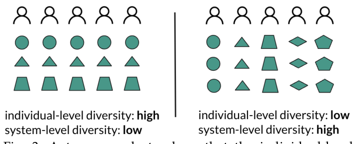
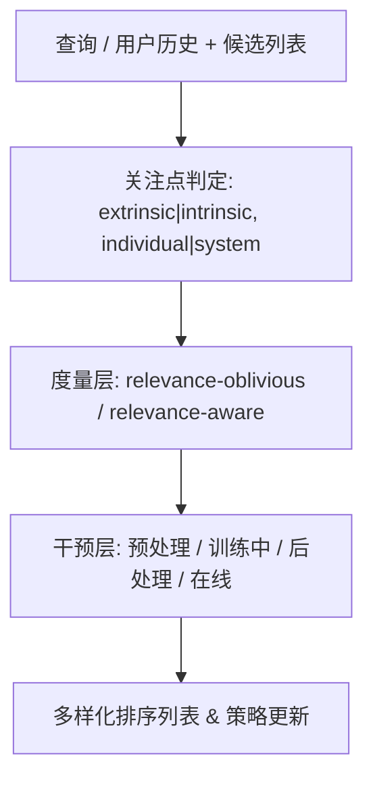
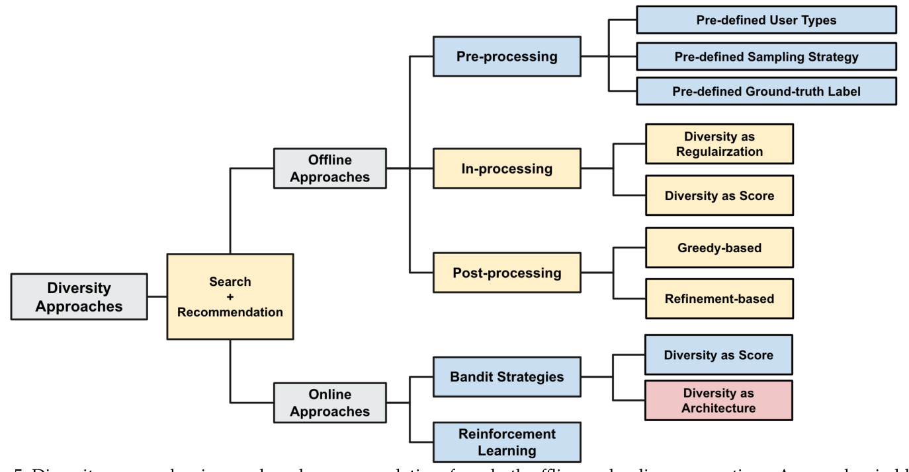

# Result Diversification in Search and Recommendation: A Survey (搜索与推荐中的结果多样性：综述)

- **会议/期刊**: IEEE TKDE (2024, arXiv v4)
- **作者与机构**: Haolun Wu, Yansen Zhang, Chen Ma (通讯), Fuyuan Lyu, Bowei He, Bhaskar Mitra, Xue Liu — McGill University / City University of Hong Kong / Microsoft Research
- **推荐链路定位**: 重排（列表级重排；兼覆盖召回负采样与在线策略层）
- **研究方向**: 多任务学习与列表级重排 / 去偏公平与工业架构
- **论文原文**: [https://arxiv.org/abs/2212.14464v4](https://arxiv.org/abs/2212.14464v4)
- **开源代码**: [https://github.com/Forrest-Stone/Diversity](https://github.com/Forrest-Stone/Diversity)（经典多样性度量与方法的参考实现）

## TL;DR (1分钟核心速览)

检索系统长期以相关性为唯一目标，造成用户侧冗余/"信息茧房"与供给侧"超级明星"曝光垄断两类失衡，而现有文献对 "diversity" 一词用法混乱、度量与方法碎片化。本综述首次把搜索与推荐纳入**同一分类体系**：概念层区分搜索的 extrinsic/intrinsic 与推荐的 individual/system-level；度量层以"是否含相关性"划分 relevance-oblivious（距离/覆盖/社会福利）与 relevance-aware（α-nDCG、IA-family、D-family）；方法层按干预时机划分为预处理/训练中/后处理与在线 Bandit/RL。综述不做统一实验，但以 100+ 篇文献查表定位，并用 Kwon 等 C-Coverage 24%→78% 的个案说明多样性并非相关性折损。

## Background & Motivation (背景与核心矛盾)

- **主流范式**: 搜索（query→排序）与推荐（历史交互→个性化排序）均以 relevance 为核心优化目标，多样性作为附加重排层（MMR/DPP）或附加正则项处理。
- **前人局限**: ①术语不一致——同一 "diversity" 时而指去冗余、时而指意图覆盖、时而指曝光公平，方法论文互不可比；②单点方法各自为战，缺少"该用哪个度量 + 该在何时干预"的对应关系，导致工业上常只挂一层 MMR 却无法改善长尾曝光。
- **核心洞察 (Key Insight)**: 搜索的多样性源于**信息需求的不确定性**（extrinsic：query 歧义/意图差异；intrinsic：单意图下去冗余），推荐的多样性则锚定**两类利益相关方**（individual-level 对应用户满意度，system-level 对应 provider 曝光公平）；且系统级多样性**不是**个体级多样性的均值，二者重叠极小。
- **本文切入点**: 以"关注点(concern) → 度量(metric) → 干预时机(approach)"三层卡尺，把两领域的方法与指标统一编目，并显式标注每条文献的适用口径。

<figure class="paper-figure" markdown="span">
  <figcaption>图3：一个玩具示例，说明推荐中的个体级多样性与系统级多样性是不同的关注点且重叠很少。在此示例中，不同形状表示不同类别。考虑一个 top-3 推荐，并假设系统中用户和物品数量极大（与真实场景相同）。在情形1中，系统向每个用户推荐相同的3类物品；在情形2中，系统总是向每个不同用户推荐唯一类别的物品。因此，在情形1中，个体级...</figcaption>
</figure>

## Method (核心方法设计)

### 1. 整体框架 (Overall Architecture)

综述的组织逻辑本身即其"模型"：先判定任务属于搜索还是推荐，从而确定多样性关注点（extrinsic/intrinsic 或 individual/system）；再据此选择度量族——若只关心列表内部结构可用 relevance-oblivious 的距离/覆盖/社会福利指标，若需与相关性联合评估则用 relevance-aware 的 α-nDCG、IA/D-family；最后按干预时机落位：预处理（用户分型、类别增强采样、监督重标注）、训练中（多样性作正则或作打分项）、后处理（MMR/DPP 贪心、列表精修）、在线（CMAB 与 RL）。整体形成从概念到工程部署的单向映射，任意新方法都可在三维坐标中被定位并立即读出其可优化的关注点上界。

<figure class="paper-figure" markdown="span">
  <figcaption>图5：从离线和在线视角看搜索与推荐中的多样性方法。蓝色框中的方法表示其通常用于推荐，粉色框表示其通常用于搜索，黄色框中的方法在搜索与推荐中同样广泛使用。</figcaption>
</figure>

### 2. 关键设计拆解 (Key Designs)

1. **关注点解耦：个体级 ≠ 系统级**：前人常把"多样性提升"当作单一标量汇报。本文用反例证明二者几乎正交：向所有用户各推 5 个互不相似的爆款可获高 ILAD，但全站只曝光 5 个物品，Gini 反而恶化。系统级用 $\text{Gini}=\frac{1}{2|\mathcal{D}|^2\bar{e}}\sum_{i}\sum_{j}|e_i-e_j|$（$e_i$为物品曝光次数），个体级用$ \text{ILAD}=\mathrm{mean}_{d_i,d_j\in\sigma,i\neq j}\,\mathrm{dis}_{ij} $；面板推荐场景还可退化为局部窗口版$ \text{ILALD} $（仅比较$|\sigma^{-1}(d_i)-\sigma^{-1}(d_j)|\leq w$ 的相邻位次）。这解释了为何只做重排无法改善曝光公平。

2. **度量统一分类：覆盖式 vs 相关性感知**：覆盖类指标（$\text{S-Coverage}=\frac{|\bigcup_{i=1}^{N}\bigcup_{d\in\sigma_i}S(d)|}{n_S}$）只看"子话题是否出现"，可被随机推荐刷分；相关性感知族则把冗余惩罚写进增益——$\mathrm{Gain}(d_k)=\sum_{i=1}^{n_S}o(d_k|s_i)(1-\alpha)^{c^{\sigma_{1:k}}_{s_i}}$，同一子话题被覆盖越多、边际增益指数衰减（α-nDCG/NRBP）。更细的 IA-family 用意图分布加权 $\mathrm{M\text{-}IA}(\sigma)=\sum_i p(s_i|q)M(\sigma|s_i)$，而 D-family 改为先算全局增益再排序，并用 $\mathrm{D^{\#}\text{-}M}@K=\gamma\cdot\text{S-Recall}@K+(1-\gamma)\cdot\text{D-M}@K$ 显式激励意图召回，从而规避 IA 族的"欠归一化"问题。直觉：多样性必须与相关性共享同一增益通道，否则容易被噪声策略套利。

3. **三族干预算子与推理代价**：后处理最通用且零重训——MMR 逐位贪心 $d_k=\arg\max_{d}\,[o_{rel}(d|u)+\lambda\, o_{div}(d|\sigma_{1:k-1},u)]$，其中 $o_{div}=-\max_{d_j\in\sigma_{1:k-1}}\mathrm{sim}(d,d_j)$，复杂度 $O(K|\mathcal{D}|)$；DPP 改用集合级概率$ p(C)\propto\det(L_C)=\big(\prod_{i\in C}\xi_i^2\big)\det(S_C) $，对角线编码相关性、非对角编码相似度，行列式天然实现"相关且互斥"，贪心增量解为$O(K^2|\mathcal{D}|)$。训练中则以$ \min_{\Theta}\mathcal{L}_{rel}+\lambda\mathcal{L}_{div} $注入，意图感知版正则为$ \mathcal{L}^{\sigma_u}_{div}=-\sum_i p(s_i|u)\big(1-\prod_{d\in\sigma_u}(1-p(d|s_i))\big) $。预处理侧的类别增强负采样把负样本限制在**与正样本同类别**内，避免跨类物品被过度推远从而抬高列表跨类覆盖。在线侧把多样性写进 CMAB 的 attraction 分数，最小化级联浏览下的累积 regret$ R(T)=\sum_{t=1}^{T}\mathbb{E}[r(\sigma^{*},\alpha_t)-r(\sigma_t,\alpha_t)] $；RL 则用 DQN + DBGD 扰动探索兼顾长期回报。负采样策略整体是"免负采样重训"路线：多样性大多在打分/重排阶段注入，不改动召回双塔。

## Experimental Setup & Evaluation Protocol (实验设置与评估协议)

- **文献采集与"数据"口径**: 本文是综述，**不提供自建数据集统计、不做统一实验**；其"数据"为 100+ 篇文献：以 search/recommendation/ranking/retrieval × diversity/serendipity/coverage 为关键词检索 KDD、NeurIPS、SIGIR、RecSys、WSDM、TheWebConf、CIKM、AAAI、ICDM、TKDE、TOIS 等至 2022 年，再沿引文图回溯扩充。

| 代表作 | 场景/数据 | 多样性口径 | 报告增益（综述正文） |
| :--- | :--- | :--- | :--- |
| Kwon et al. | 时尚电商（访谈驱动的四类购买行为） | C-Coverage + 购买转化 | **C-Cov 24%→78%，购买率 +3.2%，客单价 +$13** |
| Zheng et al. | 图推荐（类别增强邻域/负采样） | individual-level 跨类覆盖 | 定性（提升类别覆盖） |
| Cheng et al. | 监督学习（多样性重标注） | F-measure 折中（相关性 + ILAD） | 定性 |
| Li et al. | 序列推荐（逐位生成列表） | 子话题折扣增益 | 定性 |
| Chen et al. (DPP) | Top-K 重排 | $\det(L_C)$ 集合级 | 定性 |
| Radlinski et al. (RBA) | Web 搜索（rank-wise bandit） | 每位置独立 MAB | 理论 regret 保证 |
| Zheng et al. (DQN+DBGD) | 在线 RL | 长期回报 + 探索扰动 | 定性 |

- **数据划分与防穿越**: 综述层面**不存在统一划分**；被引工作混用 Leave-One-Out、全局时间戳切分与线上 A/B，且多数未报告跨域复现，因此跨论文数字**不可直接横向比较**——这是本领域最突出的评测缺口。
- **排名评测协议**: 主流为 Top-K 列表级评估（非单点排序）；α-nDCG/NRBP/IA-family 依赖 **subtopic 或 intent 分布标注**（人工或 query log 估计），属"半监督评测"，标注缺失时只能退化为 ILAD/S-Coverage 等无偏但可被刷分的指标。未见系统性显著性检验报告。
- **对比基线与超参**: 综述以方法族而非单模型为对比单元；核心折中参数为后处理权重 $\lambda$、新颖度衰减$\alpha$、浏览继续概率$\beta$、意图召回权重$\gamma$，均为区间$(0,1)$ 的人工设定值。

## Key Experimental Results (实验关键数据)

### 1. 主实验对比 (Main Results)

综述无统一主表，此处将其 Table 3 的族级对照重排为"可部署性"视角（★ 表示该族最具代表性的能力维度）：

| 方法族 | 代表 | 干预时机 | 需重训 | 个体级 | 系统级 | 单位置复杂度 | 报告效果 |
| :--- | :--- | :--- | :---: | :---: | :---: | :--- | :--- |
| 预定义用户分型 | Kwon et al. | 训练前 | 否 | ✔ | ✔ | $O(1)$| **C-Cov 24%→78%，+3.2% 购买，+$13 客单** |
| 预定义采样/负采样 | Zheng et al. | 训练前 | 是 | ✔ | 弱 | 采样开销 | 定性 |
| 预定义标注 | Cheng et al. | 训练前 | 是 | ✔ | 弱 | $O(|C_u|K)$ | 定性 |
| 多样性作正则 | Wasilewski et al. | 训练中 | 是 | ✔ | 弱 | $+\lambda$ 项 | 定性 |
| 多样性作打分 | Li et al. | 训练中 | 是 | ✔ | 弱 | $O(n_S)$ | 定性 |
| 贪心 MMR | Carbonell et al. | 训练后 | 否 | ✔ | 弱 | $O(K|\mathcal{D}|)$ | 定性（工业最常用） |
| 贪心 DPP | Chen et al. | 训练后 | 否 | ★✔ | 弱 | $O(K^2|\mathcal{D}|)$ | 定性（集合级最优） |
| 在线 CMAB | Li / Radlinski et al. | 在线 | 否 | ✔ | 弱 | $O(|\mathcal{A}|)$/轮 | **次线性 regret** |

### 2. 分类矩阵对照 (Ablation-style Taxonomy Matrix)

由于无统一实验，作者用"能否优化某一关注点"的覆盖矩阵替代消融（✔=可直接优化，◐=间接，✘=不可）：

| 方法族 | extrinsic 覆盖 | intrinsic 去冗余 | individual | system(Gini) |
| :--- | :---: | :---: | :---: | :---: |
| 预定义用户分型 | ◐ | ✔ | ✔ | ✔ |
| 预定义采样策略 | ✘ | ✔ | ✔ | ◐ |
| 预定义标注 | ◐ | ✔ | ✔ | ✘ |
| 多样性作正则 | ✔ | ✔ | ✔ | ✘ |
| 多样性作打分 | ✔ | ✔ | ✔ | ✘ |
| 贪心 MMR | ✘ | ✔ | ✔ | ✘ |
| 贪心 DPP | ✘ | ✔ | ✔ | ✘ |
| 在线 Bandit/RL | ✔ | ✔ | ✔ | ◐ |

### 3. 关键实验发现 (Key Findings)

- **口径错配是最大隐性失败源**：后处理族（MMR/DPP）在 intrinsic 去冗余上最强且零重训，但对 extrinsic 的 S-Coverage 几乎无直接作用；真正能拉动覆盖的是预处理用户分型（C-Coverage 24%→78%）与意图感知正则（显式以 $p(s_i|u)$ 加权）。即"要哪种多样性就得选对应度量的优化通道"，混用无效。
- **系统级公平无法靠"个体级多样性"溢出获得**：由 Gini/SD Index 的聚合定义与反例可知，给每个用户各推互不相似的爆款即可拿到高 ILAD 却让 $e_i$ 高度集中，故工业上单挂一层 MMR 重排对长尾曝光基本无改善，必须在训练目标或系统级约束中显式引入覆盖/集中度项。
- **多样性不必然是相关性税**：Kwon 等在线上实验组同时取得 C-Coverage 24%→78%、购买率 +3.2% 与客单价 +$13，支持"覆盖式多样性对供给冷启与长尾是净收益"；但该结论依赖访谈先验的四类购买行为分型，不可无条件外推。
- **集合级建模优于成对贪心**：DPP 的 $\det(L_C)=\prod_{i\in C}\xi_i^2\det(S_C)$把相关性（对角）与冗余（非对角）压进单一行列式目标，避免 MMR 逐位贪心的短视与相关性/多样性分离建模，代价是$O(K^2|\mathcal{D}|)$ 与 PSD 分解开销。

## Highlights & Limitations (亮点、对比与审稿批判)

- **与代表作对比 (vs. Prior Work)**: 相比既有推荐侧多样性综述（如 Kunaver & Požrl），本文首次跨搜索/推荐给出统一分类；相比 MMR(1998) 与 DPP 等单点方法，本文将其降格定位为 post-processing 一族，并明确指出它与 "in-processing diversity as score" 的**唯一本质区别在于贪心选择是否发生在训练过程中**（是否使用已训练好的嵌入），这一区分澄清了长期存在的概念混淆；相比 IA-family，D-family 通过单一"全局理想列表"修掉了前者的欠归一化问题。
- **可迁移亮点**: ①"关注点 → 度量 → 干预时机"三层卡尺可直接用于给多目标重排/去偏新工作做定位与选型自检；②局部窗口距离 ILALD/ILMLD 适配仅有 $w$ 个连续位置曝光的流式推荐（短视频、会话式列表），比全列表两两距离更贴近真实曝光注意力。
- **审稿级局限批判**: ①**没有统一 benchmark 与任何自建实验**，族级优劣结论靠定性论证与个别被引数字支撑，缺乏统计显著性与跨数据集复现，读者无法据此判定"哪种方法更好"；②文献截止 2022，缺失生成式/语义 ID 推荐（解码器一次生成整张列表时如何在 beam search 内施加 set-level 覆盖约束）、扩散式生成推荐的多样性控制，以及 LLM 作为重排器的多样性评估；③对 $\lambda/\alpha/\beta/\gamma$ 的敏感性、重排带来的在线延迟预算、subtopic/intent 标注成本均只字未提，落地可行性论证偏弱。

## Rating (四维评分)

- **方法创新性 (Novelty)**: ⭐⭐⭐⭐ （非提出新模型，但首次给出跨搜索/推荐的统一概念—度量—方法三层分类，"个体级≠系统级"的正交性论证具有真正澄清价值）
- **评估协议与实验扎实度 (Protocol & Experiments)**: ⭐⭐⭐ （无统一数据集、划分与显著性检验，仅靠覆盖矩阵与个别被引数字支撑，族间优劣无法被实证裁决）
- **写作与数学规范度 (Clarity & Rigor)**: ⭐⭐⭐⭐⭐ （公式与符号表完备，度量族逐条给出定义、动机与适用边界，IA-family 与 D-family 的欠归一化差异讲得干净）
- **工业落地与复现价值 (Industrial & Practical Value)**: ⭐⭐⭐⭐ （开源经典度量实现、后处理族 model-agnostic 可直接挂到现有精排后，但缺少延迟/复杂度实测与线上部署细节）

