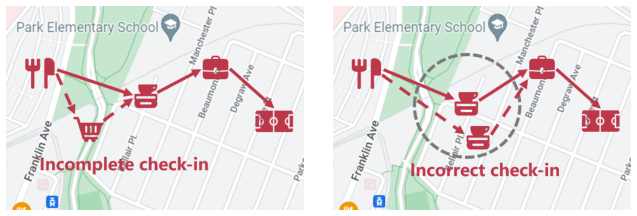
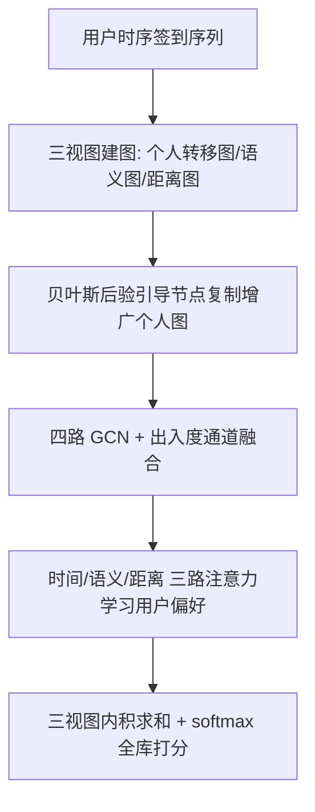
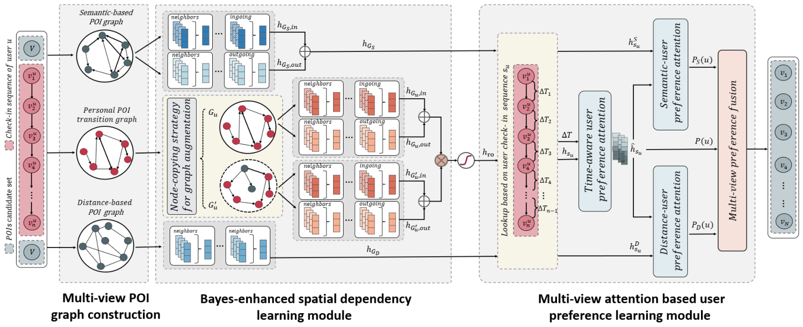

# Bayes-enhanced Multi-view Attention Networks for Robust POI Recommendation (贝叶斯增强多视图注意力网络下的鲁棒 POI 推荐)

- **会议/期刊**: IEEE TKDE (2024, Vol.36)；arXiv 预印本 2023-11
- **作者与机构**: Jiangnan Xia, Yu Yang, Senzhang Wang, Hongzhi Yin, Jiannong Cao, Philip S. Yu（中南大学 / 香港理工大学 / 昆士兰大学 / UIC）
- **推荐链路定位**: 召回（Next-POI 排序打分）
- **研究方向**: 时空轨迹与 POI 本地生活推荐 / 自监督对比学习与交互去噪
- **论文原文**: [论文原文链接](https://arxiv.org/abs/2311.00491v1)
- **开源代码**: 暂未开源

## TL;DR (1分钟核心速览)

现有 POI 推荐默认签到记录是用户行为的"真值"，但定位误差与隐私顾虑使数据同时**稀疏且含噪**。BayMAN 构建个人转移图、全局语义图与地理距离图三视图，先用"最相似用户 + 贝叶斯后验"做节点复制式图增广以补全个人图，再用时间感知与语义/距离两路注意力精化用户偏好。在 Foursquare/NYC/Gowalla 上按 8:2 时序划分、全库 softmax 排序评估，原始数据 R@5 相对提升 11.93%–16.40%，20% 删除扰动下提升扩大至 12.13%–34.93%。

## Background & Motivation (背景与核心矛盾)

- **主流范式**: RNN/LSTM 序列模型（STGN、Time-LSTM、LSTPM）与图/注意力模型（ASGNN、STAN、GSTN）建模连续或非连续签到的时空依赖。
- **前人局限**: ① 抗稀疏多依赖社交关系、POI 类别等外部特征，外部信息缺失时失效；② 语义（全局共现）与地理距离依赖缺乏统一框架联合建模；③ 几乎无人把"签到本身不可信"当作一等公民处理，噪声被视为偶然而非建模对象。
- **核心洞察 (Key Insight)**: 作者指出即便在**未扰动的原始数据**上，融入增广与去噪的模型也显著优于 SOTA——说明原始签到集自身就带噪，鲁棒性不是"退化场景"的补丁而是常态需求。
- **本文切入点**: 个人图噪声最重但最贴用户偏好，故用贝叶斯后验从"同好用户"处复制节点生成增广图，与全局语义/距离图形成局部-全局互补。

<figure class="paper-figure" markdown="span">
  <figcaption>图1：不可靠POI签到的示意图。</figcaption>
</figure>

## Method (核心方法设计)

### 1. 整体框架 (Overall Architecture)

输入为每个用户的时序签到序列 $s_u$。先并行构建三张图：个人转移图$G_u$（边权为个人转移频率）、语义图$G_S$（全体用户转移频率，刻画"饭后常去商场"式共现语义）、距离图$G_D$（Haversine 距离$1/dis$为权重，阈值$\Delta_d$截断）。对最脆弱的$G_u$，先以 Jaccard 序列相似度选出同好用户$u_q$，按贝叶斯后验$p(\zeta\mid G_{u_p},G_{u_q})$决定逐节点复制，得到增广图$G'_u$；原图与增广图各过 GCN 后 Hadamard 融合得个人表征，语义图与距离图各过 GCN 得全局表征。随后三路注意力（时间感知 / 语义精化 / 距离精化）分别产出$P(u),P_S(u),P_D(u)$，与对应 POI 表征内积求和后经 softmax 全库打分。

<figure class="paper-figure" markdown="span">
  <figcaption>图2：所提出的BayMAN模型的整体框架。</figcaption>
</figure>

### 2. 关键设计拆解 (Key Designs)

1. **贝叶斯后验引导的节点复制式图增广（Bayes-enhanced Augmentation）**：个人图稀疏且噪声敏感，直接 GCN 学不到稳定表征。作者把 $G_{u_p}$视为随机图族的一次实现，做后验推断$p(G'_{u_p}\mid G_{u_p},G_{u_q})$，用辅助向量$\zeta$指示第$i$个节点是否被同好用户的节点替换；替换分布由融合时间差与地理距离的 POI 相似度决定：$sim(v_i,v_l)_v=\sigma\!\left(\frac{1}{dis(v_i,v_l)}+|t(v_i)-t(v_l)|\right)$，$p(\zeta_i=v_l\mid G_{u_p},C)=\frac{sim(v_i,v_l)_v}{\sum_{j}sim(v_i,v_j)_v}$。生成模型为$P(G'_{u_p}\mid G_{u_p},\zeta)=\prod_{i}\varepsilon^{\mathbb{I}\{G'_{u_p,i}=G_{u_q,\zeta_i}\}}(1-\varepsilon)^{\mathbb{I}\{G'_{u_p,i}=G_{u_p,i}\}}$，$\varepsilon$ 控制复制强度。直觉上"保留原结构 + 注入同好协同信号"等价于在分布约束下做数据增广，噪声节点被高概率替换、缺失节点被补齐，且复制节点天然携带时间-空间合理性。
2. **时间感知 + 语义/距离双路精化注意力**：常规注意力忽略签到时间间隔，而"10 小时走完"与"1 小时走完"同序列偏好迥异。时间感知层把时间差向量直接注入注意力 logits：$\hat{h}_{s_u}=\mathrm{softmax}\!\left(\frac{QK^\top+\Delta T}{\sqrt{d}}\right)V$，聚合得$P(u)$；随后以$\hat{h}_{s_u}$为 Query、语义图表征为 Key/Value 得到$P_S(u)$（距离路同理得$P_D(u)$），即"个人偏好去检索全局语义邻里"。最终打分$z_{u,j}=P(u)^\top h^{ro}_j+P_D(u)^\top h^{G_D}_j+P_S(u)^\top h^{G_S}_j$，三视图互补使偏好从"我走过哪"扩到"这类 POI 在全局与空间上如何关联"。
3. **训练目标、负采样与推理效率**：采用全库 softmax 交叉熵（免负采样）$\mathcal{L}=-\sum_{j}y_{u,j}\log\hat{y}_{u,j}+(1-y_{u,j})\log(1-\hat{y}_{u,j})+\lambda_\theta\|\theta\|_2^2$，$\hat{y}_{u,j}=\frac{\exp(z_{u,j})}{\sum_{v_k}\exp(z_{u,v_k})}$。增广图仅训练期参与表征学习，推理时不增加在线开销；隐维$d=48$，Foursquare 上单 epoch 训练时间$1.42\times10^2$→$7.11\times10^2$ s（随训练数据量线性增长），8 个 epoch 即收敛，与 STAN 相当。

## Experimental Setup & Evaluation Protocol (实验设置与评估协议)

- **数据集与预处理**:

| 数据集 | #Users | #Items(POI) | #Interactions | 特征/场景说明 |
| :--- | :---: | :---: | :---: | :--- |
| Foursquare | 2,321 | 5,596 | 194,108 | 新加坡，2009-02 至 2010-10 |
| NYC | 1,064 | 5,136 | 147,939 | 纽约城区签到 |
| Gowalla | 10,162 | 24,238 | 456,967 | 加州+内华达，2012-04 至 2013-09，最稀疏 |

- **数据划分与防穿越**: 按用户内部时序排序后 `比例划分`——前 80% 用于训练+验证，后 20% 作测试；不构造未来信息，避免穿越。
- **排名评测协议**: 采用 `Full-Ranking`（对全部 POI 候选做 softmax 全库排序，无负采样近似），指标为 Recall@5/10 与 NDCG@5/10。
- **鲁棒性扰动协议（本文特有）**: 数据删除（随机删 $r\%$签到模拟缺失）、数据替换（随机把$r\%$签到替换为**最近邻 POI** 模拟定位误差）、以及二者混合；$r\in\{10\%,20\%\}$ 为主，参数分析扩展到 70%。
- **对比基线与超参**: LSTM、Time-LSTM、STGN、ARNN、LSTPM、ASGNN、STAN、GSTN 共 8 个基线；$d=48$、学习率 0.002、Adam、100 epochs、序列最大长度 50、$\Delta_d=1$km、$\varepsilon=0.5$。

## Key Experimental Results (实验关键数据)

### 1. 主实验对比 (Main Results)

原始无扰动数据（节选 R@5 / R@10 / N@5，加粗为最优）：

| 模型 | FS R@5 | FS R@10 | FS N@5 | NYC R@5 | NYC R@10 | Gowalla R@5 | Gowalla R@10 |
| :--- | :---: | :---: | :---: | :---: | :---: | :---: | :---: |
| LSTM | 0.1501 | 0.2068 | 0.1154 | 0.2035 | 0.2649 | 0.1482 | 0.1943 |
| Time-LSTM | 0.1826 | 0.2402 | 0.1347 | 0.2209 | 0.2811 | 0.1574 | 0.2193 |
| STGN | 0.1762 | 0.2374 | 0.1265 | 0.2437 | 0.3012 | 0.1688 | 0.2236 |
| LSTPM | 0.2136 | 0.2703 | 0.1584 | 0.2831 | 0.3624 | 0.1798 | 0.2302 |
| ASGNN | 0.1847 | 0.2528 | 0.1395 | 0.2450 | 0.2882 | 0.1836 | 0.2426 |
| STAN | 0.2715 | 0.3534 | 0.1881 | 0.4667 | 0.5863 | 0.1864 | 0.2479 |
| GSTN | 0.2352 | 0.2871 | 0.1683 | 0.4276 | 0.5061 | 0.2031 | 0.2637 |
| **BayMAN** | **0.3039** | **0.4118** | **0.2049** | **0.5392** | **0.6667** | **0.2364** | **0.2981** |
| Improv.% | +11.93% | +16.53% | +8.93% | +15.53% | +13.71% | +16.40% | +13.06% |

扰动数据下的鲁棒性（R@5 / NDCG 相对最强基线的提升区间）：

| 扰动设置 | Foursquare R@5 | NYC R@5 | Gowalla R@5 | 整体 Recall 提升 | 整体 NDCG 提升 |
| :--- | :---: | :---: | :---: | :---: | :---: |
| 删除 10% | 0.2745 | 0.5098 | 0.2052 | 6.41%–28.14% | 9.61%–17.80% |
| 删除 20% | 0.2679 | 0.4602 | 0.1975 | 12.13%–34.93% | 10.18%–22.79% |
| 替换 10% | 0.2843 | 0.5196 | 0.2166 | 6.71%–21.58% | 7.10%–12.61% |
| 混合 20% | 0.2549 | 0.4513 | 0.1882 | 6.09%–31.30% | 8.38%–16.72% |

### 2. 消融实验 (Ablation Study)

原文以图 4（Foursquare / NYC 曲线）呈现，下表为剔除各组件后的相对变化趋势：

| 变体 | 移除组件 | 性能变化（R@5/NDCG@5） | 归因 |
| :--- | :--- | :--- | :--- |
| BayMAN-noB | 贝叶斯增广图 $G'_u$ | 降幅最大 | 协同信号缺失，稀疏-噪声无法补偿 |
| BayMAN-noG | 语义图 + 距离图 | 大幅下降 | 仅靠个人图不足以刻画偏好 |
| BayMAN-noGs | 语义图 | 明显下降 | 全局共现语义对精化最关键 |
| BayMAN-noGd | 距离图 | 中等下降（优于 noGs） | 噪声序列中距离信息冗余度更高 |
| BayMAN-noT | 时间感知注意力 | 小幅下降 | 时间间隔带来额外增益但非主导 |

### 3. 关键实验发现 (Key Findings)

1. **原始数据本身即不可靠**：在完全无扰动的数据上 BayMAN 仍比 STAN/GSTN 高出 11.93%–16.40% R@5，说明基线在"干净"数据上也被潜在噪声拖累，去噪增广是普适收益而非仅针对合成扰动。
2. **扰动越强、增益越大**：删除比例从 10% 升到 20% 时，Recall 提升区间由 6.41%–28.14% 扩大到 12.13%–34.93%，且 $r<40\%$ 时性能缓慢下降、超过 40% 后陡降，给出该方法可承受的扰动上限约 40%。
3. **增广强于结构、语义强于距离**：noB 的跌幅大于 noG 之外的任何变体，证明"补数据"比"加结构"更契合稀疏场景；noGd 优于 noGs 说明在含噪个人序列中语义共现比地理近邻更能纠正错误签到；$\varepsilon=0.5$、$\Delta_d=1$ km 为最优，复制概率过大反而引入额外噪声。

## Highlights & Limitations (亮点、对比与审稿批判)

- **与代表作对比 (vs. Prior Work)**: 相较 STAN（仅个人序列双注意力）与 GSTN（仅全局地理/转移依赖），BayMAN 首次把"语义全局 + 距离全局 + 个人局部"三视图统一并**显式对个人图做贝叶斯增广**；相比 ASGNN（个人图 GNN 但无增广），其抗噪能力来自生成式补全而非更强 encoder。
- **可迁移亮点**: ①"最相似用户 + 后验加权节点复制"是一种轻量、无需额外特征的图增广算子，可直接移植到序列推荐/会话推荐的稀疏用户侧；②把时间差向量直接加进注意力 logits 的做法简单且几乎零成本。
- **审稿级局限批判**: ①增广强依赖同好用户的存在与 Jaccard 重叠，冷启动用户（无相似邻居）时退化为原图，鲁棒性收益存疑；②扰动模拟用"最近邻替换"过于温和，真实 GPS 漂移可能跨类别，论文未报告跨类别噪声或对抗扰动的结果；③三图 + 四路 GCN + 三注意力的结构使超参（$\Delta_d,\varepsilon$、序列长度）敏感，且未给出与 STAN 的推理时延定量对比。

## Rating (四维评分)

- **方法创新性 (Novelty)**: ⭐⭐⭐⭐ （把贝叶斯节点复制从单图节点分类迁移到双个人图+时序场景，问题定义"鲁棒 POI 推荐"较新，但算子本身属组合式创新）
- **评估协议与实验扎实度 (Protocol & Experiments)**: ⭐⭐⭐⭐ （三数据集 + 全库排序 + 删除/替换/混合三类扰动 + 8 个强基线，扰动上限与超参分析完整；缺显著性检验与冷启动分桶）
- **写作与数学规范度 (Clarity & Rigor)**: ⭐⭐⭐ （公式完整、符号统一，但 Eq.13 把 $\Delta T$ 直接加入未归一化 logits 缺乏推导，增广分布与生成模型的合法性论证偏直觉）
- **工业落地与复现价值 (Industrial & Practical Value)**: ⭐⭐⭐⭐ （推理无额外开销、8 epoch 收敛、训练时间与 STAN 相当，增广模块可即插即用；代码未开源略降复现便利性）

