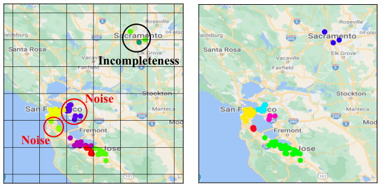
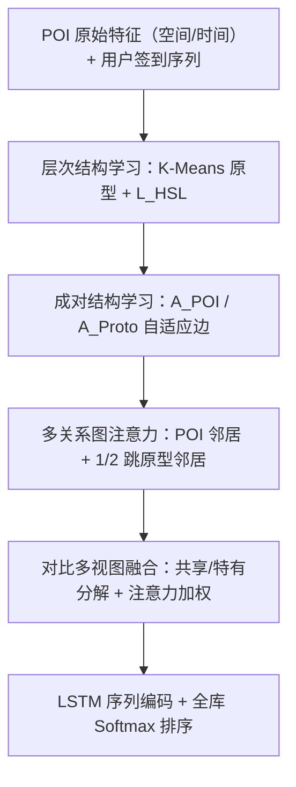
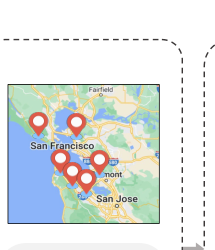

# Bi-Level Graph Structure Learning for Next POI Recommendation (面向下一 POI 推荐的双层图结构学习)

- **会议/期刊**: IEEE Transactions on Knowledge and Data Engineering (TKDE), vol. 36, no. 11, 2024
- **作者与机构**: Liang Wang, Shu Wu, Qiang Liu, Yanqiao Zhu, Xiang Tao, Mengdi Zhang, Liang Wang（中科院自动化所 CRIPAC/MAIS、UCLA、美团）
- **推荐链路定位**: 召回（候选 POI 全库排序）
- **研究方向**: 时空轨迹与 POI 本地生活推荐 / 图神经网络与知识图谱推荐
- **论文原文**: [https://arxiv.org/abs/2411.01169v1](https://arxiv.org/abs/2411.01169v1)
- **开源代码**: 暂未开源

## TL;DR (1分钟核心速览)

现有 POI 图推荐依赖"距离分箱/时间段共现"等人工规则构图，既丢失 POI 特征的细粒度→粗粒度层次，又受脏边与漏边拖累。BiGSL 用 EM 聚类把 POI 聚成原型节点构造层次图，再用可学习的成对相似度替换规则边，并在多关系图注意力中同时聚合 POI 级与原型级邻居，最后以对比分解融合空间/时间多视图。在 Gowalla / Foursquare / 美团 BJ 三数据集、用户时序 80/20 划分、全库排序协议下，Acc@20 相对最优基线提升 6.81%~13.56%，未访问新 POI 的 N²-Acc@5 提升 23.88%。

## Background & Motivation (背景与核心矛盾)

- **主流范式**: 先用空间距离、时间槽 Jaccard、转移次数等规则建多张 POI 图，再用 GNN 聚合全局协同信号，配合 LSTM/自注意力序列编码器预测下一 POI（STP-UDGAT、GETNext、HMT-GRN）。
- **前人局限 1（结构固定）**: 图拓扑由先验规则一次性确定且训练中不变，错误签到与漏签到直接变成噪声边/缺失边，GNN 的多跳传播会级联放大。
- **前人局限 2（无层次）**: 只建模 POI 对之间的局部连边，忽略"细粒度 POI 归属粗粒度簇"的层次性（同类商圈、同类时段峰、同类转移模式），稀疏 POI 得不到簇级信息补充；HMT-GRN 用多任务分区域预测，但各任务独立、层间无交互。
- **前人局限 3（融合粗暴）**: 多视图表示靠求和/拼接合并，无法区分视图共享语义与视图特有语义。
- **核心洞察 (Key Insight)**: POI 特征的层次结构是非线性的，规则分箱（网格、按日期分组）反而引入噪声；而结构本身应当是"可学习的参数"，用聚类原型 + 成对相似度共同刻画粗/细两个粒度。
- **本文切入点**: 把图结构当作双层可学习对象（POI–原型隶属 + POI–POI / 原型–原型边），与推荐损失端到端联合优化。

<figure class="paper-figure" markdown="span">
  <figcaption>图7. 由预定义规则与我们的方法构建的空间图可视化。图中相同颜色的POI相连。由预定义规则构建的图易受噪声（红圈）和不完整性（黑圈）影响，而我们的方法缓解了这些问题。</figcaption>
</figure>

## Method (核心方法设计)

### 1. 整体框架 (Overall Architecture)

对每个特征视图 $v\in\mathcal{V}$（空间经纬度、时间槽频次分布）分别执行：结构嵌入$\mathbf{z}_i^v$经 K-Means 得原型$\mathbf{c}_k^v$与隶属矩阵$A^{\text{Hier}}$（层次结构学习）→ 由 MLP 映射后的成对余弦相似度生成$A^{\text{POI}}$、$A^{\text{Proto}}$（成对结构学习）→ 在双层图上做三关系图注意力得$\mathbf{p}_i^v$→ 用 InfoNCE 与正交约束把$\mathbf{p}_i^v$分解为视图共享/特有分量并注意力融合为$\tilde{\mathbf{p}}_i$，与 POI ID 嵌入一起送入 LSTM+Softmax 排序。训练按 EM 交替（E 步聚类、M 步梯度更新）。

<figure class="paper-figure" markdown="span">
  <figcaption>图2. 我们提出的BiGSL模型的整体框架。我们首先从原始POI特征构建多个特征视图。在每个视图中，我们将POI映射为节点，然后对POI特征进行聚类以揭示层次结构。得到的原型表示粗粒度组信息，并将其加入图中。随后，我们执行成对结构学习以推断POI对和原型对之间的连通性，从而得到数据驱动的层次图。基于该层次图，我们进行多关系图学习以产生更……</figcaption>
</figure>

### 2. 关键设计拆解 (Key Designs)

1. **层次结构学习（原型作为粗粒度邻居）**：规则分组无法刻画非线性簇结构，故把 POI 到簇心的归属写成含隐变量的对数似然，用 Jensen 不等式得下界并在各向同性高斯假设下化简为带温度 $\tau_1$的软最近簇目标：$\mathcal{L}_{\text{HSL}}=-\sum_{l_i}\log\frac{\exp(\mathbf{z}_i^\top\mathbf{c}_k/\tau_1)}{\sum_{\mathbf{c}_j\in\mathcal{C}}\exp(\mathbf{z}_i^\top\mathbf{c}_j/\tau_1)}$。E 步用 K-Means 给出硬指示$\hat{Q}$，M 步最小化该损失，使结构嵌入向簇心收缩；原型取簇内表示均值，并生成隶属矩阵$A^{\text{Hier}}_{ij}=\hat{Q}(c_j|\mathbf{z}_i)$。直觉：原型为稀疏 POI 提供了"同簇邻居"这条高带宽捷径，缓解长尾。

2. **成对结构学习 + 多关系图注意力（去噪 + 用图）**：为压制规则边的噪声/缺失，用两层 MLP 把原始特征映射为结构嵌入 $\mathbf{z}_i$，以余弦相似度定义边$A^{\text{POI}}_{ij}=\frac{\mathbf{z}_i^\top\mathbf{z}_j}{\|\mathbf{z}_i\|\|\mathbf{z}_j\|}$，再经$\epsilon$-邻域稀疏化与行归一化（原型侧同理得$A^{\text{Proto}}$）。图上定义三类关系$\mathcal{R}$：POI 邻居、1 跳原型、2 跳原型；聚合同时受注意力与拓扑分$s_{ij}$（分别取$A^{\text{POI}}_{ij}$、$A^{\text{Hier}}_{ij}$、$A^{\text{Proto}}_{pj}$）调制：$\mathbf{p}_i=\sum_{r\in\mathcal{R}}\sum_{l_j\in\mathcal{N}_i^r}s_{ij}\alpha_{ij}W_r\mathbf{l}_j+W_s\mathbf{l}_i$。按关系独立参数$W_r$ 使粗/细粒度信息不被同一卷积核混淆。

3. **对比多视图融合与训练目标**：拼接/求和无法解耦语义，故以 InfoNCE 抽取视图共享表示 $\mathbf{p}_{c,i}$（正样本$(\mathbf{p}_i^v,\mathbf{p}_{c,i})$，同视图其他 POI 与融合表征其他 POI 皆负样本，$\tau_2=0.5$）；特有分量取残差$\mathbf{p}_{s,i}^v=\mathbf{p}_i^v-\mathbf{p}_{c,i}$，并用正交约束$\mathcal{L}_{\text{SP}}=\frac{1}{|\mathcal{L}|}\sum_i\sum_{v}\sum_{u\neq v}(\mathbf{p}_{s,i}^{v\top}\mathbf{p}_{s,i}^{u})^2$逼其不携带共享信息；最后用 softmax 注意力加权得$\tilde{\mathbf{p}}_i$。总体损失$\mathcal{L}=\mathcal{L}_{\text{CE}}+\beta_{\text{HSL}}\mathcal{L}_{\text{HSL}}+\beta_{\text{SH}}\mathcal{L}_{\text{SH}}+\beta_{\text{SP}}\mathcal{L}_{\text{SP}}$（$\beta$=1e-4/1e-1/1e-4）。**负采样**：不额外采样负例，依赖全库 Softmax + 批内对比负样本；**效率**：复杂度$O(N^2)$，瓶颈在成对结构学习与对比项，训练 6.5h（HMT-GRN 5.2h，RTX 3090），推理只需一次前向 + 排序。

## Experimental Setup & Evaluation Protocol (实验设置与评估协议)

- **数据集与预处理**: 沿用 HMT-GRN 协议——保留签到数 20~50 的用户，删除被 <10 用户访问的 POI。

| 数据集 | #Users | #Items(POI) | #Interactions | 稀疏度/密度 | 特征/场景说明 |
| :--- | :---: | :---: | :---: | :---: | :--- |
| Gowalla | 11,864 | 3,359 | 86,670 | 0.168% | 全球 LBSN 签到（2009.02–2010.10） |
| Foursquare | 16,636 | 4,455 | 170,573 | 0.155% | 415 城市签到（2012.04–2013.09） |
| BJ (美团) | 6,096 | 6,032 | 148,736 | 0.275% | 北京真实到店支付订单（2021.10） |

- **数据划分与防穿越**: 每个用户序列按**全局时间戳排序后前 80% 训练 / 后 20% 测试**（per-user 时序切分，无未来信息泄漏）。
- **排名评测协议**: **Full-Ranking 全库未交互 POI 排序**（Softmax 覆盖全部 $N$ 个 POI，不采样负例）；指标 Acc@5/10/20 与 MRR；另设 N²-Acc@K / N²-MRR 只统计用户**从未访问过**的目标，衡量探索能力。
- **对比基线与超参**: 序列类 RNN/LSTM/LSTPM/STAN/Flashback，图类 STP-UDGAT/GETNext/Graph-Flashback/SNPM/HMT-GRN；ID 与隐藏维 $d_2=d_3=1024$，簇数$K=80$（Gowalla）/$120$（Foursquare、BJ），$\tau_1=0.1$、$\tau_2=0.5$，batch 96，lr 1e-4，60 epoch；未报告显著性检验（$p$ 值）。

## Key Experimental Results (实验关键数据)

### 1. 主实验对比 (Main Results)

| 数据集 | Gowalla Acc@5 | Acc@10 | Acc@20 | MRR | Foursquare Acc@5 | Acc@10 | Acc@20 | MRR | BJ Acc@5 | Acc@10 | Acc@20 | MRR |
| :--- | :---: | :---: | :---: | :---: | :---: | :---: | :---: | :---: | :---: | :---: | :---: | :---: |
| LSTM | 0.1968 | 0.2575 | 0.3276 | 0.1510 | 0.2437 | 0.3174 | 0.4032 | 0.1854 | 0.1658 | 0.2316 | 0.3050 | 0.1175 |
| LSTPM | 0.2282 | 0.2720 | 0.3200 | 0.1803 | 0.2671 | 0.3214 | 0.3778 | 0.2078 | 0.1870 | 0.2396 | 0.2919 | 0.1360 |
| GETNext | 0.2546 | 0.3008 | 0.3683 | 0.1950 | 0.3141 | 0.3806 | 0.4566 | 0.2352 | 0.2142 | 0.2778 | 0.3390 | 0.1505 |
| Graph-Flashback | 0.2593 | 0.3040 | 0.3730 | 0.1979 | 0.3272 | 0.3994 | 0.4607 | 0.2399 | 0.2205 | 0.2820 | 0.3479 | 0.1530 |
| SNPM | 0.2658 | 0.3234 | 0.3952 | 0.2091 | 0.3304 | 0.4135 | 0.4978 | 0.2493 | 0.2231 | 0.2889 | 0.3507 | 0.1542 |
| HMT-GRN | 0.2783 | 0.3394 | 0.4033 | 0.2120 | 0.3357 | 0.4148 | 0.4983 | 0.2510 | 0.2285 | 0.3010 | 0.3606 | 0.1564 |
| **BiGSL** | **0.2923** | **0.3685** | **0.4471** | **0.2162** | **0.3500** | **0.4423** | **0.5323** | **0.2552** | **0.2422** | **0.3271** | **0.4095** | **0.1650** |
| Improv. | +5.04% | +8.57% | +10.85% | +1.96% | +4.25% | +6.62% | +6.81% | +1.67% | +5.94% | +8.68% | +13.56% | +5.48% |

### 2. 消融实验 (Ablation Study)

| 变体 | Gowalla Acc@5 | Acc@10 | Acc@20 | MRR | BJ Acc@5 | Acc@10 | Acc@20 | MRR |
| :--- | :---: | :---: | :---: | :---: | :---: | :---: | :---: | :---: |
| BiGSL | **0.2923** | **0.3685** | **0.4471** | **0.2162** | **0.2422** | **0.3271** | **0.4095** | **0.1650** |
| w/o HSL（去原型层次） | 0.2898 | 0.3587 | 0.4293 | 0.2152 | 0.2403 | 0.3173 | 0.3908 | 0.1645 |
| w/o PSL（回退规则构图） | 0.2803 | 0.3435 | 0.4135 | 0.2133 | 0.2310 | 0.3021 | 0.3744 | 0.1607 |
| w/o Shar（去共享对比） | 0.2904 | 0.3608 | 0.4327 | 0.2158 | 0.2407 | 0.3196 | 0.3945 | 0.1647 |
| w/o Spec（去特有+正交） | 0.2856 | 0.3536 | 0.4274 | 0.2147 | 0.2361 | 0.3120 | 0.3888 | 0.1625 |
| w/o Shar&Spec（退化和/拼接） | 0.2837 | 0.3523 | 0.4265 | 0.2143 | 0.2343 | 0.3108 | 0.3878 | 0.1616 |

### 3. 关键实验发现 (Key Findings)

1. **PSL 是最大贡献项，且证明了"规则构图有害"**：回退规则图后 Gowalla Acc@20 从 0.4471 掉到 0.4135（−7.5% 相对），BJ 掉 8.6% 相对；更关键的是表 4 中"按网格分组空间特征"（Gowalla Acc@5 0.2826）甚至**低于完全不分组**（0.2898），说明人工先验引入的噪声边净收益为负。
2. **层次原型的收益集中在稀疏/探索场景**：去掉 HSL 后 BJ Acc@20 −4.6% 相对（0.4095→0.3908），且 BiGSL 在 N²（用户从未访问 POI）上 N²-Acc@5 0.1002 vs HMT-GRN 0.0809（+23.88%）、N²-MRR +16.67%，而它并未使用 HMT-GRN 的选择性判别层——说明原型邻居带来的是"簇级泛化"而非简单记忆。
3. **视图特有信息比共享信息更重要**：w/o Spec 的降幅始终大于 w/o Shar（Gowalla Acc@20 0.4274 vs 0.4327；BJ 0.3888 vs 0.3945），最优权重亦呈 $\beta_{\text{SH}}=10^{-1}\gg\beta_{\text{SP}}=10^{-4}$的非对称分布；对比融合策略表也显示早期线性求和（需手调$\lambda_1=0.7$）已是最强对手，而本文注意力融合自适应超过它（Gowalla Acc@20 0.4471 vs 0.4423）。

## Highlights & Limitations (亮点、对比与审稿批判)

- **与代表作对比 (vs. Prior Work)**: 相比 HMT-GRN（多任务按区域分治、图仍规则构建），BiGSL 让"层次"进入拓扑本身并与 POI 级邻居在同一注意力网络内交互；相比 Graph-Flashback / SNPM（学隐图但只学成对边、仍受知识图谱或区域预定义约束），本文额外引入原型节点与原型–原型边；相比 NCL（原型仅用于对比学习辅助任务），这里原型是图上的**一等邻居**，直接参与消息传递。
- **可迁移亮点**: (1) "簇心即节点"的层次图构造可无缝搬到 POI 之外的冷门 item 侧召回；(2) 共享/特有残差分解 + 正交约束是一套轻量的多视图/多模态融合即插即用模块。
- **审稿级局限批判**: (1) 复杂度 $O(N^2)$的成对相似度与批内 InfoNCE 在百万级 POI 上不可行，文中仅以"可借用 NodeFormer/高效 GCL"作口头承诺，缺少可行性实验；(2) 全部结论基于 Acc@K/MRR 的离线全库排序，无显著性检验与方差报告，且 BJ 仅 25 天日志、单城市，线上 A/B 与长期收益（GMV/多样性）未验证；(3)$K$、$\tau_1$、$\tau_2$需按数据集网格搜索（$K$ 与 POI 数正相关），迁移成本不低。

## Rating (四维评分)

- **方法创新性 (Novelty)**: ⭐⭐⭐⭐ （首次把"聚类原型"提升为图上邻居并与成对结构学习组成双层可学习拓扑，EM 下界推导清晰，但各模块均为已知技术的精巧组合）
- **评估协议与实验扎实度 (Protocol & Experiments)**: ⭐⭐⭐⭐ （三数据集含美团工业数据、全库排序 + N² 探索指标 + 分组/融合/敏感性多维对照齐备，缺显著性检验与方差）
- **写作与数学规范度 (Clarity & Rigor)**: ⭐⭐⭐⭐ （$\mathcal{L}_{\text{HSL}}$ 从似然到高斯再到温度化 InfoNCE 的推导连贯，复杂度逐项分析到位；表 2 中 STP-UDGAT 的 BJ Acc@20 存在明显笔误）
- **工业落地与复现价值 (Industrial & Practical Value)**: ⭐⭐⭐ （无开源代码，$O(N^2)$ 结构学习需工程近似，但原型层次图与多视图融合模块易插入现有 POI 召回链路）

