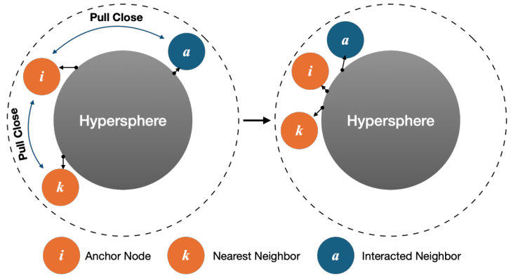
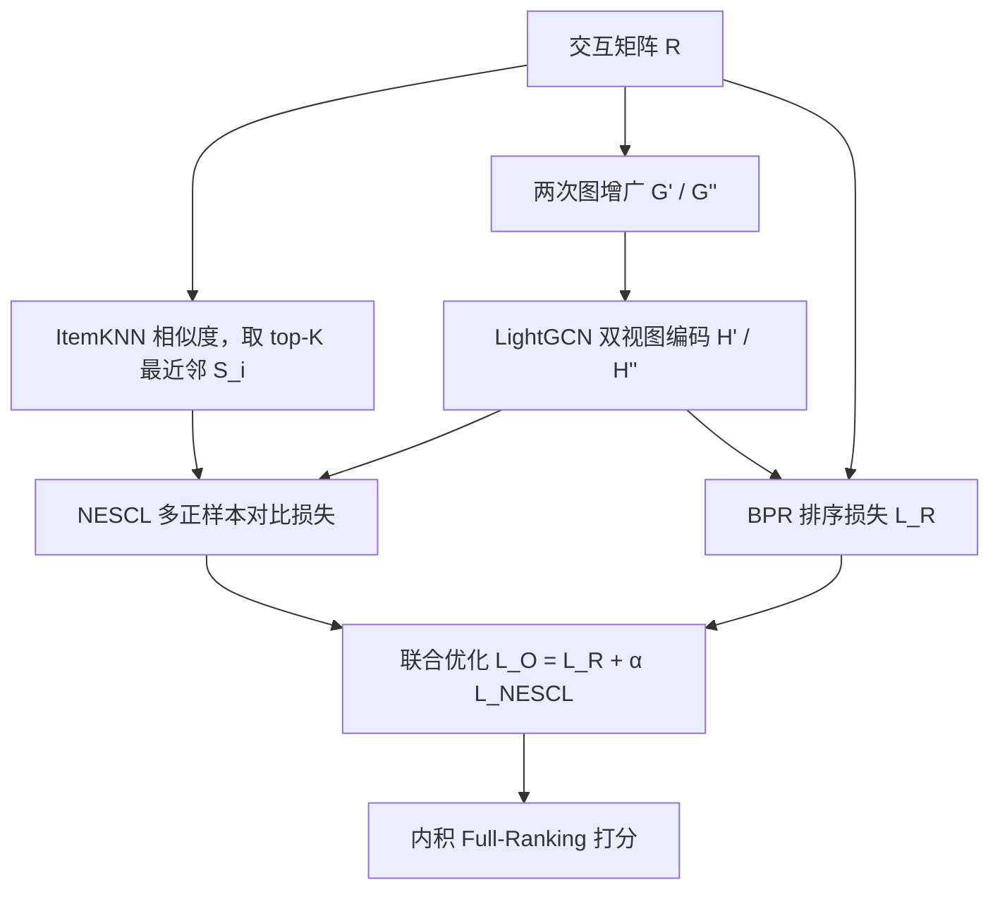
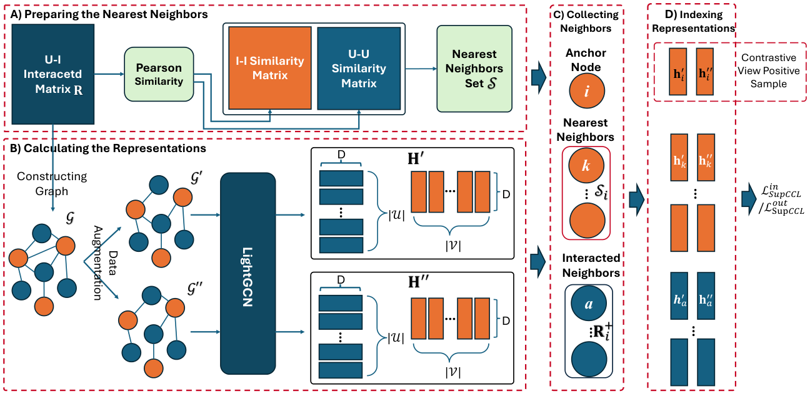

# Neighborhood-Enhanced Supervised Contrastive Learning for Collaborative Filtering (邻域增强的监督对比学习协同过滤)

- **会议/期刊**: IEEE TKDE (2024, journal-ref 2023)
- **作者与机构**: Peijie Sun（清华大学计算机系）；Le Wu、Kun Zhang、Xiangzhi Chen、Meng Wang（合肥工业大学计算机与信息学院）
- **推荐链路定位**: 召回（Candidate Matching）
- **研究方向**: 自监督对比学习与交互去噪 / 图神经网络推荐
- **论文原文**: [论文原文链接](https://arxiv.org/abs/2402.11523v1)
- **开源代码**: [开源代码仓库链接](https://gitee.com/peijie_hfut/nescl)

## TL;DR (1分钟核心速览)

SGL 式图对比学习把批内其他节点一律当负样本，会误把锚点的 ItemKNN 最近邻与交互邻居推远，形成假阴性。本文提出 NESCL：在 InfoNCE 的分子/分母中同时纳入双视图、交互邻居 $R_i^+$与最近邻$S_i$三类正样本，并给出 "in"/"out" 两种监督对比损失与梯度权重分析。在 Yelp2018、Gowalla、Amazon-Book 的 Leave-One-Out + Full-Ranking 协议下，NDCG@20 较 SGL 分别提升 10.09%、7.09%、35.36%，最优温度降至$\tau=0.1$。

## Background & Motivation (背景与核心矛盾)

- **主流范式**: LightGCN 通过用户-物品二部图传播高阶协同信号；SGL 在此基础上做 Node/Edge Dropout 增广，用 InfoNCE 拉近同一锚点的双视图、推远其他所有节点。
- **前人局限**: ① SGL 的负样本集合包含锚点的协同邻居，对比损失会把本应靠近的 ItemKNN 最近邻 $k$和交互邻居$a$推远（图 1），削弱排序损失拉近交互邻居的效果；② 温度$\tau$稍小即梯度爆炸或破坏排序损失，SGL 对$\tau$ 敏感。
- **核心洞察 (Key Insight)**: 锚点的正样本不应只有"另一视图"，交互邻居与最近邻同样是协同邻居；InfoNCE 的分子分母可以改写成多正样本联合形式，且伪邻居的噪声可由随机采样单邻居来正则。
- **本文切入点**: 保留 LightGCN + SGL 增广骨架，仅替换对比损失为邻域增强监督对比损失 NESCL。

<figure class="paper-figure" markdown="span">
  <figcaption>图 1：我们随机选择一个物品 i 作为锚节点。节点 k 是由 ItemKNN 算法找到的 i 的最近邻，节点 a 已与物品 i′ 发生交互。</figcaption>
</figure>

## Method (核心方法设计)

### 1. 整体框架 (Overall Architecture)

输入交互矩阵 $\mathbf{R}$后分两条支路：一支用 ItemKNN 的余弦相似度$\operatorname{sim}(i,j)=|R_i^+\cap R_j^+|/\sqrt{|R_i^+||R_j^+|}$为每个节点取 top-$K$最近邻集合$S_i$；另一支按 SGL 做两次图增广得到$\mathcal{G}'$、$\mathcal{G}''$，经共享 LightGCN 编码出双视图表示$\mathbf{H}'$、$\mathbf{H}''$。对每个锚点$i$索引$\mathbf{h}'_i,\mathbf{h}''_i$及邻居表示$\mathbf{h}'_k(k\in S_i)$、$\mathbf{h}'_a(a\in R_i^+)$，与 BPR 排序损失联合优化；推理阶段仍用内积做全库排序，不引入额外在线开销。

<figure class="paper-figure" markdown="span">
  <figcaption>图 2：利用我们提出的邻域增强监督对比损失（NESCL）的整体框架。框架包含四个部分：A）用于基于用户-物品交互矩阵 R 计算用户-用户相似度矩阵和物品-物品相似度矩阵。B）说明如何得到所有用户和物品的两个表示矩阵 H′ ∈R(|U|+|V|)×D 与增强表示 H′′ ∈R(|U|+|V|)×D。G′ 和 G′′ 分别表示两个增强图。C）对于任意锚节点（物品 i），需要基于物品-物品相似度矩阵收集其最近邻 Si</figcaption>
</figure>

### 2. 关键设计拆解 (Key Designs)

1. **NESCL-in / NESCL-out 双版本监督对比损失**：SGL 只把双视图当正样本，导致邻居被误推远。本文把"双视图 + 交互邻居 + 最近邻"三类正样本写入 InfoNCE，"in"版对每类正样本分别取 log 再相加：

$$
\mathcal{L}^{\text{in}}_{\text{NESCL}}=-\sum_{i\in\mathcal{N}}\log\frac{\exp(\mathbf{h}'_i{\mathbf{h}''_i}^{\top}/\tau)}{\sum_{j}\exp(\mathbf{h}'_i{\mathbf{h}''_j}^{\top}/\tau)}-\sum_i\log\frac{\sum_{k\in S_i}\operatorname{sim}(i,k)\exp(\mathbf{h}'_k{\mathbf{h}''_i}^{\top}/\tau)}{\sum_j\exp(\mathbf{h}'_k{\mathbf{h}''_j}^{\top}/\tau)}-\sum_i\log\frac{\sum_{a\in R_i^+}\exp(\mathbf{h}'_a{\mathbf{h}''_i}^{\top}/\tau)}{\sum_j\exp(\mathbf{h}'_a{\mathbf{h}''_j}^{\top}/\tau)}
$$

"out"版则把三类正样本放进同一分子、只取一次 log：
$$
\mathcal{L}^{\text{out}}_{\text{NESCL}}=-\sum_i\log\left(\frac{\exp(\mathbf{h}'_i{\mathbf{h}''_i}^{\top}/\tau)}{\sum_j\exp(\mathbf{h}'_i{\mathbf{h}''_j}^{\top}/\tau)}+\sum_{k\in S_i}\frac{\operatorname{sim}(i,k)\exp(\mathbf{h}'_k{\mathbf{h}''_i}^{\top}/\tau)}{\sum_j\exp(\mathbf{h}'_k{\mathbf{h}''_j}^{\top}/\tau)}+\sum_{a\in R_i^+}\frac{\exp(\mathbf{h}'_a{\mathbf{h}''_i}^{\top}/\tau)}{\sum_j\exp(\mathbf{h}'_a{\mathbf{h}''_j}^{\top}/\tau)}\right)
$$
直觉：in 版让每类正样本独立贡献梯度；out 版让正样本间相互竞争，梯度权重被其他正样本调节，更强调"最难"的邻居。

2. **梯度视角的影响权重分析**：对 $\mathbf{h}''_i$ 求导可得
$$
\frac{\partial\mathcal{L}^{\text{in}}_{\text{NESCL}}}{\partial\mathbf{h}''_i}=\lambda_i^{in}\mathbf{h}'_i+\lambda_k^{in}\mathbf{h}'_k+\lambda_a^{in}\mathbf{h}'_a
$$
其中邻居权重形如 $\lambda_k^{in}=\frac{1}{\tau}\left(\frac{\exp(\mathbf{h}'_k{\mathbf{h}''_i}^{\top}/\tau)}{\exp(\mathbf{h}'_k{\mathbf{h}''_i}^{\top}/\tau)+\sum_{j\ne i}\exp(\mathbf{h}'_k{\mathbf{h}''_j}^{\top}/\tau)}-1\right)$。权重由"与锚点的相似度"和"与全部负样本的指数和"共同决定；$\tau$越小，负样本项放大，正样本梯度更尖锐。out 版的$\lambda_i^{out}$比 in 版更小，且受$\mathbf{h}'_k$、$\mathbf{h}'_a$ 调节，因此两版在不同数据上互有胜负。

3. **训练目标、负采样与推理开销**：总损失 $\mathcal{L}_O=\mathcal{L}_R+\alpha\mathcal{L}_{\text{NESCL}}$，$\alpha$取 0.3/0.1/0.3；Amazon-Book 上去掉$\mathcal{L}_R$更优。负采样沿用 BPR 的 1:1 批内负样本，不额外采样；最近邻只从$S_i$中随机采一个，复杂度由$O(K|\mathcal{N}|BD)$降为$O(|\mathcal{N}|BD)$。整体训练开销为$O(|\mathcal{N}|D(2+2B))s+O(|\mathcal{E}|D(1+2B))s$，相似度矩阵$O(|\mathcal{U}|^2)+O(|\mathcal{V}|^2)$ 仅预计算一次，推理与 LightGCN 同构。

## Experimental Setup & Evaluation Protocol (实验设置与评估协议)

- **数据集与预处理**: 直接采用 LightGCN 官方版本，未额外过滤：

| 数据集 | #Users | #Items | #Interactions | 密度 | 场景 |
| :--- | :---: | :---: | :---: | :---: | :--- |
| Yelp2018 | 31,688 | 38,048 | 1,561,406 | 0.130% | 本地生活 |
| Gowalla | 29,858 | 40,981 | 1,027,370 | 0.084% | LBS 签到 |
| Amazon-Book | 55,188 | 9,912 | 1,445,622 | 0.062% | 图书电商 |

- **数据划分与防穿越 (Splitting Strategy)**: `Leave-One-Out`——每个用户最后一条交互为测试、倒数第二条为验证，其余训练；ItemKNN 相似度仅在训练集上计算，避免测试泄漏。
- **排名评测协议 (Ranking Protocol)**: 无偏 `Full-Ranking`（全库未交互物品排序，排除训练正样本），报告 Recall@20 与 NDCG@20。
- **对比基线与超参设置**: 基线含 BPR、LightGCN、UltraGCN、SimpleX、SGL(ED)、SupCon(in/out)；维度 $d=64$，GNN 层数 2/3/2，增广 Node/Node/Edge Dropout，$\rho=0.3$，$\tau=0.1$，$K=15/5/5$（Yelp/Gowalla/Amazon）。原文未报告显著性检验。

## Key Experimental Results (实验关键数据)

### 1. 主实验对比 (Main Results)

| 模型 | Yelp R@20 | Yelp N@20 | Gowalla R@20 | Gowalla N@20 | Amazon R@20 | Amazon N@20 |
|---|---:|---:|---:|---:|---:|---:|
| BPR | 0.0576 | 0.0468 | 0.1627 | 0.1378 | 0.0338 | 0.0261 |
| LightGCN | 0.0649 | 0.0530 | 0.1830 | 0.1550 | 0.0411 | 0.0315 |
| UltraGCN | 0.0683 | 0.0561 | 0.1862 | 0.1580 | **0.0681** | **0.0556** |
| SimpleX | 0.0701 | 0.0575 | 0.1872 | 0.1557 | 0.0583 | 0.0468 |
| SGL | 0.0675 | 0.0555 | 0.1787 | 0.1510 | 0.0478 | 0.0379 |
| SupCon(in) | 0.0727 | 0.0599 | 0.1900 | 0.1607 | 0.0616 | 0.0505 |
| SupCon(out) | 0.0739 | 0.0609 | 0.1897 | 0.1605 | 0.0339 | 0.0288 |
| NESCL(in) | 0.0732 | 0.0602 | 0.1913 | **0.1617** | 0.0624 | 0.0513 |
| NESCL(out) | **0.0743** | **0.0611** | **0.1917** | **0.1617** | 0.0483 | 0.0379 |
| **Improv. vs SGL** | **+10.07%** | **+10.09%** | **+7.27%** | **+7.09%** | **+30.54%** | **+35.36%** |

注：Amazon-Book 的 NESCL(in) 为去掉 $\mathcal{L}_R$ 的版本；该数据集最优仍是 UltraGCN。

### 2. 消融实验 (Ablation Study)

| 优化项（Yelp / Amazon） | Yelp R@20 | Yelp N@20 | Amazon R@20 | Amazon N@20 |
|---|---:|---:|---:|---:|
| 仅 $\mathcal{L}_R$ | 0.0649 | 0.0530 | 0.0411 | 0.0315 |
| 仅双视图对比 | 0.0434 | 0.0362 | 0.0063 | 0.0051 |
| 双视图 + $\mathcal{L}_R$（SGL） | 0.0675 | 0.0555 | 0.0478 | 0.0379 |
| 仅交互邻居正样本 | 0.0682 | 0.0566 | 0.0503 | 0.0395 |
| 仅最近邻正样本 | 0.0600 | 0.0502 | 0.0398 | 0.0332 |
| 交互 + 最近邻（去 $\mathcal{L}_R$） | 0.0705 | 0.0586 | **0.0624** | **0.0513** |
| NESCL 完整（含 $\mathcal{L}_R$） | **0.0743** | **0.0611** | 0.0580 | 0.0473 |

### 3. 关键实验发现 (Key Findings)

1. **纯双视图对比会灾难性掉点，协同正样本补位**：仅"双视图"时 Yelp NDCG@20 从 LightGCN 的 0.0530 跌至 0.0362，而把交互邻居+最近邻加入后即使去掉 $\mathcal{L}_R$ 仍达 0.0586，高于完整 SGL 的 0.0555，证明假阴性确实存在且可由多正样本修正。
2. **NESCL 允许更小温度**：三个数据集上 $\tau=0.1$最优；SGL 在$\tau$减小时先升后降，NESCL 在$\tau<0.1$才因梯度爆炸下降。说明多正样本抵消了假阴性，同时保留小$\tau$ 放大真负样本的收益。
3. **最近邻策略"少即是多"，Amazon 近邻信号尤强**：Yelp 上随机采 1 个最近邻（0.0743）优于引入全部近邻的加权（0.0725）或 identity 权重；Amazon-Book 上 ItemKNN 与 UltraGCN 这类近邻模型显著强于纯 BPR，反映电商曝光偏差，NESCL(in) 0.0624 仍低于 UltraGCN 的 0.0681，说明其近邻利用仍不充分。

## Highlights & Limitations (亮点、对比与审稿批判)

- **与代表作对比 (vs. Prior Work)**: SGL 只拉双视图、其余全负；NESCL 显式把交互邻居与 ItemKNN 最近邻当正样本。SupCon 直接把 CV 的两版损失搬到推荐，本文针对推荐三类正样本重设分子分母，实验中全面优于 SupCon(in/out)。NCL 用聚类找正样本，本文用 ItemKNN + 交互邻居，并补上梯度权重分析。
- **可迁移亮点**: ① "最近邻作为正样本"可插件式加到任意对比召回模型；② 从邻居池随机采一个而非全量加权，可正则伪邻居噪声，且降低复杂度；③ 多正样本使 $\tau$ 可调至 0.1，为温度调参提供新解释。
- **审稿级局限批判**: ① 相似度矩阵 $O(|\mathcal{U}|^2+|\mathcal{V}|^2)$在亿级用户/物品上不可行，论文未给出近似最近邻方案；② 评估仅三个 LightGCN 官方数据集，未做显著性检验，Amazon-Book 上未胜 UltraGCN 且$\mathcal{L}_R$ 去除缺乏理论解释；③ 最近邻质量依赖 ItemKNN，冷启动与长尾物品的邻居可能全是伪正样本，鲁棒性论证不足。

## Rating (四维评分)

- **方法创新性 (Novelty)**: ⭐⭐⭐⭐ （多正样本 InfoNCE 的 in/out 双版本与梯度权重分析有新意，但本质是 SupCon 的推荐适配）
- **评估协议与实验扎实度 (Protocol & Experiments)**: ⭐⭐⭐ （三数据集 Full-Ranking 与充分消融可信，缺显著性检验、Amazon 上未胜 UltraGCN、未与 NCL 直接对比）
- **写作与数学规范度 (Clarity & Rigor)**: ⭐⭐⭐⭐ （公式与附录梯度推导完整，符号统一；out 版权重公式较繁，可读性一般）
- **工业落地与复现价值 (Industrial & Practical Value)**: ⭐⭐⭐ （推理零额外开销、代码开源；训练期全量相似度矩阵与双图增广对大规模场景不友好）

