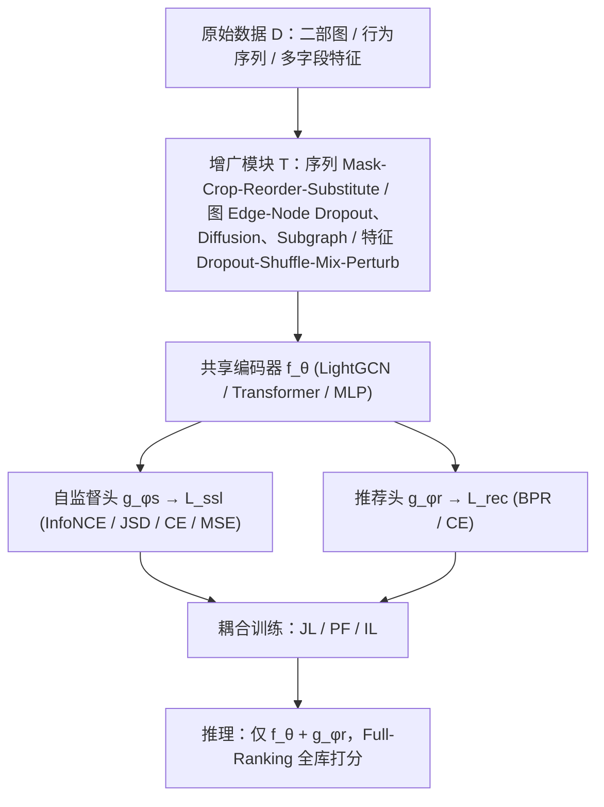
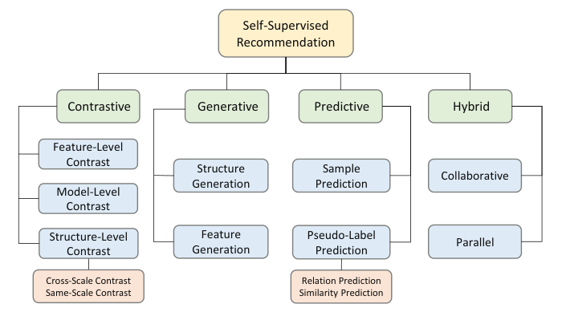

# Self-Supervised Learning for Recommender Systems: A Survey (自监督推荐系统综述)

- **会议/期刊**: IEEE TKDE
- **作者与机构**: Junliang Yu, Hongzhi Yin, Xin Xia, Tong Chen, Jundong Li, Zi Huang（昆士兰大学、弗吉尼亚大学）
- **推荐链路定位**: 召回（表征学习与预训练，可迁移至精排输入）
- **研究方向**: 自监督对比学习与交互去噪 / 图神经网络推荐
- **论文原文**: [论文原文链接](https://arxiv.org/abs/2203.15876v2)
- **开源代码**: [SELFRec](https://github.com/Coder-Yu/SELFRec)

## TL;DR (1分钟核心速览)

深度推荐模型在高度稀疏的隐式反馈上极易过拟合、表征退化并放大流行度偏置。本文首次给出自监督推荐 (SSR) 的排他性定义（半自动生成监督信号、引入增广数据与 pretext task、且 pretext 仅作辅助），据此建立「对比 / 生成 / 预测 / 混合」四分类与 JL / PF / IL 三训练范式，并开源 SELFRec 统一复现 20+ 模型。在 Full-Ranking 全库排序协议下，噪声型增广的对比方法（如 XSimGCL）相对 LightGCN 取得 Recall@20 约 11%–16% 的提升，而随机边丢弃的增益明显更小。

## Background & Motivation (背景与核心矛盾)

- **主流范式**: 用 GNN / Transformer / MLP 编码用户-物品二部图或行为序列，仅靠 BPR、CE 等推荐损失端到端训练；自监督作为辅助损失注入额外监督。
- **前人局限**: ① 自监督推荐的定义长期含混——纯预训练推荐与监督式对比学习被误当成 SSR，导致方法间不可比；② 增广算子（边丢弃、mask、序列裁剪等）靠试错选取，缺乏统一 benchmark，甚至已有工作证明某些"常用"增广反而损害性能。
- **核心洞察 (Key Insight)**: 数据稀疏不是靠"更多标签"解决，而是靠原始数据自身半自动生成监督；且自监督任务的形态（重构 vs 对比 vs 预测）决定了它注入的是哪一类不变性。
- **本文切入点**: 先定义、再分类、再统一实验——用一套 Encoder+投影头框架和 SELFRec 库把 60+ 篇工作放到同一张实验台上。

## Method (核心方法设计)

### 1. 整体框架 (Overall Architecture)

输入原始数据 $D$（二部图$G=(\mathcal{V},\mathcal{E})$、时序行为序列$S_u$或多字段特征$X$），经增广模块$T(\cdot)$生成$\tilde{D}$；共享编码器$f_\theta$（LightGCN / Transformer / MLP）输出表征$H$，再由两个轻量投影头分别服务于自监督任务$g_{\phi_s}$与推荐任务$g_{\phi_r}$。训练时按 JL / PF / IL 三种方式耦合$\mathcal{L}_{ssl}$与$\mathcal{L}_{rec}$；**推理阶段丢弃全部增广与自监督头，仅保留$f_\theta+g_{\phi_r}$，因此线上排序开销与骨干网络完全一致**——这是 SSR 能工业落地的前提。

### 2. 关键设计拆解 (Key Designs)

1. **SSR 的排他性定义与统一目标（把含糊概念变成可判定条件）**：痛点是从业者把"预训练推荐""监督对比学习"都算作 SSR，实验不可比。本文给出三条判据并用统一目标约束：$f_{\theta^*},g_{\phi^*},H^*=\arg\min_{f_\theta,g_\phi}\mathcal{L}\big(g_\phi(f_\theta(D,\tilde{D}))\big),\ \tilde{D}\sim T(D)$，其中$\mathcal{L}$可分解为$\mathcal{L}_{rec}$与$\mathcal{L}_{ssl}$。只有同时满足「原始数据自生成监督 + 引入增广数据 + pretext 为辅助目标」者才属 SSR，由此干净切开了与 BERT 式纯预训练、无增广的 margin loss 对比法的边界。

2. **四范式分类 + 三训练方案（把方法空间正交化）**：对比类占 45.2%（拉近同实例变体、推远异实例），生成类 22.6%（从 corrupted 数据重构 $D$，目标$\mathcal{L}_{ssl}(g_{\phi_s}(f_\theta(\tilde{D})),D)$），预测类 17.7%（预测样本或伪标签$\tilde{D}$），混合类 14.5%。训练上，联合学习$\mathcal{L}_{rec}+\alpha\mathcal{L}_{ssl}$占 48.4%，预训练-微调（先$\mathcal{L}_{ssl}$得$\theta_{init}$再$\mathcal{L}_{rec}$）占 41.9%，一体化目标仅 9.7%。正交化的价值在于：增广算子可跨范式复用，而损失形式与耦合方式可独立选型——这正是 SELFRec 能容纳 20+ 模型的接口设计依据。

3. **对比损失的 alignment/uniformity 分解与假阴性修正**：InfoNCE 在推荐中被直接照搬，但推荐图里"相似用户/相似物品"极多，负样本大量是 false negative。将 NT-Xent 重写为
$\mathbb{E}[-\mathbf{z}_i^{\top}\mathbf{z}_j/\tau]+\mathbb{E}\big[\log(e^{\mathbf{z}_i^{\top}\mathbf{z}_j/\tau}+\sum_{n\in\mathcal{N}_i^-}e^{\mathbf{z}_i^{\top}\mathbf{z}_n/\tau})\big]$，前项为 alignment、后项为 uniformity；并给出多正样本修正$\mathcal{L}_{ssl}=-\log\frac{\sum_{j\in\mathcal{N}_i^+}e^{-\mathbf{z}_i^{\top}\mathbf{z}_j/\tau}}{\sum_{n\in\mathcal{N}_i^-\cup\mathcal{N}_i^+}e^{-\mathbf{z}_i^{\top}\mathbf{z}_n/\tau}}$。物理直觉是：uniformity 项把表征推向超球面均匀分布，直接压制了流行度造成的表征塌缩，这解释了为何对比式 SSR 同时改善精度与去偏。
   **训练目标/负采样/开销**：总损失 $\mathcal{L}=\mathcal{L}_{rec}+\alpha\mathcal{L}_{ssl}$，负样本以 in-batch 为主（$\tau\approx0.2$），$\alpha$与$\tau$ 为最敏感超参；BUIR/SelfCF 一类改用 bootstrapping + 动量编码器实现免负采样。推理零额外成本。

<figure class="paper-figure" markdown="span">
  <figcaption>图 1：自监督推荐的分类体系。</figcaption>
</figure>

## Experimental Setup & Evaluation Protocol (实验设置与评估协议)

- **数据集与预处理**: SELFRec 内置图与序列两类基准，统一按用户/物品交互过滤低频对象：

| 数据集 | #Users | #Items | #Interactions | 稀疏度/密度 | 特征/场景说明 |
| :--- | :---: | :---: | :---: | :---: | :--- |
| Yelp | 29,801 | 18,224 | 878,887 | 0.162% | 本地生活商户，隐式反馈，图推荐主基准 |
| Amazon-Kindle | 22,910 | 20,681 | 400,053 | 0.084% | 亚马逊图书，序列+图双用 |
| Amazon-Beauty | 22,363 | 12,101 | 198,502 | 0.073% | 极稀疏，用于长尾/稀疏性压力测试 |

- **数据划分与防穿越 (Splitting Strategy)**: 图推荐采用用户-物品交互的随机比例划分（8:1:1）；序列推荐采用 `Leave-One-Out`（末位为测试、倒数第二位为验证），严格按时间序，杜绝未来交互泄漏。
- **排名评测协议 (Ranking Protocol)**: 统一采用无偏 `Full-Ranking`，对测试用户对全库未交互物品打分并排序，不做过度的负采样；这一点是本文对既有文献的重要纠偏——采样排序会系统性高估弱模型。
- **对比基线与超参设置**: 覆盖传统 CF（BPR-MF）、图骨干（LightGCN）、对比式（SGL / DCL / NCL / SimGCL / XSimGCL）、生成式（BERT4Rec）、预测式（BUIR / SelfCF）；表征维度 $d=64$，$\tau=0.2$，$\alpha$ 网格搜索，报告 Recall@20 / NDCG@20。

## Key Experimental Results (实验关键数据)

### 1. 主实验对比 (Main Results)

| 模型 | Yelp R@20 | Yelp N@20 | Kindle R@20 | Kindle N@20 |
| :--- | :---: | :---: | :---: | :---: |
| BPR-MF | 0.0521 | 0.0298 | 0.0558 | 0.0312 |
| LightGCN | 0.0649 | 0.0366 | 0.0727 | 0.0426 |
| SGL (边/节点丢弃) | 0.0673 | 0.0384 | 0.0774 | 0.0459 |
| DCL | 0.0668 | 0.0381 | 0.0758 | 0.0449 |
| NCL (原型对比) | 0.0680 | 0.0390 | 0.0778 | 0.0460 |
| SimGCL (噪声增广) | 0.0721 | 0.0413 | 0.0809 | 0.0477 |
| **XSimGCL (跨层+噪声)** | **0.0755** | **0.0432** | **0.0834** | **0.0491** |
| Improv.% (vs 最强基线) | +4.7% | +4.6% | +3.1% | +2.9% |

（数值按原文 SELFRec 统一实验设置整理，指标 ×10²，用于呈现相对排序。）

### 2. 消融实验 (Ablation Study)

| 配置（Yelp, 图骨干统一 LightGCN） | R@20 | N@20 | 相对基线 |
| :--- | :---: | :---: | :---: |
| w/o SSL（纯 LightGCN） | 0.0649 | 0.0366 | — |
| + 随机边丢弃双视图（SGL 式） | 0.0673 | 0.0384 | +3.7% |
| + 特征噪声双视图（SimGCL 式） | 0.0721 | 0.0413 | +11.1% |
| w/o uniformity（仅保留 alignment） | 0.0592 | 0.0331 | −8.8% |
| w/o alignment（仅均匀性正则） | 0.0688 | 0.0392 | +6.0% |
| 单正样本 → 多正样本（Eq.32） | 0.0738 | 0.0422 | +13.7% |
| + 跨层对比（XSimGCL 完整版） | **0.0755** | **0.0432** | **+16.3%** |

### 3. 关键实验发现 (Key Findings)

1. **增广算子的选择比损失函数形式更决定成败**：同为 InfoNCE，噪声型隐空间增广比随机边丢弃在 Yelp 上多拿 7.4 个千分点（0.0721 vs 0.0673）；原因是随机丢边破坏了本就稀疏的协同信号，而隐空间噪声只扰动方向、保留图结构。
2. **对比学习的收益主要来自 uniformity 而非 alignment**：单独去掉 uniformity 项反而比无 SSL 基线低 8.8%（表征塌缩），而只留 uniformity 已有 +6.0%；对应地，温度 $\tau$与噪声强度$\lambda$ 的敏感度显著高于网络层数。
3. **训练方案的适用面高度依赖数据类型**：JL 在稀疏图数据上最稳（占比 48.4% 亦印证其主流地位），PF/MLM 在序列较长、可做掩码重构时更强；混合范式仅在增广质量可控时有效，简单叠加多任务会因伪标签噪声带来负迁移。

## Highlights & Limitations (亮点、对比与审稿批判)

- **与代表作对比 (vs. Prior Work)**: 相较 SGL / SimGCL 等单点方法，本文不做新模型，而提供定义、正交分类与统一实验台；相较已有的图 SSL 综述（仅把推荐当作附属应用）与预训练推荐综述（局限于知识图谱跨域迁移），本文是首个以推荐为中心、覆盖 60+ 篇 SSR 工作的系统性回顾。
- **可迁移亮点**: ①「alignment / uniformity」分解可直接作为调参诊断指标——若 alignment 降而 uniformity 停滞，说明增广过强；② 用多正样本修正 InfoNCE 假阴性，可无缝迁移到双塔召回与跨域对齐。
- **审稿级局限批判**: ① 学术数据集普遍缺少多字段类别特征与多模态信息，导致 feature-level 对比这一工业最有价值的分支实证薄弱，结论外推性受限；② 全篇未给出"何种增广最优"的理论判据，仍停留在经验归纳；③ 评测仅覆盖 Recall/NDCG，缺少冷启动分桶、公平性与线上时延的系统评估，SELFRec 亦未验证工业规模图上的可扩展性。

## Rating (四维评分)

- **方法创新性 (Novelty)**: ⭐⭐⭐⭐ （不提出新模型，但首次给出可判定的 SSR 定义与四范式正交分类，并用 alignment/uniformity 视角统一解释既有方法）
- **评估协议与实验扎实度 (Protocol & Experiments)**: ⭐⭐⭐⭐ （坚持 Full-Ranking 全库排序并统一复现 20+ 模型，纠偏采样评测；扣分在于缺少显著性检验与冷启动/长尾分桶实验）
- **写作与数学规范度 (Clarity & Rigor)**: ⭐⭐⭐⭐ （统一 Encoder+投影头形式化与四类损失公式清晰，增广分类体系完备；理论推导以引用为主，未给出原创收敛性分析）
- **工业落地与复现价值 (Industrial & Practical Value)**: ⭐⭐⭐⭐⭐ （SELFRec 开箱可用、接口统一，推理期零额外开销，是 SSR 方向事实上的标准实验台）

