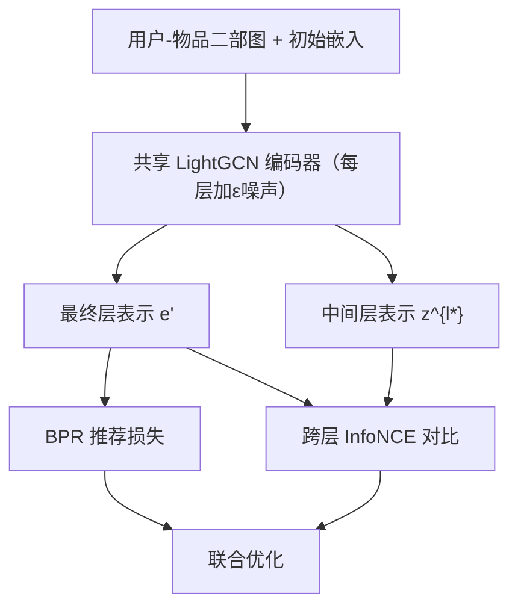
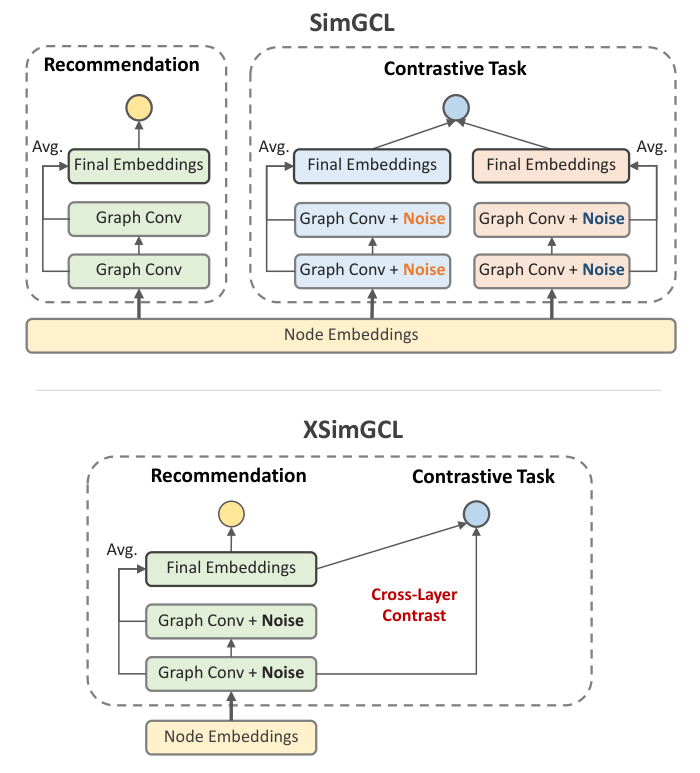

# XSimGCL: Towards Extremely Simple Graph Contrastive Learning for Recommendation (XSimGCL：面向推荐的极简图对比学习)

- **会议/期刊**: IEEE TKDE 2024（SIGIR'22 前作扩展）
- **作者与机构**: Junliang Yu, Xin Xia, Tong Chen, Lizhen Cui, Nguyen Quoc Viet Hung, Hongzhi Yin；University of Queensland / Griffith University / Shandong University
- **推荐链路定位**: 召回 / 全库排序
- **研究方向**: 自监督对比学习与交互去噪 / 图神经网络推荐
- **论文原文**: [论文原文链接](https://arxiv.org/abs/2209.02544v4)
- **开源代码**: [开源代码仓库链接](https://github.com/Coder-Yu/SELFRec)

## TL;DR (1分钟核心速览)

针对图对比推荐图增广昂贵、增益有限且三编码器开销大，本文发现 InfoNCE 的表示均匀性才是主因，提出 XSimGCL：用符号约束均匀噪声做嵌入增广，单编码器跨层对比替代图增广。四个稀疏数据集 7:1:2 全库排序下，Recall@20/NDCG@20 超越 SGL/SimGCL，Electronics 较 LightGCN 提升 33.4%/50.6%，训练近 LightGCN 轻量。

## Background & Motivation (背景与核心矛盾)

- **主流范式**: SGL 先对用户-物品二部图做边/节点 dropout 增广，再用 InfoNCE 拉近两视图，并以 BPR+$\lambda\mathcal{L}_{cl}$ 联合训练。
- **前人局限**: 图增广需反复重构邻接且三编码器约 3 倍开销；node dropout 可能删 hub 破坏子图，增广有效性依赖试错；高 dropout 仍有效，说明增益机制未明。
- **核心洞察 (Key Insight)**: 去掉图增广、仅保留 InfoNCE 的 SGL-WA 已接近 SGL-ED，说明对比损失主要将表示推匀，缓解流行度偏置与过平滑，图增广并非关键。
- **本文切入点**: 抛弃图增广，在嵌入空间注入可控噪声，并用跨层对比构造“互信息适中”的视图，同时保持单次前传。

## Method (核心方法设计)

### 1. 整体框架 (Overall Architecture)

XSimGCL 以 LightGCN 为唯一骨干：每层聚合后注入幅度 $\epsilon$的符号约束均匀噪声，得到扰动表示$e'$；推荐用$e'$计算 BPR，对比则取最终层$e'$与中间层$z^{l^*}$ 做 InfoNCE；测试阶段关闭噪声。因共享一次前传，图编码开销与 LightGCN 同阶，仅为 SimGCL 三编码器的约 1/3。

<figure class="paper-figure" markdown="span">
  <figcaption>图 2：SimGCL 与 XSimGCL 的架构。</figcaption>
</figure>
图 2：SimGCL 与 XSimGCL 架构对比（XSimGCL 单编码器、跨层对比）。

### 2. 关键设计拆解 (Key Designs)

1. **噪声嵌入增广（可控均匀性）**：图增广需采样边/重构邻接，且 node dropout 可能删 hub；改为对表示加小噪声：$e'_i=e_i+\Delta'_i,\ e''_i=e_i+\Delta''_i$，其中$\Delta=\omega\odot \mathrm{sign}(e_i),\ \|\Delta\|_2=\epsilon,\ \omega\sim U(0,1)$。符号约束使$e_i,\Delta',\Delta''$同象限，等价于小角度旋转，保留原信息又制造可控差异；$\epsilon$ 越大表示越均匀，过大（如 0.5）会过冲。

2. **跨层对比与单编码器**：SimGCL 对比两个最终表示，互信息过高且三次前传；XSimGCL 对比最终层与中间层 $l^*$，共享编码，扰动表示直接用于推荐。联合损失为  
$\mathcal{L}=-\sum_{(u,i)\in B}\log\sigma({e'_u}^{\top}e'_i-{e'_u}^{\top}e'_j)+\lambda\sum_{i\in B}-\log\frac{\exp({z'_i}^{\top}z^{l^*}_i/\tau)}{\sum_{j\in B}\exp({z'_i}^{\top}z^{l^*}_j/\tau)}$。  
谱分析：LightGCN 核 $U(I-\Lambda)U^{\top}$对高频分量交替变号，跨层高频差异大于低层/最终层，符合“增广高频差异应更大”的准则；加入自环或$E(0)$ 会低通衰减高频，性能下降。

3. **训练目标、负采样与推理效率**：总损失如上；BPR 每正样本随机采 1 负，InfoNCE 用 in-batch 负样本。无需图增广；图编码 $O(2|A|Ld)$，与 LightGCN 同阶；对比$O(BMd)$。测试关闭噪声，全库排序。

## Experimental Setup & Evaluation Protocol (实验设置与评估协议)

- **数据集与预处理**: 仅隐式反馈、无辅助特征，沿用公开数据（未额外声明 5-core）：

| 数据集 | #Users | #Items | #Interactions | 密度 | 特征/场景说明 |
| :--- | :---: | :---: | :---: | :---: | :--- |
| Yelp2018 | 31,668 | 38,048 | 1,561,406 | 0.13% | 本地商户隐式反馈 |
| Amazon-Kindle | 138,333 | 98,572 | 1,909,965 | 0.014% | 图书隐式反馈 |
| Alibaba-iFashion | 300,000 | 81,614 | 1,607,813 | 0.007% | 时尚电商隐式反馈 |
| Amazon-Electronics | 719,376 | 159,364 | 5,460,975 | 0.005% | 电子产品隐式反馈 |

- **数据划分与防穿越 (Splitting Strategy)**: 比例划分 $7:1:2$；调参后合并训练/验证集再测；非全局时间戳切分。
- **排名评测协议 (Ranking Protocol)**: 无偏 `Full-Ranking`（全库未交互物品排序），报告 Recall@20、NDCG@20，5 次运行均值。
- **对比基线与超参设置**: 基线含 LightGCN、SGL 变体、NCL、MixGCF、BUIR、DNN+SSL、SimGCL；$d=64$，Adam，学习率$10^{-3}$，L2$10^{-4}$，batch 2048，$\tau=0.2$（Yelp 上 XSimGCL 用 0.15）。原文未报告$p$ 值/显著性检验。

## Key Experimental Results (实验关键数据)

### 1. 主实验对比 (Main Results)

| 数据集/指标 | LightGCN | SGL-ED | NCL | MixGCF | SimGCL | XSimGCL | 较最强基线 |
| :--- | :---: | :---: | :---: | :---: | :---: | :---: | :---: |
| Yelp R@20 | 0.0639 | 0.0675 | 0.0682 | 0.0713 | 0.0726 | **0.0733** | +0.96% |
| Yelp N@20 | 0.0525 | 0.0555 | 0.0573 | 0.0589 | 0.0604 | **0.0606** | +0.33% |
| Kindle R@20 | 0.2057 | 0.2090 | 0.2100 | 0.2128 | 0.2118 | **0.2147** | +0.89% |
| Kindle N@20 | 0.1315 | 0.1352 | 0.1357 | 0.1327 | 0.1376 | **0.1415** | +2.83% |
| iFashion R@20 | 0.1053 | 0.1093 | 0.1132 | 0.1124 | 0.1180 | **0.1205** | +2.12% |
| iFashion N@20 | 0.0505 | 0.0531 | 0.0547 | 0.0549 | 0.0571 | **0.0582** | +1.93% |
| Electronics R@20 | 0.0560 | 0.0704 | OOM | 0.0705 | 0.0723 | **0.0750** | +3.73% |
| Electronics N@20 | 0.0354 | 0.0486 | OOM | 0.0476 | 0.0512 | **0.0531** | +3.71% |

注：SGL-ED 取 3 层结果，其余取原文主表/最佳设置；“较最强基线”为 XSimGCL 相对表内最强非 XSimGCL 值的相对提升。

### 2. 消融实验 (Ablation Study)

| 变体 | Yelp R/N | Kindle R/N | iFashion R/N |
| :--- | :---: | :---: | :---: |
| w/o both | 0.0655/0.0540 | 0.1990/0.1281 | 0.0967/0.0450 |
| w/o CL | 0.0657/0.0542 | 0.1991/0.1282 | 0.0973/0.0456 |
| w/o noise | 0.0684/0.0573 | 0.2048/0.1340 | 0.1061/0.0515 |
| XSimGCL$_{p}$（正均匀噪声） | 0.0714/0.0596 | 0.2121/0.1398 | 0.1183/0.0577 |
| XSimGCL$_{g}$（高斯噪声） | 0.0722/0.0602 | 0.2140/0.1410 | 0.1190/0.0583 |
| XSimGCL$_{a}$（对抗噪声） | 0.0558/0.0464 | 0.1267/0.0833 | 0.0158/0.0065 |
| **XSimGCL（符号均匀）** | **0.0723/0.0604** | **0.2147/0.1415** | **0.1196/0.0586** |

### 3. 关键实验发现 (Key Findings)

1. **图增广并非关键，InfoNCE 才是主因**：Yelp 上无图增广的 SGL-WA 达 0.0671，已接近 SGL-ED 的 0.0675，并高于 SGL-ND 的 0.0644；Kindle 同样为 0.2084 vs 0.2090/0.2069。
2. **噪声与跨层对比缺一不可**：Yelp 上 XSimGCL 较 w/o CL 的 Recall 0.0723 vs 0.0657（+10.0%），较 w/o noise 的 0.0684 提升 5.7%；iFashion 上 0.1196 vs 0.1061（+12.7%）。对抗噪声在 iFashion 崩至 0.0158，说明符号约束与噪声分布很关键。
3. **长尾与效率双收益**：Electronics 上 XSimGCL 较 LightGCN 的 Recall/NDCG 提升 33.4%/50.6%；SGL-ED 单批耗时约 4×LightGCN，SimGCL 约 2×，XSimGCL 接近 LightGCN 且收敛 epoch 最少。$\epsilon\in[0.05,0.2]$ 最佳，0.1 通常安全。

## Highlights & Limitations (亮点、对比与审稿批判)

- **与代表作对比 (vs. Prior Work)**: SGL 依赖图增广且需三编码器；SimGCL 已去图增广但仍三次前传、最终-最终对比；NCL/MixGCF 需原型或硬负样本挖掘。XSimGCL 用单编码器+跨层对比，更简单且更轻。
- **可迁移亮点**: 符号约束噪声增广可正则化任意 GNN 表示空间；跨层对比可替代双视图对比，降低 CL 推荐训练成本；均匀性可作为超参 $\epsilon$ 的显式调节目标。
- **审稿级局限批判**: (1) $\lambda,\epsilon,l^*$数据集相关，$l^*$ 仍需搜索（虽 3 层常够用），且未给显著性检验；(2) 噪声类型与符号约束敏感，对抗噪声失效；在 MF/DNN 上增益不稳定，方法更适合带邻域聚合的 GNN 骨干。

## Rating (四维评分)

- **方法创新性 (Novelty)**: ⭐⭐⭐⭐ （从“图增广必要性”反转到均匀性机制，跨层对比有谱分析支撑，简洁但洞察强）
- **评估协议与实验扎实度 (Protocol & Experiments)**: ⭐⭐⭐⭐ （四个大规模稀疏集、全库排序、5 次均值、消融充分；缺显著性检验）
- **写作与数学规范度 (Clarity & Rigor)**: ⭐⭐⭐⭐ （损失、复杂度与谱解释清晰；高频选择准则依赖前人结论，推导可更细）
- **工业落地与复现价值 (Industrial & Practical Value)**: ⭐⭐⭐⭐⭐ （单次前传近 LightGCN，代码在 SELFRec 开源，极易替换 SGL/SimGCL）

