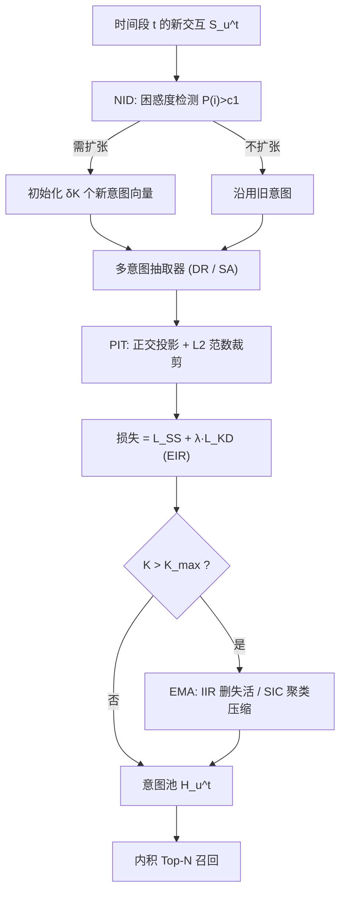
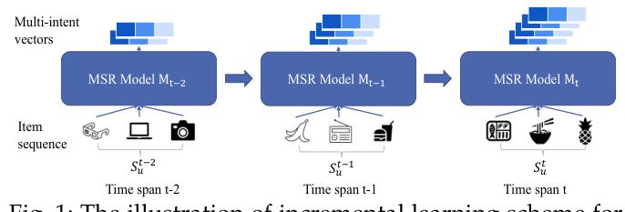

# A Framework for Elastic Adaptation of User Multiple Intents in Sequential Recommendation (面向序列推荐中用户多意图弹性自适应的框架)

- **会议/期刊**: IEEE TKDE (arXiv 2504.21270, 2025-04)
- **作者与机构**: Zhikai Wang, Yanyan Shen (上海交通大学 计算机科学与工程系)
- **推荐链路定位**: 召回 (多意图向量召回) / 端到端增量训练
- **研究方向**: 序列与会话推荐 / 增量(持续)学习
- **论文原文**: [https://arxiv.org/abs/2504.21270v1](https://arxiv.org/abs/2504.21270v1)
- **开源代码**: [https://github.com/Cloudcatcher888/EMA](https://github.com/Cloudcatcher888/EMA)

## TL;DR (1分钟核心速览)

工业界用户序列不断变长，"多意图序列推荐 (MSR)" 模型若固定意图数 $K$ 且只做微调，会同时遭遇**旧意图灾难性遗忘**与**新意图无处安放**两大痛点。本文提出 IMA：用 logits 级知识蒸馏保留旧意图、用 KL 困惑度检测是否需要扩意图、用正交投影裁剪冗余新意图；再升级为 EMA，在内存上限下删除失活意图 (IIR) 或聚类压缩相似意图 (SIC)。在 Amazon 三域 + Taobao 四个数据集、3 种基座上，NDCG 相对最优增量基线提升 3.77%/3.89%/4.21%/4.76%，训练比全量重训快约 6 倍。

## Background & Motivation (背景与核心矛盾)

- **主流范式**: MIND / ComiRec-DR 用动态路由、ComiRec-SA 用多头自注意力从序列中抽出 $K$个意图向量$H_u=(\boldsymbol{h}_{u,1},\dots,\boldsymbol{h}_{u,K})\in\mathbb{R}^{d\times K}$，聚合后与物品内积打分。
- **前人局限一**: 全量重训 (FR) 需保留全部历史序列，时间/内存不可承受；朴素微调 (FT) 只用新交互，旧意图被判分逻辑覆盖，性能随时间跨度单调下滑。
- **前人局限二**: 固定 $K$ 使新旧意图互相挤占容量；而通用增量学习方案中，回放类 (ADER) 需存历史样本、正则类 (SML) 只约束参数不约束用户意图、模型扩张类需**预先知道**每段要扩多少容量——恰恰是本文最不确定的量。
- **核心洞察 (Key Insight)**: 意图演化有两条统计规律——旧意图会**平滑漂移**（翻盖机→智能机，语义连续但坐标可变），新意图数量**因人因段而异**（有孩子后突然出现母婴意图）。因此"该保的用 logits 保、该扩的用数据信号触发、扩多的用几何裁剪"。
- **本文切入点**: 放弃对意图向量坐标的硬约束，改为对**输出分布**做蒸馏，并用无监督的"困惑度"信号驱动容量扩张。

## Method (核心方法设计)

### 1. 整体框架 (Overall Architecture)

时间轴被切成预训练段 + $T$个增量段。第$t$段仅拿到新交互$S_u^t$，先由 NID 判断该用户是否需要新增$\delta K$个随机初始化意图，再由基座多意图抽取器输出$K_u^t+\delta K$个向量，PIT 做正交化并剔除平凡向量，训练目标为 sample-softmax 损失与蒸馏损失之和；EMA 额外在$K>K_{\max}$ 时执行 IIR 或 SIC 收缩意图池。推理时用最终意图向量与物品内积取 Top-N。

<figure class="paper-figure" markdown="span">
  <figcaption>图1：用于……的增量学习方案示意图</figcaption>
</figure>

### 2. 关键设计拆解 (Key Designs)

1. **现有意图保持器 EIR（用 logits 蒸馏替代欧氏正则）**：欧氏距离正则的致命缺陷是"不同意图向量在高维空间可能本就靠得很近"，一点位移就换语义。作者把旧意图视为教师、新意图视为学生，只约束打分行为：
$\mathcal{L}^t_{KD}=\sum_{S_u^t\in D^t}\sum_{k=1}^{K_u^{t-1}}\mathcal{L}_{CE}\!\left(\sigma\!\left(\frac{f(\boldsymbol{h}_k^t,\boldsymbol{e}_a^t)}{\tau}\right),\ \sigma\!\left(\frac{f(\boldsymbol{h}_k^{t-1},\boldsymbol{e}_a^t)}{\tau}\right)\right)$其中$f$取内积、$\sigma$为 sigmoid、$\tau$ 为温度。直觉：向量可以自由漂移，只要"它对哪些物品打高分"不变，语义就被保住了。

2. **新意图检测器 NID（KL 到均匀分布 = 困惑度）**：把物品到意图的内积做 softmax 视为分类后验 $p(h_k|e_i)$；若某物品对所有意图都近似均匀，说明现有意图"装不下它"。用 KL 散度导出可闭式计算的困惑度：
$P(i)=\frac{1}{K^t}\sum_{k'=1}^{K^t}e_i\boldsymbol{h}_{k'}^{\top}-\ln\sum_{k'=1}^{K^t}e^{\,e_i\boldsymbol{h}_{k'}^{\top}}+\ln K^t$当用户新序列的平均困惑度超过阈值$c_1$时新建$\delta K$ 个意图——**无需标签即可触发容量扩张**。

3. **投影式意图裁剪器 PIT（只留"真正新增"的方向）**：直接扩 $\delta K$ 会带来两类冗余：与旧意图高度相关（学了个重复意图）或范数极小（什么也没学到）。先把新向量投影到旧意图张成空间之外：
$\boldsymbol{h}_{u,k}^{t,proj}=M_{exist}M_{exist}^{\top}\!\left(M_{exist}M_{exist}^{\top}\right)^{-1}\boldsymbol{h}_k^t$仅保留正交分量，再丢弃$\|\boldsymbol{h}_{k}^{t,proj}\|_{L2}<c_2$ 的向量。几何直觉：与旧意图平面重合的部分本质是旧意图的线性组合，不该占新容量。

4. **EMA 弹性压缩**：活跃度分数 $AS(k)=\frac{1}{T-t_k}\sum_{t=t_k}^{T}\frac{1}{|S^t|}\sum_{i\in S^t}p_{ik}^t$可增量递推（只需存累加量$tmp$）；超限时删除$AS$最低的意图 (IIR)，或用 DBSCAN 将空间邻近意图合并（$\epsilon$自动二分至恰好产生$K_{\max}$ 个簇）。

5. **训练目标与开销**：总损失 $\mathcal{L}=\mathcal{L}_{SS}+\lambda\mathcal{L}_{KD}$（sample softmax + 蒸馏，无额外负采样设计）。EIR/NID/PIT 复杂度均为$O(|U|K)$ 级，远低于基座；Taobao 上训练比 FR 快约 6 倍，仅比 FT 多 3.5% 时间，推理 0.15s→0.17s（每实例 +100ms 量级）。

## Experimental Setup & Evaluation Protocol (实验设置与评估协议)

- **数据集与预处理**（Amazon 与 Taobao，丢弃交互数 < 30 的用户）：

| 数据集 | #Users | #Items | #Interactions | 密度 | 特征/场景说明 |
| :--- | :---: | :---: | :---: | :---: | :--- |
| Electronics | 87,912 | 234,621 | 1,689,188 | 0.0082% | Amazon 电子产品评论 |
| Clothing | 285,464 | 376,859 | 5,748,920 | 0.0053% | Amazon 服饰 |
| Books | 459,133 | 313,966 | 8,898,041 | 0.0062% | Amazon 图书，意图最稳定 |
| Taobao | 976,779 | 1,708,530 | 85,384,110 | 0.0051% | 淘宝点击，意图漂移最快 |
| Xlong / Tmall-long | — | — | 平均序列 732 / 1077 | — | 仅 EMA 用，超长序列，切 20 段 |

- **数据划分与防穿越 (Splitting Strategy)**: 全局时间戳切分为 $T+1=7$段（$\alpha=0.5$，前段预训练，后 6 段增量，$T=6$）；每段内按时间序取最后 1 条为测试、倒数第 2 条为验证、其余训练，属"按时间跨度的 Leave-Last-Out"，严格防穿越。
- **排名评测协议 (Ranking Protocol)**: 指标 HR@20 / NDCG@20，论文未显式声明采样负例比例，沿用 MSR 文献惯例的 Top-20 排序评测；报告 10 次重复实验均值，并对 IMA vs SML/ADER 做双尾配对 t 检验（$p<0.05$）。
- **对比基线与超参**: 3 个基座 (MIND, ComiRec-DR, ComiRec-SA，$K_0=4$、$d=64$) × 4 种训练策略 (FR / FT / SML / ADER)；$\lambda\in\{10^{-2},\dots,10^{-6},0\}$，学习率$\{0.1,0.01,0.005,0.001\}$，batch=128，Adam + 早停。

## Key Experimental Results (实验关键数据)

### 1. 主实验对比 (Main Results)

ComiRec-DR 基座（%），加粗为增量方法中最优：

| 方法 | Electronics HR | NDCG | Clothing HR | NDCG | Books HR | NDCG | Taobao HR | NDCG |
| :--- | :---: | :---: | :---: | :---: | :---: | :---: | :---: | :---: |
| FR (全量重训, 上限参考) | 17.00 | 16.79 | 16.91 | 16.75 | 14.79 | 12.79 | 44.29 | 25.87 |
| FT (朴素微调) | 15.41 | 15.35 | 15.36 | 15.28 | 13.30 | 11.30 | 42.62 | 24.68 |
| SML | 16.16 | 15.85 | 16.08 | 15.77 | 13.92 | 11.85 | 43.28 | 24.89 |
| ADER | 16.12 | 15.90 | 16.02 | 15.84 | 13.73 | 11.96 | 43.44 | 25.00 |
| **IMA** | **16.80** | **16.48** | **16.74** | **16.47** | **14.46** | **12.48** | **44.48** | **26.00** |
| Improv. (vs ADER) | +4.2% | +3.6% | +4.5% | +4.0% | +5.3% | +4.3% | +2.4% | +4.0% |

跨基座一致性：MIND 上 IMA 的 HR 为 15.81 / 15.81 / 13.99 / 43.94，ComiRec-SA 上为 16.97 / 16.94 / 14.38 / 44.58（四数据集），三基座 NDCG 平均相对提升 3.77%/3.89%/4.21%/4.76%。与终身序列模型对比（表 4，HR）：Electronics IMA 16.81 vs LimaRec 15.31 / MIMN 14.11；Books 14.48 vs 13.07 / 11.87。

### 2. 消融实验 (Ablation Study)

图 5 以逐时间跨度曲线呈现（Books / Taobao × DR / SA），此处归纳相对排序与关键数值：

| 变体 | Books (意图较稳定) | Taobao (意图漂移快) | 结论 |
| :--- | :--- | :--- | :--- |
| FT | 最低 | 最低 | 基线 |
| IMA w/o NID&PIT | 略高于 FT | 掉点最大 | 扩张机制对高速漂移域最关键 |
| IMA w/o EIR | **低于 FT** | 显著下降 | 保旧是新意图检测的地基 |
| IMA (DIR, 欧氏正则替代蒸馏) | 中等 | 中等 | 坐标约束不如 logits 约束灵活 |
| IMA (KD1/KD2/KD3) | 与 IMA 接近 | 与 IMA 接近 | 对蒸馏损失具体形式不敏感 |
| **IMA (完整)** | **最优** | **最优** | 三模块缺一不可 |
| 平均意图数变化 | 4.0 → 5.6 | 4.0 → 9.2 | 意图增长量反映域内漂移强度 |

EMA 对比（Xlong / Tmall-long，20 段）：$K_{\max}=20$时 IIR 与 SIC 均优于不加约束的 IMA，意图数降至约 50%、节省 27.3% 内存；$K_{\max}=10$过紧时，Tmall-long 后 10 段 HR 分别下降 4.7% (IIR) / 3.8% (SIC)。超参$c_1\in[0.02,0.12]$、$c_2\in[0.1,0.6]$均呈倒 U 型，且$K{=}19,\delta K{=}0$等"预分配全部意图"的设定显著劣于"$K{=}4/6,\delta K{=}1/3$ 动态扩张"，直接证明增量扩张优于一次性给足容量。

### 3. 关键实验发现 (Key Findings)

1. **性能已逼近理论上限且效率更高**：ComiRec-DR 上 IMA 在 Books 的 HR 14.46 已达 FR 全量重训 14.79 的 97.8%，但训练耗时从 5,472–6,023s 降至约 950s（≈6×），仅比 FT 多 3.5% 时间——说明"蒸馏保旧 + 少量扩张"可替代历史样本回放。
2. **域漂移强度决定模块权重**：Taobao 平均意图数从 4.0 涨到 9.2，移除 NID&PIT 掉点最大；Books 仅涨到 5.6，移除 EIR 后甚至跌破 FT。即意图稳定的域应把预算押在"保旧"，意图活跃的域押在"扩张"。
3. **无限制扩张会反噬，弹性约束是必要收尾**：EMA 在 $K_{\max}=20$ 下同时提升 HR 并砍半意图数、省 27.3% 内存；但上限压到 10 时因容量不足，Tmall-long 后段 HR 反降 3.8–4.7%，说明上限需与域的真实意图基数匹配而非越小越好。

## Highlights & Limitations (亮点、对比与审稿批判)

- **与代表作对比**: 相比 MIND/ComiRec 的**固定 $K$**，本文让$K$ 随数据自适应增长并可回收；相比 SML/ADER **不改变模型容量**、需预先设定扩张规模，本文用困惑度无监督触发扩张并用正交投影自动定"扩几个"；相比 MIMN/LimaRec **只在线更新用户表征**，本文同时更新模型参数与意图池。
- **可迁移亮点**: (1) "logits 级蒸馏保旧 + 正交投影剪枝"这套组合可平移到增量 CTR、增量双塔召回的 embedding 维护；(2) 用 KL 到均匀分布作为"模型容量不足"的无监督触发器，可复用于专家网络/码本扩张判定。
- **审稿级局限批判**: (1) 每个用户独立维护意图向量，存储 $O(|U|K)$随用户量线性增长，且短序列/冷启动用户几乎无法从扩意图获益，跨用户意图共享被留作 future work；(2) 评测仅 HR/NDCG@20，未说明是否全库排序还是采样排序，也未报告方差或置信区间，只给出$p<0.05$结论；(3)$c_1,c_2,\delta K,K_{\max}$四个超参需按数据集调，且 EMA 的 DBSCAN 对$\epsilon$ 与距离度量较敏感，工程调参成本不低。

## Rating (四维评分)

- **方法创新性 (Novelty)**: ⭐⭐⭐⭐ （首次形式化"增量多意图序列推荐"，用困惑度触发容量扩张 + 正交投影裁剪，机制组合新颖且几何直觉清晰，但单点技术均可在增量学习/持续学习中找到原型）
- **评估协议与实验扎实度 (Protocol & Experiments)**: ⭐⭐⭐⭐ （4 主数据集 + 2 超长序列数据集、3 基座 × 4 策略、10 次重复 + 配对 t 检验，且含训练/推理耗时对比；扣分在于排序协议未明确负采样设置、消融仅以曲线呈现未给数值表）
- **写作与数学规范度 (Clarity & Rigor)**: ⭐⭐⭐⭐ （EIR/NID/PIT/IIR 每个模块都给出闭式公式与复杂度 $O(|U|K)$ 分析，符号统一；困惑度公式由 KL 推导而来但中间步骤略跳，投影矩阵求逆的数值稳定性未讨论）
- **工业落地与复现价值 (Industrial & Practical Value)**: ⭐⭐⭐⭐ （代码开源，训练比全量重训快 6×、存储可按 $K_{\max}$ 硬约束，天然适配线上增量调度；但每用户独立意图池的内存随用户数线性增长，超大规模场景仍需改造）

