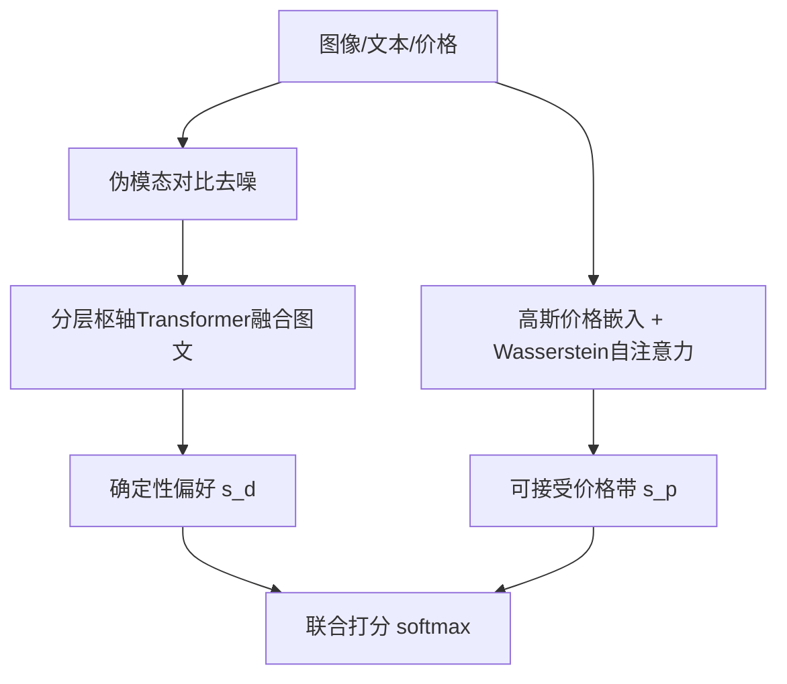
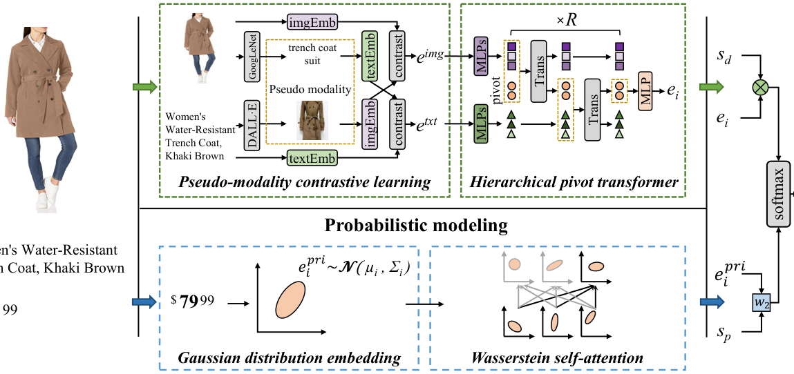

# Beyond Co-occurrence: Multi-modal Session-based Recommendation (超越共现：多模态会话推荐)

- **会议/期刊**: IEEE TKDE
- **作者与机构**: Xiaokun Zhang, Bo Xu, Fenglong Ma, Chenliang Li, Liang Yang, Hongfei Lin；大连理工大学、宾州州立大学、武汉大学
- **推荐链路定位**: 召回（下一物品预测）
- **研究方向**: 序列与会话推荐 / 多模态推荐
- **论文原文**: [论文原文链接](https://arxiv.org/abs/2309.17037v1)
- **开源代码**: [开源代码仓库链接](https://github.com/Zhang-xiaokun/MMSBR)

## TL;DR (1分钟核心速览)

针对匿名短会话中共现信号稀缺、图文噪声异质、价格影响呈区间概率性三大痛点，MMSBR以伪模态对比学习去噪、分层枢轴Transformer融合图文、高斯分布+Wasserstein自注意力建模可接受价格带；在Amazon三域全库排序下，Prec@20较最强基线提升1.45%–3.14%，MRR@20提升1.35%–5.33%。

## Background & Motivation (背景与核心矛盾)

- **主流范式**: SBR主流用RNN/CNN/Transformer/GNN挖掘会话内物品ID共现；侧信息方法仅拼接类别、文本或价格中的一种。
- **前人局限**: 会话平均长度≤3，共现模式本就不足；图文噪声不同，直接跨模态对比会因语义鸿沟损伤表征；价格并非点式偏好，而是“可接受区间”概率作用。
- **核心洞察 (Key Insight)**: 用户决策同时评估页面上的图像、描述文本和价格，因此应整体建模多模态信息，而非只挖ID共现。
- **本文切入点**: 将多模态分为描述性信息与数值信息，分别做确定性建模与概率性建模。

## Method (核心方法设计)

### 1. 整体框架 (Overall Architecture)

MMSBR先以GoogLeNet/BERT编码图像与文本，并通过DALL·E由文本生成伪图像、以GoogLeNet top-2类别拼接伪文本，构造同空间正对做对比去噪；随后用分层枢轴Transformer逐层融合图文，得到描述性物品表征。价格先离散为价位，再映射为高斯分布，以Wasserstein自注意力聚合会话价格序列，得到用户可接受价格范围。最终用描述性确定偏好与价格概率匹配联合打分，交叉熵+对比损失端到端训练。

<figure class="paper-figure" markdown="span">
  <figcaption>图 2：提出的MMSBR分别定制确定性和概率性建模以处理描述性和数值信息。在确定性建模中，设计伪模态对比学习以增强描述信息表示，提出分层枢轴Transformer以融合异构描述信息，并使用普通注意力捕捉用户确定性偏好。概率性建模用高斯分布嵌入表示项目价格，并设计Wasserstein自注意力建模用户可接受价格范围。</figcaption>
</figure>

### 2. 关键设计拆解 (Key Designs)

1. **伪模态对比学习（去异质噪声）**：图文直接对比存在语义鸿沟；本文用DALL·E生成伪图像、用图像分类标签生成伪文本，使正对处于同一语义空间，再拉近实际-伪模态、推远批内其他物品：$\mathcal{L}_{con}=-\frac{\exp(sim(e^{img}_i,e^{pseimg}_i))}{\sum_k\exp(sim(e^{img}_i,e^{pseimg}_k))}-\frac{\exp(sim(e^{txt}_i,e^{psetxt}_i))}{\sum_k\exp(sim(e^{txt}_i,e^{psetxt}_k))}$。伪模态保留核心语义、过滤冗余内容，故能提升图文表征鲁棒性。
2. **分层枢轴Transformer（融合互补图文）**：简单拼接难抽取图文共享与互补信息；每层引入可学习枢轴$P^l$，先让图像与枢轴交互，再以$p^l_*=(P^l_{img}+P^l)/2$把图像信息传给文本分支，并更新$p^{l+1}=(P^l_{txt}+P^l_*)/2$。枢轴作为信息瓶颈逐层筛选、交换模态信息，最终拼接$P^R$经MLP得描述表征$e_i$。
3. **高斯价格嵌入与Wasserstein自注意力（概率价格建模）**：价格点嵌入无法表达区间偏好；本文将价位映射为$e^{pri}_i\sim\mathcal{N}(\hat{\mu}_i+e^c_i,\hat{\Sigma}_i+e^c_i)$，并以$W_2(G_1,G_2)=\sqrt{\|\mu_1-\mu_2\|_2^2+\|(\Sigma_1)^{1/2}-(\Sigma_2)^{1/2}\|_2^2}$计算价格分布相关性，聚合得$s_p$。预测为$\hat{y}_i=softmax(e_i s_d+W_2(e^{pri}_i,s_p))$，总损失$\mathcal{L}=\mathcal{L}_{rec}+\lambda\mathcal{L}_{con}$，$\lambda=0.01$。训练用全物品softmax交叉熵，无额外负采样；对比学习以批内其他物品伪模态为负例。

## Experimental Setup & Evaluation Protocol (实验设置与评估协议)

- **数据集与预处理**: Amazon三域；过滤会话长度1、物品出现<5、缺失/无效图文；主实验删去冷启动物品，冷启动实验再保留新物品。

| 数据集 | #Items | #Categories | #Interactions | #Sessions | avg.length | 特征/场景 |
| :--- | :---: | :---: | :---: | :---: | :---: | :--- |
| Cellphones | 8,614 | 48 | 196,376 | 78,026 | 2.52 | 电子，价格敏感 |
| Grocery | 11,638 | 665 | 364,728 | 127,548 | 2.86 | 快消，实用导向 |
| Sports | 18,796 | 1,259 | 566,504 | 211,959 | 2.67 | 户外，品类多 |

- **数据划分与防穿越**: 按时间顺序以7:2:1划分训练/验证/测试；会话末项为预测目标，其余项建模意图。
- **排名评测协议**: `Full-Ranking`全库未交互物品排序（softmax over all items），非采样排序；指标Prec@10/20、MRR@10/20。
- **对比基线与超参**: 共现类S-POP/SKNN/NARM/SASRec/BERT4Rec/SR-GNN/COTREC/MSGIFSR，侧信息类MGS/UniSRec/CoHHN；嵌入维度64，图像/文本经PCA降至64；R为3/4、C=4、T=4、价位100；t检验$p<0.01$。

## Key Experimental Results (实验关键数据)

### 1. 主实验对比 (Main Results)

| 方法 | Cellphones Prec@20/MRR@20 | Grocery Prec@20/MRR@20 | Sports Prec@20/MRR@20 |
| :--- | :---: | :---: | :---: |
| S-POP | 7.24/2.85 | 23.64/17.25 | 17.59/14.69 |
| NARM | 24.12/15.56 | 42.41/34.62 | 34.17/27.12 |
| SASRec | 27.58/15.76 | 43.02/34.92 | 34.11/26.87 |
| SR-GNN | 25.08/15.77 | 42.74/35.01 | 34.29/27.51 |
| COTREC | 28.33/11.13 | 43.24/30.75 | 35.13/23.46 |
| MSGIFSR | 24.51/14.77 | 43.40/35.47 | 34.95/27.72 |
| UniSRec | 26.65/15.63 | 43.44/35.24 | 34.41/27.04 |
| CoHHN | 27.71/15.96 | 43.59/35.58 | 35.02/27.31 |
| **MMSBR** | **29.22/16.81** | **44.27/36.06** | **35.64/28.28** |
| Improv. | +3.14%/+5.33% | +1.56%/+1.35% | +1.45%/+2.02% |

### 2. 消融实验 (Ablation Study)

| 变体 | Cellphones Prec/MRR | Grocery Prec/MRR | Sports Prec/MRR |
| :--- | :---: | :---: | :---: |
| MMSBR_mlp（去枢轴融合） | 26.74/15.95 | 42.93/35.28 | 34.67/27.86 |
| w/o image | 27.45/14.85 | 41.23/35.20 | 32.14/27.50 |
| w/o text | 27.19/14.69 | 41.11/35.08 | 32.22/27.42 |
| w/o price | 25.10/13.35 | 42.98/35.57 | 34.78/27.68 |
| **MMSBR** | **29.22/16.81** | **44.27/36.06** | **35.64/28.28** |

### 3. 关键实验发现 (Key Findings)

1. 主实验中MMSBR在三个域全部指标第一；Cellphones提升最大（Prec@20 +3.14%、MRR@20 +5.33%），说明多模态信息对最稀疏域补足共现不足最有效。
2. 去掉价格后Cellphones Prec@20由29.22降至25.10（-4.12），降幅大于去图/文；而Grocery仅由44.27降至42.98（-1.29），表明价格在电子品类更关键、快消品更重实用性。
3. 以MLP替代分层枢轴Transformer后，Cellphones Prec@20降至26.74（-2.48）、Grocery降至42.93（-1.34），证明枢轴逐层交换图文互补信息优于简单拼接；冷启动实验中MMSBR退化最小。

## Highlights & Limitations (亮点、对比与审稿批判)

- **与代表作对比 (vs. Prior Work)**: 相较COTREC/MSGIFSR只挖ID共现，MMSBR引入页面多模态；相较CoHHN仅用价格、UniSRec仅用文本，MMSBR整体建模图像+文本+价格，并区分确定性/概率性影响模式。
- **可迁移亮点**: 伪模态生成可推广到图文噪声对齐；枢轴token可作为任意异构模态融合的低秩信息瓶颈；Wasserstein注意力适合分布型侧信息。
- **审稿级局限批判**: DALL·E/GoogLeNet伪模态离线生成成本高且可能引入生成噪声；价格高斯与全物品softmax在大规模工业库上开销较大；实验仅Amazon三域，缺少线上A/B与更广冷启动验证。

## Rating (四维评分)

- **方法创新性 (Novelty)**: ⭐⭐⭐⭐ （首次在SBR中统一描述性与数值多模态，伪模态对比与枢轴融合设计有辨识度）
- **评估协议与实验扎实度 (Protocol & Experiments)**: ⭐⭐⭐⭐ （三域全库排序、显著性检验、消融与冷启动分析较完整，但缺线上验证）
- **写作与数学规范度 (Clarity & Rigor)**: ⭐⭐⭐⭐ （三类挑战与模块对应清晰，公式完整；部分注意力权重细节可更严谨）
- **工业落地与复现价值 (Industrial & Practical Value)**: ⭐⭐⭐ （代码开源、思路可迁移，但伪模态生成与分布注意力带来额外工程开销）

