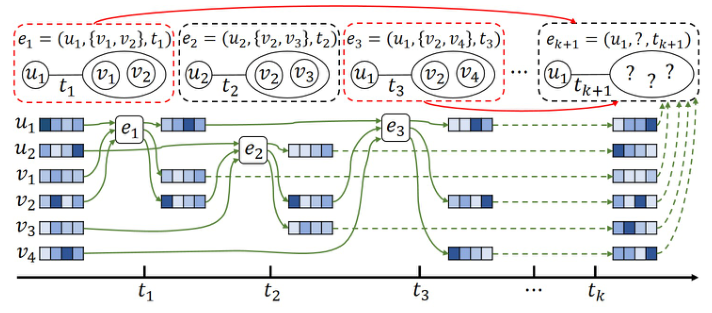
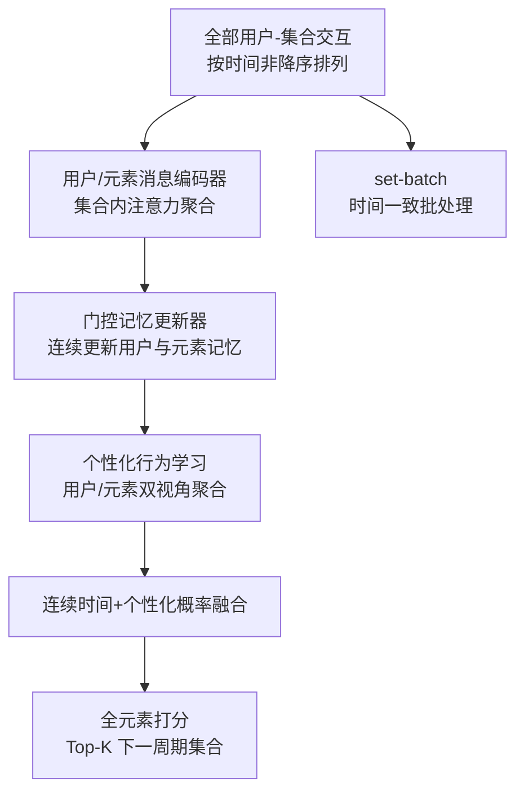
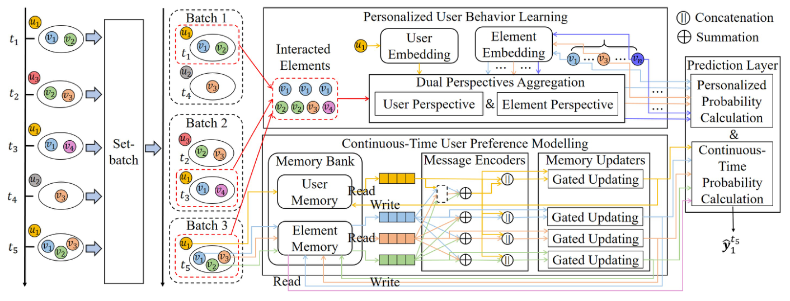

# Continuous-Time User Preference Modelling for Temporal Sets Prediction (连续时间用户偏好建模用于时序集合预测)

- **会议/期刊**: IEEE TKDE
- **作者与机构**: Le Yu, Zihang Liu, Leilei Sun, Bowen Du, Chuanren Liu, Weifeng Lv；北航软件开发环境国家重点实验室、田纳西大学
- **推荐链路定位**: 召回（下一周期元素集合预测）
- **研究方向**: 序列与会话推荐
- **论文原文**: [论文原文链接](https://arxiv.org/abs/2204.05490v7)
- **开源代码**: [开源代码仓库链接](https://github.com/yule-BUAA/CTTSP)

## TL;DR (1分钟核心速览)

针对时序集合预测中用户偏好被隐式压缩、难追踪连续演化与跨用户协同的问题，CTTSP 将全部用户-集合交互排成全局非降序序列，维护用户/元素记忆库，以消息编码器+门控更新器连续更新状态，并用用户/元素双视角聚合个性化历史。模型以全元素二元交叉熵训练、全库 Top-K 排序评估；四数据集优于 ETGNN 等，JingDong K=10 Recall +11.48%，set-batch 平均加速 3.5×/3.0×。

## Background & Motivation (背景与核心矛盾)

- **主流范式**: 一类方法先池化/矩阵分解得到集合向量，再用 RNN/Transformer 学用户序列；另一类设计元素级专用网络（DSNTSP、DNNTSP、ETGNN）建模集合内共现与跨集合时序。
- **前人局限**: 用户偏好仅由交互元素隐式表示，缺乏显式状态，无法追踪连续演化；每个用户序列独立重算，跨用户协同信号难以传播，且集合内元素关系与用户-集合关系未被统一建模。
- **核心洞察 (Key Insight)**: 若把所有用户-集合交互按时间排成一条 universal sequence，用户/元素状态可在全局时间轴上持续演化，元素记忆自然携带跨用户信息。
- **本文切入点**: 用显式记忆库+门控更新器替代隐式用户表示，再以个性化双视角聚合补足个体特征，并用 set-batch 保持时序一致。

<figure class="paper-figure" markdown="span">
  <figcaption>图 1. 我们的任务旨在预测用户 u1 在时间戳 tk+1 的下一周期集合。与以往基于交互元素隐式捕捉每个用户偏好的方法不同，我们的方法维护一个记忆库，显式存储所有用户和元素的状态，并可在所有用户-集合交互的非递减序列（以绿色标出）上持续演化。我们还基于 u1 的历史序列学习其个性化行为，以反映个体特征（以红色标出）。</figcaption>
</figure>
图1 显式记忆库与隐式偏好建模的动机对比（原文图1）

## Method (核心方法设计)

### 1. 整体框架 (Overall Architecture)

CTTSP 先将所有用户-集合交互按时间非降序排列为全局序列，逐条处理每个交互：用户消息编码器用集合内元素注意力聚合用户当前消息，元素消息编码器对称建模元素-用户/元素-元素关系；随后门控记忆更新器用当前消息与历史记忆连续改写用户和元素记忆。个性化模块从用户历史元素序列出发，以用户嵌入和元素嵌入为双 query 自适应聚合历史；预测层融合连续时间概率与个性化概率，对全元素做 sigmoid 打分并取 Top-K。训练时用 set-batch 预创建时间一致批次，保证记忆按时间顺序更新。

<figure class="paper-figure" markdown="span">
  <figcaption>图 2. 所提模型的框架。</figcaption>
</figure>
图2 CTTSP 整体框架（原文图2）

### 2. 关键设计拆解 (Key Designs)

1. **全局连续时间记忆演化**：隐式方法每用户从零重算，无法记住历史状态。CTTSP 对交互 $e_k=(u_i,S_k,t_k)$先用集合内注意力得到用户消息$m_i^{u,t_k}$，再以逐维门控在旧记忆与新消息间插值：$z_i^{u,t_k}=\tanh(g_{i,M}^{u,t_k}\odot W_M^u m_i^{u,t_k}+(1-g_{i,M}^{u,t_k})\odot W_Z^u z_i^{u,t_k^-})$。记忆本身不直接训练，而由可训练更新器沿全局序列改写，因此元素记忆可携带其他用户信息，形成协同传播。

2. **个性化双视角聚合**：全局记忆偏协同，可能稀释个体重复偏好。模型用用户嵌入 $e^u$和元素嵌入$e_{j'}^v$分别对历史元素$V_i^{t_k}$做注意力，得到$\beta_{i,j}^k$与$\gamma_{j',j}^k$，再融合聚合：$h_{i,j'}^{t_k}=\sum_{v_j\in V_i^{t_k}}(\lambda_{up}\beta_{i,j}^k+(1-\lambda_{up})\gamma_{j',j}^k)e_j^v$。用户视角抓“我常买”，元素视角抓“相似元素常共现”，二者互补。

3. **概率融合、损失与 set-batch**：连续时间概率对当前集合元素用 $s(z_i^u,z_j^v)$，对历史非当前元素用$s(z_i^u,\mathrm{FCN}(z_j^{v,t^-}))$以保留梯度；个性化概率为$s(W_Sh,e_j^v)$。融合为$\hat y_{i,j}^{t_k}=\sigma(\tau_{i,j}^{t_k}\lambda_{cp}\hat p_{i,j}^c+(1-\tau_{i,j}^{t_k}\lambda_{cp})\hat p_{i,j}^s)$。训练目标为全元素二元交叉熵$\mathcal{L}=-\sum_{e_k}\sum_{v_j\in V}[y_{i,j}^{t_k}\log\hat y_{i,j}^{t_k}+(1-y_{i,j}^{t_k})\log(1-\hat y_{i,j}^{t_k})]$，无负采样；推理对全元素排序。set-batch 预创建时间一致 batch，复杂度$O(|S^t|)$，训练/评估平均加速 3.5×/3.0×。

## Experimental Setup & Evaluation Protocol (实验设置与评估协议)

- **数据集与预处理**: 保留覆盖 80% 记录的频繁元素；序列长度 <4 删除、>20 截断（与 ETGNN 一致）。

| 数据集 | #S（用户-集合交互） | #Users | #Items | #E/S | #S/U | 场景/时间跨度 |
| :--- | ---: | ---: | ---: | ---: | ---: | :--- |
| JingDong | 15,195 | 3,063 | 3,551 | 1.26 | 4.96 | 京东购买，2018-03 |
| DC | 42,905 | 9,010 | 217 | 1.52 | 4.76 | 零售交易，前60天 |
| TaFeng | 73,302 | 9,841 | 4,935 | 5.41 | 7.45 | 杂货购物，2000-11–2001-02 |
| TaoBao | 225,989 | 49,393 | 689 | 1.45 | 4.58 | 淘宝品类，2017-11-24–12-03 |

- **数据划分与防穿越 (Splitting Strategy)**: Transductive 设置每用户最后集合测试、倒数第二验证、其余训练；Inductive 设置按用户 70%/10%/20% 划分训练/验证/测试用户，测试用户训练中未出现。
- **排名评测协议 (Ranking Protocol)**: 多标签全元素排序，按预测概率对全部元素取 Top-K（K=10/20/30/40），无采样负例；指标 Recall、NDCG、PHR；10 个 seed 平均，paired t-test 显著性 $p<0.05$。
- **对比基线与超参设置**: 基线含 RNN/记忆类（DREAM、RUM）、动态图（TGN）、CTR 注意力（DIN）与专用模型（Sets2Sets、DSNTSP、DNNTSP、ETGNN）。Adam lr=0.001，$d\in\{32,64,128\}$（多数数据集 64，TaoBao 32），dropout 网格搜索，2000 epochs、early stopping 100；$\lambda_{up}$、$\lambda_{cp}$ 网格搜索。

## Key Experimental Results (实验关键数据)

### 1. 主实验对比 (Main Results)

表2 给出 JingDong 与 TaoBao 在 K=10 下的 Recall/NDCG；CTTSP 全部最优，Improv. 相对最强基线 ETGNN。

| 数据集 | 方法 | Recall@10 | NDCG@10 |
| :--- | :--- | ---: | ---: |
| JingDong | DREAM | 0.2888 | 0.2198 |
| JingDong | TGN | 0.2359 | 0.1682 |
| JingDong | RUM | 0.2921 | 0.2229 |
| JingDong | DIN | 0.3024 | 0.2503 |
| JingDong | Sets2Sets | 0.3209 | 0.2497 |
| JingDong | DSNTSP | 0.3464 | 0.2734 |
| JingDong | DNNTSP | 0.3224 | 0.2458 |
| JingDong | ETGNN | 0.3658 | 0.2724 |
| JingDong | **CTTSP** | **0.4078** | **0.2946** |
| JingDong | Improv. | +11.48% | +7.75% |
| TaoBao | DREAM | 0.1665 | 0.0932 |
| TaoBao | TGN | 0.1665 | 0.0888 |
| TaoBao | RUM | 0.1671 | 0.1077 |
| TaoBao | DIN | 0.2188 | 0.1317 |
| TaoBao | Sets2Sets | 0.2413 | 0.1488 |
| TaoBao | DSNTSP | 0.2363 | 0.1431 |
| TaoBao | DNNTSP | 0.2511 | 0.1535 |
| TaoBao | ETGNN | 0.2589 | 0.1542 |
| TaoBao | **CTTSP** | **0.2610** | **0.1595** |
| TaoBao | Improv. | +0.81% | +3.44% |

### 2. 消融实验 (Ablation Study)

| 变体 | JingDong NDCG@10 | TaoBao NDCG@10 | 变化说明 |
| :--- | ---: | ---: | :--- |
| CTTSP | **0.2946** | **0.1595** | 完整模型 |
| w/o AUME | 低于完整 | 低于完整 | 用户消息退化为平均池化，失去元素重要性区分 |
| w/o AEME | 低于完整 | 低于完整 | 元素消息忽略同集合其他元素，丢失 intra-set 关系 |
| w/o GUMU | 低于完整 | 低于完整 | GRU 替代门控，参数更多且训练更难 |

### 3. 关键实验发现 (Key Findings)

1. ETGNN 是最强基线，但 JingDong K=10 上 CTTSP 的 Recall 从 0.3658 提至 0.4078（+11.48%）、NDCG 从 0.2724 提至 0.2946（+7.75%），说明全局记忆传播协同信号比仅元素引导的时序图更有效。
2. TaoBao 数据最密集，Recall 仅 +0.81% 但 NDCG +3.44%，表明提升更多来自排序质量而非简单命中；DC 上 Recall@10 仅 +1.72%，可能因元素数仅 217、重复购买强，个性化与协同的边际收益较小。
3. set-batch 将训练/评估平均加速 3.51×/3.04×（TaoBao 达 4.81×/3.97×），且消融中去掉 AUME、AEME、GUMU 均下降，证明消息编码与门控记忆是必要组件；Inductive 设置下 CTTSP 仍优于基线（原文图3），显示记忆+共享用户嵌入对冷启动新用户有潜力。

## Highlights & Limitations (亮点、对比与审稿批判)

- **与代表作对比 (vs. Prior Work)**: ETGNN 用时间图+元素引导消息，但仍为每个用户学元素级表示；DSNTSP 用双 Transformer 学集合/元素级；Sets2Sets 池化+RNN。CTTSP 的本质差异是显式维护用户/元素记忆并在全局序列上连续更新，先记忆跨用户协同，再由个性化模块补个体重复偏好。
- **可迁移亮点**: “全局 universal sequence + 记忆库”可直接迁移到购物篮、处方、POI 等集合型序列；set-batch 的时间一致批处理可用于任何连续时间事件序列，避免逐条处理。
- **审稿级局限批判**: 其“continuous-time”并非在任意时刻插值，时间信息主要经最后时间戳与全局顺序隐式编码，未显式建模不规则时间间隔；记忆库随用户/元素数线性增长，工业规模需分片，且 $\lambda_{cp}$、$\lambda_{up}$ 对数据集敏感；Inductive 仅按用户划分，未严格验证新物品冷启动。

## Rating (四维评分)

- **方法创新性 (Novelty)**: ⭐⭐⭐⭐ （显式连续时间记忆+set-batch 机制清晰，跨用户协同传播有说服力，但记忆网络本身非全新）
- **评估协议与实验扎实度 (Protocol & Experiments)**: ⭐⭐⭐⭐ （四数据集、transductive/inductive、10 seeds 与 t-test 较完整；消融仅图无数值、缺时间间隔消融）
- **写作与数学规范度 (Clarity & Rigor)**: ⭐⭐⭐⭐ （公式与符号定义清楚，复杂度分析到位；continuous-time 与 Neural ODE 的区别需读者自行接受）
- **工业落地与复现价值 (Industrial & Practical Value)**: ⭐⭐⭐⭐ （开源且 set-batch 带来 3.5×/3.0× 加速；全局顺序训练与记忆存储扩展仍需工程分片）

