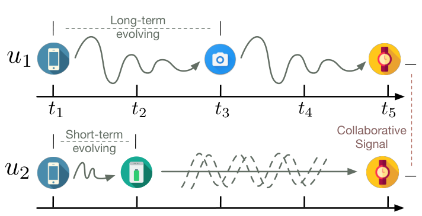
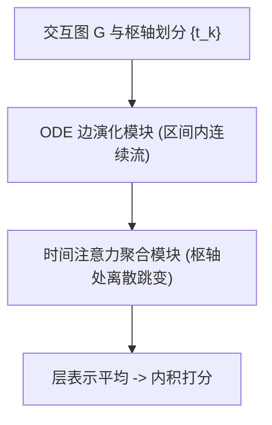
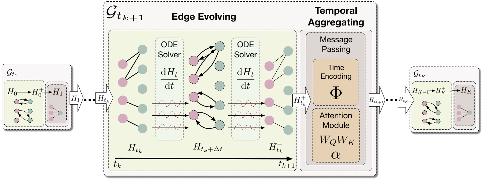

# Learning Graph ODE for Continuous-Time Sequential Recommendation (面向连续时间序列推荐的图神经常微分方程)

- **会议/期刊**: IEEE TKDE 2024
- **作者与机构**: Yifang Qin, Wei Ju, Hongjun Wu, Xiao Luo, Ming Zhang（北京大学、UCLA）
- **推荐链路定位**: 召回（序列建模）
- **研究方向**: 序列与会话推荐 / 图神经网络推荐
- **论文原文**: [论文原文链接](https://arxiv.org/abs/2304.07042v2)
- **开源代码**: [torchdiffeq](https://github.com/rtqichen/torchdiffeq)（依赖 NODE 求解器，作者代码暂未独立放出）

## TL;DR (1分钟核心速览)

现有序列推荐把交互当作等时间间隔离散序列，既忽略协同信号随时间的连续演化，也无法处理不规则采样间隔带来的偏好漂移。GDERec 提出自回归图 ODE 框架：以"枢轴时间戳"划分混合动态系统 $\{G_{t_k}\}_{k=1}^{K}$，在区间内用 ODE 刻画边演化、在枢轴点用带可学习时间编码的注意力做离散聚合，两模块交替自回归训练。在 5 个基准数据集的全库排序（Full-Ranking）协议下，Recall@5/Recall@10/MRR 分别取得约 6.5%/8.8%/2% 的相对提升。

## Background & Motivation (背景与核心矛盾)

- **主流范式**: 序列推荐以 GRU4Rec/SASRec 在等间隔 item 序列上建模转移，或以 TGSRec 式动态图在离散快照上做传播；图 ODE（NODE、GNG-ODE）已用于序列与 session 图。
- **前人局限**: (i) 协同信号（user-item 交互图）随时间演化被忽略，只建模 item-item 转移；(ii) 假设交互等间隔采样，无法适配真实场景下的不规则观测。
- **核心洞察 (Key Insight)**: 如图 1 所示，同样"手机→相机→手表"序列，规律购买的用户可判为"数码爱好者"，而不规律购买的用户只是"刚需"，间隔模式本身携带偏好信号。
- **本文切入点**: 让图传播在**连续时间**上演化——把 ODE 从 item 序列扩展至 **user-item 交互图**，用混合动态系统分离"连续演化"与"离散跳变"。

<figure class="paper-figure" markdown="span">
  <figcaption>图1：在不同时间间隔采样观测的玩具示例。不同的时间采样间隔通常意味着不同的用户偏好。</figcaption>
</figure>

## Method (核心方法设计)

### 1. 整体框架 (Overall Architecture)

将交互图按枢轴时间 $\mathcal{T}=\{t_k\}_{k=1}^{K}$划为混合动态系统，每个时间片$[t_k,t_{k+1})$内的边构成$E_{t_k}$。给定前层节点表示$\mathbf{H}_{t_k}$，先经 **ODE 边演化模块**沿连续时间积分得到$\mathbf{H}_{t_k}^{+}$（表征用户-物品关联的连续流动），再经**时间注意力聚合模块**在枢轴$t_{k+1}$处吸收新观测边$E_{t<t_{k+1}}$输出$\mathbf{H}_{t_{k+1}}$；两模块自回归堆叠$K$ 层后，对每层表示取平均得到最终用户/物品向量，用内积打分。

<figure class="paper-figure" markdown="span">
  <figcaption>图2：所提出的框架GDERec示意图。我们提出一种在混合动态交互系统上传播的自回归框架。我们框架的基本单元由两个模块组成。来自前一层的输入节点表示首先经基于ODE的边演化模块处理，以生成H+</figcaption>
</figure>

### 2. 关键设计拆解 (Key Designs)

1. **ODE 边演化模块（图传播的连续化）**: 常规 GCN $\mathbf{H}_{l+1}=\mathbf{A}\mathbf{H}_l$忽略节点间亲和度，作者改成$\mathbf{H}_{l+1}=\mathbf{A}\mathbf{H}_l+\mathbf{A}\mathbf{H}_0\odot\mathbf{H}_0$并展开为几何级数，令层数$l\to t\in\mathbb{R}$得积分形式；对$t$两次求导消去$\mathbf{A}^t$后得 ODE 及一阶近似解：$\frac{d\mathbf{H}_t}{dt}=(\mathbf{A}-\mathbf{I})\mathbf{H}_t+\mathbf{A}\mathbf{H}_0\odot\mathbf{H}_0$。这使表征可"泛化到任意未见时间戳"，用 Runge-Kutta 求解。核心直觉：ODE 让边亲和力随连续时间自然生长，避开了等间隔假设。
2. **时间注意力 + 可学习时间编码（离散聚合）**: 用 Bochner 定理构造 $\Phi(t)=\sqrt{1/d_T}[\cos(\omega_1 t),\sin(\omega_1 t),\dots]^\top$，$\omega$可学习以适配灵活时间跨度；注意力权重$\pi_t(i,j)=\sigma(\boldsymbol{\alpha}^\top\mathrm{CONCAT}(\mathbf{W}_Q\mathbf{h}_i;\Phi(t);\mathbf{W}_K\mathbf{h}_j))$。**关键设计**：ODE 只"看"当前区间（避免长历史信息过载），注意力看全部历史$E_{t<t_{k+1}}$（自适应增长的图），该非对称信号配置经消融证实最优。
3. **训练目标与推理开销**: 采用 BPR 损失 $\mathcal{L}=\sum_{(u,i,j)}-\ln\sigma(\hat{y}_{ui}-\hat{y}_{uj})+\lambda\|\Theta\|_2^2$，负样本从$\mathcal{U}\times\mathcal{I}-E$均匀采样。总复杂度$O\big(((2+s/\epsilon)d+d_t)|E|\big)$，$s$为 RK 阶数、$\epsilon$ 步长——深度由 ODE 求解步数控制而非堆层，天然回避过平滑，也可换自适应步长求解器。

## Experimental Setup & Evaluation Protocol (实验设置与评估协议)

- **数据集与预处理**:

| 数据集 | #Users | #Items | #Interactions | 密度 | 场景 |
| :--- | :---: | :---: | :---: | :---: | :--- |
| Cloth | 39,387 | 23,033 | 278,677 | 0.31% | Amazon 稀疏 |
| Baby | 19,445 | 7,050 | 160,792 | 0.11% | Amazon 极稀疏 |
| Music | 5,541 | 3,568 | 64,706 | 0.32% | Amazon |
| ML-1M | 6,040 | 3,706 | 1,000,209 | 4.46% | 稠密 |
| ML-100K | 943 | 1,682 | 100,000 | 6.30% | 稠密 |

- **数据划分与防穿越**: 全交互按时间戳升序，按 `80%/10%/10%` 比例划分（比例划分），验证集选 MRR 最优模型测试。
- **排名评测协议**: **Full-Ranking（全库未交互物品排序）**，指标 Recall@5、Recall@10、MRR。
- **对比基线与超参**: 对比 11 个基线，覆盖序列（GRU4Rec/SASRec/TiSASRec）、图（SR-GNN/LightGCN/DGCF）、连续时间（TGSRec/NODE/GCG-ODE）、对比学习（IOCRec/DCRec）四大类；Embedding $d=64$、时间编码$d_T=16$、$lr=0.001$、$\lambda=10^{-3}$、RK 步长 0.2、$K$在$\{2,3,4\}$搜索；$\star$表示$p<0.05$ 的未配对 t 检验显著。

## Key Experimental Results (实验关键数据)

### 1. 主实验对比 (Main Results)

| 模型 | Cloth R@10 | Cloth MRR | Music R@10 | Music MRR | ML-1M R@10 | ML-1M MRR | ML-100K R@10 |
| :--- | :---: | :---: | :---: | :---: | :---: | :---: | :---: |
| GRU4Rec | 0.0212 | 0.0090 | 0.0544 | 0.0216 | 0.2131 | 0.0755 | 0.3475 |
| SASRec | 0.0206 | 0.0099 | 0.0771 | 0.0320 | 0.2135 | 0.0787 | 0.3064 |
| LightGCN | 0.0283 | 0.0106 | 0.1167 | 0.0451 | 0.2214 | 0.0757 | 0.3128 |
| DGCF | 0.0289 | 0.0112 | 0.1258 | 0.0459 | 0.2276 | 0.0789 | 0.3329 |
| DCRec | 0.0251 | 0.0108 | 0.1062 | 0.0433 | 0.2285 | 0.0791 | 0.3541 |
| GCG-ODE | 0.0299 | 0.0123 | 0.1237 | 0.0455 | 0.2263 | 0.0767 | 0.3598 |
| **GDERec** | **0.0331** | **0.0146** | **0.1363** | **0.0528** | **0.2389** | **0.0801** | **0.3712** |
| **Improv.** | +10.7% | +18.7% | +10.2% | +15.0% | +5.0% | +1.3% | +3.2% |

### 2. 消融实验 (Ablation Study)

| 变体 | Cloth R@10 | Music R@10 | ML-1M R@10 | ML-100K R@10 |
| :--- | :---: | :---: | :---: | :---: |
| GDERec_ATT（去 ODE 层） | 0.0279 | 0.1178 | 0.2211 | 0.3733 |
| GDERec_ODE（去时间注意力） | 0.0295 | 0.1280 | 0.2243 | 0.3571 |
| GDERec_GCN（注意力→GCN） | 0.0303 | 0.1291 | 0.2388 | 0.3690 |
| **GDERec（完整）** | **0.0331** | **0.1363** | **0.2389** | **0.3712** |

### 3. 关键实验发现 (Key Findings)

1. **ODE 是主引擎**：去除 ODE 层（GDERec_ATT）使 Cloth R@10 从 0.0331 骤降至 0.0279（-15.7%）、Music 从 0.1363 跌至 0.1178（-13.6%），衰减幅度远超其他变体——连续演化是核心增益来源。
2. **时间注意力在长周期数据集更值钱**：GDERec 相对 GDERec_GCN 在 Cloth/Music（时间跨度长）提升 9.2%/5.6%，而在 ML-1M（短周期）提升仅 0.04%，印证注意力机制的价值随交互系统时长放大。
3. **深度与信号的鲁棒性**：$K=3$最优，$K>4$ 反而下降（过拟合细粒度动态）；ODE 求解步数增加时 GDERec 性能单调上升且不出现过平滑，而 LightGCN/DGCF 深层显著退化——NODE 天然稳。

## Highlights & Limitations (亮点、对比与审稿批判)

- **与代表作对比 (vs. Prior Work)**: 对比 LightGCN（静态无时序）、TGSRec（离散图快照）与 NODE/GNG-ODE（ODE 仅用于序列或 session 图），GDERec 首次把 ODE 从序列域扩展至 **user-item 全局交互图**，同时用"连续流 + 离散跳变"混合动态区分时间尺度。
- **可迁移亮点**: (1) 用 ODE 求解步数控制层深，天然规避 GNN 过平滑的堆叠退化；(2) 可学习 Bochner 时间编码 $\Phi(t)$ 可无成本接入任意时间敏感的序列/图模型；(3) ODE/注意力"看不同时间窗"的非对称设计对动态图建模具普适性。
- **审稿级局限批判**: (1) 每个时间片都要跑 Runge-Kutta 求解，推理延迟和内存随 $K$与 #E 平方膨胀，线上大规模部署需蒸馏/近似；(2) 全库排序下稠密 ML-1M 提升仅约 1.3% MRR，对稠密场景收益有限；枢轴数$K$ 需网格搜索，缺乏自适应选定机制。

## Rating (四维评分)

- **方法创新性 (Novelty)**: ⭐⭐⭐⭐ （首次将图 ODE 引入连续时间序列推荐，混合动态系统 + 非对称信号设计有理论支撑）
- **评估协议与实验扎实度 (Protocol & Experiments)**: ⭐⭐⭐⭐ （5 数据集全库排序、11 基线、显著性检验与 4 类消融齐备；稠密集提升偏低）
- **写作与数学规范度 (Clarity & Rigor)**: ⭐⭐⭐⭐ （ODE 推导含命题与证明、复杂度分析完整；部分公式排版可更清晰）
- **工业落地与复现价值 (Industrial & Practical Value)**: ⭐⭐⭐ （依赖 torchdiffeq 可复现，但逐片 ODE 求解推理开销大，线上需优化）

