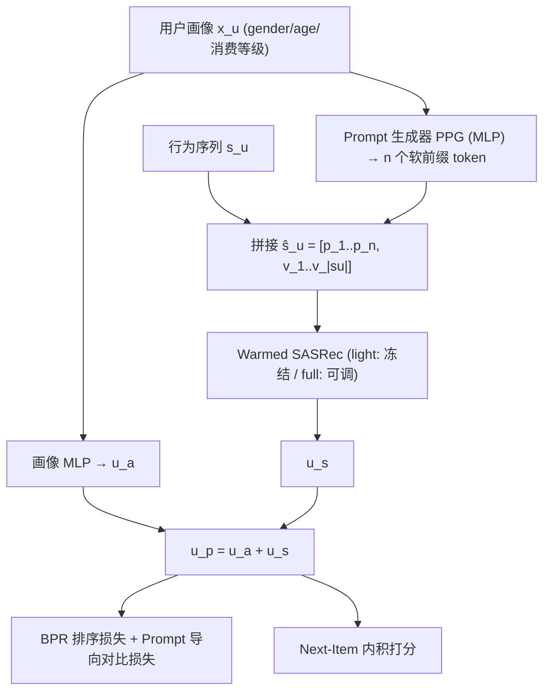
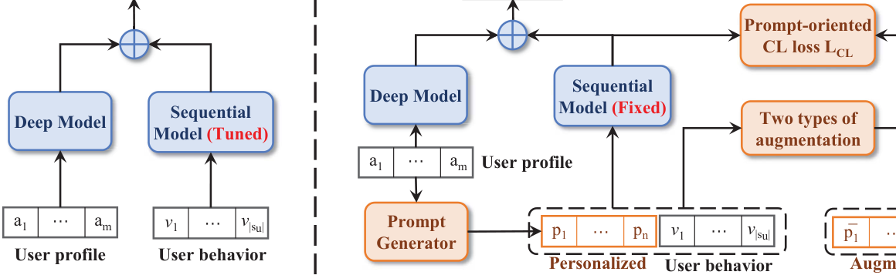

# Personalized Prompt for Sequential Recommendation (面向序列推荐的个性化提示微调)

- **会议/期刊**: IEEE TKDE (arXiv:2205.09666v3, 2024)
- **作者与机构**: Yiqing Wu, Ruobing Xie, Yongchun Zhu, Fuzhen Zhuang*, Xu Zhang, Leyu Lin, Qing He (中科院计算所 / 北航 / 腾讯微信)
- **推荐链路定位**: 精排 (Next-Item 打分) — 下游微调范式改造
- **研究方向**: 序列与会话推荐 / 冷启动与长尾推荐
- **论文原文**: [https://arxiv.org/abs/2205.09666v3](https://arxiv.org/abs/2205.09666v3)
- **开源代码**: 暂未开源

## TL;DR (1分钟核心速览)

序列推荐把物品当 token 做预训练，但下游一律全参 Fine-tuning，在冷用户少样本场景既易过拟合又浪费预训练知识。本文首次把 Prompt-tuning 引入推荐：用用户画像经 MLP 生成个性化软前缀 Prompt 拼在行为序列头部，取代人工硬模板；再用"画像掩码 + 行为掩码"双增广的 Prompt 导向对比损失把 Prompt 训充分。在 CIKM/QQBrowser/AliEC 上以 99 负采样排序协议评测，PPR 在 Few-shot、Zero-shot 与联合冷启动三类任务上全面超越 Fine-tuning 与 MeLU/CL4SRec/GCE-GNN，且 PPR(light) 仅需 0.25%–0.6% 的可调参数。

## Background & Motivation (背景与核心矛盾)

- **主流范式**: SASRec/BERT4Rec/CL4SRec 等先在大规模行为序列上预训练（本文称 warmed model），再在下游冷用户数据上全参微调。
- **前人局限**: ①冷用户交互极少（<10 次点击），全参微调百万级物品嵌入易过拟合，且调参开销大；②物品 token 无显式语义、数量达百万级，NLP 的硬模板 Prompt 无法直接迁移。
- **核心洞察 (Key Insight)**: 冷启动的瓶颈不是"模型容量不够"，而是"预训练知识与下游任务目标之间的鸿沟"。NLP 已证明 Prompt 能桥接该鸿沟；推荐中缺失的恰是一个**可自动生成、且对每个用户都不同**的 Prompt。
- **本文切入点**: 把"每个用户的推荐"视为一个独立任务，用用户画像（age/gender/消费等级等）作为任务描述生成个性化软前缀，让冻结的 warmed 模型"被提示着"输出该用户相关知识。

## Method (核心方法设计)

### 1. 整体框架 (Overall Architecture)

输入侧有两条支路：用户画像 $\mathbf{x}_u$一路进入 Prompt 生成器得到$n$个软前缀 token，拼在行为序列$s_u$之前形成$\hat{s}_u$，送入（冻结或可调的）SASRec 编码得到行为表征$\mathbf{u}_s$；另一路经 MLP 得到画像表征$\mathbf{u}_a$，二者相加为最终用户向量$\mathbf{u}_p$。训练时在 BPR 排序损失之外，对 Prompt 与行为分别做掩码增广，构造同一用户不同视图的 InfoNCE 辅助损失。推理时按内积对全库物品排序，无需任何额外结构。

<figure class="paper-figure" markdown="span">
  <figcaption>图 2. (a) 传统微调与 (b) 本文个性化提示推荐的整体架构。</figcaption>
</figure>

### 2. 关键设计拆解 (Key Designs)

1. **个性化软前缀 Prompt 生成器 (Personalized Prompt Generator)**：NLP 的硬模板在推荐中失效（物品无语义），且"千人一面"的 Prompt 违背推荐个性化本质。做法是拼接 $m$个画像嵌入$\mathbf{x}_u=[\mathbf{a}_{u,1}\|\cdots\|\mathbf{a}_{u,m}]$，经单隐层 MLP 一次输出$n$个 token：$\mathbf{P}_u=\mathrm{PPG}(\mathbf{x}_u|\vartheta)=\mathbf{W}_2\sigma(\mathbf{W}_1\mathbf{x}_u+\mathbf{b}_1)+\mathbf{b}_2$，再令$\hat{s}_u=\{p_{u,1},\dots,p_{u,n},v_{u,1},\dots,v_{u,|s_u|}\}$。其物理直觉是：Prompt 把"20 岁女性"这类先验写进序列上下文，使 warmed 模型的注意力在缺乏行为时仍能被画像"锚定"，从而在 Zero-shot（序列为空）时也有输入可用。$n$ 取 1（更长无显著收益）。

2. **PPR(light) / PPR(full) 双档调参**：NLP 的 light prompt-tuning 只调 Prompt，但推荐的"标签空间"是百万级物品。轻档只更新 $\vartheta,\phi$（参数占比 0.3%/0.25%/0.6%），把 Prompt 当"知识诱导器"；全档额外解冻$\Theta$（含物品嵌入与序列编码器），等价于"Prompt 增强的微调"。二者用同一目标$\mathcal{L}_p=-\sum_{(u,v_i)\in S_c^+}\sum_{(u,v_j)\in S_c^-}\log\sigma(\mathbf{u}_p^{\top}\mathbf{v}_i-\mathbf{u}_p^{\top}\mathbf{v}_j)$训练，$\mathbf{u}_p=\mathbf{u}_a+\mathbf{u}_s$。

3. **Prompt 导向对比学习与训练开销**：冷用户画像常缺失/含噪，且下游样本极少。本文对画像做元素级随机掩码（比率 $\gamma_1=0.2$）得$\bar{s}_u^1$，对行为做物品零掩码（$\gamma_2=0.2$）得$\bar{s}_u^2$，将原序列与增广序列视为正对、批内其他用户为负：$\mathcal{L}_{CL}=-\sum_{\mathcal{B}}\log\frac{\exp(\mathrm{sim}(\mathbf{u}_s,\bar{\mathbf{u}}_s)/\tau)}{\sum_{u'\in\mathcal{B}}\exp(\mathrm{sim}(\mathbf{u}_s,\bar{\mathbf{u}}'_s)/\tau)}$；总损失$\mathcal{L}_{all}=\mathcal{L}_p+\lambda\mathcal{L}_{CL}$（$\lambda=0.1$）。免去人工难负采样，全部负例来自 in-batch；训练/服务耗时与 Fine-tuning 同量级，light 档显存与存储大幅下降。

## Experimental Setup & Evaluation Protocol (实验设置与评估协议)

- **数据集与预处理**: 按交互数 <10 划分冷/暖用户；暖用户行为作 warm-training，冷用户行为作 tuning/test。

| 数据集 | #Users | #Items | #Warm-Train | #Tuning | 画像/场景 |
| :--- | :---: | :---: | :---: | :---: | :--- |
| CIKM | 80,964 | 87,894 | 2,103,610 | 143,726 | 电商，3 属性 |
| QQBrowser | 134,931 | 97,904 | 15,359,880 | 263,572 | 新闻/视频，3 属性 |
| AliEC(→AliAD) | 104,984 | 109,938 | 8,768,915 | 39,292 | 电商/广告，8 属性 |

- **数据划分与防穿越 (Splitting Strategy)**: 冷用户按 80%/20% 随机切分为 tuning 集与测试集；测试集用户的**首个点击**用于 Zero-shot（无行为输入），其余行为用于 Few-shot。
- **排名评测协议 (Ranking Protocol)**: `Sampled Ranking` — 每条真值随机抽 99 个未交互物品作负例，指标为 AUC、HIT@{5,10,20,50}、NDCG@{5,10,20,50}。
- **对比基线与超参设置**: SASRec(底座)、BERT4Rec、MeLU(元学习)、CL4SRec、GCE-GNN、PeterRec、warm-train、Fine-tuning；嵌入维 $d=64$、batch 256、Adam，prompt 长度 1、$\lambda=0.1$、掩码率 0.2；改进经$t$检验$p<0.05$ 显著。

## Key Experimental Results (实验关键数据)

### 1. 主实验对比 (Main Results)

Few-shot 推荐（节选，Improv. 为最优 PPR 相对 Fine-tuning）：

| 数据集 | 模型 | AUC | HIT@5 | NDCG@10 |
| :--- | :--- | :---: | :---: | :---: |
| CIKM | SASRec | 0.8676 | 0.5808 | 0.5220 |
| CIKM | BERT4Rec | 0.8482 | 0.5191 | 0.4616 |
| CIKM | MeLU | 0.8255 | 0.4647 | 0.4124 |
| CIKM | CL4SRec | 0.8676 | 0.5840 | 0.5252 |
| CIKM | GCE-GNN | 0.8676 | 0.5156 | 0.4345 |
| CIKM | PeterRec | 0.8686 | 0.4950 | 0.4070 |
| CIKM | Fine-tuning | 0.8731 | 0.5886 | 0.5255 |
| CIKM | **PPR(full)** | **0.8774** | **0.5918** | **0.5290** |
| CIKM | Improv. | +0.49% | +0.54% | +0.67% |
| QQBrowser | Fine-tuning | 0.9645 | 0.8142 | 0.6944 |
| QQBrowser | **PPR(full)** | **0.9652** | **0.8169** | **0.6960** |
| QQBrowser | Improv. | +0.07% | +0.33% | +0.23% |
| AliEC | Fine-tuning | 0.8907 | 0.6058 | 0.5217 |
| AliEC | **PPR(light)** | **0.8975** | **0.6123** | 0.5246 |
| AliEC | **PPR(full)** | 0.8941 | 0.6126 | **0.5256** |
| AliEC | Improv. | +0.76% | +1.12% | +0.75% |

Zero-shot / 联合冷启动 / 跨域（关键列）：

| 任务 | 模型 | AUC | HIT@5 | NDCG@10 |
| :--- | :--- | :---: | :---: | :---: |
| CIKM Zero-shot | Fine-tuning | 0.7753 | 0.2991 | 0.2463 |
| CIKM Zero-shot | **PPR(full)** | **0.7825** | **0.3069** | **0.2507** |
| CIKM 联合 | Fine-tuning | 0.8418 | 0.5202 | 0.4639 |
| CIKM 联合 | **PPR(light)** | **0.8606** | **0.5399** | **0.4777** |
| AliEC→AliAD CDR | Fine-tuning | 0.7165 | 0.3362 | 0.2813 |
| AliEC→AliAD CDR | **PPR(full)** | **0.7343** | **0.3632** | **0.3109** (+10.5%) |

### 2. 消融实验 (Ablation Study)

以图 3 读数（CIKM / AliEC，近似值）验证 Prompt 导向对比学习的贡献：

| 变体 | CIKM AUC | CIKM HIT@5 | AliEC AUC | AliEC HIT@5 |
| :--- | :---: | :---: | :---: | :---: |
| Fine-tuning | 0.873 | 58.9 | 0.891 | 60.6 |
| PPR(light) w/o CL | ≈0.877 | ≈58.8 | ≈0.893 | ≈60.9 |
| **PPR(light)** | **0.878** | **0.5895** | **0.8975** | **61.2** |
| PPR(full) w/o CL | ≈0.876 | ≈59.0 | ≈0.893 | ≈61.0 |
| **PPR(full)** | **0.8774** | **0.5918** | **0.8941** | **61.3** |

其他验证：换底座 CL4SRec 后 PPR(full) 在 CIKM 仍由 0.8660 升至 0.8769（AUC）、AliEC PPR(light) 0.8912→0.8992；稀疏度 $k\in\{1,5,7\}$ 下 PPR 相对提升随序列变短而增大；画像噪声率 0.1→0.9 时 CL 版下降更缓；画像预测任务 ACC 0.89→0.92、F1 0.47→0.54。

### 3. 关键实验发现 (Key Findings)

1. **Prompt 的收益在越稀疏处越大**：Few-shot 仅有 +0.07%~1.12% 的边际提升，但联合冷启动（含空序列用户）在 CIKM 上 AUC 提升 2.23%、Zero-shot HIT@50 提升 1.84%，说明 Prompt 主要在行为信号缺失时替代行为发挥作用。
2. **light 与 full 各有适用面**：数据充足的 CIKM/QQBrowser 上 full 更优（调物品嵌入有益），而最稀疏的 AliEC 上 light 反超（AUC 0.8975 vs 0.8941），验证"下游样本不足时解冻百万级嵌入会过拟合"。
3. **对比学习是稳健性来源而非主要增益来源**：去掉 CL 后 AUC 仅下降约 0.1~0.4 个百分点，但仍高于 Fine-tuning；其真正价值体现在高噪声画像（噪声率 0.9）下相对提升持续扩大。

## Highlights & Limitations (亮点、对比与审稿批判)

- **与代表作对比 (vs. Prior Work)**: 相比 MeLU 的元学习快速适应与 CL4SRec 的序列自增广，PPR 不改下游模型结构，只改"调参入口"；相比 PeterRec 的 Adapter 迁移，PPR 与底座模型解耦（model-agnostic），且在 CIKM 上 AUC/NDCG 全面领先；相比 PEPLER/P5 依赖 PLM 与文本，PPR 只用纯 ID 序列与画像，更易工业部署。
- **可迁移亮点**: ①把画像/上下文塞进序列前缀，是让冻结大模型"感知用户"的廉价手段；②对画像做元素级掩码的增广方式可直接复用到任何使用画像特征的冷启动模型上。
- **审稿级局限批判**: ①绝对提升幅度偏小（多数指标 <1%），且 99 负采样的 Sampled Ranking 会放大头部命中差异，缺少 Full-Ranking 验证；②画像字段仅 3–8 个、prompt 长度固定为 1，作者也承认"画像信息不足限制了 Prompt 潜力"，对富特征场景的结论尚不明确；③Zero-shot 中 PPR(light) 在 QQBrowser 上反而低于 Fine-tuning（AUC 0.8635 vs 0.8743），说明该设定下 Prompt 生成器在无行为约束时可能引入偏置。

## Rating (四维评分)

- **方法创新性 (Novelty)**: ⭐⭐⭐⭐ （首个将 prompt-tuning 引入推荐微调范式，个性化 Prompt 生成器 + 双增广对比学习组合自然，但单点算子较朴素）
- **评估协议与实验扎实度 (Protocol & Experiments)**: ⭐⭐⭐⭐ （三数据集 × Few/Zero/联合/跨域/画像预测 + 换底座 + 稀疏度与噪声分析，覆盖全面；扣分在仅用 99 负采样排序、提升幅度小）
- **写作与数学规范度 (Clarity & Rigor)**: ⭐⭐⭐⭐ （符号统一、损失与复杂度交代清楚，参数占比表格直观；对 light/full 差异给出了基于标签空间规模的可解释论证）
- **工业落地与复现价值 (Industrial & Practical Value)**: ⭐⭐⭐⭐ （0.25%–0.6% 可调参数、与 Fine-tuning 同量级时延、模型无关，适合冷启动在线部署；可惜未开源、缺线上 A/B）

