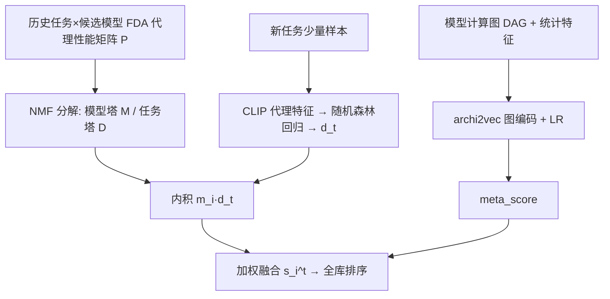
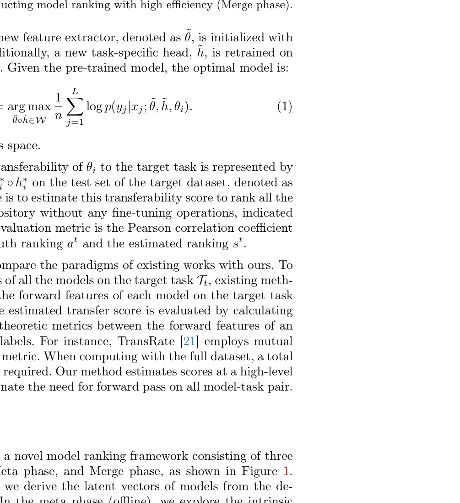

# Pre-Trained Model Recommendation for Downstream Fine-tuning (面向下游微调的预训练模型推荐)

- **会议/期刊**: TKDE 2026（arXiv 2024-03）
- **作者与机构**: Jiameng Bai, Sai Wu, Jie Song, Junbo Zhao, Gang Chen（浙江大学）
- **推荐链路定位**: 召回（候选预训练模型全库排序 / Model Selection）
- **研究方向**: 协同过滤与双塔召回 / 冷启动与长尾推荐
- **论文原文**: [https://arxiv.org/abs/2403.06382v1](https://arxiv.org/abs/2403.06382v1)
- **开源代码**: 暂未开源（论文称 benchmark 与代码将公开；文中引用的 imgclsmob 仅为候选模型库）

## TL;DR (1分钟核心速览)

预训练模型选择现有方法（LogME/TransRate/SFDA 等）需对「每个模型 × 每条样本」做前向传播、且强依赖目标任务标签，模型库扩大时开销线性爆炸。Fennec 把 model-task 迁移性能矩阵做 NMF 分解，得到「模型塔 / 任务塔」隐向量，内积即迁移分；再用 archi2vec 编码模型架构图、CLIP 作代理推断新任务向量。在 32 模型（PARC）与 105 模型（Fennec）全库排序上，无标签条件下 mean PC 达 68.12% / 87.79%，在线排序仅 2.2/5.1 ms。

## Background & Motivation (背景与核心矛盾)

- **主流范式**: 计算高效派以「前向特征—标签」的信息论相关性打分（LEEP、H-Score、LogME、TransRate、SFDA、ETran、PED），计算昂贵派（Taskonomy、RSA、DDS）需在目标任务上额外训练探针模型。
- **前人局限 1（非可迁移分数）**: 每个 (模型, 任务) 对独立打分，历史任务上积累的迁移经验完全不复用，忽略「相似模型/相似任务表现相近」这一结构性先验。
- **前人局限 2（依赖标签 + 线性开销）**: 打分需标签，且全库评估要 $M\times L$ 次前向；实测特征提取占评估总时长的绝对主导（105 模型下 22015.9 s）。
- **核心洞察 (Key Insight)**: 图 2 显示架构相近的模型（ResNet18/ResNet10）在 Cifar10、Nabird 上迁移效果高度一致——迁移性既由「任务域相似度」也由「模型固有归纳偏置」共同决定，前者可从历史交互中学习，后者可从计算图结构中编码。
- **本文切入点**: 把「任务当用户、模型当物品」，用协同过滤式隐因子分解复用历史迁移记录，把在线打分降为一次向量内积。

## Method (核心方法设计)

### 1. 整体框架 (Overall Architecture)

Fennec 分三阶段：**Transfer 阶段（离线）**用 FDA 代理分数填充 model×task 历史性能矩阵，再用 NMF 分解出模型隐向量 $\mathbf{M}$与任务隐向量$\mathbf{D}$；**Meta 阶段（离线）**抽取参数量、层数等统计特征，并用 archi2vec 把模型运行时计算图编码为向量，二者拼接后经线性回归拟合迁移分；**Merge 阶段（在线）**用 CLIP 提取目标任务少量样本的图像特征，经随机森林回归映射到同一迁移子空间得到$\mathbf{d}_t$，最终按权重$\alpha$融合两路分数完成全库排序。全流程在线只需处理「当前任务」，复杂度$\mathcal{O}(1)$，且无需目标任务任何标签。

<figure class="paper-figure" markdown="span">
  <figcaption>图 1：Fennec 框架概览。在高效进行模型排序（合并阶段）的同时，综合考虑前向特征（迁移阶段）和内在属性（元阶段）对可迁移性估计的影响。</figcaption>
</figure>

### 2. 关键设计拆解 (Key Designs)

1. **迁移子空间双塔（Transfer Phase）**：痛点是真实性能矩阵需微调全部模型（约 28000 GPU 小时）无法获得。作者用 Fisher 判别分析在特征子空间上的贝叶斯后验作为代理分数：$p(\hat{x}_a,c)=\tilde{f}_a^{i\top}\Sigma^{-1}\mu_c-\tfrac{1}{2}\mu_c^{\top}\Sigma^{-1}\mu_c+\log\pi_c$，归一化求和得$p_{ij}$；因$p_{ij}\ge 0$，用带 Frobenius 正则的 NMF 分解$\min_{\mathbf{M},\mathbf{D}}\|\mathbf{P}-\mathbf{M}\mathbf{D}^{\top}\|_F^2+\alpha_m\|\mathbf{M}\|_F^2+\alpha_d\|\mathbf{D}\|_F^2$。直觉：FDA 衡量类间可分性，与微调后精度强相关，故隐向量内积可替代昂贵前向。

2. **archi2vec 架构图编码（Meta Phase）**：one-hot 无法刻画架构细微差异且随模型库膨胀失效。作者以单次前向 + 反向链式求导递归还原模型的**有向无环属性图** $G_i=(V_i,E_i,A_i)$，节点归为 37 类算子属性，再把整图当"文档"、根子图当"句子"跑 graph2vec 得到架构向量。有效性验证：ResNet18 与 ResNet10 余弦相似度 0.9703，与 AlexNet 仅 0.4673，与真实迁移表现一致。

3. **代理冷启动与融合打分（Merge Phase）**：新任务无标签、无历史交互，是典型 cold-start。用 CLIP 图像编码 $g_t$经随机森林回归$\mathbf{d}_t=\text{regressor}(g_t)$对齐到迁移空间；最终$s_i^t=(1-\alpha)\,\mathbf{m}_i\cdot\mathbf{d}_t+\alpha\cdot\text{LR}([f_i^{model},f_t^{data}])$，默认$\alpha=0.5$。全程无负采样（回归式打分而非对比学习），在线仅 1 次 CLIP 前向 + 一次内积。

## Experimental Setup & Evaluation Protocol (实验设置与评估协议)

- **基准与规模**: 自建 Fennec benchmark（105 个预训练模型、60+ 架构、跨 Scenes/Medical/Gesture 等领域）+ 公开 PARC（32 模型、4 架构）。

| 基准 | #候选模型 | #架构 | 评估 model-task 对 | 真值获取方式 | 说明 |
| :--- | :---: | :---: | :---: | :---: | :--- |
| PARC | 32 | 4 | 840 | 网格搜索微调 | 源域已知，架构单一 |
| Fennec | 105 | 60+ | 3675 | 网格搜索微调（≈28000 GPU·h） | 源域未知，含 HRNet 等长尾架构 |

- **数据划分与防穿越**: 采用 **Leave-One-Task-Out** 交叉验证——目标任务作测试，其余任务全部作历史任务训练 NMF 与回归器；目标任务的微调真值仅用于计算相关系数，绝不进入训练。
- **排名评测协议**: **Full-Ranking 全库排序**（对全部 32/105 个模型排序，无采样、无负例），指标为估计排序与真实精度排序的 **Pearson 相关系数 (PC)**；每次评估用 5 组不同随机种子的 500 样本探针集取均值±标准差。
- **对比基线与超参**: 覆盖概率类（NCE、LEEP）、特征类（H-Score、LogME、TransRate、PARC、GBC、SFDA、ETran、NCTI、PED）、Taskonomy 类（RSA、DDS）；隐空间维度 $k\in[2,10]$，$\alpha=0.5$，代理模型 CLIP，回归器为随机森林/线性回归。

## Key Experimental Results (实验关键数据)

### 1. 主实验对比 (Main Results)

| 方法 | 需标签 | PARC PC(%) | Fennec PC(%) | 特征提取时间(s) | 在线耗时(ms) |
| :--- | :---: | :---: | :---: | :---: | :---: |
| LEEP | ✔ | 10.82 | 74.05 | 0 | 1.1 / 2.0 |
| H-Score | ✔ | 55.95 | 84.98 | 4137.4 / 22015.9 | 12.6 / 9.1 |
| LogME | ✔ | 55.09 | 82.79 | 4137.4 / 22015.9 | 18.0 / 10.5 |
| TransRate | ✔ | −6.45 | 86.36 | 4137.4 / 22015.9 | 15.9 / 9.3 |
| PARC | ✔ | 59.31 | 83.28 | 4137.4 / 22015.9 | 38.9 / 34.0 |
| SFDA | ✔ | 67.76 | 85.41 | 4137.4 / 22015.9 | 41.9 / 20.2 |
| PED | ✔ | 54.46 | 85.99 | 4137.4 / 22015.9 | 9230.8 / 9682.7 |
| **Fennec (Ours)** | ✘ | **68.12** | **87.79** | **635.6 / 420.7** | **2.2 / 5.1** |
| Improv. | — | +0.53% | +1.66% | ↓35× / ↓52× | ↓8× / ↓1900× |

### 2. 消融实验 (Ablation Study)

| 配置 | PARC PC(%) | Fennec PC(%) |
| :--- | :---: | :---: |
| w/o transfer（仅 meta 分支） | 53.78 | 63.70 |
| w/o meta（仅 transfer 分支） | 61.89 | 85.46 |
| 仅 meta：w/o archi_graph（仅统计特征） | 12.40 | 42.35 |
| 仅 meta：w/ one-hot 架构 | 53.78 | 55.28 |
| Full Fennec（transfer + meta） | **68.12** | **87.79** |

### 3. 关键实验发现 (Key Findings)

1. **两阶段互补而非冗余**：仅 transfer 分支在 Fennec 上已达 85.46%，与最强基线 TransRate（86.36%）持平但特征提取时间从 22015.9 s 降至 420.7 s；叠加 meta 后升至 87.79%（+2.33），说明隐因子刻画「任务域相似度」、架构编码刻画「归纳偏置」，二者捕获正交信息。
2. **架构多样性越大，archi2vec 收益越显著**：Fennec 上仅统计特征的 meta 分支 PC 仅 42.35，one-hot 升至 55.28，图编码进一步到 63.70（+21.35）；而 PARC 只有 4 种架构，one-hot 与 archi2vec 完全持平（均 53.78），证明图编码的价值来自对细粒度结构差异的分辨能力。
3. **规模扩展下在线开销近乎恒定**：模型库从 32 扩到 105（×3.3），在线打分仅从 2.2 ms 增至 5.1 ms，而 GBC 在同等条件下达 23342.7 ms（含二次规划求解）；探针集从 100 增至 2000 时多数基线 PC 上升但耗时指数增长，Fennec 不依赖在线前向，天然规避该瓶颈。

## Highlights & Limitations (亮点、对比与审稿批判)

- **与代表作对比**: 相较 LogME/TransRate 等「逐对独立打分」，Fennec 首次把历史 model-task 交互作为可复用资产（CF 视角）；相较 SFDA（同用 FDA 但仅作单任务打分），本文把 FDA 降级为矩阵填充器、把判别力交给 NMF 隐空间；相较 RSA/DDS，完全免除目标任务的探针训练（节省 3–5 小时/任务）。
- **可迁移亮点**: ① 用「大视觉模型特征 → 回归到隐空间」解决无标签冷启动，可直接移植到冷启动物品/新场景嵌入；② archi2vec 的「单次前向 + 反向求导还原 DAG」是零成本获取模型结构先验的通用手段，可扩展到异构推荐模型库。
- **审稿级局限批判**: ① 迁移真值本身来自 FDA 代理而非全量微调，代理噪声会与最终 PC 指标耦合，缺少与真实微调矩阵的一致性分析；② 评估仅限图像分类骨干（ResNet/HRNet 系），未覆盖 ViT/CLIP 类大模型与 NLP/多模态任务，跨模态泛化性未知；③ 融合权重 $\alpha=0.5$与隐维度$k$ 全数据集固定，缺少按任务自适应的敏感性分析；④ 在线仍依赖一次 CLIP 前向，若目标域严重偏离自然图像分布，代理特征可能失效。

## Rating (四维评分)

- **方法创新性 (Novelty)**: ⭐⭐⭐⭐ （首次将 CF 双塔隐因子范式引入预训练模型选择，archi2vec 图编码归纳偏置的思路新颖，但整体为多模块工程组合，缺理论保证）
- **评估协议与实验扎实度 (Protocol & Experiments)**: ⭐⭐⭐⭐ （Leave-One-Task-Out + Full-Ranking + 5 seed 均值方差规范，自建 105 模型 benchmark 贡献大；但真值为代理分数、任务类型单一）
- **写作与数学规范度 (Clarity & Rigor)**: ⭐⭐⭐⭐ （FDA→NMF→融合的推导链条清晰、复杂度分析明确，但 FDA 到最终 $p_{ij}$ 的归一化细节置于附录、符号在正文与附录间略有跳变）
- **工业落地与复现价值 (Industrial & Practical Value)**: ⭐⭐⭐⭐⭐ （在线 $\mathcal{O}(1)$、CPU 可跑、无需标签，对模型市场/自动迁移平台价值极高；扣分项为代码尚未开源、benchmark 复现成本约 28000 GPU·h）

