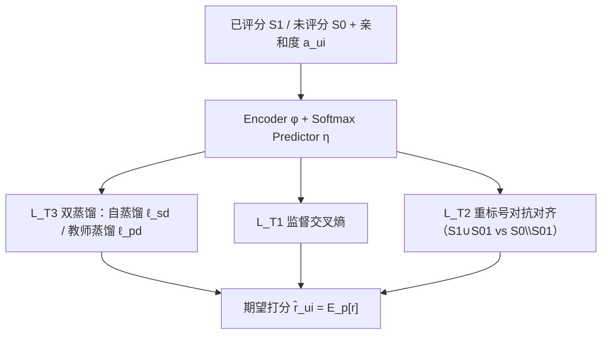

# BPL: Bias-adaptive Preference Distillation Learning for Recommender System (偏置自适应偏好蒸馏学习)

- **会议/期刊**: IEEE TKDE 2026（arXiv 2510.16076）
- **作者与机构**: SeongKu Kang, Dongha Lee, Wonbin Kweon, Hwanjo Yu 等（Korea University / Yonsei / POSTECH / Microsoft Research Asia / William & Mary）
- **推荐链路定位**: 精排（多级显式评分预测打分）
- **研究方向**: 去偏公平与可信推荐 / 跨域分布对齐
- **论文原文**: [https://arxiv.org/abs/2510.16076v1](https://arxiv.org/abs/2510.16076v1)
- **开源代码**: [https://github.com/SeongKu-Kang/BPL](https://github.com/SeongKu-Kang/BPL)

## TL;DR (1分钟核心速览)

现有显式反馈去偏方法（IPS/DR 系列）一味优化 RCT 反事实测试，却在本平台真实交互构成的 factual 测试上大幅掉点，形成次优折中；蒸馏方法 InterD 又受限于两个固定 teacher 的质量天花板。BPL 将真实风险按 Ben-David 上界拆成「已评分经验风险 + 分布散度 + 理想假设联合误差」三项，用**亲和度自适应的双蒸馏**（可靠性过滤自蒸馏 + 置信惩罚偏好蒸馏）填补未评分空间。在 Yahoo!R3/Coat/KuaiRec 上同时取得 factual 与 counterfactual 双低误差，Yahoo!R3 RCT 基准 MSE 由 1.278 降至 0.987（`-22.8%`），MAE 由 0.849 降至 0.745（`-12.2%`）。

## Background & Motivation (背景与核心矛盾)

- **主流范式**: 显式反馈去偏以 IPS 重加权、数据插补及二者结合的 DR 为主线（Stable-DR/MRDR、DCE-TDR），大多假设可获得少量随机曝光数据或无偏训练集，指标普遍只报 RCT 反事实测试。
- **前人局限**: ① 只优化反事实环境导致 factual 精度显著退化——propensity 重加权压制了已收集反馈中的有效信号；② KD 路线（InterD）把偏置/去偏 teacher 的预测插值蒸馏，本质仍被预训练 teacher 的能力上界锁死，常相对去偏 teacher 仅有边际收益甚至倒退。
- **核心洞察 (Key Insight)**: 论文定义 **$S_1$-affinity**，即用一层 MLP 二分类器估计的$\hat{p}(s_{ui}=1)$。实验（图 2、图 3）显示：偏置模型在**高 affinity**（流行度高、流行度对齐强、与大众意见一致性高）的样本上误差稳定偏低，因为这些样本与$S_1$ 同源同分布；但在低 affinity 样本上误差爆炸。去偏模型恰好相反。因此偏置教师的知识不该被整体丢弃或整体重加权，而应按 affinity **选择性取用**。
- **本文切入点**: 把"该用哪部分偏置知识"转化为风险上界第三项 $T_3$（表征的评分判别性）的最小化问题，用双蒸馏在未评分空间上做渐进式知识扩展。

<figure class="paper-figure" markdown="span">
  ![图 1：三种真实世界数据集上多种偏好学习方法在事实测试和反事实测试中的均方误差。我们比较四种不同方法：(a) 未进行去偏学习的标准训练，(b) Stable-MRDR \[5\]，一种近期去偏方法，(c) InterD \[18\]，一种代表性知识蒸馏方法，以及（紫色）BPL，本文提出的方法。](../../../../assets/papers/2510.16076v1/figure_1.png)<figcaption>图 1：三种真实世界数据集上多种偏好学习方法在事实测试和反事实测试中的均方误差。我们比较四种不同方法：(a) 未进行去偏学习的标准训练，(b) Stable-MRDR [5]，一种近期去偏方法，(c) InterD [18]，一种代表性知识蒸馏方法，以及（紫色）BPL，本文提出的方法。</figcaption>
</figure>

## Method (核心方法设计)

### 1. 整体框架 (Overall Architecture)

模型为 encoder $\phi$+ K 类 softmax predictor$\eta$的标准评分预测骨架（ID-based / GNN / DNN 均可替换）。训练前先用二分类器离线估计全库的$S_1$-affinity；训练中三个损失联合优化：$\mathcal{L}_{T1}$拟合已评分数据、$\mathcal{L}_{T2}$在表征空间对齐已评分与未评分分布、$\mathcal{L}_{T3}$通过双蒸馏把偏好知识铺展到未评分样本。评分输出取期望$\hat{r}_{ui}=\mathbb{E}_{\hat{p}}[r_{ui}]=\sum_k k\hat{p}(r_{ui}=k)$，该形式使蒸馏时可直接以"期望值匹配 + 熵惩罚"控制置信度。推理只用骨干模型$f$，**无额外推理开销**。

### 2. 关键设计拆解 (Key Designs)

**（1）风险上界三项分解（问题重构）**：真实风险不可达，故最小化可证的域适应上界：$\epsilon_{\mathcal{S}}(\eta)\le\epsilon_{\mathcal{S}_1}(\eta)+\lambda_0\big(\tfrac{1}{2}d_{\mathcal{H}\Delta\mathcal{H}}(\mathcal{Z}_{S_0},\mathcal{Z}_{S_1})+(\epsilon_{S_0}(\eta^*)+\epsilon_{S_1}(\eta^*))\big)$。$T_1$即常规交叉熵；$T_2$用对抗学习近似$\mathcal{H}\Delta\mathcal{H}$散度；**$T_3$（理想假设在两侧的联合误差）因$S_0$ 无标签而无法直接估计，是本文主攻项**——直觉上它等价于"表征里是否已包含足够区分评分等级的信息"。

**（2）重标号对抗对齐 $T_2$**：痛点在于$S_0$与$S_1$并非独立域（用户持续使用后$S_0$会自然被评分），判别器找不到清晰决策边界、对齐随之失效。做法是把 affinity 最高的$x\%$未评分样本并入已评分域，让判别器区分$S_1\cup S_{01}$与$S_0\setminus S_{01}$：$\max_{f_d}\mathcal{L}_{T2}=\sum_{(u,i)\in S_1\cup S_{01}}\log f_d(z_{ui})+\sum_{(u,i)\in S_0\setminus S_{01}}\log(1-f_d(z_{ui}))$，判别器有了可分边界，encoder 才有明确的对齐梯度。

**（3）可靠性过滤自蒸馏 $\ell_{sd}$**：直接自蒸馏会被大量不可靠预测污染。论文用**时间一致性**（而非最大概率）作可靠性判据：维护移动平均教师$\theta_{f_{te}}=\tau\theta_{f_{te}}+(1-\tau)\theta_f$（$\tau=0.999$），仅当$\arg\max_k\hat{p}_{te}=\arg\max_k\hat{p}$时对未评分样本做熵最小化：$\ell_{sd}=\mathbb{1}[\arg\max_k\hat{p}_{te}=\arg\max_k\hat{p}]\,\mathcal{H}(\hat{p}(r_{ui}))$。图 5 显示最大概率在高/低 affinity 组间差异超 20%，阈值不可迁移；而一致性判据与概率幅值无关，更稳健。

**（4）置信惩罚偏好蒸馏 $\ell_{pd}$+ 亲和度自适应组合**：高 affinity 样本上偏置教师可靠，但直接拟合会让模型记住"从众/流行度"等不可泛化模式。故在蒸馏项上叠熵惩罚：$\ell_{pd}=\lambda(\mathbb{E}_{\hat{p}}[r_{ui}]-t_{ui})^2-\mathcal{H}(\hat{p}(r_{ui}))$。最终按亲和度加权组合两条蒸馏路线：$\mathcal{L}_{T3}=|\mathcal{S}_0|^{-1}\sum_{(u,i)\in\mathcal{S}_0}a_{ui}\ell_{pd}+(1-a_{ui})\ell_{sd}$，其中$a_{ui}=\hat{p}(s_{ui}=1)$为 Soft 版，$a_{ui}=\mathbb{1}[(u,i)\in S_{01}]$ 为 Hard 版。

**（5）训练目标与推理效率**：$\min_{\phi,\eta}\max_{f_d}\mathcal{L}_{T1}+\alpha\mathcal{L}_{T2}+\beta\mathcal{L}_{T3}$，配合 Adam、$\lambda=1.0$、$\alpha,\beta\in\{0.5,\dots,2.0\}$。负采样策略不适用（显式评分回归/分类任务），$S_1$-affinity 一次性预计算，训练后仅保留骨干网络。

## Experimental Setup & Evaluation Protocol (实验设置与评估协议)

- **数据集与预处理**: 三个自带偏置训练集 + 反事实测试集的真实数据；论文额外从偏置训练集随机抽 10% 作为 **factual 测试集**，剩余 90% 训练，再从训练集留 10% 作验证。

| 数据集 | #Users | #Items | #Interactions (train / CF / factual) | 密度 | 特征/场景说明 |
| :--- | :---: | :---: | :---: | :---: | :--- |
| Yahoo!R3 | 15,400 | 1,000 | 280,534 / 54,000 / 31,170 | 1.8% | RCT 反事实测试，1–5 星级 |
| Coat | 290 | 300 | 6,264 / 4,640 / 696 | 7.2% | 小规模 RCT，自选偏置极强 |
| KuaiRec | 7,176 | 10,728 | 11,277,725 / 4,676,570 / 1,253,081 | 14.6% | 全曝光测试集，观看率转为 1–5 分 |

- **数据划分与防穿越 (Splitting Strategy)**: 比例划分（训练/验证/事实测试）+ 数据集自带的 RCT 或全曝光反事实测试集，二者互不重叠，反事实分数不作为训练信号。
- **排名评测协议 (Ranking Protocol)**: 本文为**评分预测**任务，采用 MSE 与 MAE 而非 Top-N 排序，属全样本（全库对）误差评估；不做负采样，也不做 `Sampled Ranking`。五折/五次独立运行取均值。
- **对比基线与超参设置**: 标准训练、FADA、FADA/IA、FreeMatch、IPS、AT/AST、DAMF、MR、TMRDR-CL、Stable-DR/Stable-MRDR、DCE-TDR、TIDE、Zerosum、ESAM、InvCF、InterD，以及新增 DebiasKD；嵌入维度在 $\{16,32,64,128\}$中按验证集选定（Yahoo!R3 与 KuaiRec 取 64，Coat 取 32），配对 t 检验$p<0.05$。

## Key Experimental Results (实验关键数据)

### 1. 主实验对比 (Main Results) — 基准 RCT 反事实测试

| Method | Yahoo!R3 MSE | Yahoo!R3 MAE | Coat MSE | Coat MAE |
| :--- | :---: | :---: | :---: | :---: |
| Standard Training | 1.937 | 1.086 | 1.284 | 0.904 |
| FADA/IA | 1.456 | 0.898 | 1.253 | 0.845 |
| AT | 1.350 | 0.945 | 1.105 | 0.832 |
| Stable-MRDR | 1.316 | 0.882 | 1.093 | 0.779 |
| Stable-DR | 1.327 | 0.887 | **1.088** | **0.778** |
| InterD | 1.278 | 0.849 | 1.052 | 0.814 |
| DebiasKD | 1.354 | 0.895 | 1.101 | 0.795 |
| BPL-Soft | 1.086 | 0.787 | 1.006 | 0.782 |
| **BPL-Hard** | **0.987\*** | **0.745\*** | **0.986\*** | 0.779 |
| Improv. | `-22.8%` | `-12.2%` | `-6.3%` | `+0.1%` |

（`*` 表示对最佳基线的配对 t 检验 $p<0.05$ 显著；Improv. 以 InterD 为参照。）在 factual + counterfactual 联合设置（图 6/7）中，BPL-Hard 取得最低调和均值：Yahoo!R3 factual **1.469** / counterfactual **0.991**，Coat factual **1.104** / counterfactual **1.037**，且在 6 个反事实场景中 5 个显著优于最佳基线。

### 2. 消融实验 (Ablation Study, MSE)

| 变体 | Yahoo! factual | Yahoo! counterfactual | Coat factual | Coat counterfactual |
| :--- | :---: | :---: | :---: | :---: |
| **BPL-Hard (full)** | **1.469** | **0.991** | **1.104** | **1.037** |
| w/o $\mathcal{L}_{T2}$ | 1.509 | 1.219 | 1.119 | 1.120 |
| w/o $\ell_{sd}$ | 1.426 | 2.035 | 1.089 | 1.211 |
| w/o $\ell_{pd}$ | 1.494 | 2.304 | 1.149 | 1.242 |
| w/o $\mathcal{L}_{T2}$&$\mathcal{L}_{T3}$ | 1.539 | 1.938 | 1.123 | 1.287 |
| w/o confidence penalty | 1.454 | 2.258 | 1.101 | 1.371 |
| $S_1$-affinity 当 propensity | 1.720 | 1.694 | 1.294 | 1.192 |

### 3. 关键实验发现 (Key Findings)

1. **双蒸馏互补且不可替代**：去掉任一条蒸馏都会在反事实测试上塌陷（$\ell_{sd}$移除：0.991→2.035；$\ell_{pd}$移除：0.991→2.304，均为 Yahoo!R3）。但注意 factual 侧反而略有改善（1.469→1.426），说明 factual 精度主要由$T_1$ 与教师蒸馏维持，而**反事实泛化完全由自蒸馏的渐进扩展提供**——这正是与 InterD"两条 teacher 静态插值"的本质分野。
2. **置信惩罚是教师蒸馏的生死开关**：仅去掉 $-H(\hat{p})$ 项（即退化为朴素 teacher-student 蒸馏），Coat 反事实误差从 1.037 飙至 1.371，Yahoo!R3 从 0.991 至 2.258，验证了"高 affinity 子集高度受流行度与从众偏差污染，无惩罚必然过拟合教师"的假设；同时 DebiasKD（同类朴素蒸馏基线）也劣于最优去偏方法，形成双向印证。
3. **affinity 应作"选择门"而非"权重"**：把 $\hat{p}(s_{ui}=1)$当作 propensity 去重加权训练损失，是全部变体中最差（Yahoo!R3 1.720/1.694），且 Hard 版（只在$S_{01}$上启用教师）稳定优于 Soft 版，对 10 种不同 affinity 估计器（换种子/换层数）均保持优于 InterD 的稳健性——因为它只用排序信息而非幅值。此外表征质量分析（图 8）显示 BPL 在高评分等级上 F1 提升最大，即真正改善了$T_3$ 所度量的评分判别性。

## Highlights & Limitations (亮点、对比与审稿批判)

- **与代表作对比 (vs. Prior Work)**: 与 Stable-MRDR 等 DR 系方法相比，BPL 不做重加权也不做插补，因而不牺牲已收集反馈中的真实信号；与 InterD 相比，BPL 不以固定 teacher 为知识上限，而是让目标模型在训练过程中自我迭代扩展（自蒸馏），并把教师知识限定在高 affinity 子集内；与 DAMF/InvCF 等对抗式域适应相比，BPL 指出了"$S_0/S_1$ 非独立域导致判别器坍缩"这一被忽视的工程陷阱，并给出重标号修法。
- **可迁移亮点**: ①「用二分类器估计样本亲和度 → 按亲和度做知识路由」这一范式可直接迁移到冷启动物品、跨场景迁移与新用户分层蒸馏；②「时间一致性 + 熵最小化」的免阈值可靠性过滤，可复用于半监督/伪标签式推荐的样本筛选。
- **审稿级局限批判**: ① 评估仅覆盖评分预测（MSE/MAE），未涉及 Top-N 全库排序或线上排序指标，MSE 的 0.0x 级改进对真实排序收益的映射不明；② 需要两阶段训练（先训偏置教师、再离线训 affinity 分类器），训练开销与超参 $x$（$S_{01}$规模）对数据集分布散度敏感——论文自承 Yahoo!R3（KL=0.470）与 Coat（KL=0.049）的最优$x$ 差异明显，缺少自动选择准则；③ 未验证隐式反馈与 CTR 场景，泛化边界待检验。

## Rating (四维评分)

- **方法创新性 (Novelty)**: ⭐⭐⭐⭐ （把风险上界第三项 $T_3$ 明确落到"双蒸馏 + 亲和度路由"上，理论分解与算子设计咬合紧密，虽各组件均为已知技术但组合视角新颖）
- **评估协议与实验扎实度 (Protocol & Experiments)**: ⭐⭐⭐⭐ （三数据集 × factual/counterfactual 双环境 + 16 个基线 + 配对 t 检验 + 5 次重复，消融与超参/骨干/亲和度估计器敏感性分析齐全；扣分在于无排序指标与线上验证）
- **写作与数学规范度 (Clarity & Rigor)**: ⭐⭐⭐⭐ （上界推导引用清晰、三项损失与三项界一一对应，动机分析图 2/3/5 层层递进；部分符号如 $\mathcal{S}_{01}$与$x$ 的关系仅在正文口头说明）
- **工业落地与复现价值 (Industrial & Practical Value)**: ⭐⭐⭐⭐ （推理零额外开销、骨干可插拔、代码已开源；代价是需额外训练偏置教师与亲和度分类器，且 $x$ 需按数据分布调参）

