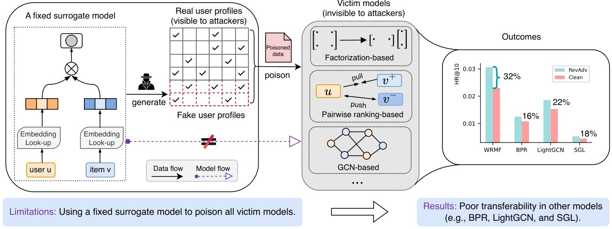
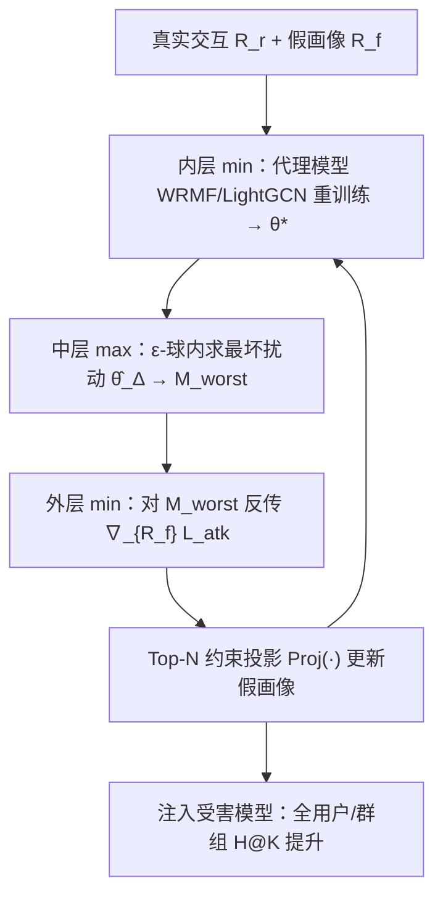
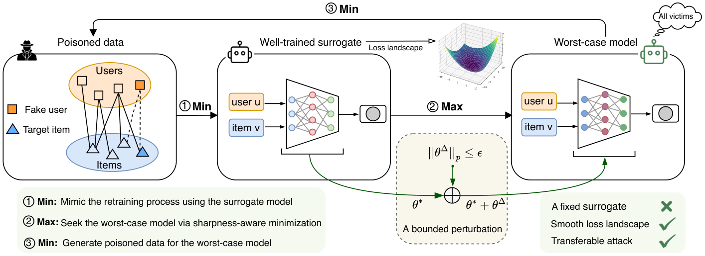

# Sharpness-Aware Poisoning: Enhancing Transferability of Injective Attacks on Recommender Systems (锐度感知投毒：增强推荐系统注入式攻击的迁移性)

- **会议/期刊**: IEEE TKDE 2026
- **作者与机构**: Junsong Xie, Yonghui Yang, Pengyang Shao, Le Wu（合肥工业大学大数据知识工程重点实验室 / 新加坡国立大学 NExT++）
- **推荐链路定位**: 召回（训练数据投毒 / 假用户画像注入，黑盒受害模型跨架构泛化）
- **研究方向**: 去偏公平、可信隐私与工业架构（可信推荐 / 对抗鲁棒性）
- **论文原文**: [https://arxiv.org/abs/2604.22170v1](https://arxiv.org/abs/2604.22170v1)
- **开源代码**: 暂未开源

## TL;DR (1分钟核心速览)

注入式投毒攻击的既有梯度方法都假设“为固定代理模型（如 WRMF）生成的假用户画像可迁移攻击任意受害模型”，当受害模型换成 BPR/LightGCN/SimGCL 时攻击增益骤降（RevAdv 在 WRMF 上 +32%，在 SGL 上仅 +18%）。本文提出 SharpAP，用锐度感知最小化在代理参数 $\epsilon$-邻域内近似最坏受害模型，把攻击重写为 min-max-min 三层优化。在 3 个真实数据集、5 类受害模型（含全用户攻击与群组攻击）上，无需额外攻击预算即可把 RevAdv 在 BPR/LightGCN 上的 H@20 分别提升 **30.3%/30.8%**，运行时间仅增约 5%。

## Background & Motivation (背景与核心矛盾)

- **主流范式**: 梯度类投毒攻击把离散假画像松弛为连续变量，先在固定代理模型上求解双层优化 $\min_{R_f}\mathcal{L}_{atk}$s.t.$\theta^*=\arg\min_\theta \mathcal{L}_{rec}$，再把生成的$R_f$ 注入目标系统诱导重训练。
- **前人局限**: ①该范式隐含“一个代理毒全天下”的脆弱假设，忽略代理与受害模型之间的结构差异（矩阵分解 vs. 成对排序 vs. 高阶图聚合），导致毒化数据对代理过拟合；②受害模型结构空间 $\Omega$ 巨大，攻击者无法在攻击过程中直接枚举或精确定位最坏受害模型。
- **核心洞察 (Key Insight)**: 作者在图 2 中实测 RevAdv 的相对增益从 WRMF 的 32% 衰减到 BPR 16%、LightGCN 22%、SGL 18%。由此推断：若能针对“最坏受害模型”优化毒化数据，则该数据的攻击效果对所有受害模型构成上界，迁移性自然提升。
- **本文切入点**: 借用锐度感知最小化（SAM）的“邻域最坏扰动”思想，用一个额外的前/反向传播在代理参数附近构造近似最坏模型，把迁移性显式写入攻击目标。

<figure class="paper-figure" markdown="span">
  <figcaption>图 2. 本文动机来源示意图。由于攻击者无法访问受害模型，现有方法使用固定代理模型来模拟受害模型以生成投毒数据。这些方法首先确保投毒数据在代理模型上的有效性，然后期望其在所有未见受害模型上同样有效。我们认为这些方法忽略了代理模型与受害模型之间的结构差异，这不可避免地导致攻击迁移性受损。右侧展示的实验结果突出了这些局限性。</figcaption>
</figure>

## Method (核心方法设计)

### 1. 整体框架 (Overall Architecture)

SharpAP 不改动上游假用户画像的离散化与投影流程，只在“代理模型训练完成 $\theta^*$”与“对$R_f$求梯度”之间插入一个最大化步骤：先在代理参数球$\|\theta_\Delta\|_p\le\epsilon$内求攻击损失最大的扰动模型$M_{worst}$，再对该扰动模型反传得到$R_f$的更新方向，最后经 Top-$N$ 约束投影回离散 0/1 画像并进入下一轮外迭代。整体是一个“代理重训练 → 最坏模型搜索 → 毒化数据更新”的三层闭环，可与 RevAdv/RAPU/DADA/CLeaR/DDSP 等任意骨干无缝拼接。

### 2. 关键设计拆解 (Key Designs)

1. **锐度感知三层优化（把“迁移性”变成可优化目标）**：痛点是用固定 $M_s$生成毒化数据必然过拟合。作者先定义受害模型空间$\Omega=\{M_v\mid \mathcal{L}_{rec}(R,M_v(R))\le\rho\}$，最坏模型为$M_{worst}=\arg\max_{M_v\in\Omega}\mathcal{L}_{atk}$，从而有$\mathbb{E}[\mathcal{L}_{atk}(M_v)]\le\mathcal{L}_{atk}(M_{worst})$；由于精确求解不可行，改用局部扰动近似：
$\min_{R_f}\max_{\|\theta_\Delta\|_p\le\epsilon}\mathcal{L}_{atk}\big(M_s(\theta^*+\theta_\Delta;R_r)\big),\ \text{s.t.}\ \theta^*=\arg\min_\theta\mathcal{L}_{rec}(R,M_s(\theta;R))$
直觉是：平坦的损失景观意味着受害模型参数漂移后攻击仍有效，因此“毒化最坏模型”等价于压平景观。

2. **一阶闭式扰动与离散投影（几乎零额外开销）**：最大化子问题用一阶 Taylor 展开得到与 SAM 同构的闭式解 $\hat{\theta}_\Delta=\epsilon\cdot\frac{\nabla_\theta\mathcal{L}_{atk}(\theta^*)}{\|\nabla_\theta\mathcal{L}_{atk}(\theta^*)\|_2}$，只需一次反向传播；随后在扰动点上求$\nabla_{R_f}\mathcal{L}_{atk}(\theta^*+\hat{\theta}_\Delta)$并做 Top-$N$投影$\text{Proj}(\hat{r}_{u_f v})=1$当且仅当$v\in\mathcal{N}_{u_f}$，保证画像稀疏性与预算约束$|U_f|\le\delta|U_r|$、$\|R_f[u_f]\|_0\le N$。

3. **迁移性上界与攻击损失族**：在 $\mathcal{L}_{atk}$为$L$-光滑、受害参数落在$\epsilon$-邻域（$\|\theta_v-\theta^*\|_2\le\epsilon$）假设下，可证
$\mathcal{L}_{atk}(\theta_v)\le \underbrace{\mathcal{L}_{atk}(\theta^*)}_{\text{代理性能}}+\underbrace{\epsilon\|\nabla\mathcal{L}_{atk}(\theta^*)\|_2}_{\text{局部锐度}}+\frac{L\epsilon^2}{2}$即传统方法只压第一项，锐度项可在大曲率景观下主导迁移差距；SharpAP 的最大化步骤正是该上界的代理优化。全用户攻击取$\mathcal{L}_{atk}^{full}=-\sum_{v_t\in\mathcal{V}_t}\sum_{u_r\in\mathcal{U}_r}\log\frac{\exp(\hat{r}_{u_r v_t})}{\sum_{v\in\mathcal{V}}\exp(\hat{r}_{u_r v})}$，群组攻击取组间得分差$\mathcal{L}_{atk}^{group}=\sum_{v_t}\big(\frac{1}{|\mathcal{U}_1|}\sum_{u\in\mathcal{U}_1}\mathbb{I}_{v_t\notin\Gamma_u}\hat{r}_{uv_t}-\frac{1}{|\mathcal{U}_0|}\sum_{u\in\mathcal{U}_0}\hat{r}_{uv_t}\big)$；内层$\mathcal{L}_{rec}$沿用 WRMF 的加权平方误差，超参与 RevAdv 对齐。复杂度$O(L(T+2)|U|\bar{n}d)$，相比双层优化每轮仅多一次反向传播。

<figure class="paper-figure" markdown="span">
  <figcaption>图 4. 我们的方法 SharpAP 的整体示意图。我们提出一种锐度感知的三层优化，该优化在有界扰动下寻找最坏情况模型（即具有最差投毒效果的受害模型）以生成鲁棒的投毒数据。</figcaption>
</figure>

## Experimental Setup & Evaluation Protocol (实验设置与评估协议)

| 数据集 | #Users | #Items | #Interactions | 密度 | 预处理/场景说明 |
| :--- | :---: | :---: | :---: | :---: | :--- |
| MovieLens-1M | 6,014 | 3,232 | 226,310 | 1.17% | 评分=5 视为正反馈；含性别属性，可做群组攻击 |
| Gowalla | 13,149 | 14,007 | 433,356 | 0.24% | 移除交互 <15 的冷启动用户/物品 |
| Amazon-book | 52,643 | 91,599 | 2,984,108 | 0.06% | 10-core 过滤 |

- **数据划分与防穿越**: 统一 `7:1:2` 训练/验证/测试比例划分；投毒数据仅注入训练集，测试集保持干净，评价时对受害模型完整重训练，无信息泄露。
- **排名评测协议**: 对全体真实测试用户做 `Full-Ranking`（全库排序，非采样），全用户攻击用 H@K 与 N@K（目标物品相关度为 1、其余为 0），5 个目标物品随机采样后 10 次重复取均值；群组攻击用 $D@K=H_{U_0}@K-H_{U_1}@K$ 度量组间命中差。
- **对比基线与超参**: 启发式（Random/Popular/CoVis）、神经网络（AUSH）、梯度类（PGA/RevAdv/RAPU/DADA/CLeaR/DDSP）；受害模型 WRMF、BPR、LightGCN、SGL、SimGCL；代理默认 WRMF，另设 LightGCN 代理实验。假用户比例 $\delta=1\%$，画像长度$N$取真实用户平均交互数，$\lambda_2=1$，扰动半径$\epsilon$在$\{0.005,0.02,0.05,0.1,0.2\}$网格搜索默认$0.05$；报告 ±标准差（随机种子/目标采样 10 次）。

## Key Experimental Results (实验关键数据)

### 1. 主实验对比 (Main Results)

MovieLens-1M 全用户攻击 H@20（代理 = WRMF，干净基线 Clean：WRMF 0.0614 / BPR 0.0294 / LightGCN 0.0417 / SGL 0.0171 / SimGCL 0.0152）：

| Attacker | WRMF | BPR | LightGCN | SGL | SimGCL |
| :--- | :---: | :---: | :---: | :---: | :---: |
| Popular | 0.0630 | 0.0298 | 0.0418 | 0.0179 | 0.0167 |
| AUSH | 0.0731 | 0.0315 | 0.0485 | 0.0181 | 0.0191 |
| RevAdv | 0.0743 | 0.0333 | 0.0491 | 0.0196 | 0.0203 |
| **RevAdv+SharpAP** | **0.0783** | **0.0434** | **0.0642** | **0.0229** | **0.0234** |
| DADA | 0.0759 | 0.0344 | 0.0539 | 0.0217 | 0.0205 |
| **DADA+SharpAP** | 0.0798 | 0.0442 | 0.0604 | 0.0240 | 0.0240 |
| DDSP | 0.0771 | 0.0339 | 0.0512 | 0.0216 | 0.0221 |
| **DDSP+SharpAP** | **0.0803** | **0.0448** | **0.0663** | **0.0242** | **0.0244** |
| Improv. (RevAdv→+SharpAP) | +5.4% | +30.3% | +30.8% | +16.8% | +15.3% |

Gowalla 上 DADA+SharpAP 将 WRMF/BPR/LightGCN 从 0.0141/0.0173/0.0198 提升至 **0.0163/0.0199/0.0214**；Amazon-book 上 DDSP+SharpAP 达到 **0.2107/0.1594/0.2073/0.2481/0.2530**（WRMF/BPR/LightGCN/SGL/SimGCL），均为全局最优。

### 2. 消融与鲁棒性分析 (Ablation & Robustness)

| 配置（MovieLens-1M，RevAdv 骨干） | WRMF | BPR | LightGCN | 说明 |
| :--- | :---: | :---: | :---: | :--- |
| w/o SharpAP（原双层优化） | 0.0743 | 0.0333 | 0.0491 | 基准 |
| w/ SharpAP（$\epsilon=0.05$） | **0.0783** | **0.0434** | **0.0642** | 全程最优 |
| $\epsilon=0.005$（退化） | ≈0.074 | ≈0.034 | ≈0.050 | 搜索空间过小，退回骨干 |
| $\epsilon=0.2$（过大） | 下降 | 下降 | 下降 | 偏离$\mathcal{L}_{rec}$可行域$\Omega$ |
| LightGCN 作代理 + SharpAP | 0.0783 | 0.0434 | 0.0608 | 代理换成图模型仍显著迁移 |
| 防御 PCA（H@10, BPR/LightGCN） | — | 0.0162/0.0241 | — | 攻击被削弱但仍压过 RevAdv 的 0.0121/0.0184 |
| 防御 PamaCF（H@10） | — | 0.0146/0.0216 | — | 强防御下仍保持优势 |

### 3. 关键实验发现 (Key Findings)

1. **迁移性提升主要发生在“结构差异最大”的受害模型上**：RevAdv+SharpAP 在 WRMF（同为矩阵分解）上仅 +5.4%，而在成对排序 BPR 与图模型 LightGCN 上分别 +30.3%/+30.8%，印证“代理-受害结构错配越严重，锐度项收益越大”的理论刻画。
2. **冷门目标物品是锐度感知的最大受益者**：群组攻击中，RevAdv+SharpAP 在 WRMF 上把冷门物品的 $D@10$ 从 0.0014 提到 0.0105（约 7 倍），而热门物品仅从 0.0412 到 0.0537，说明压平景观比单纯提高代理命中更利于稀疏嵌入的推广。
3. **代价极低且防御逃逸性更好**：每轮仅多一次反向传播，总耗时从 465.22s 增至 483.09s（约 +5%）；t-SNE 显示 SharpAP 生成的假用户分散嵌于真实用户簇中（RevAdv 则聚成紧簇），在 PCA/APT/PamaCF 三类防御下命中率仍全面领先，说明锐度优化同时抹平了统计足迹。

## Highlights & Limitations (亮点、对比与审稿批判)

- **与代表作对比 (vs. Prior Work)**: RevAdv 改进梯度计算的精确性、DADA 改进攻击目标的难度/多样性加权、DDSP 引入双促销目标，三者都在“固定代理模型 + 更好目标函数”的框架内打转；SharpAP 是首个把“代理-受害结构漂移”显式建模为优化变量（最坏模型）的工作，且作为插件与上述骨干正交叠加，而非替代。
- **可迁移亮点**: ①“$\epsilon$-邻域最坏参数 + 一阶闭式扰动”这一廉价模块可直接搬到任何以黑盒模型为优化对象的场景（如跨域迁移、模型窃取、鲁棒训练的正则项）；②平坦景观可视化 + Lipschitz 上界的三段式论证范式，适合用于其他“迁移性/泛化性”主张的可信度验证。
- **审稿级局限批判**: ①最坏模型仅在代理参数邻域内搜索，理论保证依赖“受害模型参数落在 $\epsilon$-球内”的强假设，对结构差异极大的模型（如序列/生成式推荐）该假设可能失效，实验也未覆盖此类受害模型；②$L$-光滑常数与$\epsilon$强耦合，$\epsilon$需逐数据集网格搜索（$0.005$退化、$0.2$反降），且论文未给出自适应$\epsilon$ 方案；③攻击有效性结论建立在“平台会原样重训练”的前提，缺少对增量训练、在线学习或实时过滤等工业流水线的评估。

## Rating (四维评分)

- **方法创新性 (Novelty)**: ⭐⭐⭐⭐ （首次将 SAM 引入推荐投毒，min-max-min 三层建模与迁移性上界推导构成完整闭环，但 SAM 本身是成熟技术，属“跨领域移植 + 理论补齐”型创新）
- **评估协议与实验扎实度 (Protocol & Experiments)**: ⭐⭐⭐⭐ （3 数据集 × 5 受害模型 × 10 类基线 × Full-Ranking × 10 次重复，含全用户/群组/冷热门/防御/代理切换/预算与画像长度敏感性，覆盖面充分；扣分在于缺少与“序列/生成式受害模型”的对比及显式组件消融表）
- **写作与数学规范度 (Clarity & Rigor)**: ⭐⭐⭐⭐ （三层优化、闭式扰动、投影算子与 Lipschitz 上界推导链条清晰，复杂度分析到位；主文部分叙述性数字与表格数值略有出入，需读者自行校对）
- **工业落地与复现价值 (Industrial & Practical Value)**: ⭐⭐⭐⭐ （仅增约 5% 训练开销、可插拔式集成、且反向揭示了“平坦景观 = 更强攻击”这一防御侧启示；但代码未开源，且攻击方视角的实用价值需配合防御研究转化）

