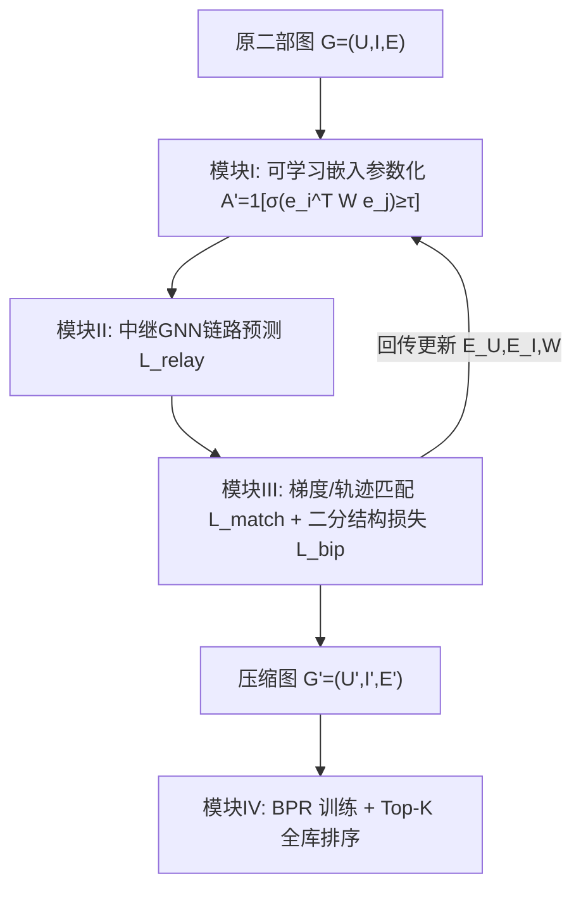
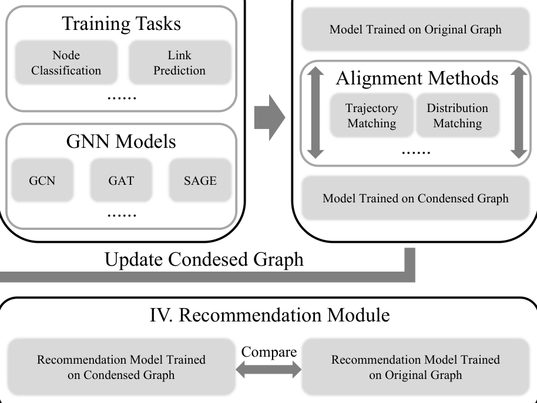

# Democratic Recommendation with User and Item Representatives Produced by Graph Condensation (基于图压缩生成用户与物品代表的民主式推荐)

- **会议/期刊**: IEEE TKDE
- **作者与机构**: Jiahao Liang, Haoran Yang, Xiangyu Zhao, Zhiwen Yu, Guandong Xu, Wanyu Wang, Kaixiang Yang（华南理工、中南大学、香港城市大学、香港教育大学）
- **推荐链路定位**: 召回（图嵌入训练阶段的图数据压缩）
- **研究方向**: 图神经网络与知识图谱推荐 / 协同过滤与双塔召回
- **论文原文**: [https://arxiv.org/abs/2511.18279v1](https://arxiv.org/abs/2511.18279v1)
- **开源代码**: 暂未开源

## TL;DR (1分钟核心速览)

针对大规模用户-物品二分图上 GNN 消息传递开销高、且同质边缺失导致高阶信息传播低效的痛点，作者把图压缩（Graph Condensation, GC）首次迁移到推荐，提出 DemoRec：用可学习嵌入参数化压缩图邻接矩阵，以中继 GNN 的梯度匹配对齐原图训练动力学，并用**二分结构损失 BSL** 抑制压缩过程产生的用户-用户/物品-物品伪边。在 4 个 10-core 数据集、80/20 划分、全库排序（Full-Ranking）协议下，仅保留 80% 数据规模的 DemoRec 相比最佳同预算基线 UnKD/GASD 提升 1.1%–2.6%，相比 100% 数据的 LightGCL 仅降约 5%–10%，而每 epoch 训练时间 6.50s（SAGE 骨干）反优于 LightGCN 的 7.01s。

## Background & Motivation (背景与核心矛盾)

- **主流范式**: 以 LightGCN / UltraGCN / LightGCL 为代表，在原始二部图上做多阶邻居聚合或对比增广；效率侧则有邻居采样、图稀疏化、图粗化(coarsening)与知识蒸馏压缩。
- **前人局限 1**: 模型中心的采样/线性聚合效果高度依赖架构与超参，泛化差；数据中心的稀疏化/粗化依赖特征值或成对距离等启发式，易造成不可逆信息损失，且**未针对二分结构设计**。
- **前人局限 2**: 为缓解二分图无同质边的问题只能堆叠 GNN 层数，既抬高计算量与显存，又触发过平滑，表征趋于不可分。
- **核心洞察 (Key Insight)**: 作者类比"民主选举"——让少数代表聚合多数人的诉求，即可在保留关键结构的前提下减少参与者（节点）数量；图压缩正是"选代表"的可微实现，但直接套用会在参数化邻接矩阵上生成语义上的伪同质边。
- **本文切入点**: 构建面向二部图的压缩框架，用梯度匹配保证行为一致、用可微 BSL 强制跨组连边，从而摆脱高阶传播依赖。

## Method (核心方法设计)

### 1. 整体框架 (Overall Architecture)

两阶段级联：**Stage One 图压缩**——初始化可学习嵌入表 $\mathbf{E}_U\in\mathbb{R}^{|U'|\times d}$、$\mathbf{E}_I\in\mathbb{R}^{|I'|\times d}$与变换矩阵$\mathbf{W}$，经参数化函数生成压缩邻接矩阵并二值化；随后训练中继 GNN（GCN/GAT/SAGE）完成链路预测，用梯度匹配把"在压缩图上训练"的行为拉向"在原图上训练"的行为，同时叠加 BSL 约束，迭代回传更新$\mathbf{E}_U,\mathbf{E}_I,\mathbf{W}$。**Stage Two 推荐**——在收敛的压缩图$G'$上用 BPR 训练推荐模型并输出 Top-K 排序。压缩图为一次性预计算，其后所有 epoch 均在$|V'|\ll|V|$的图上进行，复杂度由$O(KEd)$降至$O(KE'd)$。

<figure class="paper-figure" markdown="span">
  <figcaption>图2：所提出的 DemoRec 的详细架构。该架构由两个不同部分组成：图压缩模块和推荐模块。</figcaption>
</figure>

### 2. 关键设计拆解 (Key Designs)

1. **可微邻接参数化 + 行为对齐（让压缩图"像"原图）**：直接优化离散邻接矩阵不可导，故改为学习连续嵌入再阈值化，$A'_{ij}=\mathbb{I}\left(\sigma(\mathbf{e}_i^{\top}\mathbf{W}\mathbf{e}_j)\ge\tau\right)$，把组合优化转为嵌入空间优化。对齐目标为双层优化的梯度匹配$\mathcal{L}_{match}=\min_{A',X'}\mathbb{E}_{\theta_0}\sum_{t=0}^{T-1}D\left(\nabla_\theta\mathcal{L}_{relay}(f_{\theta_t}(A',X')),\nabla_\theta\mathcal{L}_{relay}(f_{\theta_t}(T))\right)$，即压缩图应诱发与原图同向的参数更新，从而"蒸馏"出的是训练动力学而非静态输出。

2. **二分结构损失 BSL（堵住伪同质边这个优化捷径）**：由于参数化对节点语义类型不可知，优化器可能添加少量用户-用户/物品-物品边来降低梯度距离，形成语义非法的解。作者以软惩罚替代硬约束：

$$\mathcal{L}_{bip}=\lambda\Big(\sum_{i,j\in U'}\left|A'_{ij}\right|_2^2+\sum_{i,j\in I'}\left|A'_{ij}\right|_2^2\Big)=\lambda\left(\lVert A'\odot M_{U'}\rVert_F^2+\lVert A'\odot M_{I'}\rVert_F^2\right)$$

其梯度 $\partial\mathcal{L}_{bip}/\partial A'_{ij}=2\lambda\left(A'_{ij}M_{U'}^{ij}+A'_{ij}M_{I'}^{ij}\right)$与组内边幅值成正比，逐轮把组内边压向 0；等价的拉普拉斯形式$\lambda\left(\mathrm{tr}(X'^{\top}L_{U'}X')+\mathrm{tr}(X'^{\top}L_{I'}X')\right)$ 说明其物理直觉是**惩罚同组节点特征平滑**，与二分语义一致，且仅为稀疏矩阵乘加，开销极低。

3. **训练目标、负采样与推理开销**：压缩阶段 $\mathcal{L}_{cond}=\mathcal{L}_{bip}+\beta\mathcal{L}_{match}$，中继任务为链路预测并按度分布负采样；推荐阶段在压缩图上用 BPR，负样本从原图未观测交互中随机采样；总目标不含对比增广与多层堆叠，最优配置为 3 层、$d=256$、$\lambda=0.3$、$\beta=0.6$、压缩比$\alpha=80\%$。

## Experimental Setup & Evaluation Protocol (实验设置与评估协议)

- **数据集与预处理**: 统一 10-core 过滤（剔除交互 <10 的用户/物品），覆盖极稀疏到较稠密的密度谱：

| 数据集 | #Users | #Items | #Interactions | 密度 | 场景说明 |
| :--- | :---: | :---: | :---: | :---: | :--- |
| Gowalla | 29,858 | 40,981 | 1,027,370 | 0.084% | 社交签到 |
| Amazon-Book | 52,643 | 91,599 | 2,984,108 | 0.062% | 图书电商评分 |
| LastFM | 23,466 | 48,123 | 8,057,269 | 0.710% | 音乐收听 |
| Yelp | 31,668 | 38,048 | 1,561,406 | 0.130% | 商户点评 |

- **数据划分与防穿越**: 随机 **80%/20% 比例划分**（非全局时间戳切分），无冷启动专用划分。
- **排名评测协议**: **Full-Ranking 全库排序**——所有未交互物品作为候选，报告 P@20 / R@20 / NDCG@20 的用户平均；主实验取种子 1024/2046/4096 三次均值并给出 R@20 标准差，但未报告显著性检验（如 $p<0.05$）。
- **对比基线与超参**: 传统 CF（NGCF、GF-CF）、GNN（LightGCN、UltraGCN、LightGCL）、压缩类（UnKD、GASD）以及作者补充的采样变体 MajSAM / RanSAM；统一 $d=256$、3 层、Adam、lr=1e-3、100 epoch，Top-20 推荐。注意 LightGCL 等为 100% 数据，其余 80% 预算方法与之对比时属"低预算"赛道。

## Key Experimental Results (实验关键数据)

### 1. 主实验对比 (Main Results)

| Method (数据预算) | Gowalla P@20 | Gowalla R@20 | Amazon P@20 | Amazon R@20 | LastFM P@20 | LastFM R@20 | Yelp P@20 | Yelp R@20 |
| :--- | :---: | :---: | :---: | :---: | :---: | :---: | :---: | :---: |
| NGCF (100%) | 0.0342 | 0.0835 | 0.0133 | 0.0325 | 0.0445 | 0.1970 | 0.0208 | 0.0430 |
| GF-CF (100%) | 0.0370 | 0.0632 | 0.0126 | 0.0300 | 0.0395 | 0.1885 | 0.0196 | 0.0382 |
| LightGCN (100%) | 0.0400 | 0.1298 | 0.0175 | 0.0354 | 0.0600 | 0.2115 | 0.0226 | 0.0520 |
| UltraGCN (100%) | 0.0441 | 0.1465 | 0.0220 | 0.0430 | 0.0675 | 0.2430 | 0.0280 | 0.0625 |
| LightGCL (100%) | <u>0.0448</u> | <u>0.1525</u> | <u>0.0223</u> | <u>0.0432</u> | <u>0.0718</u> | <u>0.2608</u> | <u>0.0287</u> | <u>0.0638</u> |
| UnKD (80%) | 0.0405 | 0.1370 | 0.0200 | 0.0380 | 0.0670 | 0.2420 | 0.0265 | 0.0580 |
| GASD (80%) | 0.0390 | 0.1330 | 0.0190 | 0.0365 | 0.0650 | 0.2350 | 0.0250 | 0.0560 |
| RanSAM (80%) | 0.0370 | 0.1280 | 0.0175 | 0.0340 | 0.0610 | 0.2220 | 0.0230 | 0.0530 |
| **DemoRec (80%)** | **0.0410** | **0.1385** | **0.0205** | **0.0390** | **0.0680** | **0.2450** | **0.0270** | **0.0595** |
| Improv. vs 最佳 80% 基线 | +1.2% | +1.1% | +2.5% | +2.6% | +1.5% | +1.2% | +1.9% | +2.6% |
| vs LightGCL(100%) | −8.5% | −9.2% | −8.1% | −9.7% | −5.3% | −6.1% | −5.9% | −6.7% |

### 2. 消融实验 (Ablation Study)

| 变体 (Gowalla, 80%) | P@20 | R@20 | NDCG@20 | 每 epoch 时间 / 显存 |
| :--- | :---: | :---: | :---: | :---: |
| **DemoRec (GCN + 梯度匹配 + BSL)** | **0.0410** | **0.1385** | **0.1190** | 7.32s / 138.3MB |
| w/o BSL（Non-Bi） | 0.0355 | 0.1162 | 0.0891 | 7.17s / 138.0MB |
| 匹配器换为分布匹配 | 0.0350 | 0.1190 | 0.0980 | 7.03s / 137.5MB |
| 匹配器换为轨迹匹配 | 0.0470 | 0.1490 | 0.1310 | 9.15s / 145.0MB |
| LightGCN (100% 数据) | 0.0400 | 0.1298 | 0.1075 | 7.01s / 142.5MB |
| D.(SAGE) 骨干 | — | — | — | 6.50s / 165.1MB |
| GASD (80% 数据) | 0.0390 | 0.1330 | — | 52.41s / 245.1MB |

### 3. 关键实验发现 (Key Findings)

1. **BSL 是"保结构"而非"加信息"的关键**：去掉 BSL 后 NDCG@20 从 0.1190 骤降到 0.0891（−25.1%），远超 P@20 的 −13.4%，说明伪同质边主要破坏排序质量；且压缩比越高、差距越大，证明低预算下结构保真度更稀缺。
2. **压缩必须"合成"而非"丢弃"**：同等 20% 削减下，随机/按度采样（RanSAM 0.0370、MajSAM 0.0380）全面落后 DemoRec（0.0410），即简单丢节点引发不可逆信息损失，而梯度对齐能把全图信息"投票"进代表节点。
3. **匹配器与骨干存在明显收益/成本错配**：轨迹匹配比默认的梯度匹配高出 P@20 0.006（+14.6%），代价是每 epoch 9.15s + 需展开完整训练轨迹；而 SAGE 骨干把训练压到 6.50s，已在时间上优于 100% 数据的 LightGCN（7.01s）与 LightGCL（21.30s），显存侧 GCN 变体 138.3MB 也低于 LightGCN 的 142.5MB。

## Highlights & Limitations (亮点、对比与审稿批判)

- **与代表作对比 (vs. Prior Work)**: 相对于 GCond 类通用图压缩，本文新增面向二部图的 BSL 与参数化约束，避免"跨类型边"伪解；相对于 UnKD/GASD 这类蒸馏压缩，本文在压缩图上单次训练即可完成（GASD 52.41s vs 本文 7.32s，约 7× 加速），不依赖全图反复蒸馏；相对于 UltraGCN 的"绕开消息传递"，本文是数据侧减负，可与任意 GNN 骨干正交组合。
- **可迁移亮点**: (1) BSL 的"组内边 L2 软惩罚 + 拉普拉斯等价形式"可直接搬到任何需要保持二部/异构类型约束的图合成、图增广与对比视图生成中；(2) "先压缩图、再在压缩图上做下游训练与调参"的摊销式预计算范式，适合超参搜索密集的离线实验场景。
- **审稿级局限批判**: (1) **压缩幅度过小且代价未计全**：$\alpha=80\%$仅削 20% 数据，却在摘要中宣称"显著降低复杂度"；压缩图邻接为稠密的$|U'|\times|I'|$表示，若把$\alpha$ 推到 20%–40%，显存与伪边风险都会显著恶化，而效率表恰恰只测了 80% 点。(2) **收益主张与数字不匹配**：所有 80% 预算方法均劣于 100% 数据的 LightGCL（−5.3%~−9.7%），作者亦承认目标是"效率-精度折中"而非 SOTA；此外未做显著性检验（仅给 R@20 标准差）、分析实验只在 Gowalla 单数据集、划分用随机 80/20 而非时间切分，存在轻度信息泄漏与结论外推风险。

## Rating (四维评分)

- **方法创新性 (Novelty)**: ⭐⭐⭐⭐ （首次将图压缩引入二部图推荐，BSL 的软结构正则与拉普拉斯解释自洽，但整体仍是 GCond 框架的领域适配）
- **评估协议与实验扎实度 (Protocol & Experiments)**: ⭐⭐⭐ （4 数据集 + Full-Ranking + 三种子均值尚可，但缺显著性检验、分析仅单数据集、未与时间切分/冷启动协议对照）
- **写作与数学规范度 (Clarity & Rigor)**: ⭐⭐⭐⭐ （BSL 的矩阵/拉普拉斯/梯度三种等价表述完整，复杂度分析清晰；但公式编号与符号重复、多处 LaTeX 排版错漏）
- **工业落地与复现价值 (Industrial & Practical Value)**: ⭐⭐⭐ （压缩后训练确有 1.0–1.1× 时间与小幅显存收益且与骨干解耦，但 20% 压缩比与一次性预计算成本限制了大规模上线收益，且未开源）

