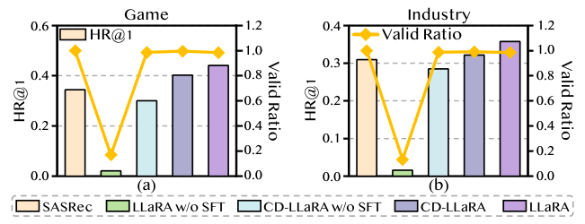
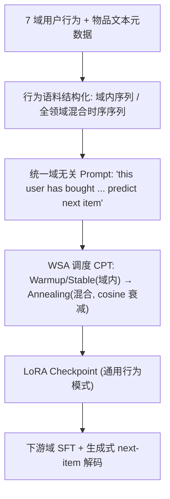
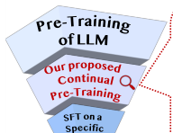

# Large Language Model Empowered Recommendation Meets All-domain Continual Pre-Training (大语言模型推荐遇上全领域持续预训练)

- **会议/期刊**: TKDE (投稿中, arXiv 2504.08949)
- **作者与机构**: Haokai Ma, Yunshan Ma, Ruobing Xie*, Lei Meng, Jialie Shen, Xingwu Sun, Zhanhui Kang, Tat-Seng Chua — NUS / SMU / 腾讯 / 山东大学 / City University London
- **推荐链路定位**: 端到端生成式（LLM 生成式召回/排序），CPT 作为 SFT 前的通用初始化层
- **研究方向**: 大语言模型推荐 / 跨域与多场景推荐
- **论文原文**: [https://arxiv.org/abs/2504.08949v1](https://arxiv.org/abs/2504.08949v1)
- **开源代码**: 暂未开源（作者称接收后释放）

## TL;DR (1分钟核心速览)

现有 LLM4Rec 直接在单域交互上做 SFT，导致"开放世界语义"与"领域协同偏好"两大模态间存在硬缺口，且无法跨域复用。CPRec 提出**全领域持续预训练**：用统一域无关 prompt 把 7 个 Amazon 域的用户行为重构成"域内序列 + 全领域混合时序序列"，再配一套 Warmup-Stable-Annealing (WSA) 学习率调度分阶段灌注行为知识；只需 1 个 epoch、55 H100 GPU 小时的 CPT 即可初始化任意下游 LLM4Rec。在 5 个跨平台数据集、19 负采样排序协议下，HR@1 相对 LLaRA 提升 +4.28%~+11.12%（平均 +7.39%）。

## Background & Motivation (背景与核心矛盾)

- **主流范式**: LLM-as-recommender 用 LLaRA 式"文本 token + 协同 embedding"混合 prompt，在**单域**交互上做 SFT（部分再加 DPO）。
- **前人局限**: ① 语义表征与协同偏好分布严重错位，一步式 SFT 无法完成模态迁移；② 单域 SFT 在多域/少样本场景泛化崩溃；③ Recformer 等跨域预训练只用小模型、且**不做混合行为序列**，忽略真实用户跨域决策逻辑。
- **核心洞察 (Key Insight)**: 消融式实证（图 2）显示 `LLaRA w/o SFT` 甚至**不如随机**，而用他域 checkpoint 初始化的 `CD-LLaRA w/o SFT` 已可追平 SASRec——说明存在一个"通用用户行为模式"构成的中间空间，但单域预训练会让 LLM **坍缩到单一偏好位置**（CD-LLaRA 反而不如 LLaRA）。
- **本文切入点**: 用**更广、更多样的全领域行为**做持续预训练，充当语义模态 → 协同模态的桥。

<figure class="paper-figure" markdown="span">
  <figcaption>图 2：SASRec、无 SFT 的 LLaRA、无 SFT 的 CD-LLaRA、CD-LLaRA 和 LLaRA 在两个数据集上的结果。移除定制 SFT 过程会导致断崖式性能下降，表明 LLM 中的开放世界语义知识与 RS 中的协同信息之间存在显著差距。简单的跨域预训练 LLM 可以缓解该问题，但仍有进一步改进的空间。</figcaption>
</figure>

## Method (核心方法设计)

### 1. 整体框架 (Overall Architecture)

CPRec 不改动下游推荐器结构，只在"LLM 预训练"与"领域 SFT"之间插入一段 CPT。流程为：先汇集 7 个域的行为，构建两类语料——域内行为序列 $S^{A}_u$与按时间戳重排的全领域混合序列$S^{M}_u$；再用统一的、不含协同 token 的自然语言模板把序列转成 next-item 生成任务；随后按 WSA 调度，Warm-up 与 Stable 阶段只喂域内数据、Annealing 阶段引入更难的全领域混合数据；产出的 LoRA checkpoint 用于初始化 LLaRA 的低秩矩阵，最后照常在下游做 SFT。关键在于 CPT 与具体用户/域解耦，可增量扩展新平台数据。

<figure class="paper-figure" markdown="span">
  <figcaption>图 3：CPRec 的整体结构，它连接 LLM 的预训练与特定领域的 SFT。它通过 WSA 调度器将多个单域行为数据和全领域混合数据纳入训练，以实现无缝模态适配。</figcaption>
</figure>

### 2. 关键设计拆解 (Key Designs)

1. **全领域混合行为序列构建（把真实决策链搬进语料）**: 以往多域预训练是对各域**碎片化**建模，割裂了用户跨域兴趣演化。本文对同一用户各域序列按时间戳拼接重排 $S^{M}_u=\{i^{B}_{1},i^{C}_{2},i^{A}_{3},\dots,i^{A}_{p_A+p_B+p_C}\}$，并加两条硬约束：待预测目标项所属域必须在历史中出现、历史项至少来自两个域。这样既保留跨域偏好相关性，又避免"跨域即噪声"的伪样本；且不要求跨数据集用户重叠（区别于 C2DSR/Tri-CDR）。
2. **域无关统一 Prompt（让 next-token 预测对齐 next-item 预测）**: LLaRA 的混合 prompt 依赖域内协同信号与域名词汇，跨域不可迁移。CPRec 直接**删除协同 token**，把所有实体名统一替换为通用词 "item"，模板固定为 *"This user has bought $t_1,\dots,t_m$ … The item title candidates are … Choose only one item. The answer is"*。纯文本模板使 CPT 与 LLM 原生语言建模目标同构，降低灾难性遗忘，也让任意新域即插即用。
3. **WSA 学习率调度（按数据难度分阶段投喂）**: 直觉是"域内序列易、混合序列难"，一次性混训会浪费算力并扰乱优化方向。给定 $W,S,A$ 三个阶段的终点步：

$$
\mathrm{WSA}(s)=\begin{cases}\eta_l+\frac{s}{W}(\eta_h-\eta_l), & s\le W\\[2pt] \eta_h, & W<s\le S\\[2pt] \eta_l+f(s)(\eta_h-\eta_l), & S<s\le A\end{cases},\quad f(s)=\frac{1}{2}\Big(1+\cos\big(\pi\cdot\frac{s-S}{A-S}\big)\Big)
$$

Warm-up（$W$取域内样本的 5%）平滑摆脱"文本补全"惯性；Stable 用恒定$\eta_h{=}5e{-}4$充分吸收域内主流模式；Annealing 用余弦衰减至$\eta_l{=}5e{-}6$ 的同时注入混合序列，让模型在收敛末期完成"域内 → 全域"的泛化跃迁。
4. **训练目标与开销**: 沿用 LLM 自回归交叉熵（next-token），LoRA 微调，全 CPT 仅 1 epoch；下游 SFT 与 LLaRA 完全一致，故推理开销同量级（表 7：Game 每 epoch 训练 27:55 vs 27:59，推理 14:48 vs 15:19，显存 68,428 MB 完全相同）。

## Experimental Setup & Evaluation Protocol (实验设置与评估协议)

- **数据集与预处理**: 全部采用 **3-core** 过滤，CPT 语料来自 Amazon 七域，下游 5 个域**在 CPT 中完全未出现**（3 个 Amazon + 2 个 Bilibili，跨平台）。

| 数据集 | #Users | #Items | #Interactions | 稀疏度 | 说明 |
| :--- | :---: | :---: | :---: | :---: | :--- |
| CPT: Amazon×7 合计 | 208,962 | ~103k | 1,383,926 | 99.92–99.96% | Automotive/Clothing/Electronic/Food/Home/Movie/Phone |
| Game | 4,564 | 3,058 | 30,302 | 99.78% | 下游, Amazon |
| Music | 7,501 | 3,547 | 48,240 | 99.82% | 下游, Amazon |
| Industry | 5,526 | 2,739 | 29,325 | 99.81% | 下游, Amazon |
| Bili_Movie | 7,971 | 1,390 | 42,936 | 99.61% | 下游, Bilibili（跨平台） |
| Bili_Cartoon | 6,037 | 2,115 | 36,954 | 99.71% | 下游, Bilibili（跨平台） |

- **数据划分与防穿越**: `Leave-One-Out`（最后 1 条测试、倒数第 2 条验证，其余训练），序列严格按时间排序。
- **排名评测协议**: `Sampled Ranking` —— 每个正样本随机采 **19 个未交互负样本**构成 20 选 1，指标为 **HR@1** 与 **Valid Ratio**（输出是否落在候选集内的指令遵循率）；稳健性分析再扩展至 HR@{1,3,5}、N@{3,5}（迭代生成 5 次并移除已选项模拟 top-k）。
- **对比基线与超参**: 传统序列推荐 GRU4Rec / SASRec / CL4SRec / TedRec，LLM4Rec LLaMA-2 / ChatRec / MoRec / LLaRA / CPT-LLaRA（同框架直接 CPT 后 SFT 的对照）；骨干 LLaMA2-7B + LoRA，4 个随机种子取均值，配对 t 检验 $p<0.05$，下游学习率在$\{6e{-}4,3e{-}4,1e{-}4\}$ 中搜索。

## Key Experimental Results (实验关键数据)

### 1. 主实验对比 (Main Results)

| 方法 | Game | Music | Industry | Bili_Movie | Bili_Cartoon |
| :--- | :---: | :---: | :---: | :---: | :---: |
| GRU4Rec | 0.3063 | 0.3371 | 0.2846 | 0.2283 | 0.2401 |
| SASRec | 0.3443 | 0.3530 | 0.3096 | 0.2497 | 0.2631 |
| CL4SRec | 0.3482 | 0.3596 | 0.3048 | 0.2555 | 0.2646 |
| TedRec | 0.3576 | 0.3798 | 0.3230 | 0.2561 | 0.2771 |
| LLaMA-2 (zero-shot) | 0.0741 | 0.0252 | 0.0460 | 0.0238 | 0.0209 |
| ChatRec | 0.2382 | 0.1274 | 0.2302 | 0.0544 | 0.1135 |
| MoRec | 0.3857 | 0.3773 | 0.3460 | 0.2285 | 0.2575 |
| LLaRA | 0.4411 | 0.3972 | 0.3577 | 0.2532 | 0.2816 |
| CPT-LLaRA | 0.3775 | 0.2562 | 0.2856 | 0.0629 | 0.1280 |
| **CPRec** | **0.4764** | **0.4286** | **0.3730** | **0.2706** | **0.3129** |
| **Improv.%** | **+8.00%** | **+7.91%** | **+4.28%** | **+5.66%** | **+11.12%** |

（HR@1；CPRec 全部显著优于基线 $p<0.05$。Valid Ratio 上 CPRec 为 0.9788–0.9952，略低于 LLaRA 的 0.9851–0.9988。）

### 2. 消融实验 (Ablation Study)

| 配置 | 数据构成 / 调度 | 相对上一变体 | 说明 |
| :--- | :--- | :---: | :--- |
| LLaRA | 无 CPT，直接单域 SFT | — | 基线 |
| +DS | 仅域内序列 CPT | ↑ 全部数据集 | 简单 CPT 已有稳定增益 |
| +DS+Mix (N) | 域内+混合数据**一次性混训** | ↑ Game/Music/Bili_Movie，其他≈ | 混合数据有效但引入噪声 |
| +DS+Mix (S) | 混合数据在 Stable 期即注入 | ↓ 多数数据集 | 过早喂难样本损害收敛 |
| **+DS+Mix (A) = CPRec** | 混合数据仅入 **Annealing** 期 | **↑ 5 域中多数最优** | 课程式调度是关键 |

### 3. 关键实验发现 (Key Findings)

1. **CPT 单独就能"顶掉"完整训练的序列模型**：`CPRec w/o SFT` 在 Game 上 0.3775、Music 0.2562，前者已超过充分训练的 SASRec(0.3443)，而 `LLaRA w/o SFT` 仅 0.0210/0.0120——说明增益来自"行为语料 + 调度"而非 SFT 本身。
2. **收益来自课程式数据投喂而非数据堆量**：直接混训 `(N)` 与仅在 Annealing 注入 `(A)` 的对比表明混合序列必需"后期低频高难"处理；同时训练规模曲线显示 0.5M 行为即可逼近 1M 的最终效果，即 CPT 收益对数据量**非严格单调依赖**。
3. **稀疏用户与跨平台是最大受益者**：稀疏桶 Game 0.4500→0.4849、Bili_Cartoon 0.2704→0.3022（+11.8%），但 Bili 的 dense 桶 0.3276 与 zero-shot 0.0629/0.1280 明显偏低，暴露 CPT 语料全部来自 Amazon 的平台偏置——跨平台泛化仍需更多源域行为。

## Highlights & Limitations (亮点、对比与审稿批判)

- **与代表作对比**: vs **LLaRA**：后者把协同信号塞进混合 prompt 做单域 SFT，跨域不可复用；CPRec 前置一段域无关 CPT，SFT 流程完全不变即可"一次训练、处处初始化"。vs **Recformer**：其双向 Longformer 小模型只做域内对比对齐，忽略混合序列与调度设计。vs **CD-LLaRA**（朴素他域预训练）：会坍缩到单一域偏好，反而不如不预训练，凸显"全领域 + 分阶段"的必要性。
- **可迁移亮点**: ① "域内易样本 → 混合难样本"配合 WSA 调度，可直接迁移到多场景 CTR/多任务精排的预训练课程设计；② 用统一"item"占位符抹平域差异，是低成本实现跨域 prompt 复用的通用技巧。
- **审稿级局限批判**: ① 评测为 19 负采样 + HR@1，非全库排序，且生成式解码需逐 token 输出，虽与 LLaRA 同量级但远慢于 SASRec，工业实时性未验证；② CPT 语料单一平台（Amazon），Bili 上 zero-shot 仅 0.06–0.13，且混合序列两条构造准则会丢弃大量无跨域共现的用户行为，冷启动/单域用户覆盖不足；③ Valid Ratio 出现小幅下降（Music 0.9912 vs LLaRA 0.9971），精度与格式遵循存在 trade-off 未做深入权衡。

## Rating (四维评分)

- **方法创新性 (Novelty)**: ⭐⭐⭐⭐ （首次把 CPT 范式系统性引入 LLM4Rec，并以实证揭示"语义-协同模态缺口"与单域预训练坍缩现象，WSA 调度虽借自 MiniCPM 但与行为难度分层结合得自然）
- **评估协议与实验扎实度 (Protocol & Experiments)**: ⭐⭐⭐ （5 个跨平台数据集 + 4 种子 + t 检验较完备，但仅 19 负采样排序、缺全库排序与线上验证，消融以曲线呈现、缺精确数值表）
- **写作与数学规范度 (Clarity & Rigor)**: ⭐⭐⭐⭐ （语料构造准则、WSA 分段公式与复杂度分析交代清楚，公式简洁无冗余；理论分析偏直觉、缺收敛或泛化界支撑）
- **工业落地与复现价值 (Industrial & Practical Value)**: ⭐⭐⭐⭐ （一次性 55 GPU 小时 CPT 即可复用到任意下游、推理开销与 LLaRA 持平，落地成本极低；但代码未开源、依赖 LLaMA2-7B 与预抽取 SASRec 协同特征，复现门槛仍在）

